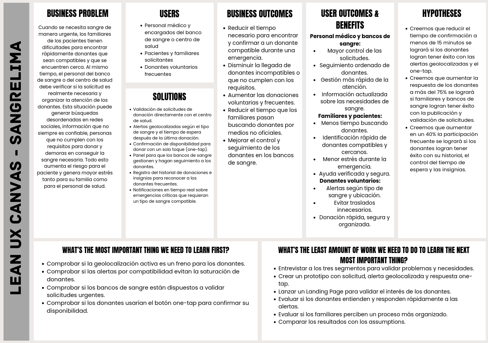

# Capítulo I: Introducción

## 1.1. Startup Profile

### 1.1.1. Descripción de la Startup

**Nombre de la startup**: SangreLima

**Descripción**

> SangreLima es una startup tecnológica enfocada en el desarrollo de soluciones digitales para la optimización y el acompañamiento del proceso de donación de sangre. Construimos sistemas que articulan la urgencia médica con la solidaridad ciudadana, convirtiendo datos de compatibilidad y ubicación en conexiones vitales. En SangreLima buscamos transformar la manera en que los pacientes, sus familias y las instituciones de salud se relacionan con los donantes voluntarios: para quienes hoy buscan ayuda de forma desesperada, manual y poco estructurada, les brindamos agilidad y tranquilidad; para quienes ya tienen la disposición de ayudar, les damos un canal seguro, directo y libre de fricciones. Integramos progresivamente tecnologías de geolocalización y validación de datos para construir soluciones capaces de modernizar la red de donación del futuro, adaptándose a las necesidades de cualquier establecimiento de salud.

**Visión**

> Convertirnos en el principal referente de innovación social y tecnológica para la gestión de donantes en Latinoamérica, conectando a ciudadanos y centros de salud alrededor de una misma red eficiente, transparente y verificada.

**Misión**

> Brindar soluciones tecnológicas accesibles que traduzcan la necesidad de componentes sanguíneos en respuestas rápidas y estructuradas: para los familiares que buscan donantes, reducimos la incertidumbre y el tiempo de respuesta; para los donantes, entregamos alertas precisas basadas en compatibilidad real; y para los bancos de sangre, damos herramientas de validación que aseguran la legitimidad del proceso. Todo esto operando bajo procesos digitales simples y una conexión directa con los protocolos de los centros de salud.
>
> **Propuesta de Valor  **
> “La urgencia no debería depender del azar. Conecta de manera inteligente.”
>
> SangreLima existe para cerrar la brecha entre la emergencia de un paciente y la voluntad de un ciudadano dispuesto a donar. Creemos que conseguir donantes en momentos críticos no debería dejarse a la suerte de una publicación en redes sociales, sino gestionarse mediante información clara, segmentada y verificada. Por eso construimos un ecosistema digital que sirve como puente entre las necesidades validadas de las instituciones médicas y la comunidad de donantes. Nuestra apuesta no es simplemente desarrollar una aplicación de mensajería, sino ser la capa de inteligencia comunitaria que transforma la voluntad de donar en un proceso estructurado, seguro y capaz de salvar vidas.

### 1.1.2. Perfiles de integrantes del equipo

<table>
<colgroup>
<col style="width: 45%" />
<col style="width: 54%" />
</colgroup>
<thead>
<tr>
<th style="text-align: center;"></th>
<th style="text-align: left;">
<strong>Nombre:</strong> Campos Acosta Fatima Brigit

<strong>Carrera:</strong> Ingeniería de Software

<strong>Código:</strong> U202521899

<strong>Conocimientos y habilidades:</strong>

Estudiante de Ingeniería de Software en la Universidad Peruana de Ciencias Aplicadas (UPC), enfocada en la creación de soluciones tecnológicas eficaces para desafíos en entornos digitales. Destaca por su capacidad analítica, razonamiento lógico y facilidad para colaborar en equipo, aportando valor en cada etapa del desarrollo de proyectos<strong>.</strong>
</th>
</tr>
<tr>
<th style="text-align: center;"></th>
<th style="text-align: left;">
<strong>Nombre:</strong> Calderon Mendoza Sebastian Pavel

<strong>Carrera:</strong> Ingeniería de Software

<strong>Código:</strong> U202412227

<strong>Conocimientos y habilidades:</strong>

Estudiante de Ingeniería de Software en la UPC, enfocado en el diseño y desarrollo de código eficiente bajo estándares de calidad. Cuento con una mentalidad orientada a la resolución de problemas y optimización de procesos mediante un enfoque ágil. Disfruto trabajar en equipo, aportando una comunicación abierta y un compromiso constante con la mejora continua para crear software que añada un valor real al negocio.
</th>
</tr>
<tr>
<th style="text-align: center;"></th>
<th style="text-align: left;">
<strong>Nombre:</strong> Martín Farro, Alexis Sebastian

<strong>Carrera:</strong> Ingeniería de Software

<strong>Código:</strong> U202515871

<strong>Conocimientos y habilidades:</strong>

Soy una persona disciplinada y constante, cualidades que he desarrollado gracias a mi práctica de la natación, un deporte que me ha enseñado a mantener el enfoque, gestionar el esfuerzo a largo plazo y superar obstáculos con perseverancia. Estas habilidades las aplico en mi formación como estudiante de Ingeniería de Software, donde busco resolver problemas de manera metódica y con atención al detalle.
</th>
</tr>
<tr>
<th style="text-align: center;"></th>
<th style="text-align: left;">
<strong>Nombre:</strong> Reyes Diaz, Frances Kamila

<strong>Carrera:</strong> Ingeniería de Software

<strong>Código:</strong> U202421764

<strong>Conocimientos y habilidades:</strong>

Estudiante de Ingeniería de Software en la Universidad Peruana de Ciencias Aplicadas (UPC). Se caracteriza por su interés en el desarrollo de soluciones tecnológicas orientadas a la resolución de problemáticas en entornos digitales. Posee habilidades en análisis de requerimientos, pensamiento lógico y trabajo en equipo, lo que le permite contribuir de manera efectiva en el desarrollo de proyectos.
</th>
</tr>
<tr>
<th style="text-align: center;"></th>
<th style="text-align: left;">
<strong>Nombre:</strong> Belon Carita, Jorge Mathias

<strong>Carrera:</strong> Ingeniería de Software

<strong>Código:</strong> U202322422

<strong>Conocimientos y habilidades:</strong>

Estudiante de la carrera de Ingeniería de software en la UPC, me considero una persona responsable, cumplidora y enfocado en hacer un buen trabajo, cuento con conocimientos básicos en la programación.
</th>
</tr>
<tr>
<th style="text-align: center;"></th>
<th style="text-align: left;">
<strong>Nombre:</strong> Molina Benites, Luis Enrique

<strong>Carrera:</strong> Ingeniería de Software

<strong>Código:</strong> U202520955

<strong>Conocimientos y habilidades:</strong>

Estudiante de la carrera de Ingeniería de software en la UPC, me considero una persona que le gusta trabajar en equipo y poder hacer trabajos muy bien planteados y poder entregar todo a tiempo y responsablemente.
</th>
</tr>
</thead>
<tbody>
</tbody>
</table>

## 1.2. Solution Profile

### 1.2.1. Antecedentes y problemática

Técnica 5W2H

> *1. ¿Qué ocurre o qué problema se presenta? (What?)*
>
> Existe una gran dificultad y demora para encontrar donantes de sangre compatibles, verificados y aptos en situaciones de emergencia médica. Actualmente, la búsqueda depende en gran medida de los esfuerzos manuales de familiares y amigos mediante cadenas de mensajes, publicaciones en redes sociales o contactos directos. Este proceso desestructurado genera que las solicitudes lleguen a audiencias masivas pero incorrectas, provocando retrasos críticos, información falsa o incompleta, y la movilización de personas que, al llegar al centro de salud, descubren que no son aptas para donar o no poseen el tipo de sangre requerido.
>
> *2. ¿Cuándo se presenta el problema? (When?)*
>
> El problema se vuelve evidente y crítico durante emergencias médicas, tales como accidentes de tránsito, cirugías de alta complejidad imprevistas, tratamientos oncológicos, o partos de riesgo, donde el paciente requiere transfusiones inmediatas y el banco de sangre del centro de salud no cuenta con el stock suficiente. También se presenta cuando los hospitales exigen a los familiares reponer las unidades de sangre utilizadas durante una intervención urgente.
>
> *3. ¿Dónde sucede? (Where?)*
>
> El problema ocurre físicamente en las salas de espera de hospitales, clínicas y bancos de sangre, donde los familiares enfrentan la urgencia. Paralelamente, se desarrolla en el entorno digital (grupos de WhatsApp, Facebook, Instagram), que se convierte en el canal principal y saturado donde se difunden los pedidos de ayuda de forma no segmentada ni geolocalizada.
>
> *4. ¿Quiénes están involucrados o afectados? (Who?)*
>
> El problema impacta directamente a tres grupos: primero, a los pacientes en riesgo y a sus familiares (solicitantes), quienes sufren altos niveles de estrés y angustia al asumir la responsabilidad de conseguir donantes rápidamente. Segundo, a los donantes voluntarios, que muchas veces tienen la disposición de ayudar pero reciben información irrelevante, lejana a su ubicación, o acuden a donar sin saber que no cumplen con los tiempos de espera reglamentarios. Tercero, al personal de los bancos de sangre e instituciones de salud, que debe lidiar con la verificación manual de donantes y el desorden generado por campañas no oficiales.
>
> *5. ¿Por qué ocurre? (Why?)*
>
> El problema ocurre por la falta de un sistema centralizado e inteligente que cruce la urgencia médica con la disponibilidad ciudadana. Las redes sociales y aplicaciones de mensajería no están diseñadas para filtrar o realizar un "matching" basado en compatibilidad sanguínea, ubicación geográfica, o el historial médico del donante (tiempo desde su última donación). Además, la ausencia de un filtro de validación institucional en las publicaciones de redes sociales genera desconfianza en los posibles donantes, quienes muchas veces dudan de la veracidad de la emergencia o asumen que alguien más ya acudió al llamado.
>
> *6. ¿Cómo se manifiesta el problema? (How?)*
>
> Se manifiesta a través de la viralización desesperada de afiches digitales con los datos del paciente, la saturación de contactos telefónicos y la pérdida de horas vitales. En los hospitales, se refleja cuando los donantes potenciales son rechazados en la etapa de triaje por no cumplir con los requisitos básicos o por no ser compatibles, lo que significa una pérdida de tiempo tanto para el donante como para el personal médico, prolongando el estado de vulnerabilidad del paciente.
>
> *7. ¿Cuánto cuesta o cuál es la magnitud? (How Much?)*
>
> La magnitud de esta problemática se cuantifica en el tiempo crítico que se pierde: encontrar un donante a través de redes sociales puede tomar días, cuando en situaciones de emergencia se requieren respuestas en minutos u horas. A nivel de salud, el costo se mide en el agravamiento del estado del paciente, complicaciones quirúrgicas o incluso la pérdida de vidas por falta de transfusiones oportunas. Operativamente, se traduce en una bajísima tasa de conversión: de miles de personas que ven una publicación en redes sociales, menos del 1% resulta ser un donante compatible, apto y dispuesto a trasladarse físicamente al hospital en ese momento.

### 1.2.2. Lean UX Process.

#### 1.2.2.1. Lean UX Problem Statements.

> Actualmente, la búsqueda de donantes de sangre en situaciones de emergencia depende en gran medida de procesos informales y desestructurados, como cadenas de mensajes, publicaciones masivas en redes sociales y contactos directos, para conseguir personas dispuestas a ayudar. Esta situación genera problemas como la difusión de información no verificada, la movilización de personas incompatibles o no aptas para donar en ese momento, y una sobrecarga de estrés tanto para las familias como para el personal de los centros de salud.
>
> Las soluciones existentes no ofrecen una manera inteligente de conectar las necesidades críticas de los pacientes con la disponibilidad real y geolocalizada de los donantes voluntarios. Como consecuencia, los familiares pierden tiempo vital intentando llegar a la persona correcta, mientras que los posibles donantes reciben solicitudes que no coinciden con su tipo de sangre o ubicación, lo que genera demoras que ponen en riesgo la vida del paciente, además de frustración y pérdida de tiempo para la comunidad dispuesta a colaborar.
>
> ¿Cómo podríamos reducir la demora, la desorganización y la falta de información verificada en la búsqueda de donantes de sangre, de manera que los familiares consigan ayuda compatible en tiempo récord, los bancos de sangre optimicen su flujo de atención, y los donantes voluntarios puedan colaborar de forma segura, rápida y efectiva?

#### 1.2.2.2. Lean UX Assumptions.

> **Business Assumptions:**

1.  Creemos que nuestros usuarios necesitan encontrar donantes de sangre compatibles y previamente verificados de manera rápida, especialmente en situaciones de emergencia médica, sin tener que depender de familiares, conocidos o publicaciones en redes sociales.

2.  Estas necesidades pueden atenderse mediante una aplicación móvil que envíe alertas a posibles donantes cercanos, teniendo en cuenta su tipo de sangre y si cumplen con los requisitos para donar.

3.  Nuestros principales usuarios serían los familiares de los pacientes que necesitan sangre con urgencia, los donantes voluntarios que donan con frecuencia y los bancos de sangre o clínicas.

4.  El principal beneficio para los usuarios sería reducir considerablemente el tiempo que toma encontrar un donante. Además, los donantes recibirán alertas sólo cuando exista una compatibilidad y cumplan con las condiciones necesarias para realizar la donación.

5.  Buscaremos establecer alianzas con centros de salud, promocionar la aplicación y fomentar las recomendaciones entre los propios donantes.

6.  Uno de los principales riesgos del proyecto es que los donantes notificados no respondan a tiempo cuando se presente una emergencia. También existe el riesgo de que la validación de las solicitudes sea lenta y retrase el proceso de búsqueda.

> **User Assumptions:**

1.  Nuestros usuarios son solicitantes; familiares directos que se encargan de gestionar la atención médica de un paciente que se encuentra en una situación de emergencia.

2.  Nuestros usuarios son donantes; personas de 18 a 60 años que cuentan con un celular, tienen disposición para donar sangre y pueden trasladarse a un centro de salud cercano.

3.  El donante usa la aplicación principalmente de manera pasiva en su día a día. La tiene instalada y recibe una notificación sólo cuando se presenta una emergencia que requiere su tipo de sangre y se encuentra dentro de una zona cercana.

4.  Los familiares usan la aplicación de manera activa cuando un paciente necesita sangre con urgencia. En ese momento, registran una solicitud que previamente ha sido validada por el centro de salud.

5.  La aplicación reduce el estrés, la confusión y el tiempo que se pierde al buscar donantes mediante redes sociales o familiares.

6.  La aplicación evita que los donantes reciban demasiadas notificaciones que no sean útiles, ya que las alertas se envían solo a personas que sean compatibles y que puedan donar en ese momento.

> **Feature Assumptions:**

1.  Creemos que pedir la confirmación del centro de salud y el tipo de sangre en cada solicitud hará que los donantes tengan mayor confianza y estén más dispuestos a responder.

2.  Creemos que revisar cuánto tiempo ha pasado desde la última donación permitirá evitar enviar notificaciones a personas que todavía no pueden donar. Esto ayudará a reducir la posibilidad de que los usuarios se cansen de recibir alertas y desinstalen la aplicación.

3.  Creemos que permitir que el donante confirme su disponibilidad con un solo toque hará que pueda responder más rápido y facilitará su asistencia al hospital.

4.  Creemos que contar con un historial de donaciones y reconocimientos para los donantes ayudará a motivarlos a seguir participando y donar nuevamente en el futuro.

#### 1.2.2.3. Lean UX Hypothesis Statements.

1.  Creemos que reducir el tiempo promedio de confirmación de donantes en situaciones de emergencia a menos de 15 minutos se logrará si los donantes voluntarios recurrentes logran tener éxito con el sistema de alertas geolocalizadas inteligentes y la confirmación de disponibilidad con un solo toque (one-tap). ESTO SE VALIDARÁ ….

2.  Creemos que incrementar la tasa de respuesta efectiva de los donantes a más del 75% por cada alerta enviada se logrará si los familiares de pacientes en situación de urgencia y los bancos de sangre logran tener éxito con la función que permite publicar y validar solicitudes vinculadas directamente a un centro de salud. ESTO SE VALIDARÁ ….

3.  Creemos que aumentar la retención y la participación frecuente de los donantes en un 40% se logrará si los donantes voluntarios logran tener éxito con la gestión de su historial de donaciones, el control automático del tiempo mínimo de espera y la obtención de insignias de reconocimiento dentro de la aplicación. ESTO SE VALIDARÁ ….

#### 1.2.2.4 Lean Ux Canvas

#### Link del canva: [<u>https://canva.link/owh2v89iamdenxx</u>](https://canva.link/owh2v89iamdenxx)

## 1.3. Segmentos objetivo.

> Según el alcance de nuestra aplicación, identificamos tres grupos principales de usuarios:

1.  ***Pacientes y familiares que necesitan una transfusión con urgencia:***

    1.  Demográfico:  
        Hombres y mujeres de 18 a 65 años o más, de ocupaciones variadas, que son pacientes que requieren una transfusión o familiares/responsables a cargo de la gestión del insumo médico durante una emergencia de salud.

    2.  Psicográfico:  
        Enfrentan altos niveles de estrés, ansiedad y vulnerabilidad emocional debido a la situación crítica de salud. Valoren al máximo la efectividad, la rapidez, la transparencia y la confiabilidad. Buscan tranquilidad, seguridad sobre el estado del suministro y predictibilidad para responder de forma inmediata a la emergencia médica de sus seres queridos o propia.

    3.  Conductual:  
        Cuentan con un dominio básico o intermedio en el uso de smartphones e internet móvil. Tienen una frecuencia de uso por necesidad puntual/urgente (intermitente o de alta densidad en períodos de crisis). Buscan registrar rápidamente solicitudes validada por el centro médico, especificar el tipo de sangre requerido y la ubicación del establecimiento. Están plenamente dispuestos a adoptar la herramienta si perciben un beneficio claro, confiable y de respuesta inmediata frente a la urgencia.

    4.  Geográfico:  
        Residentes en Perú. Se desenvuelven principalmente en zonas urbanas que cuentan con infraestructura hospitalaria, clínicas privadas y centros de salud con conectividad a internet móvil.

2.  ***Donantes voluntarios:***

    1.  Demográfico: Hombres y mujeres de 18 a 65 años (rango de edad legal y apto para donar), con ocupaciones variadas (estudiantes, profesionales, trabajadores independientes, etc.) que cumplen con los requisitos médicos y de salud para realizar la donación de sangre.

    2.  Psicográfico: Personas empáticas, solidarias y con un alto sentido de responsabilidad social y comunitaria. Valoran el orden, la eficiencia y la relevancia en la información que reciben. Buscan ayudar de forma ágil sin saturarse de mensajes irrelevantes en redes sociales, priorizando la transparencia, el control de sus aportes y la satisfacción de marcar una diferencia directa en la vida de alguien.

    3.  Conductual: Manejan aplicaciones móviles con facilidad. No usan la app todos los días, sino que responden cuando reciben alertas de casos compatibles y cercanos a su ubicación. Desde la plataforma confirman si pueden donar, revisan su historial y ven cuándo estarán listos para su siguiente donación. La integran rápido a su rutina porque les hace más fácil y ordenada su ayuda voluntaria.

    4.  Geográfico: Residentes en Perú. Se desplazan principalmente en áreas urbanas de alta densidad, con presencia de centros de salud, bancos de sangre o campañas itinerantes, y conectividad estable a internet móvil para recibir las alertas oportunas.

3.  ***Bancos de sangre y centros de salud (clínicas y hospitales):***

    1.  Demográfico:  
        Instituciones públicas y privadas del sector salud (clínicas, hospitales y bancos de sangre autorizados). Representadas operativamente por personal administrativo, jefes de laboratorio, tecnólogos médicos, médicos hematólogos y coordinadores de donación y banco de sangre.

    2.  Psicográfico:  
        Su prioridad es la seguridad del paciente y seguir los protocolos médicos al pie de la letra. Les importa mucho que la información sea real, que el trabajo esté ordenado y que la sangre disponible se use de la mejor manera. Buscan reducir el papeleo, evitar el desorden que generan las solicitudes falsas o repetidas y contar con un proceso transparente y confiable.

    3.  Conductual:  
        Tienen un buen manejo de la tecnología médica e institucional. Utilizan la plataforma de forma constante para validar los pedidos de sangre de los pacientes, verificar la compatibilidad de los donantes y confirmar los aportes realizados. La adoptan fácilmente porque les ayuda a mantener una red de donantes reales, segura y bien organizada.

    4.  Geográfico:  
        Ubicados en Perú. Centros hospitalarios, clínicas e institutos especializados situados en zonas urbanas con alta demanda de procedimientos médicos, quirúrgicos y de emergencia, con infraestructura tecnológica y conectividad constante a internet.