# Capítulo II: Requirements Elicitation & Analysis

# 2.1 Competidores

> Los principales referentes identificados son Dale Vida Perú, Blooders, American Red Cross Blood Donor App, los servicios informativos del Ministerio de Salud del Perú y las redes sociales y aplicaciones de mensajería utilizadas para difundir solicitudes de sangre.

### 2.1.1 Análisis Competitivo

> Para analizar el entorno competitivo de SangreLima se consideraron competidores y referentes nacionales e internacionales, evaluando principalmente su propuesta de valor, mecanismos de conexión con los donantes y principales funcionalidades.

<table>
<colgroup>
<col style="width: 12%" />
<col style="width: 13%" />
<col style="width: 19%" />
<col style="width: 17%" />
<col style="width: 18%" />
<col style="width: 19%" />
</colgroup>
<thead>
<tr>
<th colspan="6"><strong>Competitive Analysis Landscape</strong></th>
</tr>
<tr>
<th colspan="2"><strong>¿Por qué llevar a cabo este análisis?</strong></th>
<th colspan="4">¿Cómo se diferencia SangreLima frente a las principales soluciones digitales de donación de sangre y qué oportunidades puede aprovechar para facilitar una conexión rápida, confiable y organizada entre solicitantes, donantes y establecimientos de salud?</th>
</tr>
<tr>
<th colspan="2" style="text-align: center;"><strong>Competidor</strong></th>
<th style="text-align: center;">
<strong>SangreLima</strong>

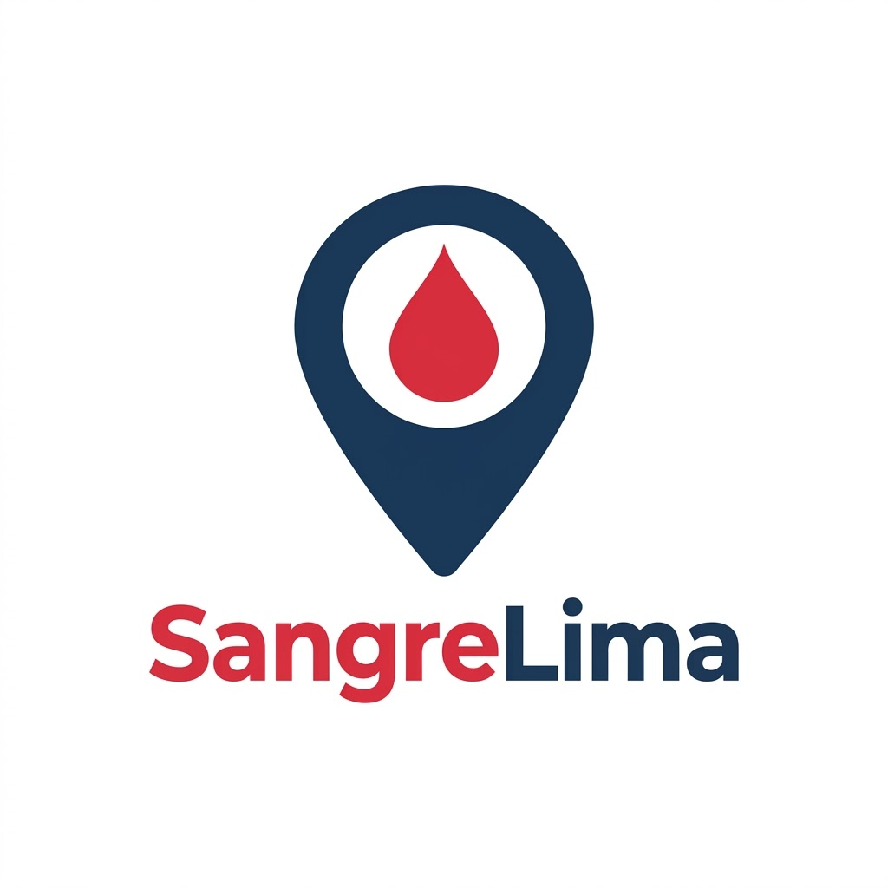
</th>
<th style="text-align: center;">
<strong>Dale Vida Perú</strong>

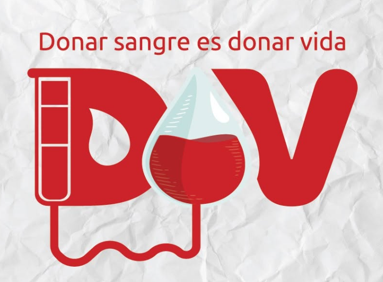
</th>
<th style="text-align: center;">
<strong>Blooders</strong>

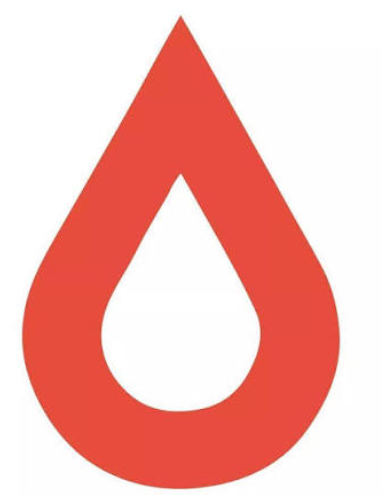
</th>
<th style="text-align: center;">
<strong>American Red Cross Blood Donor App</strong>

</th>
</tr>
<tr>
<th rowspan="2" style="text-align: center;"><strong>Perfil</strong></th>
<th style="text-align: center;"><strong>Overview</strong></th>
<th>Plataforma móvil que busca conectar solicitudes de sangre con donantes compatibles, cercanos y disponibles, mediante alertas segmentadas y solicitudes vinculadas a establecimientos de salud.</th>
<th>Iniciativa de By People orientada a promover la donación voluntaria. Su aplicación permitió registrar donantes, seleccionar lugar y horario y reservar citas. La campaña Dale Vida Perú continúa activa en 2026.</th>
<th>Plataforma mexicana que conecta donantes, pacientes y hospitales. Permite registrar tipo sanguíneo y ciudad, crear campañas, buscar donantes y agendar citas.</th>
<th>Aplicación de la American Red Cross orientada a facilitar la experiencia del donante: localización de campañas, citas, RapidPass, historial y seguimiento de la donación.</th>
</tr>
<tr>
<th style="text-align: center;"><strong>Ventaja competitiva ¿Qué valor ofrece a los clientes</strong></th>
<th>Busca reducir el tiempo de búsqueda mediante matching por compatibilidad, proximidad y disponibilidad, evitando alertas masivas o irrelevantes.</th>
<th>Experiencia y presencia en Perú, vinculación con instituciones sanitarias y organización de campañas presenciales.</th>
<th>Integra en una misma plataforma pacientes, donantes y hospitales, además de campañas y comunidades de donantes.</th>
<th>Respaldo institucional de American Red Cross y ecosistema digital consolidado para administrar todo el proceso del donante.</th>
</tr>
<tr>
<th rowspan="2" style="text-align: center;"><strong>Perfil de Marketing</strong></th>
<th style="text-align: center;"><strong>Mercado objetivo</strong></th>
<th>
1. Pacientes y familiares que requieren sangre.

2. Donantes voluntarios.

3. Bancos de sangre, clínicas y hospitales de Lima.
</th>
<th>Donantes voluntarios peruanos y establecimientos de salud aliados.</th>
<th>Donantes voluntarios, pacientes/familiares que necesitan sangre y hospitales en México.</th>
<th>Personas elegibles para donar sangre o plaquetas y participantes de campañas de American Red Cross en EE. UU.</th>
</tr>
<tr>
<th style="text-align: center;"><strong>Estrategias de marketing</strong></th>
<th><strong>Propuesta:</strong> alianzas con hospitales y bancos de sangre, campañas digitales, contenido educativo, difusión de solicitudes verificadas y programas de reconocimiento al donante.</th>
<th>Campañas presenciales de donación, alianzas con instituciones de salud, municipios y organizaciones, acompañadas de difusión digital.</th>
<th>Comunidad de donantes, campañas compartibles, alianzas hospitalarias, reconocimiento digital y comunicación de historias de pacientes.</th>
<th>Campañas institucionales, llamados ante necesidades de sangre, localización de blood drives, notificaciones, promociones y fidelización mediante la app.</th>
</tr>
<tr>
<th rowspan="3" style="text-align: center;"><strong>Perfil de Producto</strong></th>
<th style="text-align: center;"><strong>Productos &amp; Servicios</strong></th>
<th>Registro de donantes; solicitudes de sangre; compatibilidad sanguínea; geolocalización; alertas dirigidas; confirmación de disponibilidad; historial de donaciones; información de centros de salud.</th>
<th>Registro de donantes; programación de citas; selección de lugar y horario; campañas de donación; información posterior al proceso.</th>
<th>Registro de donantes; búsqueda por tipo sanguíneo; campañas para pacientes; comunidades; citas en hospitales aliados; información sobre compatibilidad y reconocimientos digitales.</th>
<th>Búsqueda de centros y campañas; programación y gestión de citas; RapidPass; resultados del mini-examen; historial; seguimiento de la sangre donada y notificaciones.</th>
</tr>
<tr>
<th style="text-align: center;"><strong>Precios &amp; Costos</strong></th>
<th>Aún no definido en el proyecto. Para el MVP se puede plantear acceso gratuito para donantes y solicitantes; el modelo institucional deberá validarse posteriormente.</th>
<th>La aplicación fue presentada como gratuita para los usuarios y sus convenios institucionales contemplaron acceso sin costo.</th>
<th>El servicio de creación de campañas para solicitar donantes es gratuito.</th>
<th>Aplicación gratuita para los usuarios.</th>
</tr>
<tr>
<th style="text-align: center;"><strong>Canales de distribución (Web y/o Móvil)</strong></th>
<th><strong>Propuesto:</strong> aplicación móvil; posible plataforma web para hospitales/bancos de sangre.</th>
<th>Aplicación móvil y plataforma web/extranet documentadas en sus convenios.</th>
<th>Plataforma web y aplicación móvil.</th>
<th>Aplicación móvil y sitio web RedCrossBlood.org</th>
</tr>
<tr>
<th rowspan="4" style="text-align: center;"><strong>Análisis SWOT</strong></th>
<th style="text-align: center;"><strong>Fortalezas</strong></th>
<th>Matching por compatibilidad y proximidad; alertas segmentadas; enfoque en urgencias; propuesta adaptada al contexto de Lima.</th>
<th>Presencia local; experiencia realizando campañas; alianzas con entidades sanitarias; reconocimiento previo en Perú.</th>
<th>Plataforma especializada; conecta pacientes, donantes y hospitales; campañas; comunidad; hospitales aliados.</th>
<th>Gran respaldo institucional; plataforma consolidada; numerosas funciones para el donante; integración web/móvil.</th>
</tr>
<tr>
<th style="text-align: center;"><strong>Debilidades</strong></th>
<th>Proyecto nuevo; todavía sin base de donantes; depende de conseguir instituciones aliadas; funcionalidades aún deben validarse con usuarios.</th>
<th>Las funciones digitales documentadas corresponden principalmente a años anteriores; actualmente existe evidencia más clara de campañas que de todas las funciones originales de la app.</th>
<th>Está principalmente enfocada en México; su modelo y red hospitalaria no responden directamente al contexto peruano.</th>
<th>Está enfocada en el ecosistema de American Red Cross en EE. UU.; no está diseñada para solicitudes individuales de pacientes en Lima.</th>
</tr>
<tr>
<th style="text-align: center;"><strong>Oportunidades</strong></th>
<th>Déficit de donación voluntaria; digitalización del proceso; alianzas con hospitales; crecimiento de una comunidad recurrente; integración futura con bancos de sangre.</th>
<th>Ampliar nuevamente su presencia digital y extender alianzas con más instituciones del país.</th>
<th>Expandir su modelo a nuevos mercados y fortalecer herramientas de conexión entre pacientes y donantes.</th>
<th>Continuar utilizando datos, personalización y tecnología para aumentar la recurrencia de donantes.</th>
</tr>
<tr>
<th style="text-align: center;"><strong>Amenazas</strong></th>
<th>Baja adopción inicial; desconfianza ante solicitudes digitales; regulación y tratamiento de datos sensibles; competencia de redes sociales y soluciones existentes.</th>
<th>Aparición de plataformas con matching y geolocalización más avanzados; dependencia de alianzas institucionales.</th>
<th>Plataformas locales mejor adaptadas a normativa y necesidades de otros países; dependencia de hospitales participantes.</th>
<th>Otras organizaciones de donación y servicios hospitalarios propios; cambios en hábitos y canales digitales de los donantes.</th>
</tr>
</thead>
<tbody>
</tbody>
</table>

### 2.1.2 Estrategias y Tácticas Frente a Competidores

> Las estrategias no buscan sustituir a los bancos de sangre ni al sistema sanitario, sino complementar el proceso de captación de donantes mediante herramientas digitales que reduzcan las fricciones existentes entre una necesidad y la posibilidad de encontrar personas dispuestas a donar.
>
> **Tácticas**

- ***Matching inteligente entre solicitudes y donantes compatibles***

> En contraste con alternativas basadas principalmente en campañas generales o publicaciones abiertas en redes sociales, SangreLima buscará conectar cada solicitud con personas que realmente puedan atenderla. Como táctica, la plataforma filtrará a los posibles donantes considerando el tipo sanguíneo, la compatibilidad, la ubicación y el tiempo transcurrido desde su última donación, evitando enviar alertas innecesarias a usuarios que no correspondan con la necesidad publicada.

- ***Validación de solicitudes mediante establecimientos de salud***

> Frente a las solicitudes difundidas por Facebook, WhatsApp u otras redes sociales, donde puede resultar difícil verificar la autenticidad de la información, SangreLima buscará incrementar la confianza del usuario mediante solicitudes vinculadas a hospitales, clínicas o bancos de sangre. Como táctica, cada solicitud mostrará información del establecimiento de salud relacionado, el tipo de sangre requerido y los datos necesarios para que el posible donante pueda comprobar dónde debe realizar la donación.

- ***Notificaciones segmentadas según necesidad y proximidad***

> Frente a plataformas y redes sociales que pueden difundir solicitudes de manera masiva, SangreLima buscará reducir la saturación de información recibida por los usuarios. Como táctica, las alertas se enviarán prioritariamente a donantes compatibles que se encuentren dentro de una zona cercana al establecimiento donde se requiere la donación, permitiendo que el usuario reciba información relevante para su perfil.

- ***Simplificación del proceso de respuesta del donante***

> Frente a soluciones en las que el usuario debe buscar campañas, consultar establecimientos o realizar varios pasos antes de decidir donar, SangreLima buscará reducir la fricción del proceso. Como táctica, la notificación mostrará de manera directa la información principal de la solicitud y permitirá que el usuario confirme su disponibilidad desde la misma plataforma, facilitando una respuesta más rápida ante una necesidad de sangre.

- ***Historial y reconocimiento de participación del donante***

> Frente a soluciones enfocadas únicamente en cubrir una necesidad puntual, SangreLima buscará fomentar una relación continua con los donantes voluntarios. Como táctica, se implementará un historial de donaciones y participación, acompañado de reconocimientos digitales que permitan al usuario visualizar su contribución y mantener un seguimiento de su actividad dentro de la plataforma.

**Estrategias**

- **Confiabilidad mediante validación y segmentación de solicitudes**

> **Objetivo:  **
> Incrementar la confianza de los donantes frente a alternativas informales, como publicaciones abiertas en redes sociales, donde la información puede ser incompleta, repetitiva o difícil de verificar.
>
> **Acciones:  **
> Establecer un proceso de validación de solicitudes vinculadas a establecimientos de salud, registrar información esencial como tipo de sangre, ubicación y centro de atención, y dirigir las alertas únicamente a usuarios compatibles con la necesidad publicada.
>
> **Resultados esperados:  **
> Mayor confianza por parte de los donantes, reducción de solicitudes poco relevantes o dudosas y aumento de la probabilidad de respuesta ante necesidades reales de sangre.

- **Optimización de la conexión entre donantes y solicitantes**

> **Objetivo:  **
> Reducir el tiempo y esfuerzo requerido para localizar posibles donantes compatibles frente a métodos tradicionales como llamadas telefónicas, grupos de WhatsApp, publicaciones en Facebook o búsqueda mediante familiares y conocidos.
>
> **Acciones:  **
> Implementar mecanismos de matching considerando compatibilidad sanguínea, proximidad geográfica y disponibilidad del donante, acompañados de notificaciones segmentadas y opciones de confirmación rápida.
>
> **Resultados esperados:  **
> Disminución del tiempo de búsqueda de posibles donantes, reducción de comunicaciones innecesarias y mayor eficiencia en la conexión entre una solicitud y los usuarios que realmente pueden atenderla.

- **Fidelización y formación de una comunidad de donantes voluntarios**

> **Objetivo:  **
> Promover una relación continua con los donantes para disminuir la dependencia exclusiva de donaciones de emergencia o reposición.
>
> **Acciones:  **
> Incorporar historial de donaciones, seguimiento de participación, recordatorios cuando el usuario pueda volver a donar y reconocimientos digitales que refuercen su contribución dentro de la comunidad.
>
> **Resultados esperados:  **
> Mayor recurrencia de donantes voluntarios, incremento de usuarios activos dentro de SangreLima y fortalecimiento de una comunidad disponible para futuras necesidades.

- **Diferenciación mediante experiencia de usuario y respuesta rápida**

> **Objetivo:  **
> Facilitar la participación del donante mediante un proceso digital sencillo y reducir las barreras existentes entre recibir una solicitud y decidir acudir a donar.
>
> **Acciones:  **
> Diseñar notificaciones claras con información esencial, permitir la confirmación de disponibilidad con pocos pasos y mostrar de forma directa el establecimiento de salud, ubicación y características principales de cada solicitud.
>
> **Resultados esperados:  **
> Menor abandono durante el proceso, aumento de las confirmaciones de disponibilidad y una experiencia de uso más clara y eficiente para los potenciales donantes.

## 2.2. Entrevistas.

### 2.2.1. Diseño de entrevistas

> Esta sección presenta las preguntas principales que se aplicarán a cada segmento objetivo. Las preguntas buscan recoger información demográfica (edad, distrito, ocupación) y otras características necesarias para construir los arquetipos, como comportamiento, motivaciones, frustraciones y uso de tecnología frente al proceso de donación o solicitud de sangre.
>
> ***Segmento 1: Pacientes y familiares que necesitan transfusión con urgencia***
>
> 1\. ¿Cuál es tu edad, distrito de residencia y ocupación?
>
> 2\. ¿Has tenido que conseguir sangre para un familiar o paciente alguna vez?
>
> 3\. Cuando necesitaste sangre con urgencia, ¿qué fue lo primero que hiciste?
>
> 4\. ¿A través de qué medios buscaste ayuda? (redes sociales, WhatsApp, hospital, campaña)
>
> 5\. ¿Qué fue lo más difícil o lo que más tiempo te tomó en ese proceso?
>
> 6\. ¿Qué te generaría confianza en los donantes que respondan a tu solicitud?
>
> 7\. ¿Qué aplicaciones usas con más frecuencia? ¿Qué tan cómodo/a te sientes usando apps nuevas?
>
> 8\. ¿Usarías una aplicación para este proceso de solicitar sangre? ¿Qué te preocuparía al respecto?
>
> 9\. Si pudieras cambiar algo del proceso actual de solicitud de sangre, ¿qué sería?
>
> ***Segmento 2: Donantes voluntarios***
>
> 1\. ¿Cuál es tu edad, distrito de residencia y ocupación?
>
> 2\. ¿Has donado sangre alguna vez? ¿Con qué frecuencia?
>
> 3\. Cuando decidiste donar, ¿qué fue lo primero que hiciste?
>
> 4\. ¿A través de qué medios te enteraste? (redes sociales, WhatsApp, hospital, campaña)
>
> 5\. ¿Qué te motivaría a donar ante una solicitud específica?
>
> 6\. ¿Qué te generaría desconfianza o te haría dudar antes de participar en una solicitud publicada por una app?
>
> 7\. ¿Qué aplicaciones usas con más frecuencia? ¿Qué tan cómodo/a te sientes usando apps nuevas?
>
> 8\. ¿Usarías una aplicación para este proceso de donar sangre? ¿Qué te preocuparía al respecto?
>
> 9\. Si pudieras cambiar algo del proceso actual de donación de sangre, ¿qué sería?
>
> ***Segmento 3: Bancos de sangre y centros de salud***
>
> 1\. ¿Cuál es tu cargo y cuánto tiempo llevas trabajando en el área?
>
> 2\. ¿Qué tipo de institución es (hospital público, clínica privada, banco de sangre independiente)?
>
> 3\. ¿Cómo gestionan actualmente las solicitudes de sangre que reciben (canales, formularios, verificación)?
>
> 4\. ¿Cómo verifican que una solicitud o un donante sean legítimos?
>
> 5\. ¿Cuánto tiempo toma en promedio validar una solicitud?
>
> 6\. ¿Qué problemas enfrentan con solicitudes falsas, duplicadas o mal dirigidas?
>
> 7\. ¿Qué dificultades tienen para contactar donantes compatibles rápidamente?
>
> 8\. ¿Qué sistemas o herramientas digitales usan actualmente para este proceso?
>
> 9\. ¿Qué tan digitalizado está su proceso hoy (totalmente manual, mixto, digital)?
>
> 10\. ¿Qué esperarían de una plataforma que los ayude a validar solicitudes y conectar con donantes verificados?
>
> 11\. ¿Qué información necesitarían recibir para confiar en una solicitud generada por una app externa?

### 2.2.2. Registro de entrevistas.

> Se registran de 3 a 5 entrevistas por cada uno de los tres segmentos objetivo. Cada entrevista fue grabada en video como evidencia. A continuación se presenta la ficha de registro de cada entrevista realizada.
>
> ***Segmento 1: Pacientes y familiares que necesitan transfusión con urgencia***
>
> **<u>Entrevista 1:</u>**
>
> Entrevistado: Leonardo Dextre
>
> Edad: 23 años
>
> Distrito:Ate
>
> Fecha de la entrevista: \[19/09/2026\]
>
> Video: [<u>https://youtu.be/9Fd4GNOTsxI</u>](https://youtu.be/9Fd4GNOTsxI)
>
> Captura del video:
>
> 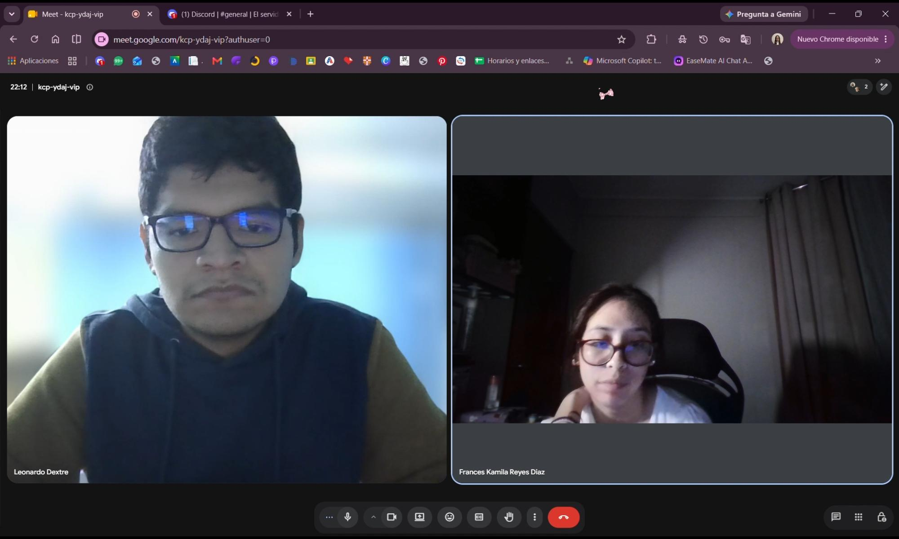
>
> Resumen:
>
> Leonardo Dextre, asistente administrativo de 23 años residente en Ate, necesitó buscar donantes de sangre para su papá antes de un procedimiento médico. Ante esta urgencia, sus primeras acciones consistieron en preguntar dentro de su familia y comunicarse con amigos y conocidos, apoyándose principalmente en WhatsApp y publicaciones en Facebook para difundir la solicitud.
>
> Durante el proceso, lo más complicado para él fue saber quién realmente podía ayudar, ya que muchas personas querían donar pero no tenían el tipo de sangre necesario, estaban lejos o no podían acercarse ese día, lo que obligaba a preguntar una por una.
>
> Para confiar en los donantes, le daría seguridad saber que la persona responde a una solicitud real confirmada por un hospital o clínica, y que está siguiendo el proceso correspondiente en lugar de solo responder a una publicación de internet.
>
> Respecto al uso de tecnología, utiliza frecuentemente WhatsApp, Facebook e Instagram, y se muestra dispuesto a probar una aplicación nueva siempre que sea sencilla y no tenga demasiados pasos, dado que en una emergencia se busca resolver rápido.
>
> Finalmente, utilizaría una aplicación que ayude a encontrar donantes compatibles validados por un centro de salud, aunque le preocuparía la veracidad de la información, la protección de datos y que la plataforma sea seria; asimismo, cambiaría del proceso actual el hecho de que dependa tanto de tener muchos contactos y escribirle a todo el mundo.
>
> **<u>Entrevista 2:</u>**
>
> Entrevistado: Luana Espinoza Cruz
>
> Edad: 18 años
>
> Distrito: Puente Piedra
>
> Fecha de la entrevista: \[19/09/2026\]
>
> Video: [<u>https://youtu.be/9Fd4GNOTsxI</u>](https://youtu.be/9Fd4GNOTsxI)
>
> Captura del video: 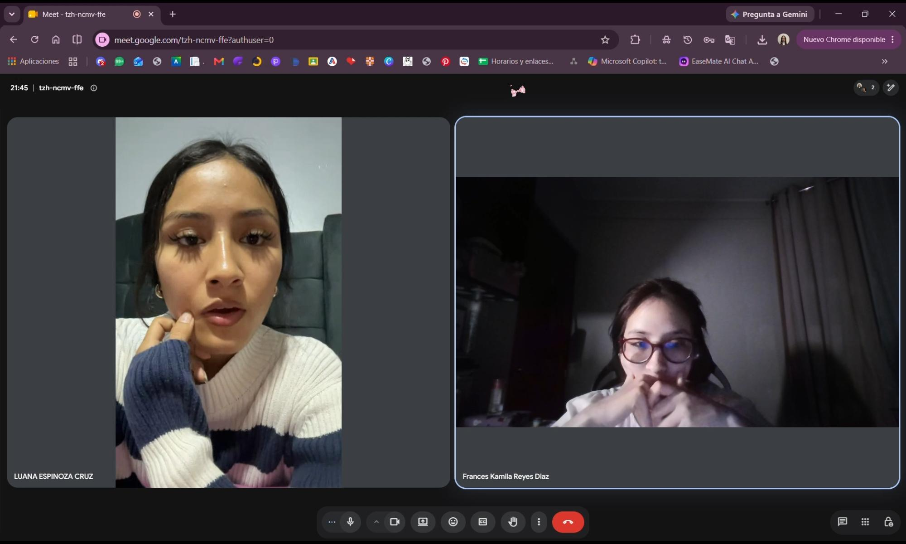
>
> Resumen:
>
> Luana Espinoza Cruz, estudiante de 18 años de la carrera de Medicina Humana y residente en el distrito de Puente Piedra, cuenta con experiencia directa apoyando en la búsqueda de donantes de sangre para familiares y amigos cercanos. Ante una urgencia, sus primeras acciones consisten en consultar de manera directa con su círculo cercano y difundir la solicitud mediante mensajes en WhatsApp y grupos de redes sociales dedicados a la donación.
>
> Durante este proceso, la mayor dificultad a la que se enfrentó fue hallar personas que estuvieran disponibles y realmente cumplieran con todos los requisitos médicos, ya que en ocasiones los voluntarios tenían toda la disposición, pero terminaban siendo rechazados tras los análisis clínicos.
>
> Para confiar en los donantes que responden a un llamado, le da seguridad percibir desde un inicio la disposición y las ganas genuinas de ayudar por parte de las personas.
>
> Respecto al uso de la tecnología, utiliza frecuentemente plataformas como WhatsApp y TikTok, mostrando una alta comodidad y disposición para probar aplicaciones nuevas siempre y cuando sean sencillas e intuitivas; en ese sentido, considera que una app organizada facilitaría enormemente la búsqueda de donantes, aunque su principal preocupación al respecto recae en la seguridad y protección de los datos personales.
>
> Finalmente, al reflexionar sobre el sistema actual de solicitudes, sugirió que lo ideal sería que todo el procedimiento para conseguir sangre fuera mucho más rápido y estructurado.
>
> **<u>Entrevista 3:</u>**
>
> Entrevistado: Carlos Salcedo
>
> Edad: 19 años
>
> Distrito: San Martín de Porres
>
> Fecha de la entrevista: \[19/09/2026\]
>
> Video: [<u>https://youtu.be/9Fd4GNOTsxI</u>](https://youtu.be/9Fd4GNOTsxI)
>
> Captura del video:
>
> 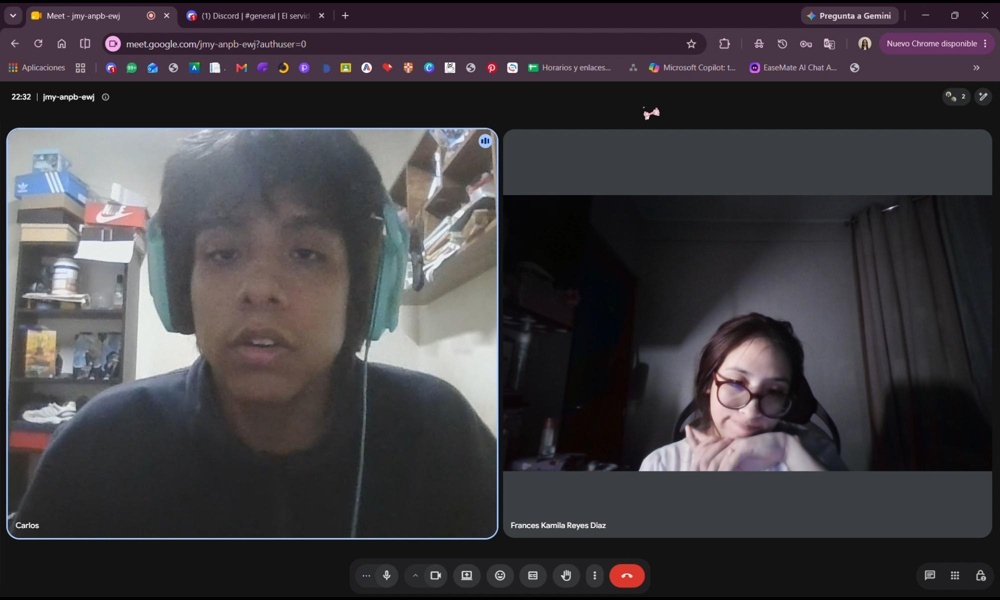
>
> Resumen:
>
> Carlos Salcedo, estudiante de 19 años residente en el distrito de San Martín de Porres, cuenta con experiencia previa ayudando a conseguir donantes para su hermana cuando estuvo hospitalizada. Ante una urgencia de este tipo, sus primeras acciones consisten en llamar a sus hermanos, primos y amigos cercanos para preguntar quién podía acercarse a donar, apoyándose principalmente en WhatsApp y publicaciones en Facebook para difundir la solicitud.
>
> Durante el proceso, lo que más tiempo le tomó fue la coordinación, ya que las personas decían que podían ir pero luego fallaban por trabajo o distancia, o no sabían si su tipo de sangre servía, lo que obligaba a hacer numerosas llamadas y mensajes para confirmar todo.
>
> Para confiar en los donantes, considera importante que la persona esté identificada y que la solicitud provenga directamente de un hospital o institución, con indicaciones claras del tipo de sangre necesario y el lugar de presentación, evitando así compartir información incorrecta.
>
> Respecto al uso de la tecnología, utiliza frecuentemente WhatsApp, Facebook y YouTube, y estaría dispuesto a usar una aplicación nueva si es clara y sin complicaciones, aunque al no ser de descargar muchas apps necesitaría comprobar su verdadera utilidad.
>
> Finalmente, utilizaría una aplicación con solicitudes validadas por un centro de salud si hay urgencia, aunque le preocuparía la veracidad de la información, la exposición de datos familiares y que los donantes realmente cumplan las condiciones; por ello, cambiaría del proceso actual la falta de organización, prefiriendo un sistema centralizado donde se registre la necesidad y ayude a encontrar colaboradores.
>
> ***Segmento 2: Donantes voluntarios***
>
> **<u>Entrevista 1:</u>**
>
> Entrevistado: Herencia Saenz, Jose Gonzalo
>
> Edad: 30 años
>
> Distrito: Puente Piedra
>
> Fecha de la entrevista: \[18/09/2026\]
>
> Video: [<u>https://youtu.be/9Fd4GNOTsxI</u>](https://youtu.be/9Fd4GNOTsxI)
>
> Captura del video:
>
> 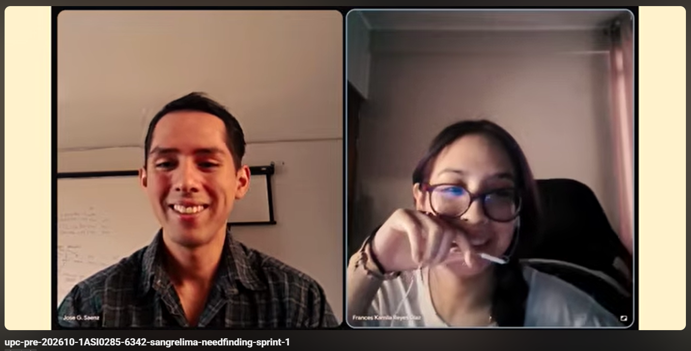
>
> Resumen:
>
> En cuanto a sus datos generales y perfil, José Gonzalo Herencia Saenz tiene 30 años, reside en el distrito de Puente Piedra y trabaja como contador público. Cuenta con experiencia previa como donante, realizando esta acción de manera voluntaria aproximadamente cada tres años. Su motivación inicial surgió a raíz de la solicitud de un amigo cuyo familiar necesitaba donantes, lo que lo llevó a vivir la experiencia y motivarlo a seguir haciéndolo. La primera vez se enteró de la necesidad a través de las redes sociales. Sobre sus motivaciones y factores de confianza, lo que más lo impulsa a donar ante una solicitud específica es el deseo de ayudar a personas que conoce y que sabe que lo necesitan. En cuanto al uso de tecnología, está habituado a aplicaciones como WhatsApp, YouTube y TikTok, y se muestra dispuesto a utilizar apps nuevas si le son recomendadas. Sin embargo, manifestó que le generaría desconfianza participar en solicitudes publicadas a través de una aplicación si esta no es muy conocida. Finalmente, respecto al interés en herramientas digitales y propuestas de mejora, José considera viable el uso de una aplicación orientada a la donación de sangre, aunque le gustaría conocer su funcionamiento y expresó cierta preocupación por la seguridad en los lugares donde se realiza el procedimiento. Como sugerencia de mejora para el proceso actual de donación, indicó que desearía que los trámites fueran más rápidos, ya que en su experiencia anterior llegó a demorar cerca de una hora en concretar el procedimiento.
>
> **<u>Entrevista 2:</u>**
>
> Entrevistado: John Austin Vega Pérez
>
> Edad: 22 años
>
> Distrito: Chiclayo
>
> Fecha de la entrevista: \[19/09/2026\]
>
> Video: [<u>https://youtu.be/9Fd4GNOTsxI</u>](https://youtu.be/9Fd4GNOTsxI)
>
> Captura del video:
>
> 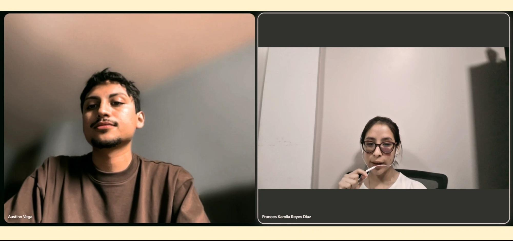
>
> Resumen:
>
> John Austin Vega Pérez, de 22 años, residente en Chiclayo y trabajador freelancer, es un donante frecuente que dona sangre aproximadamente dos veces al año. Su primer contacto con la donación ocurrió hace tres años a través de una campaña informativa organizada en su propio campus universitario, y su principal motivación para participar ante una solicitud específica es el deseo de ayudar a alguien que lo necesite.
>
> En cuanto al uso de herramientas digitales, utiliza frecuentemente aplicaciones de comunicación y entretenimiento como WhatsApp, Instagram y TikTok. Muestra una actitud positiva y cómoda hacia el aprendizaje de nuevas tecnologías, por lo que considera que una aplicación móvil para la donación de sangre sería muy útil para lograr un mayor alcance de personas. No obstante, su principal preocupación al interactuar con una app de este tipo es la desconfianza ante posibles estafas, por lo que evaluaría cuidadosamente la elaboración y estructura de la plataforma.
>
> Finalmente, al reflexionar sobre el proceso actual de donación de sangre, el entrevistado identifica que el principal aspecto por mejorar es la difusión y la información pública. Señala que la falta de conocimiento sobre el proceso real y lo que este conlleva es lo que genera que existan pocas personas que se animen a donar.
>
> **<u>Entrevista 3:</u>**
>
> Entrevistado: Fely Gabriela Villanueva Azulca
>
> Edad: 20 años
>
> Distrito:Ate
>
> Fecha de la entrevista: \[19/09/2026\]
>
> Video: [<u>https://youtu.be/9Fd4GNOTsxI</u>](https://youtu.be/9Fd4GNOTsxI)
>
> Captura del video:
>
> 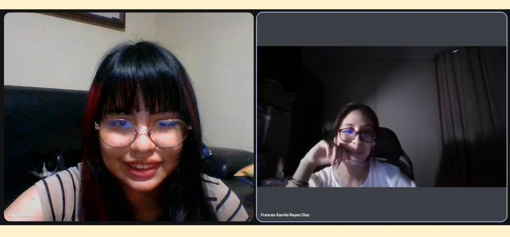
>
> Resumen:
>
> Fely Gabriela Villanueva Azulca, estudiante de 20 años residente en el distrito de Ate, cuenta con una única experiencia previa como donante de sangre realizada hace aproximadamente un año en una campaña organizada en su universidad, a la cual asistió gracias a que una amiga le avisó y la acompañó. En aquella ocasión, el primer paso del proceso consistió en someterla a diversos exámenes médicos para descartar enfermedades y verificar que sus niveles de hemoglobina no estuvieran bajos. Ante una solicitud específica, su principal motivación para donar sería la cercanía o parentesco con la persona afectada y la urgencia del caso. Sin embargo, le generaría desconfianza participar a través de una aplicación si esta no cuenta con el respaldo de instituciones oficiales como ministerios u hospitales, prefiriendo evitar iniciativas particulares o poco conocidas. Aunque utiliza frecuentemente redes sociales y aplicaciones de mensajería como Instagram y WhatsApp, se muestra cautelosa frente a plataformas nuevas destinadas a este fin. Finalmente, al evaluar los aspectos por mejorar del proceso actual, señaló que las dificultades con sus venas generaron estrés en el personal de salud, lo cual incrementó su propia ansiedad y la hizo sentir más nerviosa durante la donación.
>
> ***Segmento 3: Bancos de sangre y centros de salud***
>
> **<u>Entrevista 1:</u>**
>
> Entrevistado: Dylan Jonathan Santiago Salinas
>
> Cargo / institución: Licenciado en enfermería, en el área de Emergencias / Clínica privada
>
> Fecha de la entrevista: \[18/09/2026\]
>
> Video: [<u>https://youtu.be/9Fd4GNOTsxI</u>](https://youtu.be/9Fd4GNOTsxI)
>
> Captura del video:
>
> 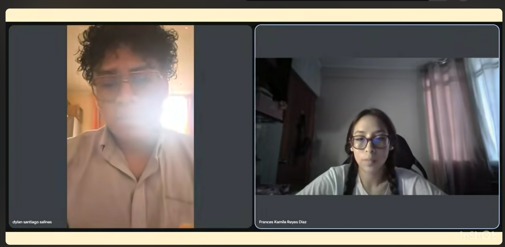
>
> Resumen:
>
> En cuanto a su perfil y contexto institucional, Dylan Jonathan Santiago Salinas se desempeña como licenciado en enfermería en el área de emergencias de la Clínica Doctus, una institución privada que brinda servicios de atención médica de urgencia, contando con más de un año de experiencia en el puesto. Respecto a la gestión de solicitudes y procesos actuales, la clínica maneja un stock establecido de unidades de sangre para emergencias que luego debe ser devuelto o cubierto por el paciente o sus familiares al retirarse. Para este proceso, emplean un sistema mixto que combina documentación física con formularios electrónicos en tablets, donde se evalúan criterios estandarizados a nivel nacional como la edad, el peso, los niveles de hemoglobina y antecedentes de salud, tomando en promedio un día y medio para validar una solicitud. En relación con las dificultades operativas y el nivel de digitalización, el personal enfrenta problemas cotidianos como errores en la escritura de los nombres de los pacientes o la falta de compatibilidad sanguínea de los donantes que aportan los familiares. Aunque actualmente operan de forma mixta, buscan transicionar hacia un entorno más digital mediante firmas y formularios electrónicos por motivos ecológicos. Finalmente, sobre sus expectativas hacia plataformas tecnológicas externas, el entrevistado considera indispensable que cualquier aplicación esté debidamente validada y regularizada por profesionales de la salud, como hematólogos, y respaldada legalmente por el Estado, de modo que se garantice la legitimidad de las solicitudes y se evite el lucro con la donación de sangre.
>
> **<u>Entrevista 2:</u>**
>
> Entrevistado: Guillermo Espinoza Elorreaga
>
> Cargo / institución: Tecnólogo médico
>
> Fecha de la entrevista: \[19/09/2026\]
>
> Video: [<u>https://youtu.be/9Fd4GNOTsxI</u>](https://youtu.be/9Fd4GNOTsxI)
>
> Captura del video:
>
> 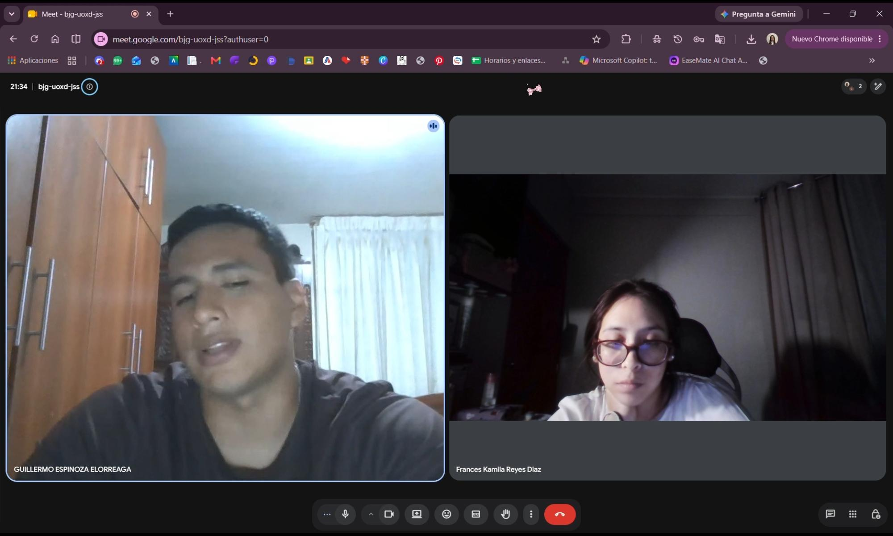
>
> Resumen:
>
> Guillermo Espinoza Elorreaga, tecnólogo médico de 28 años con cinco años de experiencia en el laboratorio y banco de sangre de una clínica privada, gestiona los requerimientos de hemocomponentes que inician los médicos tratantes, los cuales son verificados mediante filtros, entrevistas y pruebas clínicas antes de su uso.
>
> Durante el proceso, el personal enfrenta problemas como la difusión de solicitudes incompletas o duplicadas por parte de las familias, la llegada de donantes que no resultan aptos tras los análisis y la dificultad de encontrar personas que realmente estén disponibles y cumplan con la compatibilidad más allá del grupo sanguíneo.
>
> Para validar la legitimidad, el hospital comprueba que el paciente tenga un requerimiento activo y somete al donante a un riguroso proceso de identificación y selección, tardando un tiempo variable según los análisis posteriores.
>
> Actualmente operan en una etapa de transición digital donde utilizan sistemas informáticos combinados con formatos físicos, por lo que una plataforma externa que conecte con donantes verificados sería de gran ayuda para organizar la disponibilidad y ubicación, siempre y cuando esté respaldada por una institución, proteja los datos personales y actúe como complemento sin reemplazar las evaluaciones del banco de sangre.
>
> **<u>Entrevista 3:</u>**
>
> Entrevistado: Joaquin Ponce
>
> Cargo / institución: Médico cirujano
>
> Fecha de la entrevista: \[19/09/2026\]
>
> Video: [<u>https://youtu.be/9Fd4GNOTsxI</u>](https://youtu.be/9Fd4GNOTsxI)
>
> Captura del video:
>
> 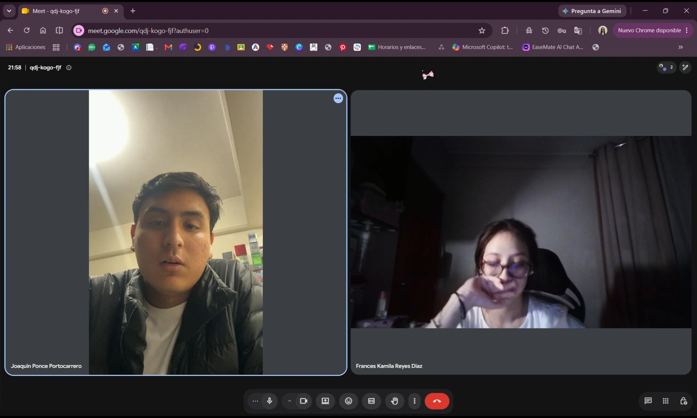
>
> Resumen:
>
> Joaquin, médico cirujano de 26 años con dos años de experiencia en la rotación por emergencia y hospitalización de un hospital de nivel intermedio, gestiona las solicitudes de transfusión mediante formatos en papel y comunicaciones directas con el banco de sangre respaldadas por la historia clínica del paciente.
>
> Durante su labor, se enfrenta a problemas como la angustia de las familias que dependen de su red de contactos, la difusión desactualizada de pedidos en redes sociales cuando el paciente ya no los necesita, y la complicación de que los voluntarios acudan sin cumplir con los criterios de elegibilidad.
>
> Para garantizar la legitimidad, el hospital valida el requerimiento a través del diagnóstico médico y somete al donante a un riguroso filtro de entrevistas y pruebas clínicas, un proceso que puede tomar horas críticas para el paciente.
>
> Actualmente el nivel de digitalización es parcial y los sistemas informáticos no están completamente integrados, por lo que una plataforma externa que organice la difusión y conecte con voluntarios sería un excelente complemento, siempre y cuando esté respaldada por un hospital, cuente con vigencia en las solicitudes, proteja los datos sensibles y respete la evaluación final del banco de sangre.

### 2.2.3. Análisis de entrevistas.

> En esta sección se realiza un análisis por cada segmento objetivo, identificando con sustento estadístico (porcentajes) las características objetivas y subjetivas más comunes de cada segmento, necesarias para la construcción de los arquetipos. La fuente de información proviene de las entrevistas registradas en la sección 2.2.2, evidenciando la relación entre cada característica y los resúmenes de entrevistas correspondientes.
>
> ***Segmento 1: Pacientes y familiares que necesitan una transfusión con urgencia:***
>
> Las entrevistas realizadas a Leonardo, Luana y Carlos evidencian que, ante una necesidad urgente de sangre, la búsqueda comienza siempre dentro del círculo cercano (familia y amigos) y se apoya fuertemente en WhatsApp, y que la confianza en un donante depende de que la solicitud esté respaldada por una institución de salud.
>
> **Características objetivas**

| **Hallazgo** | **Entrevistados relacionados** | **Frecuencia** | **Porcentaje** |
|----|----|----|----|
| Residen en Lima (en distintos distritos) | Leonardo (Ate), Luana (Puente Piedra), Carlos (San Martín de Porres) | 3 de 3 | 100 % |
| Son estudiantes | Luana, Carlos | 2 de 3 | 67 % |
| Cuentan con otra ocupación | Leonardo | 1 de 3 | 33 % |
| Buscaron sangre para un familiar directo (padre / hermana) | Leonardo, Carlos | 2 de 3 | 67 % |
| Buscaron sangre para familiares y amigos cercanos | Luana | 1 de 3 | 33 % |

> **Características subjetivas**

| **Hallazgo** | **Entrevistados relacionados** | **Frecuencia** | **Porcentaje** |
|----|----|----|----|
| Al enterarse de la urgencia, preguntaron primero a familiares y conocidos cercanos | Leonardo, Luana y Carlos | 3 de 3 | 100 % |
| Usaron WhatsApp como principal canal de búsqueda | Leonardo, Luana y Carlos | 3 de 3 | 100 % |
| Recurrieron también a Facebook u otras redes/grupos como canal secundario | Leonardo, Luana y Carlos | 3 de 3 | 100 % |
| Señalan la dificultad de coordinar y confirmar donantes disponibles y compatibles como el mayor obstáculo | Leonardo, Luana y Carlos | 3 de 3 | 100 % |
| La confianza en el donante depende de que la solicitud esté validada por una institución de salud | Leonardo, Carlos | 2 de 3 | 67 % |
| La confianza en el donante depende más de su disposición o ganas de ayudar | Luana | 1 de 3 | 33 % |
| Usan aplicaciones con frecuencia y se sienten cómodos probando apps nuevas si son sencillas | Leonardo, Luana y Carlos | 3 de 3 | 100 % |
| Usarían una aplicación para solicitar sangre si está validada por un centro de salud | Leonardo, Luana y Carlos | 3 de 3 | 100 % |
| Les preocupa la veracidad de la información y la protección de los datos personales | Leonardo, Luana y Carlos | 3 de 3 | 100 % |
| Piden que el proceso dependa menos de la red de contactos personal y sea más organizado o centralizado | Leonardo, Luana y Carlos | 3 de 3 | 100 % |

> El 100 % comenzó preguntando dentro de su círculo cercano. Leonardo indica que lo primero fue “preguntar dentro de mi familia quién podía donar”, para luego recurrir a amigos y conocidos. Luana señala que primero preguntó a “familiares, amigos, personas cercanas” antes de divulgar la necesidad por redes sociales. Carlos precisa que llamó primero a hermanos y primos, y después amplió la búsqueda a amigos y conocidos.
>
> El 100 % usó WhatsApp como canal principal, complementado con Facebook u otras redes. Leonardo y Carlos mencionan haber publicado también en Facebook cuando la red de contactos directa no fue suficiente; Luana divulgó la solicitud en grupos de redes sociales dedicados a donaciones de sangre.
>
> El 100 % coincide en que lo más difícil fue coordinar y confirmar donantes realmente disponibles y compatibles. Leonardo explica que debían preguntar “una por una” porque algunas personas no tenían el tipo de sangre necesario o no podían acercarse ese día. Luana relata que encontró a dos personas dispuestas, pero que “rebotaron” al no cumplir los requisitos tras los análisis. Carlos señala que se hacían “muchas llamadas y mensajes para confirmar todo” porque los donantes cambiaban de disponibilidad o no sabían su tipo de sangre.
>
> El 67 % (Leonardo y Carlos) asocia la confianza en un donante a que la solicitud esté confirmada por un hospital o institución de salud. Leonardo señala que le daría confianza saber que “el hospital o la clínica confirmó que necesita ese tipo de sangre”, y Carlos coincide en que la solicitud debería venir “directamente del hospital o de una institución”. Luana, en cambio, pone el énfasis en la disposición genuina del donante más que en la validación institucional.
>
> El 100 % usaría una aplicación para solicitar sangre si está validada por un centro de salud, y ninguno mostró rechazo hacia la idea. Sin embargo, los tres condicionan esa confianza a la protección de los datos: Leonardo menciona que le preocuparía “que la información sea verdadera y que se protejan los datos del paciente”, Luana señala “la seguridad de los datos personales”, y Carlos teme que “los datos de la familia queden expuestos”.
>
> Finalmente, el 100 % pide un proceso menos dependiente de la red de contactos personal. Leonardo quisiera que el sistema “ayudara a encontrar directamente a personas que podrían donar”, Carlos propone “un solo lugar donde registrar la necesidad”, y Luana resume su expectativa en que el proceso sea “más rápido y organizado”.
>
> Respecto a sus características generales, la edad promedio es de 20 años (Leonardo: 23, Luana: 18, Carlos: 19). Los tres residen en distintos distritos de Lima. El 67 % buscó sangre para un familiar directo (padre o hermana) y el 33 % para familiares y amigos cercanos.
>
> ***Segmento 2: Donantes Voluntarios***
>
> Las entrevistas realizadas a José, Austin y Fely evidencian que la motivación para donar surge principalmente de vínculos cercanos o de campañas organizadas, y que la confianza en canales digitales depende fuertemente de que exista una verificación institucional detrás de la solicitud.
>
> **Características objetivas:**

| **Hallazgo** | **Entrevistados relacionados** | **Frecuencia** | **Porcentaje** |
|----|----|----|----|
| Son hombres | José, Austin | 2 de 3 | 67 % |
| Son mujeres | Fely | 1 de 3 | 33 % |
| Residen en Lima | José, Fely | 2 de 3 | 67 % |
| Residen fuera de Lima | Austin (Chiclayo) | 1 de 3 | 33 % |
| Cuentan con empleo formal | José (contador) | 1 de 3 | 33 % |
| Trabajan como freelancer | Austin | 1 de 3 | 33 % |
| Son estudiantes | Fely | 1 de 3 | 33 % |
| Donan con baja frecuencia (cada 3 años) | José | 1 de 3 | 33 % |
| Donan con frecuencia regular (2 veces al año) | Austin | 1 de 3 | 33 % |
| Son donantes primerizos | Fely | 1 de 3 | 33 % |

> **Características subjetivas**

| **Hallazgo** | **Entrevistados relacionados** | **Frecuencia** | **Porcentaje** |
|----|----|----|----|
| Se motivaron a donar por cercanía con la persona afectada o por una campaña | José, Austin y Fely | 3 de 3 | 100 % |
| Desconfían de aplicaciones no verificadas o poco conocidas | José, Austin y Fely | 3 de 3 | 100 % |
| Usan WhatsApp con frecuencia | José, Austin y Fely | 3 de 3 | 100 % |
| Usan además Instagram o TikTok | Austin y Fely | 2 de 3 | 67 % |
| Se sienten cómodos probando aplicaciones nuevas | José y Austin | 2 de 3 | 67 % |
| Usarían una aplicación para donar si está respaldada por una institución de salud | José, Austin y Fely | 3 de 3 | 100 % |
| Señalan la demora en la atención como una frustración | José | 1 de 3 | 33 % |
| Señalan la falta de información o difusión del proceso como una frustración | Austin | 1 de 3 | 33 % |
| Señalan ansiedad o incomodidad durante la extracción como una frustración | Fely | 1 de 3 | 33 % |

> El 100 % de los entrevistados se motivó a donar por cercanía con la persona afectada o por una campaña organizada. José decidió donar por primera vez porque un amigo tenía un familiar que necesitaba donantes: "me llamó la atención tener esa experiencia y me gustó". Austin y Fely, por su parte, donaron por primera vez a través de campañas realizadas en sus universidades, y Fely añade que la cercanía con la persona o la urgencia del caso son factores que más la motivarían a donar ante una solicitud específica.
>
> El 100 % expresa desconfianza hacia aplicaciones no verificadas o poco conocidas. Austin señala que suele recibir "aplicativos que son con fines de estafa", por lo que verificaría bien ese aspecto antes de participar. Fely menciona que dudaría si la institución detrás de la solicitud "no es algún ministerio o algún hospital". José, de forma similar, indica que tendría dudas si la app "no es muy conocida".
>
> El 100 % usa WhatsApp con frecuencia: José lo combina con YouTube y TikTok, Austin con Instagram y TikTok, y Fely con Instagram. El 67 % (Austin y Fely) usa además Instagram o TikTok como canal habitual, lo que sugiere que estos canales pueden ser útiles para difundir campañas o solicitudes entre donantes jóvenes.
>
> El 67 % (José y Austin) se declara cómodo probando aplicaciones nuevas sin mayor resistencia; José señala que usaría apps nuevas "si me las recomiendan" y Austin afirma que le gusta "probar aplicaciones nuevas" porque son intuitivas. Fely no se pronuncia de forma tan directa, aunque menciona explorar apps similares a TikTok.
>
> El 100 % usaría una aplicación para donar sangre si está respaldada por una institución de salud reconocida. Ninguno mostró rechazo hacia la idea de una app; la condición transversal en los tres casos es la validación institucional.
>
> En cuanto a frustraciones, cada una aparece en el 33 % de la muestra: José señala la demora del trámite presencial ("demoraron casi como una hora"), Austin menciona la falta de información y difusión sobre el proceso de donación, y Fely destaca la ansiedad generada por la dificultad para ubicarle las venas durante la extracción.
>
> Respecto a sus características generales, la edad promedio es de 24 años (José: 30, Austin: 22, Fely: 20). El 67 % son hombres y el 33 % mujer; el 67 % reside en Lima y el 33 % fuera de ella (Austin, en Chiclayo). Las ocupaciones varían entre empleo formal, trabajo freelance y estudios universitarios, y la frecuencia de donación va desde donantes primerizos hasta quienes donan cada 2-3 años.
>
> ***Segmento 3: Bancos de sangre y centros de salud***
>
> Las entrevistas realizadas a Dylan (enfermero de emergencias), Guillermo (tecnólogo médico de laboratorio y banco de sangre) y Joaquín (médico cirujano) ofrecen la perspectiva del segmento institucional. Dos de ellos trabajan en clínicas privadas con servicio de banco de sangre / hemoterapia y uno en un hospital de nivel intermedio, lo que permite contrastar la perspectiva de quien valida al donante con la de quien genera la solicitud como médico tratante.
>
> **Características objetivas**

| **Hallazgo** | **Entrevistados relacionados** | **Frecuencia** | **Porcentaje** |
|----|----|----|----|
| Tiene 26 años | Dylan, Joaquín | 2 de 3 | 67 % |
| Tiene 28 años | Guillermo | 1 de 3 | 33 % |
| Trabaja en una clínica privada con servicio de banco de sangre / hemoterapia | Dylan, Guillermo | 2 de 3 | 67 % |
| Trabaja en un hospital (nivel intermedio, con servicio de banco de sangre) | Joaquín | 1 de 3 | 33 % |
| Ocupa un cargo de enfermería en el área de emergencias | Dylan | 1 de 3 | 33 % |
| Es tecnólogo médico (laboratorio y banco de sangre) | Guillermo | 1 de 3 | 33 % |
| Es médico cirujano | Joaquín | 1 de 3 | 33 % |
| Cuenta con 2 años o menos de experiencia en el área | Dylan (1 año), Joaquín (~2 años) | 2 de 3 | 67 % |
| Cuenta con más de 2 años de experiencia en el área | Guillermo (5 años) | 1 de 3 | 33 % |

> **Características subjetivas**

| **Hallazgo** | **Entrevistados relacionados** | **Frecuencia** | **Porcentaje** |
|----|----|----|----|
| Describe su proceso de gestión como mixto: digital (tablets, sistemas informáticos) y físico (firmas y documentación en papel) | Dylan, Guillermo, Joaquín | 3 de 3 | 100 % |
| Vincula la legitimidad de la solicitud a que corresponda a un paciente real con un requerimiento confirmado por el área asistencial | Guillermo, Joaquín | 2 de 3 | 67 % |
| Valida al donante mediante entrevista y criterios clínicos específicos (edad, hemoglobina, peso, antecedentes) | Dylan, Guillermo, Joaquín | 3 de 3 | 100 % |
| Señala que el tiempo de validación varía según la urgencia o el flujo de atención y no es inmediato | Dylan, Guillermo, Joaquín | 3 de 3 | 100 % |
| Reporta más problemas por información incompleta, duplicada o mal dirigida que por solicitudes falsas | Dylan, Guillermo, Joaquín | 3 de 3 | 100 % |
| Señala que la compatibilidad no depende únicamente del grupo sanguíneo, sino de pruebas adicionales del banco de sangre | Guillermo, Joaquín | 2 de 3 | 67 % |
| Indica que la búsqueda de donantes compatibles depende en gran medida de la red de contactos del paciente o su familia | Dylan, Guillermo, Joaquín | 3 de 3 | 100 % |
| Describe el nivel de digitalización de su institución como intermedio o en transición, no totalmente digital | Dylan, Guillermo, Joaquín | 3 de 3 | 100 % |
| Exige que una plataforma externa esté validada por un profesional de salud o una institución antes de confiar en ella | Dylan, Guillermo, Joaquín | 3 de 3 | 100 % |
| Requiere transparencia sobre quién respalda/administra la plataforma y cómo protege los datos personales | Dylan, Guillermo, Joaquín | 3 de 3 | 100 % |
| Considera que una plataforma externa debería ser un complemento y no un sustituto del proceso institucional | Guillermo, Joaquín | 2 de 3 | 67 % |

> El 100 % de los entrevistados describe su proceso de gestión como una combinación de herramientas digitales y documentación física. Dylan menciona que usan tablets, pero mantienen papel porque “la misma persona tiene que firmar y dar su consentimiento”. Guillermo señala que cuentan con sistemas informáticos, aunque “todavía se utilizan formatos físicos en determinadas etapas”. Joaquín precisa que la historia clínica se maneja en sistema, pero que “las solicitudes de transfusión todavía se hacen en papel en muchos casos”.
>
> El 67 % (Guillermo y Joaquín) vincula la legitimidad de una solicitud a que esté asociada a un paciente real con un requerimiento confirmado por el área asistencial. Joaquín es explícito al señalar que la solicitud es legítima porque “está vinculada a un paciente con historia clínica y una indicación médica justificada”. Dylan, en cambio, centra su respuesta en los criterios clínicos del donante más que en el trámite de la solicitud en sí.
>
> El 100 % describe un proceso de validación del donante basado en entrevista y criterios clínicos específicos. Dylan detalla que se revisan mayoría de edad, niveles de hemoglobina, peso, historial de viajes y de pareja estable. Guillermo menciona identificación, entrevista y selección con criterios definidos, mientras que Joaquín aclara que, aunque él no evalúa al donante directamente, sabe que “no cualquiera puede donar, aunque tenga el grupo sanguíneo correcto”.
>
> El 100 % coincide en que el tiempo de validación no es inmediato y depende del contexto. Dylan indica un promedio de un día y medio. Guillermo señala que la evaluación inicial puede ser rápida, pero que existen procedimientos posteriores que alargan el proceso. Joaquín advierte que, cuando hay que conseguir donantes, “el proceso se alarga bastante” y puede tomar varias horas mientras el paciente espera.
>
> El 100 % reporta más problemas de información incompleta, duplicada o mal dirigida que casos de solicitudes falsas. Dylan menciona apellidos mal escritos que retrasan la donación directa. Guillermo señala que distintos familiares comparten la misma solicitud sin coordinar entre ellos o transmiten información incompleta. Joaquín agrega que los pedidos siguen circulando en redes sociales incluso “cuando el paciente ya no lo necesita o incluso cuando ya fue dado de alta”.
>
> El 67 % (Guillermo y Joaquín) subraya que el grupo sanguíneo no es el único criterio de compatibilidad y que se requieren pruebas adicionales realizadas por el banco de sangre. Joaquín lo resume señalando que “el grupo sanguíneo es solo una parte” del proceso; Dylan también menciona dificultades cuando el tipo de sangre requerido no coincide con el de los contactos cercanos del paciente.
>
> El 100 % coincide en que la búsqueda de donantes compatibles depende en gran medida de la red de contactos del paciente o su familia, lo que genera demoras. Joaquín observa que las familias “no conocen mucho del proceso y se angustian”, y que no existe una forma rápida de identificar quién está disponible cerca con el grupo sanguíneo necesario.
>
> El 100 % describe el nivel de digitalización de su institución como intermedio o en transición, no totalmente digital. Dylan indica que están avanzando hacia el registro electrónico por temas de conservación del medio ambiente; Guillermo lo califica como “una etapa de transición”, y Joaquín como “intermedio o parcial”.
>
> El 100 % exige que cualquier plataforma externa esté validada por un profesional de salud o una institución antes de generar confianza. Dylan requiere que la app esté “verificada por el estado” y respaldada por un profesional como un hematólogo. Guillermo espera mecanismos que eviten “solicitudes falsas o información desactualizada”. Joaquín pide que la solicitud tenga “fecha y vigencia” y se cierre automáticamente cuando ya no sea necesaria.
>
> El 100 % menciona la necesidad de conocer quién respalda y administra la plataforma, así como la forma en que se protegen los datos personales del paciente y del donante, antes de confiar en una solicitud generada por una app externa.
>
> El 67 % (Guillermo y Joaquín) enfatiza que una plataforma externa debería funcionar como un complemento y no como un sustituto del proceso institucional. Joaquín lo resume con claridad: “la plataforma conecta, y el banco de sangre decide”.
>
> Respecto a sus características generales, la edad promedio es de 26.7 años (Dylan: 26, Guillermo: 28, Joaquín: 26). El 67 % trabaja en una clínica privada y el 33 % en un hospital. Los cargos se dividen entre enfermería, tecnología médica y medicina (33 % cada uno), con una experiencia en el área que va desde 1 hasta 5 años.
>
> **Síntesis de los resultados:**
>
> Los pacientes y familiares que buscan sangre con urgencia dependen casi por completo de su red de contactos personal y de WhatsApp, y su mayor frustración es la incertidumbre sobre quién realmente puede ayudar; confiarían en una app siempre que esté validada por un centro de salud y proteja los datos del paciente. Los donantes, por su parte, necesitan sentir que cualquier solicitud proviene de una fuente verificada antes de comprometerse a donar, y valoran canales de comunicación ya familiares (WhatsApp, Instagram) frente a procesos que perciben lentos o poco informados. Los bancos de sangre y centros de salud requieren que cualquier plataforma externa se someta a validación institucional y profesional, y que complemente sin reemplazar los criterios clínicos y normativos que ya aplican para evaluar donantes y solicitudes. El punto en común entre los tres segmentos es claro: la confianza depende de una validación institucional visible, ya sea de un hospital, un ministerio o un profesional de salud.
>
> Estos resultados servirán como fundamento para la elaboración de los User Personas, el User Task Matrix, los User Journey Maps y los Empathy Maps de SangreLima.

## 2.3. Needfinding.

### 2.3.1. User Personas.

> Las siguientes fichas de User Persona se elaboraron a partir del análisis de entrevistas y de los hallazgos del análisis competitivo. Se presenta una ficha por cada uno de los tres segmentos objetivo identificados. Para el Segmento 3, la ficha representa a la persona que opera el proceso dentro de la institución, como un coordinador de banco de sangre o personal administrativo, ya que este segmento corresponde a una institución y no a un usuario individual.
>
> ***Segmento 1: Pacientes y familiares que necesitan transfusión con urgencia***
>
> 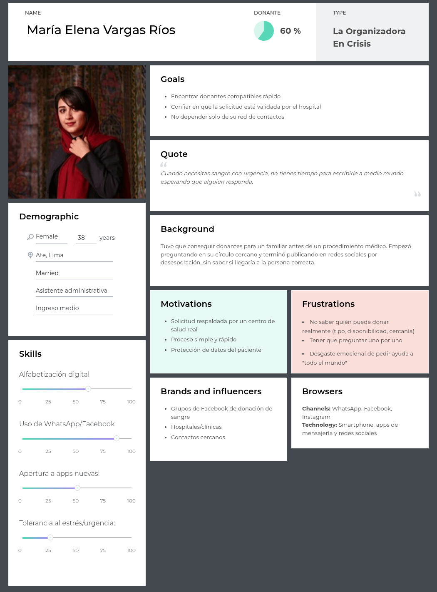
>
> ***Segmento 2: Donantes voluntarios***
>
> 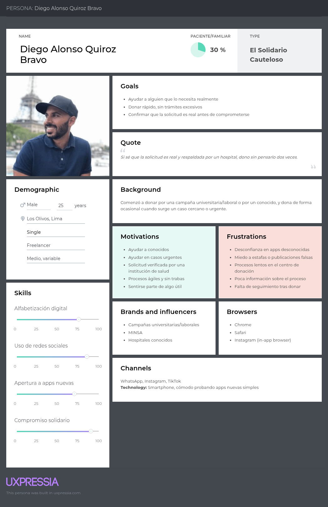
>
> ***Segmento 3: Bancos de sangre y centros de salud***
>
> 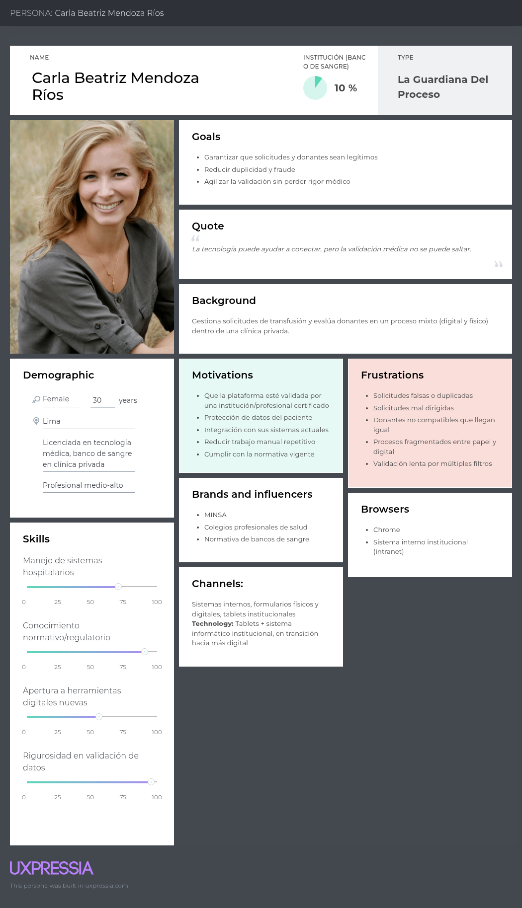

### 2.3.2. User Task Matrix.

> **Segmento Objetivo 1:** Pacientes y familiares que necesitan transfusión con urgencia

<table>
<colgroup>
<col style="width: 33%" />
<col style="width: 33%" />
<col style="width: 33%" />
</colgroup>
<thead>
<tr>
<th colspan="3" style="text-align: center;">Maria Elena Vargas Rios</th>
</tr>
<tr>
<th style="text-align: center;">Actividades</th>
<th style="text-align: center;">Frecuencia</th>
<th style="text-align: center;">Importancia</th>
</tr>
<tr>
<th style="text-align: center;">Detectar la necesidad urgente de transfusión sanguínea</th>
<th style="text-align: center;">Baja</th>
<th style="text-align: center;">Alta</th>
</tr>
<tr>
<th style="text-align: center;">Recopilar datos del paciente</th>
<th style="text-align: center;">Baja</th>
<th style="text-align: center;">Alta</th>
</tr>
<tr>
<th style="text-align: center;">Redactar y difundir solicitudes de ayuda</th>
<th style="text-align: center;">Baja</th>
<th style="text-align: center;">Alta</th>
</tr>
<tr>
<th style="text-align: center;">Responder llamadas de posibles donantes</th>
<th style="text-align: center;">Baja</th>
<th style="text-align: center;">Alta</th>
</tr>
<tr>
<th style="text-align: center;">Gestionar la validación de la solicitud con el centro de salud</th>
<th style="text-align: center;">Baja</th>
<th style="text-align: center;">Alta</th>
</tr>
<tr>
<th style="text-align: center;">Coordinar la asistencia de los voluntarios al hospital</th>
<th style="text-align: center;">Baja</th>
<th style="text-align: center;">Media</th>
</tr>
<tr>
<th style="text-align: center;">Compartir actualización de estado sobre la campaña</th>
<th style="text-align: center;">Ocasional</th>
<th style="text-align: center;">Media</th>
</tr>
<tr>
<th style="text-align: center;">Registrar apoyo a la comunidad</th>
<th style="text-align: center;">Ocasional</th>
<th style="text-align: center;">Baja</th>
</tr>
</thead>
<tbody>
</tbody>
</table>

> **Segmento Objetivo 2:** Donantes voluntarios

<table>
<colgroup>
<col style="width: 33%" />
<col style="width: 33%" />
<col style="width: 33%" />
</colgroup>
<thead>
<tr>
<th colspan="3" style="text-align: center;">Diego Alonso Quiroz Bravo</th>
</tr>
<tr>
<th style="text-align: center;">Actividades</th>
<th style="text-align: center;">Frecuencia</th>
<th style="text-align: center;">Importancia</th>
</tr>
<tr>
<th style="text-align: center;">Revisar solicitud de donaciones</th>
<th style="text-align: center;">Frecuente</th>
<th style="text-align: center;">Alta</th>
</tr>
<tr>
<th style="text-align: center;">Evaluar la confiabilidad de la solicitud</th>
<th style="text-align: center;">Frecuente</th>
<th style="text-align: center;">Alta</th>
</tr>
<tr>
<th style="text-align: center;">Verificar la compatibilidad del tipo de sangre</th>
<th style="text-align: center;">Ocasional</th>
<th style="text-align: center;">Alta</th>
</tr>
<tr>
<th style="text-align: center;">Organizar agenda personal</th>
<th style="text-align: center;">Ocasional</th>
<th style="text-align: center;">Alta</th>
</tr>
<tr>
<th style="text-align: center;">Confirmar disponibilidad</th>
<th style="text-align: center;">Ocasional</th>
<th style="text-align: center;">Alta</th>
</tr>
<tr>
<th style="text-align: center;">Trasladarse al centro de salud</th>
<th style="text-align: center;">Ocasional</th>
<th style="text-align: center;">Alta</th>
</tr>
<tr>
<th style="text-align: center;">Registrar su historial de donación y tiempo de espera</th>
<th style="text-align: center;">Ocasional</th>
<th style="text-align: center;">Media</th>
</tr>
</thead>
<tbody>
</tbody>
</table>

> **Segmento Objetivo 3:** Bancos de sangre y centros de salud

<table>
<colgroup>
<col style="width: 33%" />
<col style="width: 33%" />
<col style="width: 33%" />
</colgroup>
<thead>
<tr>
<th colspan="3" style="text-align: center;">Carla Beatriz Mendoza Ríos</th>
</tr>
<tr>
<th style="text-align: center;">Actividades</th>
<th style="text-align: center;">Frecuencia</th>
<th style="text-align: center;">Importancia</th>
</tr>
<tr>
<th style="text-align: center;">Revisar y verificar solicitudes de transfusión</th>
<th style="text-align: center;">Diaria</th>
<th style="text-align: center;">Alta</th>
</tr>
<tr>
<th style="text-align: center;">Validar la legitimidad de los donantes</th>
<th style="text-align: center;">Diaria</th>
<th style="text-align: center;">Alta</th>
</tr>
<tr>
<th style="text-align: center;">Gestionar stock de unidades de sangre</th>
<th style="text-align: center;">Diaria</th>
<th style="text-align: center;">Alta</th>
</tr>
<tr>
<th style="text-align: center;">Coordinar protocolos de compatibilidad</th>
<th style="text-align: center;">Diaria</th>
<th style="text-align: center;">Alta</th>
</tr>
<tr>
<th style="text-align: center;">Supervisar proceso de triaje y extracción</th>
<th style="text-align: center;">Frecuente</th>
<th style="text-align: center;">Alta</th>
</tr>
<tr>
<th style="text-align: center;">Registrar información</th>
<th style="text-align: center;">Frecuente</th>
<th style="text-align: center;">Media</th>
</tr>
<tr>
<th style="text-align: center;">Resolver incidencias por errores o donantes no aptos</th>
<th style="text-align: center;">Ocasional</th>
<th style="text-align: center;">Media</th>
</tr>
<tr>
<th style="text-align: center;">Revisar reportes normativos</th>
<th style="text-align: center;">Ocasional</th>
<th style="text-align: center;">Media</th>
</tr>
</thead>
<tbody>
</tbody>
</table>

### 

### 2.3.3. User Journey Mapping 

**Segmento Objetivo 1:**Pacientes y familiares que necesitan transfusión con urgencia

### 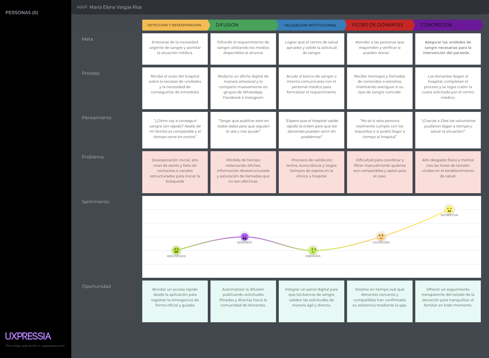

> **Segmento Objetivo 2:** Donantes voluntarios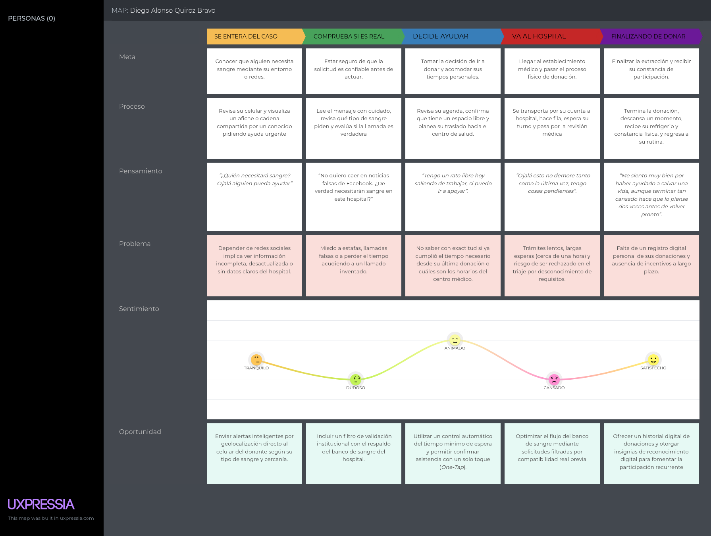
>
> **Segmento Objetivo 3:** Bancos de sangre y centros de salud
>
> 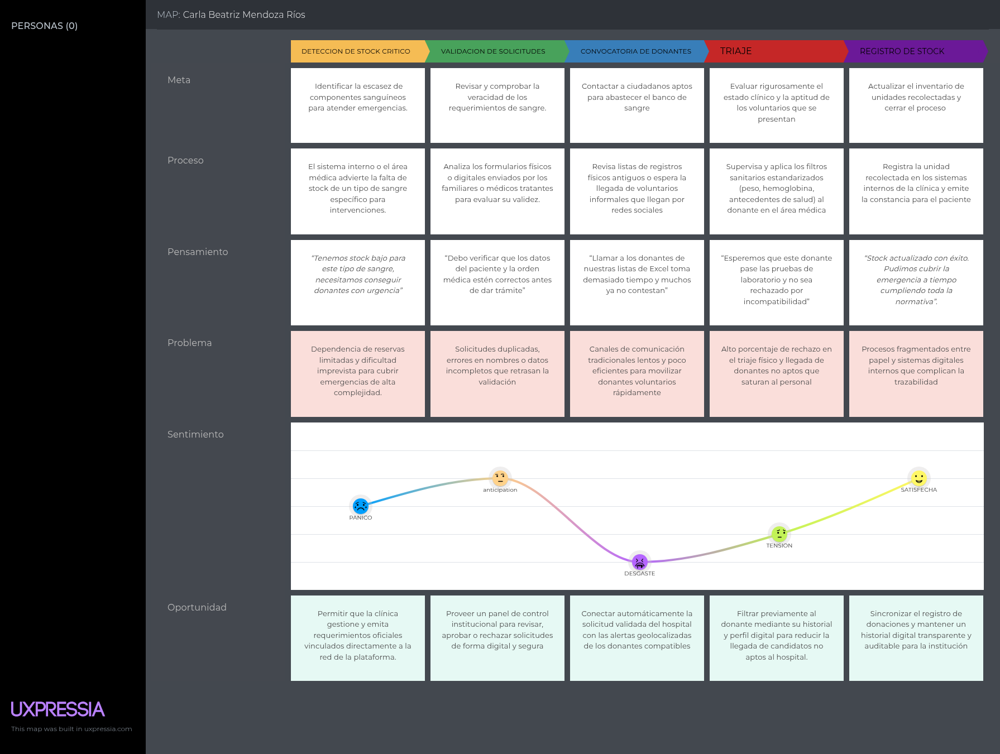

### 

### 

### 2.3.4. Empathy Mapping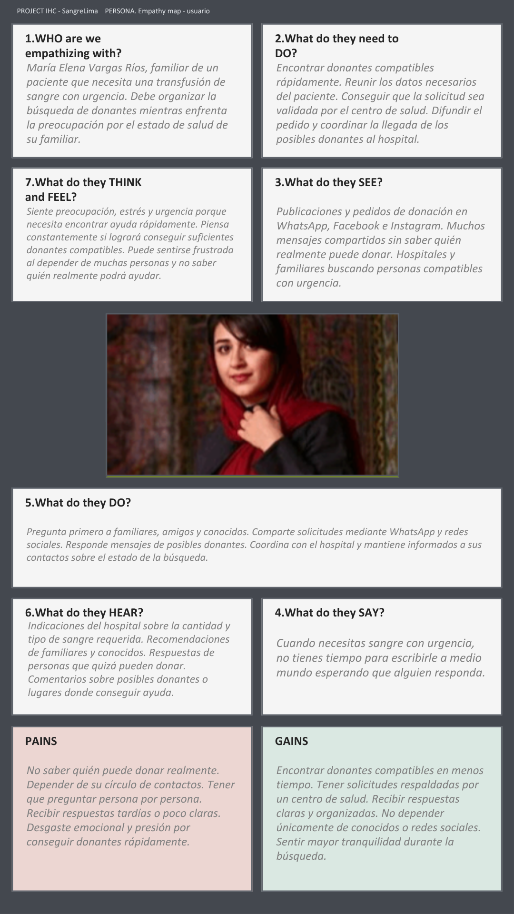

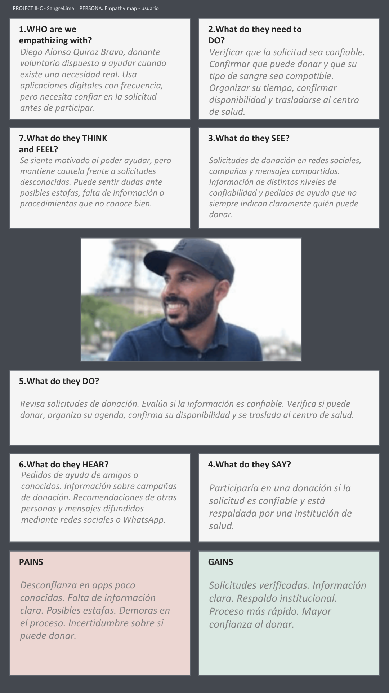

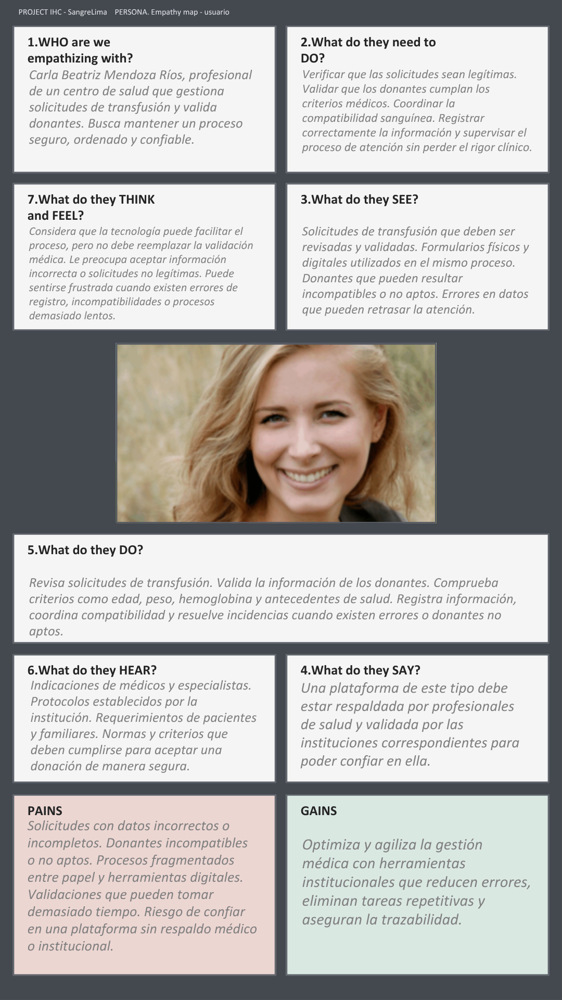

### 2.3.5. As-is Scenario Mapping

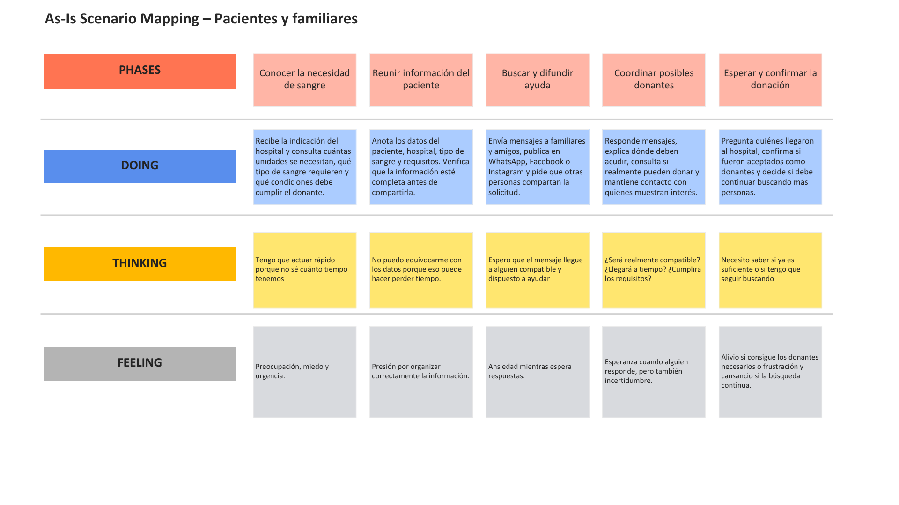

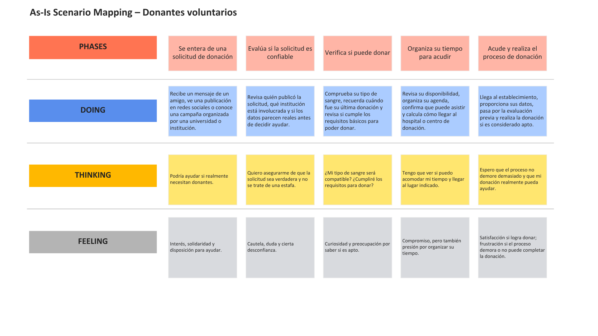

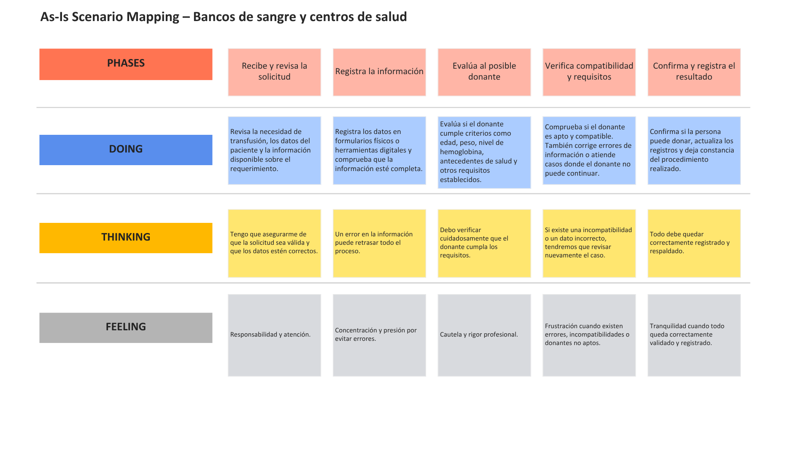