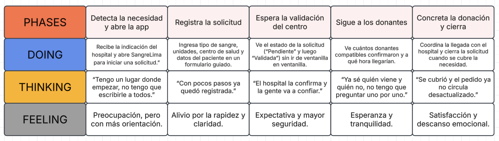
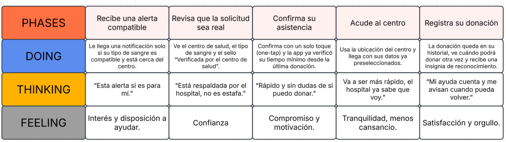
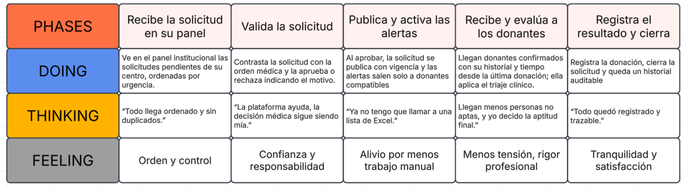
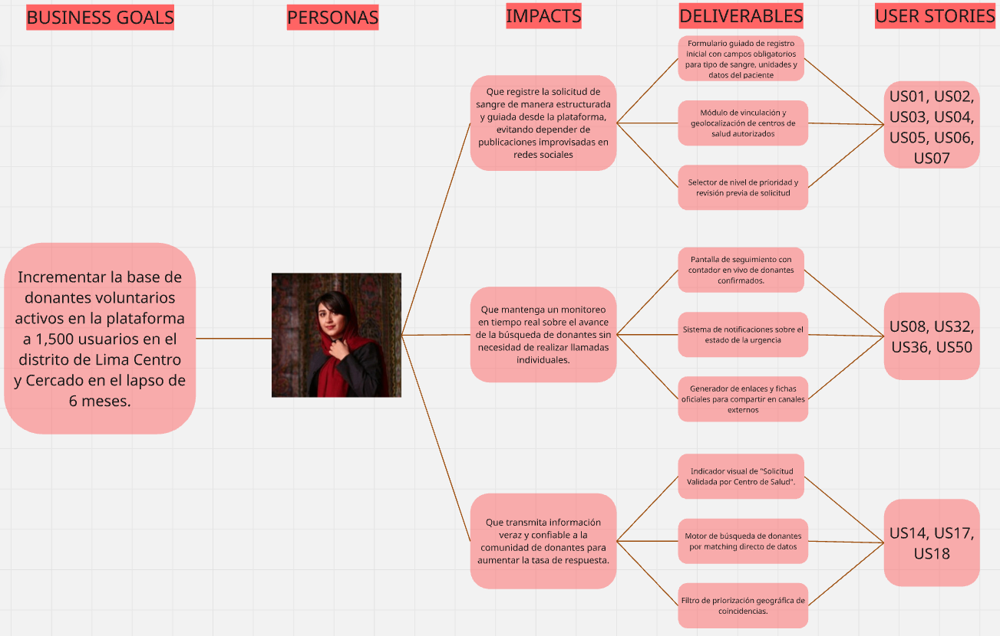
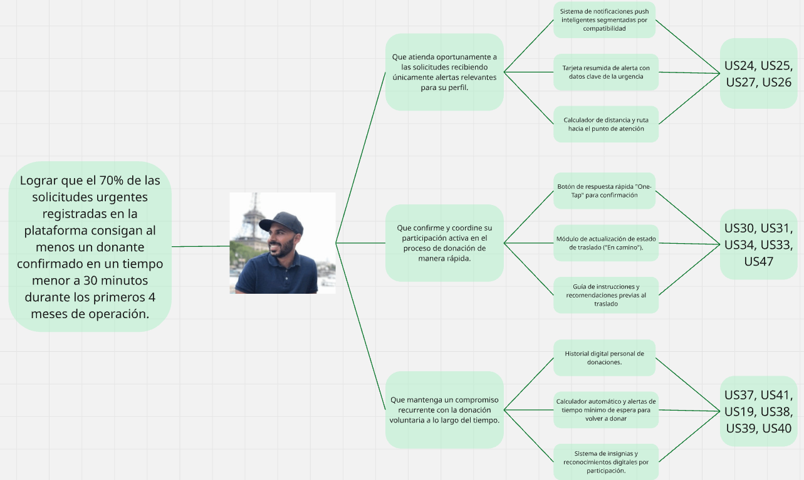
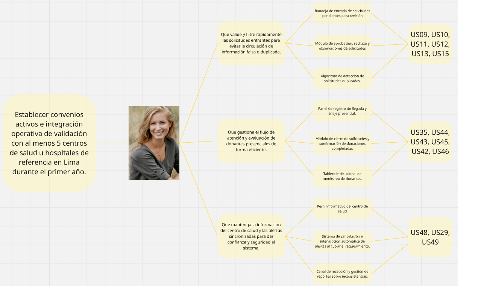

# Capítulo III: Requirements Specification 

## 3.1. To-Be Scenario Mapping. 

El To-Be Scenario Mapping muestra cómo sería la experiencia de cada usuario al utilizar SangreLima y cómo cambiaría su forma de buscar y coordinar donantes. La idea es pasar de depender de mensajes por WhatsApp y llamadas, que muchas veces hacen que el proceso sea más lento y complicado, a tener una forma más organizada, rápida y segura de encontrar donantes cercanos y verificar que puedan donar. Para ello, se elaboró un mapa para cada persona: María Elena Vargas Ríos, Diego Alonso Quiroz Bravo y Carla Beatriz Mendoza Ríos. Estos mapas se desarrollaron tomando como referencia el As-Is Scenario Mapping y los User Journey Maps del capítulo II, con el fin de comparar la situación actual con la experiencia que se busca ofrecer mediante SangreLima.

### Proceso realizado:

- Primero, revisamos los As-Is Scenario Maps, los Empathy Maps y las dificultades y beneficios identificados para cada persona. Con esta información, definimos cómo sería su experiencia al utilizar SangreLima.

- Cada integrante propuso ideas en post-its sobre cómo cambiarían las acciones, los pensamientos y las emociones de cada persona al usar la aplicación.

- Después, revisamos las propuestas en equipo, juntamos las que eran similares y descartamos aquellas que no ayudaban a resolver los problemas identificados. Nos enfocamos en las necesidades encontradas durante las entrevistas, como contar con solicitudes verificadas por instituciones de salud, recibir alertas según la compatibilidad y depender menos de llamadas y contactos personales.

- Organizamos la experiencia en cinco fases para cada persona. Mantuvimos la misma cantidad de fases que en el As-Is Scenario Mapping para que fuera más fácil comparar la situación actual con la experiencia que se espera lograr con SangreLima.

- Finalmente, comparamos cada fase con su equivalente en el escenario actual para identificar los cambios que ofrecería SangreLima y cómo ayudaría a mejorar la experiencia de cada persona.

<!-- -->

- **To-Be Scenario Mapping, María Elena Vargas Ríos (Pacientes y familiares)**

- **To-Be Scenario Mapping, Diego Alonso Quiroz Bravo (Donantes voluntarios)**

- **To-Be Scenario Mapping, Carla Beatriz Mendoza Ríos (Bancos de sangre y centros de salud)**

***<u>Comparación con el As-Is:</u>***

María Elena ya no tendría que publicar afiches ni contactar a cada persona por separado para conseguir donantes. Con SangreLima, podría registrar una sola solicitud y saber cuáles son los donantes que han confirmado su disponibilidad. Esto le ayudaría a sentirse más tranquila, ya que podría seguir el proceso sin tanta angustia ni incertidumbre.

Diego, por su parte, podría comprobar que las solicitudes son confiables antes de responder a ellas. En lugar de tener dudas sobre si se trata de una estafa o acudir sin saber si cumple con los requisitos para donar, recibiría alertas verificadas según su tipo de sangre, compatibilidad y tiempo transcurrido desde su última donación. Además, podría consultar su historial y recibir reconocimientos por su participación, algo que no tiene actualmente.

En el caso de Carla, SangreLima le permitiría dejar de depender de formularios físicos y archivos de Excel para organizar las solicitudes. Desde un solo panel podría revisarlas, comprobar su información y recibir una lista de donantes preseleccionados. Sin embargo, la plataforma serviría como apoyo para agilizar el trabajo del banco de sangre, sin reemplazar la evaluación que realiza el personal de salud.

En general, los tres escenarios muestran una mejora en la experiencia de cada persona. Desde las primeras etapas, la confianza y la tranquilidad reemplazan gran parte de la angustia y las dudas que existen en el proceso actual. Esto se debe a que SangreLima permite tener información más clara, solicitudes verificadas y una mejor organización de todo el proceso de donación.

## 3.2. User Stories. 

- **EP01:** Gestión de solicitudes de sangre

- **EP02:** Validación institucional de solicitudes

- **EP03:** Matching y elegibilidad de donantes

- **EP04:** Alertas y notificaciones segmentadas

- **EP05:** Respuesta y coordinación de la donación

- **EP06:** Historial y recurrencia del donante

- **EP07:** Gestión institucional del centro de salud

- **EP08:** Confianza e información verificada

<table>
<colgroup>
<col style="width: 24%" />
<col style="width: 32%" />
<col style="width: 25%" />
<col style="width: 17%" />
</colgroup>
<thead>
<tr>
<th>User Story ID</th>
<th>US01</th>
<th>Epic ID</th>
<th>EP01</th>
</tr>
<tr>
<th>Título:</th>
<th colspan="3">Registrar una solicitud urgente de sangre</th>
</tr>
<tr>
<th>Descripción:</th>
<th colspan="3">Como familiar de un paciente, deseo registrar una solicitud urgente de sangre para iniciar rápidamente la búsqueda de donantes compatibles.</th>
</tr>
<tr>
<th>Criterios de Aceptación:</th>
<th colspan="3">
Dado que necesito sangre para un paciente

Cuando completo los datos obligatorios de la solicitud y la envío

Entonces la solicitud queda registrada con estado pendiente de validación.
</th>
</tr>
</thead>
<tbody>
</tbody>
</table>

<table>
<colgroup>
<col style="width: 25%" />
<col style="width: 25%" />
<col style="width: 25%" />
<col style="width: 25%" />
</colgroup>
<thead>
<tr>
<th>User Story ID</th>
<th>US02</th>
<th>Epic ID</th>
<th>EP01</th>
</tr>
<tr>
<th>Título:</th>
<th colspan="3">Indicar el tipo de sangre requerido</th>
</tr>
<tr>
<th>Descripción:</th>
<th colspan="3">Como familiar de un paciente, deseo indicar el tipo de sangre requerido para que la búsqueda se dirija a donantes compatibles.</th>
</tr>
<tr>
<th>Criterios de Aceptación:</th>
<th colspan="3">
Dado que estoy creando una solicitud

Cuando selecciono el grupo y factor sanguíneo requerido

Entonces el sistema guarda ese dato como criterio de compatibilidad.
</th>
</tr>
</thead>
<tbody>
</tbody>
</table>

<table>
<colgroup>
<col style="width: 25%" />
<col style="width: 25%" />
<col style="width: 25%" />
<col style="width: 25%" />
</colgroup>
<thead>
<tr>
<th>User Story ID</th>
<th>US03</th>
<th>Epic ID</th>
<th>EP01</th>
</tr>
<tr>
<th>Título:</th>
<th colspan="3">Indicar la cantidad de unidades requeridas</th>
</tr>
<tr>
<th>Descripción:</th>
<th colspan="3">Como familiar de un paciente, deseo registrar cuántas unidades de sangre se necesitan para comunicar con claridad la magnitud de la solicitud.</th>
</tr>
<tr>
<th>Criterios de Aceptación:</th>
<th colspan="3">
Dado que estoy completando una solicitud

Cuando ingreso la cantidad de unidades requeridas

Entonces el sistema muestra y conserva la cantidad necesaria para el caso.
</th>
</tr>
</thead>
<tbody>
</tbody>
</table>

<table>
<colgroup>
<col style="width: 25%" />
<col style="width: 25%" />
<col style="width: 25%" />
<col style="width: 25%" />
</colgroup>
<thead>
<tr>
<th>User Story ID</th>
<th>US04</th>
<th>Epic ID</th>
<th>EP01</th>
</tr>
<tr>
<th>Título:</th>
<th colspan="3">Vincular la solicitud a un centro de salud</th>
</tr>
<tr>
<th>Descripción:</th>
<th colspan="3">Como familiar de un paciente, deseo seleccionar el hospital, clínica o banco de sangre relacionado para que los donantes sepan dónde se realizará la donación.</th>
</tr>
<tr>
<th>Criterios de Aceptación:</th>
<th colspan="3">
Dado que estoy registrando una solicitud

Cuando selecciono un establecimiento de salud disponible

Entonces la solicitud queda vinculada a ese establecimiento.
</th>
</tr>
</thead>
<tbody>
</tbody>
</table>

<table>
<colgroup>
<col style="width: 25%" />
<col style="width: 25%" />
<col style="width: 25%" />
<col style="width: 25%" />
</colgroup>
<thead>
<tr>
<th>User Story ID</th>
<th>US05</th>
<th>Epic ID</th>
<th>EP01</th>
</tr>
<tr>
<th>Título:</th>
<th colspan="3">Registrar la ubicación del punto de donación</th>
</tr>
<tr>
<th>Descripción:</th>
<th colspan="3">Como familiar de un paciente, deseo registrar la ubicación del centro de salud para que los posibles donantes puedan evaluar la cercanía antes de responder.</th>
</tr>
<tr>
<th>Criterios de Aceptación:</th>
<th colspan="3">
Dado que la solicitud está vinculada a un centro de salud

Cuando consulto la ubicación registrada

Entonces el sistema muestra el punto de donación asociado a la solicitud.
</th>
</tr>
</thead>
<tbody>
</tbody>
</table>

<table>
<colgroup>
<col style="width: 25%" />
<col style="width: 25%" />
<col style="width: 25%" />
<col style="width: 25%" />
</colgroup>
<thead>
<tr>
<th>User Story ID</th>
<th>US06</th>
<th>Epic ID</th>
<th>EP01</th>
</tr>
<tr>
<th>Título:</th>
<th colspan="3">Definir el nivel de urgencia de la solicitud</th>
</tr>
<tr>
<th>Descripción:</th>
<th colspan="3">Como familiar de un paciente, deseo indicar el nivel de urgencia para que los posibles donantes comprendan la prioridad del caso.</th>
</tr>
<tr>
<th>Criterios de Aceptación:</th>
<th colspan="3">
Dado que estoy completando una solicitud

Cuando selecciono el nivel de urgencia permitido

Entonces la solicitud queda identificada visualmente con esa prioridad.
</th>
</tr>
</thead>
<tbody>
</tbody>
</table>

<table>
<colgroup>
<col style="width: 25%" />
<col style="width: 25%" />
<col style="width: 25%" />
<col style="width: 25%" />
</colgroup>
<thead>
<tr>
<th>User Story ID</th>
<th>US07</th>
<th>Epic ID</th>
<th>EP01</th>
</tr>
<tr>
<th>Título:</th>
<th colspan="3">Revisar la solicitud antes de enviarla</th>
</tr>
<tr>
<th>Descripción:</th>
<th colspan="3">Como familiar de un paciente, deseo revisar un resumen de la solicitud antes de enviarla para reducir errores en los datos compartidos.</th>
</tr>
<tr>
<th>Criterios de Aceptación:</th>
<th colspan="3">
Dado que he completado los datos de la solicitud

Cuando selecciono la opción de revisar

Entonces el sistema muestra un resumen y me permite volver a editar antes del envío.
</th>
</tr>
</thead>
<tbody>
</tbody>
</table>

<table>
<colgroup>
<col style="width: 25%" />
<col style="width: 25%" />
<col style="width: 25%" />
<col style="width: 25%" />
</colgroup>
<thead>
<tr>
<th>User Story ID</th>
<th>US08</th>
<th>Epic ID</th>
<th>EP01</th>
</tr>
<tr>
<th>Título:</th>
<th colspan="3">Consultar el avance de la solicitud</th>
</tr>
<tr>
<th>Descripción:</th>
<th colspan="3">Como familiar de un paciente, deseo consultar el estado de mi solicitud y la cantidad de donantes confirmados para saber si aún debo continuar buscando ayuda.</th>
</tr>
<tr>
<th>Criterios de Aceptación:</th>
<th colspan="3">
Dado que tengo una solicitud activa

Cuando ingreso al detalle de la solicitud

Entonces visualizo su estado y el avance de confirmaciones recibidas.
</th>
</tr>
</thead>
<tbody>
</tbody>
</table>

<table>
<colgroup>
<col style="width: 25%" />
<col style="width: 25%" />
<col style="width: 25%" />
<col style="width: 25%" />
</colgroup>
<thead>
<tr>
<th>User Story ID</th>
<th>US09</th>
<th>Epic ID</th>
<th>EP02</th>
</tr>
<tr>
<th>Título:</th>
<th colspan="3">Recibir solicitudes pendientes de validación</th>
</tr>
<tr>
<th>Descripción:</th>
<th colspan="3">Como personal autorizado de un centro de salud, deseo visualizar las solicitudes vinculadas a mi establecimiento para revisar su legitimidad antes de difundirlas.</th>
</tr>
<tr>
<th>Criterios de Aceptación:</th>
<th colspan="3">
Dado que existe una solicitud asociada al establecimiento

Cuando accedo a la bandeja de solicitudes pendientes

Entonces el sistema muestra la solicitud para su revisión.
</th>
</tr>
</thead>
<tbody>
</tbody>
</table>

<table>
<colgroup>
<col style="width: 25%" />
<col style="width: 25%" />
<col style="width: 25%" />
<col style="width: 25%" />
</colgroup>
<thead>
<tr>
<th>User Story ID</th>
<th>US10</th>
<th>Epic ID</th>
<th>EP02</th>
</tr>
<tr>
<th>Título:</th>
<th colspan="3">Verificar los datos de una solicitud</th>
</tr>
<tr>
<th>Descripción:</th>
<th colspan="3">Como personal autorizado de un centro de salud, deseo revisar los datos clínicos y administrativos esenciales de la solicitud para comprobar que correspondan a una necesidad real.</th>
</tr>
<tr>
<th>Criterios de Aceptación:</th>
<th colspan="3">
Dado que una solicitud está pendiente de validación

Cuando reviso su información

Entonces puedo comprobar los datos necesarios antes de aprobarla o rechazarla.
</th>
</tr>
</thead>
<tbody>
</tbody>
</table>

<table>
<colgroup>
<col style="width: 25%" />
<col style="width: 25%" />
<col style="width: 25%" />
<col style="width: 25%" />
</colgroup>
<thead>
<tr>
<th>User Story ID</th>
<th>US11</th>
<th>Epic ID</th>
<th>EP02</th>
</tr>
<tr>
<th>Título:</th>
<th colspan="3">Solicitar correcciones al solicitante</th>
</tr>
<tr>
<th>Descripción:</th>
<th colspan="3">Como personal autorizado de un centro de salud, deseo solicitar la corrección de datos incompletos o incorrectos para evitar publicar solicitudes con información errónea.</th>
</tr>
<tr>
<th>Criterios de Aceptación:</th>
<th colspan="3">
Dado que detecto información incompleta o incorrecta

Cuando marco la solicitud para corrección e indico el motivo

Entonces el solicitante recibe la observación y puede actualizar los datos.
</th>
</tr>
</thead>
<tbody>
</tbody>
</table>

<table>
<colgroup>
<col style="width: 25%" />
<col style="width: 25%" />
<col style="width: 25%" />
<col style="width: 25%" />
</colgroup>
<thead>
<tr>
<th>User Story ID</th>
<th>US12</th>
<th>Epic ID</th>
<th>EP02</th>
</tr>
<tr>
<th>Título:</th>
<th colspan="3">Aprobar una solicitud de sangre</th>
</tr>
<tr>
<th>Descripción:</th>
<th colspan="3">Como personal autorizado de un centro de salud, deseo aprobar una solicitud verificada para que pueda ser enviada a donantes compatibles.</th>
</tr>
<tr>
<th>Criterios de Aceptación:</th>
<th colspan="3">
Dado que la información de una solicitud es válida

Cuando confirmo su aprobación

Entonces la solicitud cambia a estado validada y queda habilitada para el proceso de matching.
</th>
</tr>
</thead>
<tbody>
</tbody>
</table>

<table>
<colgroup>
<col style="width: 25%" />
<col style="width: 25%" />
<col style="width: 25%" />
<col style="width: 25%" />
</colgroup>
<thead>
<tr>
<th>User Story ID</th>
<th>US13</th>
<th>Epic ID</th>
<th>EP02</th>
</tr>
<tr>
<th>Título:</th>
<th colspan="3">Rechazar una solicitud inválida</th>
</tr>
<tr>
<th>Descripción:</th>
<th colspan="3">Como personal autorizado de un centro de salud, deseo rechazar una solicitud que no pueda validarse para impedir que se difunda información no confiable.</th>
</tr>
<tr>
<th>Criterios de Aceptación:</th>
<th colspan="3">
Dado que una solicitud no cumple las condiciones de validación

Cuando selecciono rechazar e ingreso un motivo

Entonces la solicitud queda rechazada y no se envían alertas a donantes.
</th>
</tr>
</thead>
<tbody>
</tbody>
</table>

<table>
<colgroup>
<col style="width: 25%" />
<col style="width: 25%" />
<col style="width: 25%" />
<col style="width: 25%" />
</colgroup>
<thead>
<tr>
<th>User Story ID</th>
<th>US14</th>
<th>Epic ID</th>
<th>EP02</th>
</tr>
<tr>
<th>Título:</th>
<th colspan="3">Mostrar la validación institucional</th>
</tr>
<tr>
<th>Descripción:</th>
<th colspan="3">Como donante voluntario, deseo identificar claramente que una solicitud fue validada por un establecimiento de salud para confiar en que la necesidad es legítima.</th>
</tr>
<tr>
<th>Criterios de Aceptación:</th>
<th colspan="3">
Dado que una solicitud fue aprobada por un establecimiento

Cuando visualizo su detalle

Entonces el sistema muestra el estado de validación y el centro de salud responsable.
</th>
</tr>
</thead>
<tbody>
</tbody>
</table>

<table>
<colgroup>
<col style="width: 25%" />
<col style="width: 25%" />
<col style="width: 25%" />
<col style="width: 25%" />
</colgroup>
<thead>
<tr>
<th>User Story ID</th>
<th>US15</th>
<th>Epic ID</th>
<th>EP02</th>
</tr>
<tr>
<th>Título:</th>
<th colspan="3">Detectar solicitudes duplicadas</th>
</tr>
<tr>
<th>Descripción:</th>
<th colspan="3">Como personal autorizado de un centro de salud, deseo identificar solicitudes activas que parezcan duplicadas para reducir confusión y difusión repetida del mismo caso.</th>
</tr>
<tr>
<th>Criterios de Aceptación:</th>
<th colspan="3">
Dado que se registra una nueva solicitud con datos coincidentes con otra activa

Cuando el sistema detecta una posible duplicidad

Entonces muestra una advertencia para que el personal la revise antes de aprobarla.
</th>
</tr>
</thead>
<tbody>
</tbody>
</table>

<table>
<colgroup>
<col style="width: 25%" />
<col style="width: 25%" />
<col style="width: 25%" />
<col style="width: 25%" />
</colgroup>
<thead>
<tr>
<th>User Story ID</th>
<th>US16</th>
<th>Epic ID</th>
<th>EP03</th>
</tr>
<tr>
<th>Título:</th>
<th colspan="3">Registrar el tipo de sangre del donante</th>
</tr>
<tr>
<th>Descripción:</th>
<th colspan="3">Como donante voluntario, deseo registrar mi grupo y factor sanguíneo para recibir únicamente solicitudes compatibles con mi perfil.</th>
</tr>
<tr>
<th>Criterios de Aceptación:</th>
<th colspan="3">
Dado que estoy configurando mi perfil de donante

Cuando registro mi grupo y factor sanguíneo

Entonces el sistema los utiliza como datos para el matching de solicitudes.
</th>
</tr>
</thead>
<tbody>
</tbody>
</table>

<table>
<colgroup>
<col style="width: 25%" />
<col style="width: 25%" />
<col style="width: 25%" />
<col style="width: 25%" />
</colgroup>
<thead>
<tr>
<th>User Story ID</th>
<th>US17</th>
<th>Epic ID</th>
<th>EP03</th>
</tr>
<tr>
<th>Título:</th>
<th colspan="3">Filtrar donantes por compatibilidad sanguínea</th>
</tr>
<tr>
<th>Descripción:</th>
<th colspan="3">Como familiar de un paciente, deseo que la plataforma identifique donantes compatibles con el tipo de sangre requerido para evitar contactar personas que no puedan ayudar en ese caso.</th>
</tr>
<tr>
<th>Criterios de Aceptación:</th>
<th colspan="3">
Dado que una solicitud validada tiene un tipo sanguíneo requerido

Cuando se inicia el matching

Entonces el sistema considera únicamente donantes compatibles según la información registrada.
</th>
</tr>
</thead>
<tbody>
</tbody>
</table>

<table>
<colgroup>
<col style="width: 25%" />
<col style="width: 25%" />
<col style="width: 25%" />
<col style="width: 25%" />
</colgroup>
<thead>
<tr>
<th>User Story ID</th>
<th>US18</th>
<th>Epic ID</th>
<th>EP03</th>
</tr>
<tr>
<th>Título:</th>
<th colspan="3">Filtrar donantes por proximidad</th>
</tr>
<tr>
<th>Descripción:</th>
<th colspan="3">Como familiar de un paciente, deseo que la plataforma priorice donantes cercanos al centro de salud para aumentar la posibilidad de obtener una respuesta rápida.</th>
</tr>
<tr>
<th>Criterios de Aceptación:</th>
<th colspan="3">
Dado que una solicitud validada tiene una ubicación asociada

Cuando se buscan posibles donantes

Entonces el sistema prioriza perfiles dentro de una zona cercana al establecimiento.
</th>
</tr>
</thead>
<tbody>
</tbody>
</table>

<table>
<colgroup>
<col style="width: 25%" />
<col style="width: 25%" />
<col style="width: 25%" />
<col style="width: 25%" />
</colgroup>
<thead>
<tr>
<th>User Story ID</th>
<th>US19</th>
<th>Epic ID</th>
<th>EP03</th>
</tr>
<tr>
<th>Título:</th>
<th colspan="3">Considerar la fecha de última donación</th>
</tr>
<tr>
<th>Descripción:</th>
<th colspan="3">Como donante voluntario, deseo que la plataforma considere el tiempo transcurrido desde mi última donación para evitar recibir alertas cuando todavía no puedo volver a donar.</th>
</tr>
<tr>
<th>Criterios de Aceptación:</th>
<th colspan="3">
Dado que tengo registrada una donación previa

Cuando el sistema evalúa mi elegibilidad para una nueva solicitud

Entonces toma en cuenta el tiempo transcurrido antes de incluirme en el matching.
</th>
</tr>
</thead>
<tbody>
</tbody>
</table>

<table>
<colgroup>
<col style="width: 25%" />
<col style="width: 25%" />
<col style="width: 25%" />
<col style="width: 25%" />
</colgroup>
<thead>
<tr>
<th>User Story ID</th>
<th>US20</th>
<th>Epic ID</th>
<th>EP03</th>
</tr>
<tr>
<th>Título:</th>
<th colspan="3">Considerar la disponibilidad del donante</th>
</tr>
<tr>
<th>Descripción:</th>
<th colspan="3">Como donante voluntario, deseo indicar mi disponibilidad para que la plataforma no me considere en solicitudes que no puedo atender en ese momento.</th>
</tr>
<tr>
<th>Criterios de Aceptación:</th>
<th colspan="3">
Dado que tengo un perfil de donante activo

Cuando actualizo mi disponibilidad

Entonces el sistema utiliza ese estado al seleccionar posibles donantes.
</th>
</tr>
</thead>
<tbody>
</tbody>
</table>

<table>
<colgroup>
<col style="width: 25%" />
<col style="width: 25%" />
<col style="width: 25%" />
<col style="width: 25%" />
</colgroup>
<thead>
<tr>
<th>User Story ID</th>
<th>US21</th>
<th>Epic ID</th>
<th>EP03</th>
</tr>
<tr>
<th>Título:</th>
<th colspan="3">Excluir temporalmente a donantes no elegibles</th>
</tr>
<tr>
<th>Descripción:</th>
<th colspan="3">Como donante voluntario, deseo que el sistema evite enviarme solicitudes cuando no cumplo una condición básica de elegibilidad para no recibir alertas que no puedo atender.</th>
</tr>
<tr>
<th>Criterios de Aceptación:</th>
<th colspan="3">
Dado que el sistema identifica que temporalmente no soy elegible

Cuando se genera una lista de posibles donantes

Entonces mi perfil no es incluido hasta que la condición deje de aplicar.
</th>
</tr>
</thead>
<tbody>
</tbody>
</table>

<table>
<colgroup>
<col style="width: 25%" />
<col style="width: 25%" />
<col style="width: 25%" />
<col style="width: 25%" />
</colgroup>
<thead>
<tr>
<th>User Story ID</th>
<th>US22</th>
<th>Epic ID</th>
<th>EP03</th>
</tr>
<tr>
<th>Título:</th>
<th colspan="3">Priorizar coincidencias más relevantes</th>
</tr>
<tr>
<th>Descripción:</th>
<th colspan="3">Como familiar de un paciente, deseo que los posibles donantes se prioricen según compatibilidad, cercanía y disponibilidad para aumentar la probabilidad de recibir ayuda útil.</th>
</tr>
<tr>
<th>Criterios de Aceptación:</th>
<th colspan="3">
Dado que existen varios donantes potenciales

Cuando el sistema ejecuta el matching

Entonces ordena las coincidencias considerando los criterios definidos para la solicitud.
</th>
</tr>
</thead>
<tbody>
</tbody>
</table>

<table>
<colgroup>
<col style="width: 25%" />
<col style="width: 25%" />
<col style="width: 25%" />
<col style="width: 25%" />
</colgroup>
<thead>
<tr>
<th>User Story ID</th>
<th>US23</th>
<th>Epic ID</th>
<th>EP03</th>
</tr>
<tr>
<th>Título:</th>
<th colspan="3">Recalcular el matching cuando cambie la solicitud</th>
</tr>
<tr>
<th>Descripción:</th>
<th colspan="3">Como personal autorizado de un centro de salud, deseo que el matching se actualice cuando cambien datos relevantes de una solicitud para mantener la búsqueda alineada con la necesidad real.</th>
</tr>
<tr>
<th>Criterios de Aceptación:</th>
<th colspan="3">
Dado que una solicitud validada cambia en tipo sanguíneo, ubicación o estado

Cuando se confirma la actualización

Entonces el sistema recalcula los posibles donantes usando la nueva información.
</th>
</tr>
</thead>
<tbody>
</tbody>
</table>

<table>
<colgroup>
<col style="width: 25%" />
<col style="width: 25%" />
<col style="width: 25%" />
<col style="width: 25%" />
</colgroup>
<thead>
<tr>
<th>User Story ID</th>
<th>US24</th>
<th>Epic ID</th>
<th>EP04</th>
</tr>
<tr>
<th>Título:</th>
<th colspan="3">Recibir alertas de solicitudes compatibles</th>
</tr>
<tr>
<th>Descripción:</th>
<th colspan="3">Como donante voluntario, deseo recibir alertas solo cuando exista una solicitud compatible con mi perfil para evitar notificaciones irrelevantes.</th>
</tr>
<tr>
<th>Criterios de Aceptación:</th>
<th colspan="3">
Dado que existe una solicitud validada compatible conmigo

Cuando el sistema genera las alertas segmentadas

Entonces recibo una notificación relacionada con ese caso.
</th>
</tr>
</thead>
<tbody>
</tbody>
</table>

<table>
<colgroup>
<col style="width: 25%" />
<col style="width: 25%" />
<col style="width: 25%" />
<col style="width: 25%" />
</colgroup>
<thead>
<tr>
<th>User Story ID</th>
<th>US25</th>
<th>Epic ID</th>
<th>EP04</th>
</tr>
<tr>
<th>Título:</th>
<th colspan="3">Ver información esencial en la alerta</th>
</tr>
<tr>
<th>Descripción:</th>
<th colspan="3">Como donante voluntario, deseo ver en la alerta el tipo de sangre requerido, el centro de salud y la urgencia para decidir rápidamente si puedo participar.</th>
</tr>
<tr>
<th>Criterios de Aceptación:</th>
<th colspan="3">
Dado que recibo una alerta de donación

Cuando visualizo la notificación

Entonces se muestran los datos esenciales de la solicitud sin necesidad de buscar información adicional.
</th>
</tr>
</thead>
<tbody>
</tbody>
</table>

<table>
<colgroup>
<col style="width: 25%" />
<col style="width: 25%" />
<col style="width: 25%" />
<col style="width: 25%" />
</colgroup>
<thead>
<tr>
<th>User Story ID</th>
<th>US26</th>
<th>Epic ID</th>
<th>EP04</th>
</tr>
<tr>
<th>Título:</th>
<th colspan="3">Conocer la distancia al centro de salud</th>
</tr>
<tr>
<th>Descripción:</th>
<th colspan="3">Como donante voluntario, deseo conocer la cercanía aproximada del establecimiento para evaluar si puedo trasladarme oportunamente.</th>
</tr>
<tr>
<th>Criterios de Aceptación:</th>
<th colspan="3">
Dado que una solicitud incluye una ubicación válida

Cuando abro su información

Entonces visualizo la distancia o referencia de cercanía respecto de mi ubicación permitida.
</th>
</tr>
</thead>
<tbody>
</tbody>
</table>

<table>
<colgroup>
<col style="width: 25%" />
<col style="width: 25%" />
<col style="width: 25%" />
<col style="width: 25%" />
</colgroup>
<thead>
<tr>
<th>User Story ID</th>
<th>US27</th>
<th>Epic ID</th>
<th>EP04</th>
</tr>
<tr>
<th>Título:</th>
<th colspan="3">Abrir el detalle desde una notificación</th>
</tr>
<tr>
<th>Descripción:</th>
<th colspan="3">Como donante voluntario, deseo abrir directamente el detalle de una solicitud desde la alerta para revisar toda la información antes de responder.</th>
</tr>
<tr>
<th>Criterios de Aceptación:</th>
<th colspan="3">
Dado que recibí una notificación de una solicitud compatible

Cuando selecciono la alerta

Entonces el sistema abre el detalle de esa solicitud.
</th>
</tr>
</thead>
<tbody>
</tbody>
</table>

<table>
<colgroup>
<col style="width: 25%" />
<col style="width: 25%" />
<col style="width: 25%" />
<col style="width: 25%" />
</colgroup>
<thead>
<tr>
<th>User Story ID</th>
<th>US28</th>
<th>Epic ID</th>
<th>EP04</th>
</tr>
<tr>
<th>Título:</th>
<th colspan="3">Recibir cambios importantes de una solicitud</th>
</tr>
<tr>
<th>Descripción:</th>
<th colspan="3">Como donante voluntario que confirmó interés, deseo recibir actualizaciones importantes del caso para saber si la urgencia, ubicación o necesidad cambió.</th>
</tr>
<tr>
<th>Criterios de Aceptación:</th>
<th colspan="3">
Dado que confirmé mi disponibilidad para una solicitud

Cuando el centro de salud actualiza información relevante

Entonces recibo una notificación con el cambio realizado.
</th>
</tr>
</thead>
<tbody>
</tbody>
</table>

<table>
<colgroup>
<col style="width: 25%" />
<col style="width: 25%" />
<col style="width: 25%" />
<col style="width: 25%" />
</colgroup>
<thead>
<tr>
<th>User Story ID</th>
<th>US29</th>
<th>Epic ID</th>
<th>EP04</th>
</tr>
<tr>
<th>Título:</th>
<th colspan="3">Detener alertas de una solicitud cubierta</th>
</tr>
<tr>
<th>Descripción:</th>
<th colspan="3">Como donante voluntario, deseo dejar de recibir alertas cuando una solicitud ya fue cubierta o cancelada para no movilizarme innecesariamente.</th>
</tr>
<tr>
<th>Criterios de Aceptación:</th>
<th colspan="3">
Dado que una solicitud cambia a cubierta o cancelada

Cuando el sistema actualiza su estado

Entonces deja de generar nuevas alertas para ese caso.
</th>
</tr>
</thead>
<tbody>
</tbody>
</table>

<table>
<colgroup>
<col style="width: 25%" />
<col style="width: 25%" />
<col style="width: 25%" />
<col style="width: 25%" />
</colgroup>
<thead>
<tr>
<th>User Story ID</th>
<th>US30</th>
<th>Epic ID</th>
<th>EP05</th>
</tr>
<tr>
<th>Título:</th>
<th colspan="3">Confirmar disponibilidad con un toque</th>
</tr>
<tr>
<th>Descripción:</th>
<th colspan="3">Como donante voluntario, deseo confirmar mi disponibilidad con una acción rápida para responder a una emergencia sin completar pasos innecesarios.</th>
</tr>
<tr>
<th>Criterios de Aceptación:</th>
<th colspan="3">
Dado que visualizo una solicitud compatible y validada

Cuando presiono la opción de confirmar disponibilidad

Entonces el sistema registra mi respuesta y la comunica al flujo de la solicitud.
</th>
</tr>
</thead>
<tbody>
</tbody>
</table>

<table>
<colgroup>
<col style="width: 25%" />
<col style="width: 25%" />
<col style="width: 25%" />
<col style="width: 25%" />
</colgroup>
<thead>
<tr>
<th>User Story ID</th>
<th>US31</th>
<th>Epic ID</th>
<th>EP05</th>
</tr>
<tr>
<th>Título:</th>
<th colspan="3">Declinar una solicitud</th>
</tr>
<tr>
<th>Descripción:</th>
<th colspan="3">Como donante voluntario, deseo indicar que no puedo atender una solicitud para que el sistema no me considere como confirmado.</th>
</tr>
<tr>
<th>Criterios de Aceptación:</th>
<th colspan="3">
Dado que recibí una solicitud compatible

Cuando selecciono que no puedo participar

Entonces mi respuesta queda registrada como no disponible para ese caso.
</th>
</tr>
</thead>
<tbody>
</tbody>
</table>

<table>
<colgroup>
<col style="width: 25%" />
<col style="width: 25%" />
<col style="width: 25%" />
<col style="width: 25%" />
</colgroup>
<thead>
<tr>
<th>User Story ID</th>
<th>US32</th>
<th>Epic ID</th>
<th>EP05</th>
</tr>
<tr>
<th>Título:</th>
<th colspan="3">Visualizar donantes confirmados</th>
</tr>
<tr>
<th>Descripción:</th>
<th colspan="3">Como familiar de un paciente, deseo ver cuántos donantes han confirmado disponibilidad para conocer el avance real de la búsqueda.</th>
</tr>
<tr>
<th>Criterios de Aceptación:</th>
<th colspan="3">
Dado que mi solicitud está activa

Cuando uno o más donantes confirman disponibilidad

Entonces el contador de confirmaciones se actualiza en el detalle de la solicitud.
</th>
</tr>
</thead>
<tbody>
</tbody>
</table>

<table>
<colgroup>
<col style="width: 25%" />
<col style="width: 25%" />
<col style="width: 25%" />
<col style="width: 25%" />
</colgroup>
<thead>
<tr>
<th>User Story ID</th>
<th>US33</th>
<th>Epic ID</th>
<th>EP05</th>
</tr>
<tr>
<th>Título:</th>
<th colspan="3">Consultar instrucciones para acudir a donar</th>
</tr>
<tr>
<th>Descripción:</th>
<th colspan="3">Como donante voluntario, deseo consultar el establecimiento, ubicación y recomendaciones básicas antes de acudir para llegar con la información necesaria.</th>
</tr>
<tr>
<th>Criterios de Aceptación:</th>
<th colspan="3">
Dado que confirmé mi disponibilidad

Cuando abro las instrucciones de la solicitud

Entonces visualizo el lugar de atención y las indicaciones registradas para el proceso.
</th>
</tr>
</thead>
<tbody>
</tbody>
</table>

<table>
<colgroup>
<col style="width: 25%" />
<col style="width: 25%" />
<col style="width: 25%" />
<col style="width: 25%" />
</colgroup>
<thead>
<tr>
<th>User Story ID</th>
<th>US34</th>
<th>Epic ID</th>
<th>EP05</th>
</tr>
<tr>
<th>Título:</th>
<th colspan="3">Indicar que voy en camino</th>
</tr>
<tr>
<th>Descripción:</th>
<th colspan="3">Como donante voluntario, deseo indicar que me estoy trasladando al establecimiento para que el solicitante y el centro de salud conozcan mi intención de asistir.</th>
</tr>
<tr>
<th>Criterios de Aceptación:</th>
<th colspan="3">
Dado que confirmé disponibilidad para una solicitud

Cuando marco la opción de ir en camino

Entonces mi estado de atención se actualiza para ese caso.
</th>
</tr>
</thead>
<tbody>
</tbody>
</table>

<table>
<colgroup>
<col style="width: 25%" />
<col style="width: 25%" />
<col style="width: 25%" />
<col style="width: 25%" />
</colgroup>
<thead>
<tr>
<th>User Story ID</th>
<th>US35</th>
<th>Epic ID</th>
<th>EP05</th>
</tr>
<tr>
<th>Título:</th>
<th colspan="3">Confirmar la llegada del donante</th>
</tr>
<tr>
<th>Descripción:</th>
<th colspan="3">Como personal autorizado de un centro de salud, deseo registrar que un donante confirmado llegó al establecimiento para diferenciar confirmaciones de asistencias reales.</th>
</tr>
<tr>
<th>Criterios de Aceptación:</th>
<th colspan="3">
Dado que un donante se presenta por una solicitud

Cuando el personal confirma su llegada

Entonces el sistema registra su asistencia vinculada al caso.
</th>
</tr>
</thead>
<tbody>
</tbody>
</table>

<table>
<colgroup>
<col style="width: 25%" />
<col style="width: 25%" />
<col style="width: 25%" />
<col style="width: 25%" />
</colgroup>
<thead>
<tr>
<th>User Story ID</th>
<th>US36</th>
<th>Epic ID</th>
<th>EP05</th>
</tr>
<tr>
<th>Título:</th>
<th colspan="3">Notificar la cobertura de la necesidad</th>
</tr>
<tr>
<th>Descripción:</th>
<th colspan="3">Como familiar de un paciente, deseo ser informado cuando la cantidad requerida de donaciones haya sido cubierta para dejar de buscar personas innecesariamente.</th>
</tr>
<tr>
<th>Criterios de Aceptación:</th>
<th colspan="3">
Dado que la solicitud alcanza la cobertura definida por el centro de salud

Cuando el personal actualiza el caso como cubierto

Entonces recibo una notificación y la solicitud deja de buscar nuevos donantes.
</th>
</tr>
</thead>
<tbody>
</tbody>
</table>

<table>
<colgroup>
<col style="width: 25%" />
<col style="width: 25%" />
<col style="width: 25%" />
<col style="width: 25%" />
</colgroup>
<thead>
<tr>
<th>User Story ID</th>
<th>US37</th>
<th>Epic ID</th>
<th>EP06</th>
</tr>
<tr>
<th>Título:</th>
<th colspan="3">Consultar el historial de donaciones</th>
</tr>
<tr>
<th>Descripción:</th>
<th colspan="3">Como donante voluntario, deseo consultar mi historial de donaciones para llevar un registro de mi participación en la plataforma.</th>
</tr>
<tr>
<th>Criterios de Aceptación:</th>
<th colspan="3">
Dado que tengo donaciones registradas

Cuando ingreso a mi historial

Entonces visualizo las donaciones asociadas a mi perfil con su fecha y estado.
</th>
</tr>
</thead>
<tbody>
</tbody>
</table>

<table>
<colgroup>
<col style="width: 25%" />
<col style="width: 25%" />
<col style="width: 25%" />
<col style="width: 25%" />
</colgroup>
<thead>
<tr>
<th>User Story ID</th>
<th>US38</th>
<th>Epic ID</th>
<th>EP06</th>
</tr>
<tr>
<th>Título:</th>
<th colspan="3">Conocer la próxima fecha estimada para donar</th>
</tr>
<tr>
<th>Descripción:</th>
<th colspan="3">Como donante voluntario, deseo conocer cuándo podría volver a donar según mi última participación registrada para planificar futuras donaciones.</th>
</tr>
<tr>
<th>Criterios de Aceptación:</th>
<th colspan="3">
Dado que existe una última donación registrada

Cuando consulto mi estado de elegibilidad

Entonces el sistema muestra la próxima fecha estimada en la que podría volver a participar.
</th>
</tr>
</thead>
<tbody>
</tbody>
</table>

<table>
<colgroup>
<col style="width: 25%" />
<col style="width: 25%" />
<col style="width: 25%" />
<col style="width: 25%" />
</colgroup>
<thead>
<tr>
<th>User Story ID</th>
<th>US39</th>
<th>Epic ID</th>
<th>EP06</th>
</tr>
<tr>
<th>Título:</th>
<th colspan="3">Recibir un recordatorio al volver a ser elegible</th>
</tr>
<tr>
<th>Descripción:</th>
<th colspan="3">Como donante voluntario, deseo recibir un recordatorio cuando vuelva a estar habilitado según el tiempo registrado para mantenerme disponible para futuras necesidades.</th>
</tr>
<tr>
<th>Criterios de Aceptación:</th>
<th colspan="3">
Dado que temporalmente no puedo volver a donar por el tiempo transcurrido

Cuando llega la fecha estimada de nueva elegibilidad

Entonces el sistema me notifica que vuelvo a estar disponible.
</th>
</tr>
</thead>
<tbody>
</tbody>
</table>

<table>
<colgroup>
<col style="width: 25%" />
<col style="width: 25%" />
<col style="width: 25%" />
<col style="width: 25%" />
</colgroup>
<thead>
<tr>
<th>User Story ID</th>
<th>US40</th>
<th>Epic ID</th>
<th>EP06</th>
</tr>
<tr>
<th>Título:</th>
<th colspan="3">Obtener reconocimientos por participación</th>
</tr>
<tr>
<th>Descripción:</th>
<th colspan="3">Como donante voluntario, deseo recibir reconocimientos digitales por mi participación para visualizar mi contribución y mantener mi motivación.</th>
</tr>
<tr>
<th>Criterios de Aceptación:</th>
<th colspan="3">
Dado que completo una participación reconocida por la plataforma

Cuando se actualiza mi historial

Entonces el sistema asigna el reconocimiento correspondiente a mi perfil.
</th>
</tr>
</thead>
<tbody>
</tbody>
</table>

<table>
<colgroup>
<col style="width: 25%" />
<col style="width: 25%" />
<col style="width: 25%" />
<col style="width: 25%" />
</colgroup>
<thead>
<tr>
<th>User Story ID</th>
<th>US41</th>
<th>Epic ID</th>
<th>EP06</th>
</tr>
<tr>
<th>Título:</th>
<th colspan="3">Visualizar un resumen de contribuciones</th>
</tr>
<tr>
<th>Descripción:</th>
<th colspan="3">Como donante voluntario, deseo ver un resumen de mis participaciones y donaciones registradas para comprender el impacto acumulado de mi colaboración.</th>
</tr>
<tr>
<th>Criterios de Aceptación:</th>
<th colspan="3">
Dado que tengo actividad registrada

Cuando consulto mi resumen de participación

Entonces visualizo el número de donaciones y acciones reconocidas por la plataforma.
</th>
</tr>
</thead>
<tbody>
</tbody>
</table>

<table>
<colgroup>
<col style="width: 25%" />
<col style="width: 25%" />
<col style="width: 25%" />
<col style="width: 25%" />
</colgroup>
<thead>
<tr>
<th>User Story ID</th>
<th>US42</th>
<th>Epic ID</th>
<th>EP07</th>
</tr>
<tr>
<th>Título:</th>
<th colspan="3">Visualizar solicitudes activas del establecimiento</th>
</tr>
<tr>
<th>Descripción:</th>
<th colspan="3">Como personal autorizado de un centro de salud, deseo visualizar las solicitudes activas vinculadas a mi establecimiento para gestionar las necesidades pendientes desde un solo lugar.</th>
</tr>
<tr>
<th>Criterios de Aceptación:</th>
<th colspan="3">
Dado que existen solicitudes vinculadas al establecimiento

Cuando ingreso al panel de solicitudes

Entonces visualizo los casos activos y su estado actual.
</th>
</tr>
</thead>
<tbody>
</tbody>
</table>

<table>
<colgroup>
<col style="width: 25%" />
<col style="width: 25%" />
<col style="width: 25%" />
<col style="width: 25%" />
</colgroup>
<thead>
<tr>
<th>User Story ID</th>
<th>US43</th>
<th>Epic ID</th>
<th>EP07</th>
</tr>
<tr>
<th>Título:</th>
<th colspan="3">Actualizar el estado de una solicitud</th>
</tr>
<tr>
<th>Descripción:</th>
<th colspan="3">Como personal autorizado de un centro de salud, deseo actualizar una solicitud como activa, cubierta o cancelada para mantener informados a solicitantes y donantes.</th>
</tr>
<tr>
<th>Criterios de Aceptación:</th>
<th colspan="3">
Dado que gestiono una solicitud validada

Cuando selecciono un nuevo estado permitido

Entonces el sistema actualiza el caso y refleja el cambio a los usuarios relacionados.
</th>
</tr>
</thead>
<tbody>
</tbody>
</table>

<table>
<colgroup>
<col style="width: 25%" />
<col style="width: 25%" />
<col style="width: 25%" />
<col style="width: 25%" />
</colgroup>
<thead>
<tr>
<th>User Story ID</th>
<th>US44</th>
<th>Epic ID</th>
<th>EP07</th>
</tr>
<tr>
<th>Título:</th>
<th colspan="3">Registrar el resultado de la evaluación del donante</th>
</tr>
<tr>
<th>Descripción:</th>
<th colspan="3">Como personal autorizado de un centro de salud, deseo registrar si un donante fue considerado apto o no apto en la evaluación presencial para mantener un seguimiento correcto de la atención.</th>
</tr>
<tr>
<th>Criterios de Aceptación:</th>
<th colspan="3">
Dado que un donante se presenta al establecimiento

Cuando finaliza su evaluación presencial

Entonces el personal puede registrar el resultado correspondiente sin reemplazar el criterio clínico.
</th>
</tr>
</thead>
<tbody>
</tbody>
</table>

<table>
<colgroup>
<col style="width: 25%" />
<col style="width: 25%" />
<col style="width: 25%" />
<col style="width: 25%" />
</colgroup>
<thead>
<tr>
<th>User Story ID</th>
<th>US45</th>
<th>Epic ID</th>
<th>EP07</th>
</tr>
<tr>
<th>Título:</th>
<th colspan="3">Registrar una donación completada</th>
</tr>
<tr>
<th>Descripción:</th>
<th colspan="3">Como personal autorizado de un centro de salud, deseo registrar una donación completada y asociarla a la solicitud correspondiente para actualizar el avance del caso y el historial del donante.</th>
</tr>
<tr>
<th>Criterios de Aceptación:</th>
<th colspan="3">
Dado que un donante completó el proceso de donación

Cuando el personal confirma el registro

Entonces la donación queda vinculada tanto a la solicitud como al historial del donante.
</th>
</tr>
</thead>
<tbody>
</tbody>
</table>

<table>
<colgroup>
<col style="width: 25%" />
<col style="width: 25%" />
<col style="width: 25%" />
<col style="width: 25%" />
</colgroup>
<thead>
<tr>
<th>User Story ID</th>
<th>US46</th>
<th>Epic ID</th>
<th>EP07</th>
</tr>
<tr>
<th>Título:</th>
<th colspan="3">Monitorear confirmaciones, llegadas y donaciones</th>
</tr>
<tr>
<th>Descripción:</th>
<th colspan="3">Como personal autorizado de un centro de salud, deseo diferenciar cuántos donantes confirmaron, llegaron y completaron la donación para conocer el avance real de cada solicitud.</th>
</tr>
<tr>
<th>Criterios de Aceptación:</th>
<th colspan="3">
Dado que una solicitud tiene actividad de donantes

Cuando consulto su detalle

Entonces visualizo cantidades separadas de confirmaciones, llegadas y donaciones completadas.
</th>
</tr>
</thead>
<tbody>
</tbody>
</table>

<table>
<colgroup>
<col style="width: 25%" />
<col style="width: 25%" />
<col style="width: 25%" />
<col style="width: 25%" />
</colgroup>
<thead>
<tr>
<th>User Story ID</th>
<th>US47</th>
<th>Epic ID</th>
<th>EP08</th>
</tr>
<tr>
<th>Título:</th>
<th colspan="3">Consultar requisitos básicos antes de acudir</th>
</tr>
<tr>
<th>Descripción:</th>
<th colspan="3">Como donante voluntario, deseo revisar requisitos básicos para donar antes de trasladarme al centro de salud para reducir viajes innecesarios.</th>
</tr>
<tr>
<th>Criterios de Aceptación:</th>
<th colspan="3">
Dado que estoy evaluando una solicitud compatible

Cuando consulto los requisitos informativos

Entonces el sistema muestra las condiciones básicas indicadas para orientar mi decisión.
</th>
</tr>
</thead>
<tbody>
</tbody>
</table>

<table>
<colgroup>
<col style="width: 25%" />
<col style="width: 25%" />
<col style="width: 25%" />
<col style="width: 25%" />
</colgroup>
<thead>
<tr>
<th>User Story ID</th>
<th>US48</th>
<th>Epic ID</th>
<th>EP08</th>
</tr>
<tr>
<th>Título:</th>
<th colspan="3">Consultar información del centro de salud</th>
</tr>
<tr>
<th>Descripción:</th>
<th colspan="3">Como donante voluntario, deseo ver información clara del establecimiento asociado a la solicitud para saber dónde acudir y confiar en el origen del pedido.</th>
</tr>
<tr>
<th>Criterios de Aceptación:</th>
<th colspan="3">
Dado que una solicitud está validada por un establecimiento

Cuando abro su detalle

Entonces visualizo el nombre, ubicación y datos informativos disponibles del centro de salud.
</th>
</tr>
</thead>
<tbody>
</tbody>
</table>

<table>
<colgroup>
<col style="width: 25%" />
<col style="width: 25%" />
<col style="width: 25%" />
<col style="width: 25%" />
</colgroup>
<thead>
<tr>
<th>User Story ID</th>
<th>US49</th>
<th>Epic ID</th>
<th>EP08</th>
</tr>
<tr>
<th>Título:</th>
<th colspan="3">Reportar información sospechosa o inconsistente</th>
</tr>
<tr>
<th>Descripción:</th>
<th colspan="3">Como donante voluntario, deseo reportar una inconsistencia que detecte en una solicitud para que el caso pueda ser revisado antes de afectar a más usuarios.</th>
</tr>
<tr>
<th>Criterios de Aceptación:</th>
<th colspan="3">
Dado que visualizo una solicitud activa

Cuando envío un reporte indicando el motivo

Entonces el sistema registra la observación para revisión sin modificar por sí sola el estado clínico del caso.
</th>
</tr>
</thead>
<tbody>
</tbody>
</table>

<table>
<colgroup>
<col style="width: 25%" />
<col style="width: 25%" />
<col style="width: 25%" />
<col style="width: 25%" />
</colgroup>
<thead>
<tr>
<th>User Story ID</th>
<th>US50</th>
<th>Epic ID</th>
<th>EP08</th>
</tr>
<tr>
<th>Título:</th>
<th colspan="3">Compartir una solicitud verificada</th>
</tr>
<tr>
<th>Descripción:</th>
<th colspan="3">Como familiar de un paciente, deseo compartir una solicitud validada mediante aplicaciones de mensajería o redes sociales para ampliar su alcance sin perder la información oficial del caso.</th>
</tr>
<tr>
<th>Criterios de Aceptación:</th>
<th colspan="3">
Dado que mi solicitud fue validada

Cuando selecciono la opción de compartir

Entonces el sistema genera un contenido con la información esencial y la referencia al caso verificado.
</th>
</tr>
</thead>
<tbody>
</tbody>
</table>

## 3.3. Impact Mapping.

## 3.4. Product Backlog.

| **\# Orden** | **User Story Id** | **Description** | **Story Points (1 / 2 / 3 / 5 / 8)** |
|----|----|----|----|
| 1 | US01 | Como familiar de un paciente, deseo registrar una solicitud urgente de sangre para iniciar rápidamente la búsqueda de donantes compatibles. | 5 |
| 2 | US12 | Como personal autorizado de un centro de salud, deseo aprobar una solicitud verificada para que pueda ser enviada a donantes compatibles. | 3 |
| 3 | US17 | Como familiar de un paciente, deseo que la plataforma identifique donantes compatibles con el tipo de sangre requerido para evitar contactar personas que no puedan ayudar en ese caso. | 8 |
| 4 | US18 | Como familiar de un paciente, deseo que la plataforma priorice donantes cercanos al centro de salud para aumentar la posibilidad de obtener una respuesta rápida. | 5 |
| 5 | US22 | Como familiar de un paciente, deseo que los posibles donantes se prioricen según compatibilidad, cercanía y disponibilidad para aumentar la probabilidad de recibir ayuda útil. | 8 |
| 6 | US24 | Como donante voluntario, deseo recibir alertas solo cuando exista una solicitud compatible con mi perfil para evitar notificaciones irrelevantes. | 5 |
| 7 | US30 | Como donante voluntario, deseo confirmar mi disponibilidad con una acción rápida para responder a una emergencia sin completar pasos innecesarios. | 3 |
| 8 | US04 | Como familiar de un paciente, deseo seleccionar el hospital, clínica o banco de sangre relacionado para que los donantes sepan dónde se realizará la donación. | 3 |
| 9 | US14 | Como donante voluntario, deseo identificar claramente que una solicitud fue validada por un establecimiento de salud para confiar en que la necesidad es legítima. | 2 |
| 10 | US32 | Como familiar de un paciente, deseo ver cuántos donantes han confirmado disponibilidad para conocer el avance real de la búsqueda. | 3 |
| 11 | US35 | Como personal autorizado de un centro de salud, deseo registrar que un donante confirmado llegó al establecimiento para diferenciar confirmaciones de asistencias reales. | 3 |
| 12 | US45 | Como personal autorizado de un centro de salud, deseo registrar una donación completada y asociarla a la solicitud correspondiente para actualizar el avance del caso y el historial del donante. | 5 |
| 13 | US43 | Como personal autorizado de un centro de salud, deseo actualizar una solicitud como activa, cubierta o cancelada para mantener informados a solicitantes y donantes. | 3 |
| 14 | US36 | Como familiar de un paciente, deseo ser informado cuando la cantidad requerida de donaciones haya sido cubierta para dejar de buscar personas innecesariamente. | 3 |
| 15 | US29 | Como donante voluntario, deseo dejar de recibir alertas cuando una solicitud ya fue cubierta o cancelada para no movilizarme innecesariamente. | 2 |
| 16 | US02 | Como familiar de un paciente, deseo indicar el tipo de sangre requerido para que la búsqueda se dirija a donantes compatibles. | 2 |
| 17 | US05 | Como familiar de un paciente, deseo registrar la ubicación del centro de salud para que los posibles donantes puedan evaluar la cercanía antes de responder. | 3 |
| 18 | US06 | Como familiar de un paciente, deseo indicar el nivel de urgencia para que los posibles donantes comprendan la prioridad del caso. | 2 |
| 19 | US19 | Como donante voluntario, deseo que la plataforma considere el tiempo transcurrido desde mi última donación para evitar recibir alertas cuando todavía no puedo volver a donar. | 5 |
| 20 | US20 | Como donante voluntario, deseo indicar mi disponibilidad para que la plataforma no me considere en solicitudes que no puedo atender en ese momento. | 2 |
| 21 | US21 | Como donante voluntario, deseo que el sistema evite enviarme solicitudes cuando no cumplo una condición básica de elegibilidad para no recibir alertas que no puedo atender. | 3 |
| 22 | US25 | Como donante voluntario, deseo ver en la alerta el tipo de sangre requerido, el centro de salud y la urgencia para decidir rápidamente si puedo participar. | 2 |
| 23 | US27 | Como donante voluntario, deseo abrir directamente el detalle de una solicitud desde la alerta para revisar toda la información antes de responder. | 2 |
| 24 | US33 | Como donante voluntario, deseo consultar el establecimiento, ubicación y recomendaciones básicas antes de acudir para llegar con la información necesaria. | 2 |
| 25 | US34 | Como donante voluntario, deseo indicar que me estoy trasladando al establecimiento para que el solicitante y el centro de salud conozcan mi intención de asistir. | 2 |
| 26 | US31 | Como donante voluntario, deseo indicar que no puedo atender una solicitud para que el sistema no me considere como confirmado. | 1 |
| 27 | US08 | Como familiar de un paciente, deseo consultar el estado de mi solicitud y la cantidad de donantes confirmados para saber si aún debo continuar buscando ayuda. | 3 |
| 28 | US09 | Como personal autorizado de un centro de salud, deseo visualizar las solicitudes vinculadas a mi establecimiento para revisar su legitimidad antes de difundirlas. | 3 |
| 29 | US10 | Como personal autorizado de un centro de salud, deseo revisar los datos clínicos y administrativos esenciales de la solicitud para comprobar que correspondan a una necesidad real. | 5 |
| 30 | US11 | Como personal autorizado de un centro de salud, deseo solicitar la corrección de datos incompletos o incorrectos para evitar publicar solicitudes con información errónea. | 3 |
| 31 | US13 | Como personal autorizado de un centro de salud, deseo rechazar una solicitud que no pueda validarse para impedir que se difunda información no confiable. | 2 |
| 32 | US15 | Como personal autorizado de un centro de salud, deseo identificar solicitudes activas que parezcan duplicadas para reducir confusión y difusión repetida del mismo caso. | 5 |
| 33 | US23 | Como personal autorizado de un centro de salud, deseo que el matching se actualice cuando cambien datos relevantes de una solicitud para mantener la búsqueda alineada con la necesidad real. | 5 |
| 34 | US28 | Como donante voluntario que confirmó interés, deseo recibir actualizaciones importantes del caso para saber si la urgencia, ubicación o necesidad cambió. | 3 |
| 35 | US42 | Como personal autorizado de un centro de salud, deseo visualizar las solicitudes activas vinculadas a mi establecimiento para gestionar las necesidades pendientes desde un solo lugar. | 3 |
| 36 | US44 | Como personal autorizado de un centro de salud, deseo registrar si un donante fue considerado apto o no apto en la evaluación presencial para mantener un seguimiento correcto de la atención. | 5 |
| 37 | US46 | Como personal autorizado de un centro de salud, deseo diferenciar cuántos donantes confirmaron, llegaron y completaron la donación para conocer el avance real de cada solicitud. | 5 |
| 38 | US16 | Como donante voluntario, deseo registrar mi grupo y factor sanguíneo para recibir únicamente solicitudes compatibles con mi perfil. | 2 |
| 39 | US26 | Como donante voluntario, deseo conocer la cercanía aproximada del establecimiento para evaluar si puedo trasladarme oportunamente. | 3 |
| 40 | US47 | Como donante voluntario, deseo revisar requisitos básicos para donar antes de trasladarme al centro de salud para reducir viajes innecesarios. | 2 |
| 41 | US48 | Como donante voluntario, deseo ver información clara del establecimiento asociado a la solicitud para saber dónde acudir y confiar en el origen del pedido. | 2 |
| 42 | US49 | Como donante voluntario, deseo reportar una inconsistencia que detecte en una solicitud para que el caso pueda ser revisado antes de afectar a más usuarios. | 3 |
| 43 | US50 | Como familiar de un paciente, deseo compartir una solicitud validada mediante aplicaciones de mensajería o redes sociales para ampliar su alcance sin perder la información oficial del caso. | 3 |
| 44 | US07 | Como familiar de un paciente, deseo revisar un resumen de la solicitud antes de enviarla para reducir errores en los datos compartidos. | 2 |
| 45 | US03 | Como familiar de un paciente, deseo registrar cuántas unidades de sangre se necesitan para comunicar con claridad la magnitud de la solicitud. | 1 |
| 46 | US37 | Como donante voluntario, deseo consultar mi historial de donaciones para llevar un registro de mi participación en la plataforma. | 3 |
| 47 | US38 | Como donante voluntario, deseo conocer cuándo podría volver a donar según mi última participación registrada para planificar futuras donaciones. | 3 |
| 48 | US39 | Como donante voluntario, deseo recibir un recordatorio cuando vuelva a estar habilitado según el tiempo registrado para mantenerme disponible para futuras necesidades. | 3 |
| 49 | US40 | Como donante voluntario, deseo recibir reconocimientos digitales por mi participación para visualizar mi contribución y mantener mi motivación. | 3 |
| 50 | US41 | Como donante voluntario, deseo ver un resumen de mis participaciones y donaciones registradas para comprender el impacto acumulado de mi colaboración. | 2 |