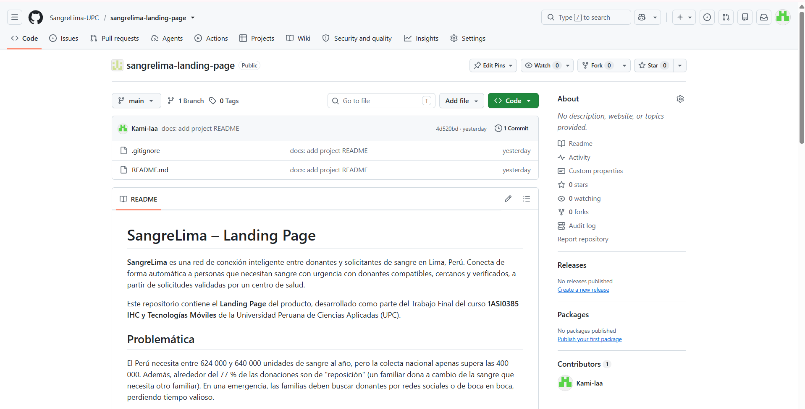
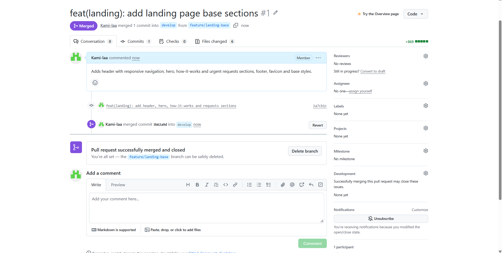
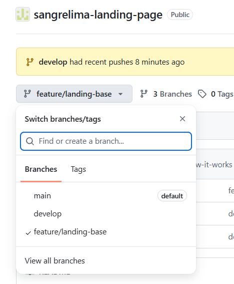
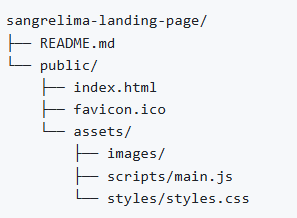
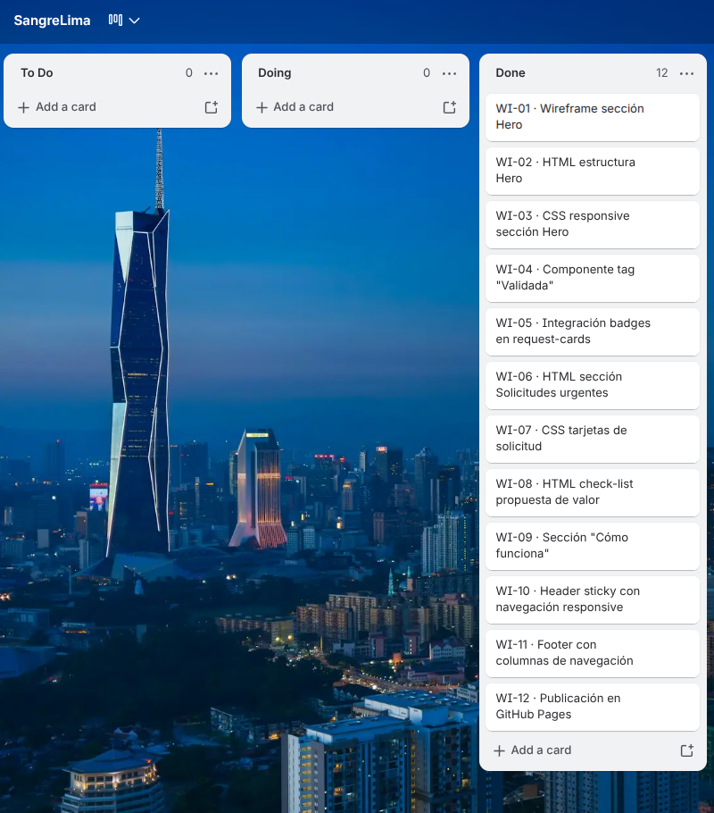
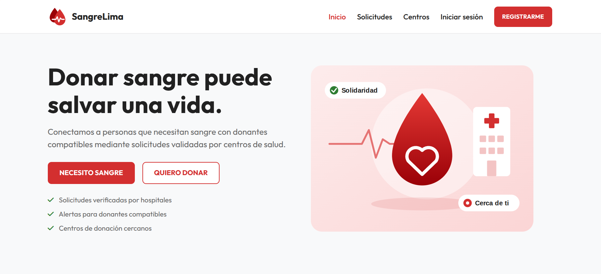
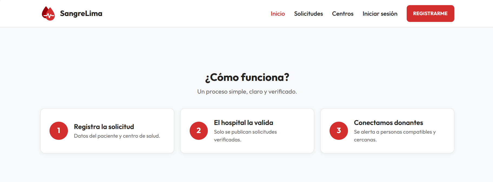
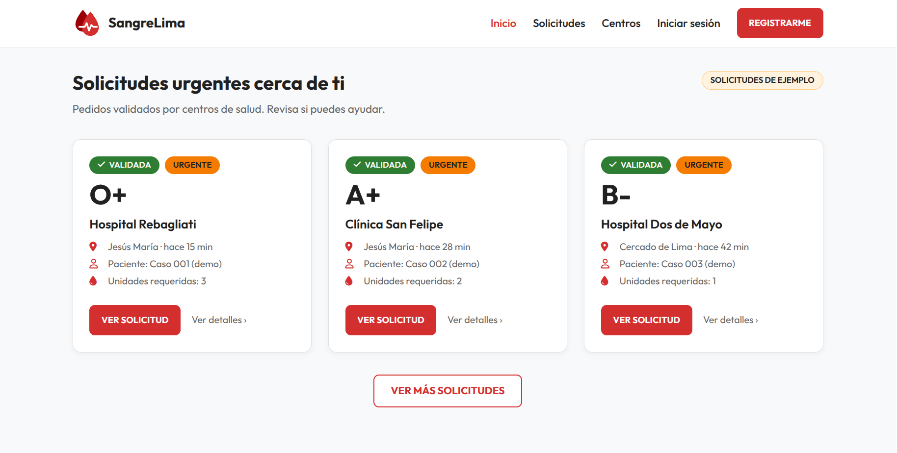
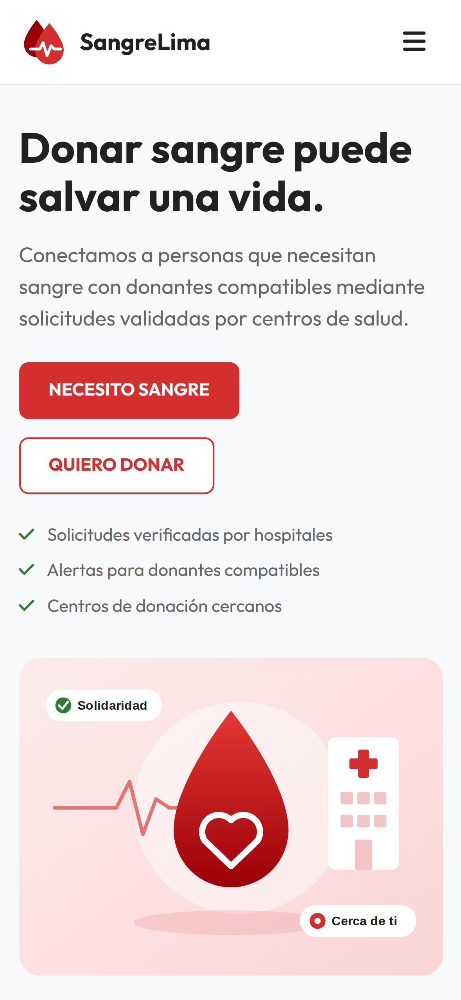
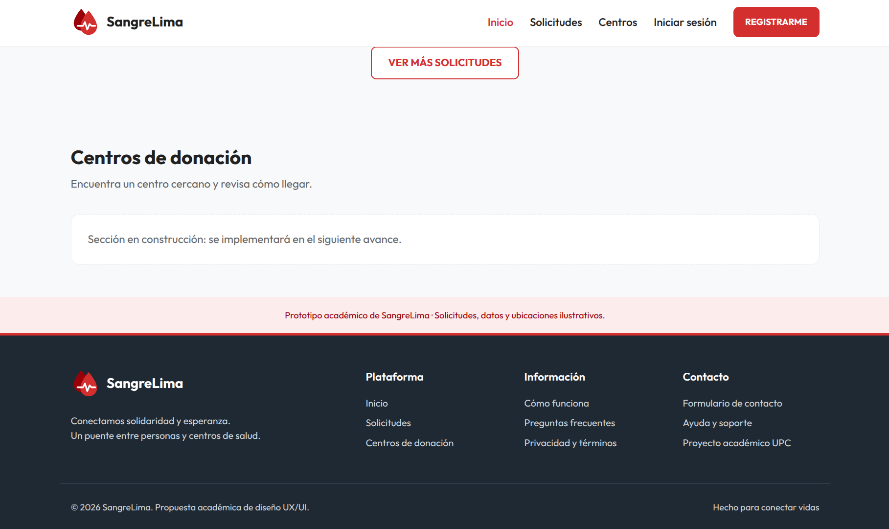

# Capítulo V: Product Implementation (centrado en el Landing Page, desarrollado en HTML y CSS, 100% responsive, con JavaScript básico)

## 5.1. Software Configuration Management

> En esta sección el equipo de SangreLima establece las decisiones y convenciones que permitirán mantener la consistencia del Landing Page y de los artefactos asociados durante todo el ciclo de vida del producto. Se especifican las herramientas que utiliza cada integrante, el esquema de control de versiones basado en Git, GitHub y el modelo GitFlow, las convenciones de codificación para HTML, CSS, JavaScript y Gherkin, y la configuración necesaria para publicar el Landing Page. Estas decisiones buscan que los siete integrantes puedan trabajar en paralelo sobre sus propias User Stories sin generar conflictos, y que cualquier cambio sea trazable hasta la persona y la historia que lo originó.

### 5.1.1. Software Development Environment Configuration

> A continuación, se especifican los productos de software que utilizan los integrantes del equipo para colaborar en el ciclo de vida de SangreLima, organizados según el tipo de actividad. Para las herramientas SaaS se indica la ruta de referencia y, para las que se instalan en el computador de cada integrante, la ruta de descarga. Todas las herramientas respetan las restricciones del curso: el Landing Page se construye solo con HTML5, CSS3 y JavaScript básico, sin frameworks de CSS.

<table>
<colgroup>
<col style="width: 17%" />
<col style="width: 17%" />
<col style="width: 20%" />
<col style="width: 45%" />
</colgroup>
<thead>
<tr>
<th style="text-align: center;"><strong>Actividad</strong></th>
<th style="text-align: center;"><strong>Herramienta</strong></th>
<th style="text-align: center;"><strong>Uso en SangreLima</strong></th>
<th style="text-align: center;"><strong>Ruta de referencia / descarga</strong></th>
</tr>
<tr>
<th>Project Management</th>
<th>Trello</th>
<th>Tablero del Sprint: User Stories, tasks, responsables y estado (To-do / In-Process / To-Review / Done).</th>
<th><a href="https://trello.com"><u>https://trello.com</u></a></th>
</tr>
<tr>
<th>Project Management</th>
<th>WhatsApp</th>
<th>Coordinación diaria del equipo y avisos de avance.</th>
<th><a href="https://www.whatsapp.com"><u>https://www.whatsapp.com</u></a></th>
</tr>
<tr>
<th>Requirements Management</th>
<th>UXPressia</th>
<th>User Personas, User Journey Maps, Empathy Maps e Impact Map.</th>
<th><a href="https://uxpressia.com"><u>https://uxpressia.com</u></a></th>
</tr>
<tr>
<th>Requirements Management</th>
<th>Lucidchart</th>
<th>As-Is y To-Be Scenario Mapping.</th>
<th><a href="https://www.lucidchart.com"><u>https://www.lucidchart.com</u></a></th>
</tr>
<tr>
<th>Product UX/UI Design</th>
<th>Figma</th>
<th>Wireframes, Wireflows, Mock-ups, User Flows y prototipos de iOS (plataforma principal) y Android (muestra comparativa).</th>
<th><a href="https://www.figma.com"><u>https://www.figma.com</u></a></th>
</tr>
<tr>
<th>Product UX/UI Design</th>
<th>Canva</th>
<th>Recursos gráficos para el Landing Page y la presentación.</th>
<th><a href="https://www.canva.com"><u>https://www.canva.com</u></a></th>
</tr>
<tr>
<th>Software Development</th>
<th>WebStorm</th>
<th>IDE para escribir HTML, CSS, JavaScript y archivos .feature, con integración de Git.</th>
<th><a href="https://www.jetbrains.com/webstorm/download/"><u>https://www.jetbrains.com/webstorm/download/</u></a></th>
</tr>
<tr>
<th>Software Development</th>
<th>Git</th>
<th>Control de versiones local en el computador de cada integrante.</th>
<th><a href="https://git-scm.com/downloads"><u>https://git-scm.com/downloads</u></a></th>
</tr>
<tr>
<th>Software Development</th>
<th>GitHub</th>
<th>Organización del equipo, repositorios remotos, Pull Requests, Insights y despliegue con GitHub Pages.</th>
<th><a href="https://github.com"><u>https://github.com</u></a></th>
</tr>
<tr>
<th>Software Development</th>
<th>Google Fonts</th>
<th>Tipografía Outfit definida en el Style Guide.</th>
<th><a href="https://fonts.google.com"><u>https://fonts.google.com</u></a></th>
</tr>
<tr>
<th>Software Development</th>
<th>Font Awesome</th>
<th>Iconografía del Landing Page.</th>
<th><a href="https://fontawesome.com"><u>https://fontawesome.com</u></a></th>
</tr>
<tr>
<th>Software Testing</th>
<th>Gherkin (plugin Gherkin de WebStorm)</th>
<th>Redacción de los Acceptance Tests en archivos .feature.</th>
<th><a href="https://cucumber.io/docs/gherkin/"><u>https://cucumber.io/docs/gherkin/</u></a></th>
</tr>
<tr>
<th>Software Testing</th>
<th>Chrome DevTools</th>
<th>Pruebas responsive (Device Mode) y revisión de errores en consola.</th>
<th><a href="https://developer.chrome.com/docs/devtools"><u>https://developer.chrome.com/docs/devtools</u></a></th>
</tr>
<tr>
<th>Software Testing</th>
<th>Lighthouse y WAVE</th>
<th>Revisión de accesibilidad (a11y), rendimiento y buenas prácticas.</th>
<th>
<a href="https://developer.chrome.com/docs/lighthouse"><u>https://developer.chrome.com/docs/lighthouse</u></a>

<a href="https://wave.webaim.org"><u>https://wave.webaim.org</u></a>
</th>
</tr>
<tr>
<th>Software Testing</th>
<th>W3C Markup Validation Service</th>
<th>Validación del HTML.</th>
<th><a href="https://validator.w3.org"><u>https://validator.w3.org</u></a></th>
</tr>
<tr>
<th>Software Documentation</th>
<th>Microsoft Word / Google Docs</th>
<th>Elaboración colaborativa del informe del proyecto.</th>
<th>
<a href="https://www.office.com"><u>https://www.office.com</u></a>

<a href="https://docs.google.com"><u>https://docs.google.com</u></a>
</th>
</tr>
<tr>
<th>Software Documentation</th>
<th>Markdown (README.md)</th>
<th>Documentación del repositorio: proyecto, autores, segmentos y características.</th>
<th><a href="https://docs.github.com/es/get-started/writing-on-github"><u>https://docs.github.com/es/get-started/writing-on-github</u></a></th>
</tr>
<tr>
<th>Software Documentation</th>
<th>YouTube</th>
<th>Publicación de videos (navegación de prototipos, validación, About-the-Product).</th>
<th><a href="https://www.youtube.com"><u>https://www.youtube.com</u></a></th>
</tr>
</thead>
<tbody>
</tbody>
</table>

### 5.1.2. Source Code Management

> Para el seguimiento de las modificaciones, el equipo utiliza Git como sistema de control de versiones y GitHub como plataforma. Los repositorios se agrupan en una organización de GitHub, de modo que el proyecto pertenece al equipo y no a un integrante en particular, y todos los miembros participan como colaboradores con permisos de escritura.

| **Elemento** | **URL** |
|----|----|
| Organización de GitHub | [<u>https://github.com/SangreLima-UPC</u>](https://github.com/SangreLima-UPC) |
| Repositorio del Landing Page | [<u>https://github.com/SangreLima-UPC/sangrelima-landing-page</u>](https://github.com/SangreLima-UPC/sangrelima-landing-page) |
| Repositorio de Acceptance Tests (.feature) | [<u>https://github.com/fatima-campos/sangrelima-acceptance-tests</u>](https://github.com/fatima-campos/sangrelima-acceptance-tests) |

> 
>
> **Workflow GitFlow:** El equipo aplica el modelo GitFlow propuesto por Vincent Driessen (2010) en "A successful Git branching model". Este modelo separa el código publicado del código en desarrollo y permite que cada integrante trabaje sus User Stories en una rama propia. Las ramas utilizadas son:

| **Rama** | **Se crea desde** | **Se fusiona en** | **Propósito** | **Convención de nombre** |
|----|----|----|----|----|
| main | — | — | Contiene solo versiones estables y publicadas del Landing Page. Cada fusión en main corresponde a un release etiquetado. | main |
| develop | main | release/\* | Integra el trabajo terminado de todos los integrantes. Es la base de cada nueva feature. | develop |
| feature | develop | develop | Desarrollo de una sección o funcionalidad del Landing Page asociada a una o más User Stories. | feature/\<descripcion-en-kebab-case\> |
| release | develop | main y develop | Preparación de una entrega: últimos ajustes, revisión y actualización de la versión. | release/v\<MAJOR.MINOR.PATCH\> |
| hotfix | main | main y develop | Corrección urgente de un error detectado en la versión publicada. | hotfix/v\<MAJOR.MINOR.PATCH\> |

> **Convenciones para feature branches:** El nombre de cada feature branch se escribe en inglés, en minúsculas y en kebab-case (palabras separadas por guiones), y describe la sección o funcionalidad que se implementa. Cuando la rama corresponde directamente a una User Story, se antepone su identificador. No se usan espacios, tildes ni caracteres especiales. Ejemplos:

- feature/header-navigation

- feature/hero-section

- feature/us01-blood-request-form

- feature/us24-donor-alert-simulation

- feature/us37-donation-history

- feature/footer-contact

> **Convenciones para release y hotfix branches:** Las ramas release toman el número de la versión que se va a publicar (por ejemplo, release/v1.0.0) y las ramas hotfix el número de la versión corregida (por ejemplo, hotfix/v1.0.1). Al cerrar cada una se fusiona en main, se crea un tag con el mismo número y se fusiona de vuelta en develop.
>
> **Semantic Versioning:** Para nombrar los releases se aplica Semantic Versioning 2.0.0 con el formato MAJOR.MINOR.PATCH:

- MAJOR: cambios grandes que modifican la estructura del Landing Page.

- MINOR: nuevas secciones o funcionalidades que no rompen lo existente.

- PATCH: correcciones de errores o ajustes menores.

> Las versiones planificadas para el proyecto son las siguientes:

| **Versión** | **Contenido** |
|----|----|
| v0.1.0 | Estructura base del proyecto: carpetas, README.md, archivos base y primer avance del Landing Page (Challenge Landing Page Work-in-progress). |
| v1.0.0 | Landing Page del Sprint 1 (TB2): secciones principales con las User Stories core simuladas y diseño 100% responsive. |
| v1.1.0 | Landing Page del Sprint 2 (TF1): mejoras a partir de las entrevistas de validación y la auditoría de UX. |
| v1.x.y | Correcciones puntuales que surjan entre entregas (hotfix). |

> **Conventional Commits:** Los mensajes de commit siguen la especificación Conventional Commits 1.0.0, con el formato \<type\>(\<scope\>): \<description\>. La descripción se escribe en inglés, en modo imperativo, en minúsculas, sin punto final y con un máximo de 72 caracteres.
>
> El scope indica la sección afectada. Los tipos utilizados son:

| **Tipo** | **Uso** | **Ejemplo** |
|----|----|----|
| feat | Nueva funcionalidad o sección | feat(hero): add main call to action |
| fix | Corrección de un error | fix(request-form): validate blood type selection |
| style | Cambios visuales o de formato sin alterar la lógica | style(header): adjust spacing on mobile |
| refactor | Reorganización del código sin cambiar el comportamiento | refactor(styles): group color variables |
| docs | Documentación | docs(readme): add team members and segments |
| test | Acceptance Tests | test(us30): add one-tap confirmation scenarios |
| chore | Configuración y mantenimiento | chore(pages): add deployment workflow |

> **Flujo de trabajo de cada integrante:** Cada integrante crea su feature branch desde develop, realiza commits pequeños y frecuentes, y al terminar abre un Pull Request hacia develop. Ese Pull Request debe ser revisado y aprobado por al menos otro integrante antes de fusionarse.
>
> Los comandos básicos son:
>
> **git checkout develop**
>
> **git pull origin develop**
>
> **git checkout -b feature/us01-blood-request-form**
>
> **git add .**
>
> **git commit -m "feat(request-form): add blood type and units fields"**
>
> **git push -u origin feature/us01-blood-request-form**
>
> **\# Luego se abre un Pull Request hacia develop en GitHub**

*Figura: Pull Request \#1 de feature/landing-base hacia develop.*

*Figura: Ramas del repositorio según GitFlow (main, develop y feature).*

### 5.1.3. Source Code Style Guide & Conventions

> En esta sección el equipo resume las convenciones que adopta para nombrar elementos y programar en los lenguajes de la solución: HTML y CSS como base obligatoria del Landing Page, JavaScript de forma básica para interacciones simples y Gherkin para los archivos .feature. En todos los lenguajes la nomenclatura técnica (nombres de archivos, clases, identificadores, variables, funciones, ramas y commits) se escribe en inglés. El contenido visible para el usuario del Landing Page está en español. Las referencias adoptadas son el Google HTML/CSS Style Guide, el HTML Style Guide and Coding Conventions de W3Schools y Gherkin Conventions for Readable Specifications de SpecFlow.
>
> **Convenciones generales y de archivos.**

- Nombres de archivos y carpetas en minúsculas y kebab-case (por ejemplo, blood-request.png, donor-alert.svg).

- Estructura del proyecto: public (archivos .html y favicon.ico), public/assets/styles (.css), public/assets/images (imágenes) y public/assets/scripts (.js). El README.md se ubica en la raíz.

- Indentación de 2 espacios, sin tabulaciones, y codificación UTF-8.

> 
>
> **HTML**

- Declarar \<!DOCTYPE html\>, \<html lang="es"\>, \<meta charset="UTF-8"\> y la etiqueta meta viewport para el diseño responsive.

- Etiquetas y atributos en minúsculas, y valores de atributos entre comillas dobles.

- Usar etiquetas semánticas: \<header\>, \<nav\>, \<main\>, \<section\>, \<article\> y \<footer\>. Un solo \<h1\> por página y una jerarquía de títulos sin saltos.

- Clases e identificadores en inglés y kebab-case (por ejemplo, class="hero-section", id="blood-request-form").

- Todas las imágenes llevan un atributo alt descriptivo. Las decorativas usan alt="".

- Accesibilidad (a11y): cada campo de formulario tiene su \<label\>; los botones con solo un ícono llevan aria-label; el menú móvil usa aria-expanded; los mensajes simulados de confirmación y alertas usan aria-live="polite".

- No se usan estilos en línea (atributo style). Los scripts se enlazan al final o con el atributo defer.

> **\<section class="hero-section" id="home" aria-labelledby="hero-title"\>**
>
> **\<h1 id="hero-title"\>Encuentra donantes compatibles cerca de ti\</h1\>**
>
> **\**
>
> **\<a class="button button--primary" href="#request"\>Solicitar sangre\</a\>**
>
> **\</section\>**
>
> **CSS**

- Un único archivo styles.css, organizado por secciones con comentarios (variables, base, layout, componentes, secciones y media queries).

- Colores, tipografía y espaciados definidos como variables en :root, según el Style Guide: --color-primary: \#d32f2f, fuente Outfit y espaciado en múltiplos de 8 px.

- Enfoque mobile-first: estilos base para celular y media queries con min-width para tablet (768px) y escritorio (1024px).

- Selectores por clase en kebab-case, opcionalmente con la notación BEM (block\_\_element--modifier). No se usan selectores de id para dar estilo ni !important.

- Una declaración por línea, un espacio después de los dos puntos, punto y coma al final de cada declaración y colores hexadecimales en minúsculas.

> **:root {**
>
> **--color-primary: \#d32f2f;**
>
> **--font-main: "Outfit", sans-serif;**
>
> **--space-2: 16px;**
>
> **}**
>
> **.button--primary {**
>
> **background-color: var(--color-primary);**
>
> **color: \#ffffff;**
>
> **padding: var(--space-2);**
>
> **}**
>
> **@media (min-width: 768px) {**
>
> **.hero-section {**
>
> **display: flex;**
>
> **}**
>
> **}**
>
> **JavaScript (uso básico)**
>
> Todo el código en public/assets/scripts/main.js. Se usa solo para interacciones simples: menú móvil, simulación del envío de una solicitud, simulación de alertas a donantes y mensajes de confirmación.
>
> Variables con const y let (no var). Variables y funciones en camelCase (por ejemplo, showDonorAlert) y constantes fijas en UPPER_SNAKE_CASE.
>
> Comparaciones con === y punto y coma al final de cada sentencia.
>
> Eventos con addEventListener, nunca con atributos onclick en el HTML.
>
> **const requestForm = document.querySelector('#blood-request-form');**
>
> **requestForm.addEventListener('submit', (event) =\> {**
>
> **event.preventDefault();**
>
> **showConfirmation('Tu solicitud quedó pendiente de validación');**
>
> **});**
>
> **Gherkin (archivos .feature)**

- Un archivo .feature por User Story, nombrado con su identificador y una descripción corta en kebab-case (por ejemplo, us01-register-blood-request.feature).

- Redacción en inglés con las palabras clave Feature, Scenario, Given, When, Then y And.

- Un Scenario por cada criterio de aceptación. Se usa Scenario Outline con Examples cuando un mismo comportamiento se prueba con distintos datos (por ejemplo, tipos de sangre).

- Los pasos describen el comportamiento que observa el usuario, no detalles técnicos de la interfaz. Se mantiene el mismo tiempo verbal en todos los pasos.

- Etiquetas con la User Story y la épica a la que pertenecen (por ejemplo, @US01 @EP01).

> **@US01 @EP01**
>
> **Feature: Register an urgent blood request**
>
> **As a patient's relative**
>
> **I want to register an urgent blood request**
>
> **So that the search for compatible donors starts quickly**
>
> **Scenario: Request registered as pending validation**
>
> **Given I need blood for a patient**
>
> **When I complete the required request data and submit it**
>
> **Then the request is registered with status "Pending validation"**

### 5.1.4. Software Deployment Configuration

> El Landing Page de SangreLima se publica con GitHub Pages, el servicio de hosting de sitios estáticos de GitHub. Como el proyecto ubica sus archivos web dentro de la carpeta public, y GitHub Pages solo publica directamente desde la raíz del repositorio o desde la carpeta /docs, el despliegue se automatiza con un workflow de GitHub Actions que publica únicamente el contenido de public. De esta manera, cada vez que un release se fusiona en la rama main, el Landing Page se actualiza automáticamente.
>
> **Pasos para el despliegue:**

1.  Verificar que el repositorio sangrelima-landing-page de la organización sea público y que public/index.html exista en la rama main.

2.  2Comprobar que todas las rutas de index.html sean relativas a la carpeta public (por ejemplo, assets/styles/styles.css y assets/scripts/main.js), para que funcionen al publicarse.

3.  Crear el archivo .github/workflows/deploy-pages.yml con el contenido que se muestra a continuación, desde una rama feature, y fusionarlo en develop.

4.  En GitHub, entrar a Settings \> Pages y, en Build and deployment \> Source, seleccionar la opción GitHub Actions.

5.  Crear la rama release/vX.Y.Z desde develop, hacer los ajustes finales y fusionarla en main mediante un Pull Request.

6.  Al recibir el push en main, el workflow se ejecuta automáticamente. Su avance se revisa en la pestaña Actions del repositorio.

7.  Al terminar, el Landing Page queda disponible en la URL que muestra Settings \> Pages. Se verifica en Chrome en vista de escritorio y en vista móvil (DevTools \> Device Mode).

8.  Crear el tag de la versión publicada (por ejemplo, v1.0.0) y su release en GitHub.

> **Workflow de despliegue (.github/workflows/deploy-pages.yml):**
>
> **name: Deploy Landing Page to GitHub Pages**
>
> **on:**
>
> **push:**
>
> **branches: \[main\]**
>
> **workflow_dispatch:**
>
> **permissions:**
>
> **contents: read**
>
> **pages: write**
>
> **id-token: write**
>
> **concurrency:**
>
> **group: pages**
>
> **cancel-in-progress: false**
>
> **jobs:**
>
> **deploy:**
>
> **runs-on: ubuntu-latest**
>
> **environment:**
>
> **name: github-pages**
>
> **url: \${{ steps.deployment.outputs.page_url }}**
>
> **steps:**
>
> **- uses: actions/checkout@v4**
>
> **- uses: actions/configure-pages@v5**
>
> **- uses: actions/upload-pages-artifact@v3**
>
> **with:**
>
> **path: ./public**
>
> **- id: deployment**
>
> **uses: actions/deploy-pages@v4**

| **Elemento** | **Valor** |
|----|----|
| URL del Landing Page publicado | [<u>https://sangrelima-upc.github.io/sangrelima-landing-page/</u>](https://sangrelima-upc.github.io/sangrelima-landing-page/) |
| Rama de despliegue | main |
| Carpeta publicada | public |
| Versión publicada | v1.0.0 |

## 5.2. Product Implementation & Deployment.

### 5.2.1. Sprint 1

#### 5.2.1.1. Sprint Backlog 1.

> **Sprint Goal:** "Diseñar e implementar el Landing Page de SangreLima con HTML5, CSS3 y JavaScript básico, publicarlo en GitHub Pages y verificar que los flujos informativos clave —solicitudes urgentes validadas, propuesta de valor del producto y llamadas a la acción para ambos perfiles de usuario— sean completamente funcionales y accesibles."
>
> Para la gestión visual del Sprint 1 se utilizó un tablero Trello organizado con las columnas **To-do**, **In-Process**, **To-Review** y **Done**. Cada tarjeta corresponde a un Work Item de la tabla siguiente e incluye su estimación, responsable y criterios de aceptación.
>
> **URL del tablero Trello:** [https://trello.com/b/F7xuEumW/sangrelima](https://trello.com/b/F7xuEumW/sangrelima)

| **Work-Item Id** | **User Story Id** | **Title** | **Description** | **Estimation (Hours)** | **Assigned To** | **Status** |
|----|----|----|----|----|----|----|
| WI-01 | US01 | Wireframe sección Hero | Diseñar la estructura visual del hero con los CTAs "Necesito sangre" y "Quiero donar", la propuesta de valor y la ilustración principal. | 3 | Martín Farro, Alexis | Done |
| WI-02 | US01 | HTML estructura Hero | Codificar el marcado semántico de la sección hero: encabezado H1, descripción, botones de acción e ilustración SVG con atributos ARIA. | 3 | Campos Acosta, Fatima | Done |
| WI-03 | US01 | CSS responsive sección Hero | Aplicar estilos mobile-first al hero: tipografía Outfit, colores del style guide y grid de 2 columnas a partir de 1024 px. | 4 | Campos Acosta, Fatima | Done |
| WI-04 | US14 | Componente tag "Validada" | Implementar el badge visual con fondo verde (#2e7d32) que identifica visualmente las solicitudes verificadas por un establecimiento de salud. | 2 | Campos Acosta, Fatima | Done |
| WI-05 | US14 | Integración badges en request-cards | Añadir los badges "Validada" y "Urgente" a las tarjetas de solicitud de ejemplo con contraste WCAG y etiquetas ARIA. | 2 | Reyes Diaz, Frances | Done |
| WI-06 | US04 | HTML sección Solicitudes urgentes | Implementar el marcado HTML de la grid de solicitudes: tipo de sangre, nombre del hospital, distrito, tiempo transcurrido y unidades requeridas. | 4 | Calderon Mendoza, Sebastian | Done |
| WI-07 | US04 | CSS tarjetas de solicitud | Aplicar diseño card con sombra (--shadow-card), tipografía y layout de los detalles del centro de salud; grid de 1, 2 y 3 columnas según breakpoint. | 3 | Campos Acosta, Fatima | Done |
| WI-08 | US24 | HTML check-list propuesta de valor | Codificar la lista de beneficios clave del hero ("Solicitudes verificadas por hospitales", "Alertas para donantes compatibles", "Centros de donación cercanos"). | 2 | Belon Carita, Jorge | Done |
| WI-09 | US24 | Sección "Cómo funciona" | Implementar los 3 steps con número circular, título y descripción en grid responsive: 1 columna en móvil, 3 columnas a partir de 768 px. | 3 | Molina Benites, Luis | Done |
| WI-10 | US30 | Header sticky con navegación responsive | Implementar el header fijo con logo, menú desktop y toggle mobile con JavaScript (atributo aria-expanded y clase main-nav--open). | 5 | Campos Acosta, Fatima | Done |
| WI-11 | US30 | Footer con columnas de navegación | Implementar el footer con grid de 4 columnas, enlaces de navegación y año dinámico mediante new Date().getFullYear(). | 3 | Reyes Diaz, Frances | Done |
| WI-12 | US30 | Publicación en GitHub Pages | Configurar el workflow de GitHub Actions (deploy-pages.yml), verificar el despliegue en producción y crear el tag v1.0.0. | 2 | Martín Farro, Alexis | Done |

#### 5.2.1.2. User Interface & Execution.

> El Landing Page de SangreLima se encuentra publicado y accesible en la siguiente URL de producción:
> [https://sangrelima-upc.github.io/sangrelima-landing-page/](https://sangrelima-upc.github.io/sangrelima-landing-page/)
>
> A continuación se presentan capturas de las principales secciones implementadas durante el Sprint 1, tomadas desde la vista desktop y la vista móvil.

#### 5.2.1.3. Team Collaboration Insights.

> En esta sección se presenta la evidencia de colaboración del equipo durante el Sprint 1, extraída de los insights del repositorio **sangrelima-upc/sangrelima-landing-page** en GitHub. Los datos reflejan las contribuciones al branch `develop` y al branch `main` durante el periodo del sprint.

*(Insertar screenshot — pestaña Insights › Contributors del repositorio GitHub, mostrando commits por integrante durante el Sprint 1)*

*(Insertar screenshot — Network Graph o lista de commits con las ramas feature/landing-base, develop y main)*

## 5.3. Video About-the-Product.

#