**UNIVERSIDAD PERUANA DE CIENCIAS APLICADAS**

**FACULTAD DE INGENIERÍA**

**CARRERAS: INGENIERÍA DE SOFTWARE / INGENIERÍA DE SISTEMAS DE INFORMACIÓN**

**1ASI0385 - IHC Y TECNOLOGÍAS MÓVILES**

**TRABAJO FINAL**

**SangreLima**

**Docente:**

**Kevin Edgar Salazar Ruiz**

| **Apellidos y nombres**          | **Código** |
|----------------------------------|------------|
| Belon Carita Jorge Mathias       | u202322422 |
| Campos Acosta, Fatima Brigit     | u202521899 |
| Calderon Mendoza Sebastian Pavel | u202412227 |
| Martín Farro, Alexis Sebastian   | u202515871 |
| Molina Benites Luis Enrique      | u202520955 |
| Reyes Diaz, Frances Kamila       | u202421764 |

**Lima, 14 de Septiembre del 2026**

**202620**

**Registro de versiones del informe**

<table>
<colgroup>
<col style="width: 21%" />
<col style="width: 16%" />
<col style="width: 25%" />
<col style="width: 35%" />
</colgroup>
<thead>
<tr>
<th style="text-align: center;"><strong>Versión</strong></th>
<th style="text-align: center;"><strong>Fecha</strong></th>
<th style="text-align: center;"><strong>Autor</strong></th>
<th style="text-align: center;"><strong>Descripción de Modificación</strong></th>
</tr>
<tr>
<th style="text-align: center;">1 - Semana 4</th>
<th style="text-align: center;">14/09</th>
<th style="text-align: left;">
Belon Carita, Jorge Mathias

Campos Acosta, Fatima Brigit

Calderon Mendoza Sebastian Pavel

Martín Farro, Alexis Sebastian

Molina Benites, Luis Enrique

Reyes Diaz, Frances Kamila
</th>
<th style="text-align: left;">Redacción de la Descripción de la Startup y Perfiles del equipo; investigación de Antecedentes y Problemática; formulación del Problem Statement, Assumptions, Hypothesis Statements y Lean UX Canvas; definición de Segmentos Objetivo; elaboración del Análisis Competitivo y Estrategias; diseño, registro y análisis de Entrevistas; desarrollo de Needfinding (User Personas, User Task Matrix, User Journey Mapping, Empathy Mapping y As-is Scenario Mapping); y estructuración del Avance de Conclusiones, Bibliografía y Anexos.</th>
</tr>
<tr>
<th style="text-align: center;">2 - Semana 7</th>
<th style="text-align: center;"><strong>10/10</strong></th>
<th style="text-align: left;">
Belon Carita, Jorge Mathias

Campos Acosta, Fatima Brigit

Calderon Mendoza Sebastian Pavel

Martín Farro, Alexis Sebastian

Molina Benites, Luis Enrique

Reyes Diaz, Frances Kamila
</th>
<th style="text-align: center;"></th>
</tr>
<tr>
<th style="text-align: center;">3 - Semana 12</th>
<th style="text-align: center;">08/11</th>
<th style="text-align: left;">
Belon Carita, Jorge Mathias

Campos Acosta, Fatima Brigit

Calderon Mendoza Sebastian Pavel

Martín Farro, Alexis Sebastian

Molina Benites, Luis Enrique

Reyes Diaz, Frances Kamila
</th>
<th style="text-align: center;"></th>
</tr>
<tr>
<th style="text-align: center;"></th>
<th style="text-align: center;"></th>
<th style="text-align: center;"></th>
<th style="text-align: center;"></th>
</tr>
</thead>
<tbody>
</tbody>
</table>

**Contenido**

[**Capítulo I: Introducción 10**](#capítulo-i-introducción)

> [**1.1. Startup Profile 10**](#startup-profile)
>
> [1.1.1. Descripción de la Startup 10](#descripción-de-la-startup)
>
> [1.1.2. Perfiles de integrantes del equipo 11](#perfiles-de-integrantes-del-equipo)
>
> [**1.2. Solution Profile 13**](#solution-profile)
>
> [1.2.1. Antecedentes y problemática 13](#antecedentes-y-problemática)
>
> [1.2.2. Lean UX Process. 15](#lean-ux-process.)
>
> [1.2.2.1. Lean UX Problem Statements. 15](#lean-ux-problem-statements.)
>
> [1.2.2.2. Lean UX Assumptions. 15](#lean-ux-assumptions.)
>
> [1.2.2.3. Lean UX Hypothesis Statements. 17](#lean-ux-hypothesis-statements.)
>
> [1.2.2.4 Lean Ux Canvas 17](#lean-ux-canvas)
>
> [Link del canva: https://canva.link/owh2v89iamdenxx 17](#link-del-canva-httpscanva.linkowh2v89iamdenxx)
>
> [**1.3. Segmentos objetivo. 18**](#segmentos-objetivo.)

[**Capítulo II: Requirements Elicitation & Analysis 19**](#capítulo-ii-requirements-elicitation-analysis)

[**2.1 Competidores 19**](#competidores)

> [2.1.1 Análisis Competitivo 20](#análisis-competitivo)
>
> [2.1.2 Estrategias y Tácticas Frente a Competidores 23](#estrategias-y-tácticas-frente-a-competidores)
>
> [**2.2. Entrevistas. 25**](#entrevistas.)
>
> [2.2.1. Diseño de entrevistas 25](#diseño-de-entrevistas)
>
> [2.2.2. Registro de entrevistas. 27](#registro-de-entrevistas.)
>
> [2.2.3. Análisis de entrevistas. 36](#análisis-de-entrevistas.)
>
> [**2.3. Needfinding. 45**](#needfinding.)
>
> [2.3.1. User Personas. 45](#user-personas.)
>
> [2.3.2. User Task Matrix. 49](#user-task-matrix.)
>
> [2.3.3. User Journey Mapping 51](#user-journey-mapping)
>
> [2.3.4. Empathy Mapping 54](#empathy-mapping)
>
> [2.3.5. As-is Scenario Mapping 57](#as-is-scenario-mapping)

[**Capítulo III: Requirements Specification 58**](#capítulo-iii-requirements-specification)

> [3.1. To-Be Scenario Mapping. 58](#to-be-scenario-mapping.)
>
> [Proceso realizado: 58](#proceso-realizado)
>
> [3.2. User Stories. 60](#user-stories.)
>
> [3.3. Impact Mapping. 70](#impact-mapping.)
>
> [3.4. Product Backlog. 71](#product-backlog.)

[**Capítulo IV: Product UX/UI Design 75**](#capítulo-iv-product-uxui-design)

> [4.1. Style Guidelines. 75](#style-guidelines.)
>
> [4.1.1. General Style Guidelines 75](#general-style-guidelines)
>
> [4.1.2. Web Style Guidelines. 78](#web-style-guidelines.)
>
> [4.1.3. Mobile Style Guidelines. 81](#mobile-style-guidelines.)
>
> [4.1.3.1. Primary Mobile Platform Style Guidelines. 84](#primary-mobile-platform-style-guidelines.)
>
> [4.1.3.2. Secondary Mobile Platform Comparative Guidelines. 85](#secondary-mobile-platform-comparative-guidelines.)
>
> [4.2. Information Architecture. 87](#information-architecture.)
>
> [4.2.1. Organization Systems. 87](#organization-systems.)
>
> [4.2.2. Labeling Systems. 88](#labeling-systems.)
>
> [4.2.3. Searching Systems. 88](#searching-systems.)
>
> [4.2.4. Navigation Systems. 88](#navigation-systems.)
>
> [4.3. Landing Page UI Design. 89](#landing-page-ui-design.)
>
> [4.3.1. Landing Page Wireframe. 89](#landing-page-wireframe.)
>
> [4.3.2. Landing Page Mock-up 91](#landing-page-mock-up)
>
> [4.4. Mobile Applications UX/UI Design. 92](#mobile-applications-uxui-design.)
>
> [4.4.1. Mobile Applications Wireframes. 92](#mobile-applications-wireframes.)
>
> [4.4.2. Mobile Applications Wireflow 100](#mobile-applications-wireflow)
>
> [4.4.3. Primary Mobile Platform Mock-ups. 104](#primary-mobile-platform-mock-ups.)
>
> [4.4.4. Primary Mobile Platform User Flow Diagrams. 104](#primary-mobile-platform-user-flow-diagrams.)
>
> [4.5. Mobile Applications Prototyping. 104](#mobile-applications-prototyping.)
>
> [4.5.1. Primary Mobile Platform Prototyping. 104](#primary-mobile-platform-prototyping.)
>
> [4.5.2. Secondary Mobile Platform Comparative Prototyping. 104](#secondary-mobile-platform-comparative-prototyping.)

[**Capítulo V: Product Implementation (centrado en el Landing Page, desarrollado en 104**](#capítulo-v-product-implementation-centrado-en-el-landing-page-desarrollado-en-html-y-css-100-responsive-con-javascript-básico)

[**HTML y CSS, 100% responsive, con JavaScript básico) 104**](#_e7qqyif29aai)

> [5.1. Software Configuration Management 104](#software-configuration-management)
>
> [5.1.1. Software Development Environment Configuration 104](#software-development-environment-configuration)
>
> [5.1.2. Source Code Management 106](#source-code-management)
>
> [5.1.3. Source Code Style Guide & Conventions 109](#source-code-style-guide-conventions)
>
> [5.1.4. Software Deployment Configuration 112](#software-deployment-configuration)
>
> [5.2. Product Implementation & Deployment. 113](#product-implementation-deployment.)
>
> [5.2.1. Sprint 1 113](#sprint-1)
>
> [5.2.1.1. Sprint Backlog 1. 113](#sprint-backlog-1.)
>
> [5.2.1.2. User Interface & Execution. 113](#user-interface-execution.)
>
> [5.2.1.3. Team Collaboration Insights. 113](#team-collaboration-insights.)
>
> [5.3. Video About-the-Product. 113](#video-about-the-product.)

[**Capítulo VI: Product Validation 113**](#capítulo-vi-product-validation)

> [6.1. Acceptance Tests 113](#acceptance-tests)
>
> [6.2. Entrevistas de validación. 113](#entrevistas-de-validación.)
>
> [6.2.1. Diseño de Entrevistas. 113](#diseño-de-entrevistas.)
>
> [6.2.2. Registro de Entrevistas. 113](#registro-de-entrevistas.-1)
>
> [6.2.3. Evaluaciones según heurísticas 113](#evaluaciones-según-heurísticas)

[**Conclusiones: 115**](#conclusiones)

[**Bibliografía: 115**](#bibliografía)

[**Anexos: 115**](#anexos)

**Student Outcome**

<table>
<colgroup>
<col style="width: 33%" />
<col style="width: 33%" />
<col style="width: 33%" />
</colgroup>
<thead>
<tr>
<th style="text-align: center;"><strong>Criterio específico</strong></th>
<th style="text-align: center;"><strong>Acciones realizadas</strong></th>
<th style="text-align: center;"><strong>Conclusiones</strong></th>
</tr>
<tr>
<th style="text-align: left;">2.c1. Diseñar soluciones en ingeniería de software (productos, procesos y/o servicios) que satisfagan necesidades específicas considerando el impacto en salud pública,seguridad, bienestar, así como factores globales, culturales,sociales, ambientales y económicos</th>
<th style="text-align: left;">
<em><strong>Campos Acosta, Fatima Brigit</strong></em>

<strong>TB1:</strong> Desarrollé la elaboración de los supuestos e hipótesis de diseño. También participé en la construcción de la matriz Lean UX Canvas y en la definición de los Segmentos Objetivo de la plataforma SangreLima.

<em><strong>Reyes Diaz, Frances Kamila</strong></em>

<strong>TB1:</strong> Realicé las entrevistas a los Segmentos 1 (Pacientes/familiares), 2 (Donantes) y 3 (Instituciones/bancos de sangre) para identificar necesidades específicas relacionadas con la falta de organización en la búsqueda de donantes de sangre durante emergencias. Participé en la construcción de los User Personas de la plataforma SangreLima a partir de la información recogida.

<em><strong>Molina Benites, Luis Enrique</strong></em>

<strong>TB1:</strong> Participé en el análisis competitivo de SangreLima, comparando soluciones como Dale Vida Perú, Blooders y American Red Cross. A partir de ello, ayudé a identificar oportunidades de diferenciación como el matching por compatibilidad, proximidad, validación de solicitudes y alertas segmentadas.

<em><strong>Belon Carita, Jorge Mathias</strong></em>

<strong>TB1:</strong> Fui encargado de realizar los User Task Matrix y los User Journey Mapping, sobre los segmentos objetivos, para entender el contexto social de los usuarios

<em><strong>Alexis Sebastian Martín Farro</strong></em>

<strong>TB1:</strong> Fui encargado de realizar el Startup Profile, la descripcion de la solucion ylos antecedentes y problematica
</th>
<th style="text-align: left;">Se logró convertir una problemática compleja de salud pública, relacionada con la falta y desorganización en la búsqueda de donantes de sangre durante emergencias, en un conjunto de hipótesis claras y fáciles de validar, enfocadas en las necesidades de los usuarios y en los resultados del proyecto.</th>
</tr>
<tr>
<th style="text-align: left;">2.c2. Validar que el diseño de la solución de software considere aspectos en salud pública, seguridad, bienestar, así como factores globales, culturales,sociales, ambientales y económicos</th>
<th style="text-align: left;">
<em><strong>Campos Acosta, Fatima Brigit</strong></em>

<strong>TB1:</strong> Colaboré activamente con el equipo para relacionar los objetivos del negocio con la información obtenida mediante la investigación de usuario. Además, incorporé las necesidades encontradas por mis compañeros en el Lean UX Canvas y ajusté los Segmentos Objetivo tomando en cuenta los resultados del análisis de la competencia y de las actividades de empatía.

<em><strong>Reyes Diaz, Frances Kamila</strong></em>

<strong>TB1:</strong> Coordiné y grabé las entrevistas con los usuarios de los tres segmentos, validando que las necesidades identificadas reflejen aspectos de salud pública y bienestar. Los hallazgos sirvieron de base para ajustar los Segmentos Objetivo y las hipótesis de diseño del equipo.

<em><strong>Molina Benites, Luis Enrique</strong></em>

<strong>TB1:</strong> Elaboré el <em>Competitive Analysis Landscape</em> considerando perfil, mercado objetivo, productos, canales, fortalezas, debilidades, oportunidades y amenazas de los principales competidores.

<em><strong>Belon Carita, Jorge Mathias</strong></em>

<strong>TB1:</strong> Me encargue de realizar el user journey mapping mediante el diseño de los recorridos de los usuarios y participe elaborando la user task matrix, identificando así tareas clave de los segmentos objetivo.

<em><strong>Alexis Sebastian Martin Farro</strong></em>

<em><strong>TB1:</strong></em>

<em>A través del desarrollo del Problem Statement y la herramienta 5W2H, validé y estructuré la magnitud de la problemática de salud pública (escasez y desorganización de donantes de sangre), asegurando que el diseño de la solución aborde directamente las necesidades de bienestar y seguridad de los pacientes en emergencia. Asimismo, mediante el Startup Profile, verifiqué que la propuesta contemple los factores sociales y económicos del entorno para ofrecer un modelo de solución viable y sostenible.</em>
</th>
<th style="text-align: left;">La definición clara de las hipótesis de solución permitió al equipo contar con una guía organizada y compartida para desarrollar las User Personas, User Task Matrix y Scenario Mappings. Esto facilitó la distribución de las tareas y ayudó a cumplir con los avances establecidos para el proyecto académico.</th>
</tr>
</thead>
<tbody>
</tbody>
</table>

# Capítulo I: Introducción

## 1.1. Startup Profile

### 1.1.1. Descripción de la Startup

**Nombre de la startup**: SangreLima

**Descripción**

> SangreLima es una startup tecnológica enfocada en el desarrollo de soluciones digitales para la optimización y el acompañamiento del proceso de donación de sangre. Construimos sistemas que articulan la urgencia médica con la solidaridad ciudadana, convirtiendo datos de compatibilidad y ubicación en conexiones vitales. En SangreLima buscamos transformar la manera en que los pacientes, sus familias y las instituciones de salud se relacionan con los donantes voluntarios: para quienes hoy buscan ayuda de forma desesperada, manual y poco estructurada, les brindamos agilidad y tranquilidad; para quienes ya tienen la disposición de ayudar, les damos un canal seguro, directo y libre de fricciones. Integramos progresivamente tecnologías de geolocalización y validación de datos para construir soluciones capaces de modernizar la red de donación del futuro, adaptándose a las necesidades de cualquier establecimiento de salud.

**Visión**

> Convertirnos en el principal referente de innovación social y tecnológica para la gestión de donantes en Latinoamérica, conectando a ciudadanos y centros de salud alrededor de una misma red eficiente, transparente y verificada.

**Misión**

> Brindar soluciones tecnológicas accesibles que traduzcan la necesidad de componentes sanguíneos en respuestas rápidas y estructuradas: para los familiares que buscan donantes, reducimos la incertidumbre y el tiempo de respuesta; para los donantes, entregamos alertas precisas basadas en compatibilidad real; y para los bancos de sangre, damos herramientas de validación que aseguran la legitimidad del proceso. Todo esto operando bajo procesos digitales simples y una conexión directa con los protocolos de los centros de salud.
>
> **Propuesta de Valor  **
> “La urgencia no debería depender del azar. Conecta de manera inteligente.”
>
> SangreLima existe para cerrar la brecha entre la emergencia de un paciente y la voluntad de un ciudadano dispuesto a donar. Creemos que conseguir donantes en momentos críticos no debería dejarse a la suerte de una publicación en redes sociales, sino gestionarse mediante información clara, segmentada y verificada. Por eso construimos un ecosistema digital que sirve como puente entre las necesidades validadas de las instituciones médicas y la comunidad de donantes. Nuestra apuesta no es simplemente desarrollar una aplicación de mensajería, sino ser la capa de inteligencia comunitaria que transforma la voluntad de donar en un proceso estructurado, seguro y capaz de salvar vidas.

### 1.1.2. Perfiles de integrantes del equipo

<table>
<colgroup>
<col style="width: 45%" />
<col style="width: 54%" />
</colgroup>
<thead>
<tr>
<th style="text-align: center;"></th>
<th style="text-align: left;">
<strong>Nombre:</strong> Campos Acosta Fatima Brigit

<strong>Carrera:</strong> Ingeniería de Software

<strong>Código:</strong> U202521899

<strong>Conocimientos y habilidades:</strong>

Estudiante de Ingeniería de Software en la Universidad Peruana de Ciencias Aplicadas (UPC), enfocada en la creación de soluciones tecnológicas eficaces para desafíos en entornos digitales. Destaca por su capacidad analítica, razonamiento lógico y facilidad para colaborar en equipo, aportando valor en cada etapa del desarrollo de proyectos<strong>.</strong>
</th>
</tr>
<tr>
<th style="text-align: center;">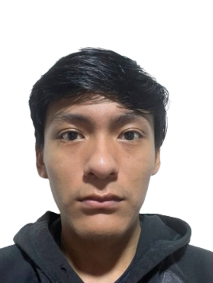</th>
<th style="text-align: left;">
<strong>Nombre:</strong> Calderon Mendoza Sebastian Pavel

<strong>Carrera:</strong> Ingeniería de Software

<strong>Código:</strong> U202412227

<strong>Conocimientos y habilidades:</strong>

Estudiante de Ingeniería de Software en la UPC, enfocado en el diseño y desarrollo de código eficiente bajo estándares de calidad. Cuento con una mentalidad orientada a la resolución de problemas y optimización de procesos mediante un enfoque ágil. Disfruto trabajar en equipo, aportando una comunicación abierta y un compromiso constante con la mejora continua para crear software que añada un valor real al negocio.
</th>
</tr>
<tr>
<th style="text-align: center;"></th>
<th style="text-align: left;">
<strong>Nombre:</strong> Martín Farro, Alexis Sebastian

<strong>Carrera:</strong> Ingeniería de Software

<strong>Código:</strong> U202515871

<strong>Conocimientos y habilidades:</strong>

Soy una persona disciplinada y constante, cualidades que he desarrollado gracias a mi práctica de la natación, un deporte que me ha enseñado a mantener el enfoque, gestionar el esfuerzo a largo plazo y superar obstáculos con perseverancia. Estas mis bu mas habilidades las aplico en mi formación como estudiante de Ingeniería de Software, donde busco resolver problemas de manera metódica y con atención al detalle.
</th>
</tr>
<tr>
<th style="text-align: center;"></th>
<th style="text-align: left;">
<strong>Nombre:</strong> Reyes Diaz, Frances Kamila

<strong>Carrera:</strong> Ingeniería de Software

<strong>Código:</strong> U202421764

<strong>Conocimientos y habilidades:</strong>

Estudiante de Ingeniería de Software en la Universidad Peruana de Ciencias Aplicadas (UPC). Se caracteriza por su interés en el desarrollo de soluciones tecnológicas orientadas a la resolución de problemáticas en entornos digitales. Posee habilidades en análisis de requerimientos, pensamiento lógico y trabajo en equipo, lo que le permite contribuir de manera efectiva en el desarrollo de proyectos.
</th>
</tr>
<tr>
<th style="text-align: center;"></th>
<th style="text-align: left;">
<strong>Nombre:</strong> Belon Carita, Jorge Mathias

<strong>Carrera:</strong> Ingeniería de Software

<strong>Código:</strong> U202322422

<strong>Conocimientos y habilidades:</strong>

Estudiante de la carrera de Ingeniería de software en la UPC, me considero una persona responsable, cumplidora y enfocado en hacer un buen trabajo, cuento con conocimientos básicos en la programación.
</th>
</tr>
<tr>
<th style="text-align: center;"></th>
<th style="text-align: left;">
<strong>Nombre:</strong> Molina Benites, Luis Enrique

<strong>Carrera:</strong> Ingeniería de Software

<strong>Código:</strong> U202520955

<strong>Conocimientos y habilidades:</strong>

Estudiante de la carrera de Ingeniería de software en la UPC, me considero una persona que le gusta trabajar en equipo y poder hacer trabajos muy bien planteados y poder entregar todo a tiempo y responsablemente.
</th>
</tr>
</thead>
<tbody>
</tbody>
</table>

## 1.2. Solution Profile

### 1.2.1. Antecedentes y problemática

Técnica 5W2H

> *1. ¿Qué ocurre o qué problema se presenta? (What?)*
>
> Existe una gran dificultad y demora para encontrar donantes de sangre compatibles, verificados y aptos en situaciones de emergencia médica. Actualmente, la búsqueda depende en gran medida de los esfuerzos manuales de familiares y amigos mediante cadenas de mensajes, publicaciones en redes sociales o contactos directos. Este proceso desestructurado genera que las solicitudes lleguen a audiencias masivas pero incorrectas, provocando retrasos críticos, información falsa o incompleta, y la movilización de personas que, al llegar al centro de salud, descubren que no son aptas para donar o no poseen el tipo de sangre requerido.
>
> *2. ¿Cuándo se presenta el problema? (When?)*
>
> El problema se vuelve evidente y crítico durante emergencias médicas, tales como accidentes de tránsito, cirugías de alta complejidad imprevistas, tratamientos oncológicos, o partos de riesgo, donde el paciente requiere transfusiones inmediatas y el banco de sangre del centro de salud no cuenta con el stock suficiente. También se presenta cuando los hospitales exigen a los familiares reponer las unidades de sangre utilizadas durante una intervención urgente.
>
> *3. ¿Dónde sucede? (Where?)*
>
> El problema ocurre físicamente en las salas de espera de hospitales, clínicas y bancos de sangre, donde los familiares enfrentan la urgencia. Paralelamente, se desarrolla en el entorno digital (grupos de WhatsApp, Facebook, Instagram), que se convierte en el canal principal y saturado donde se difunden los pedidos de ayuda de forma no segmentada ni geolocalizada.
>
> *4. ¿Quiénes están involucrados o afectados? (Who?)*
>
> El problema impacta directamente a tres grupos: primero, a los pacientes en riesgo y a sus familiares (solicitantes), quienes sufren altos niveles de estrés y angustia al asumir la responsabilidad de conseguir donantes rápidamente. Segundo, a los donantes voluntarios, que muchas veces tienen la disposición de ayudar pero reciben información irrelevante, lejana a su ubicación, o acuden a donar sin saber que no cumplen con los tiempos de espera reglamentarios. Tercero, al personal de los bancos de sangre e instituciones de salud, que debe lidiar con la verificación manual de donantes y el desorden generado por campañas no oficiales.
>
> *5. ¿Por qué ocurre? (Why?)*
>
> El problema ocurre por la falta de un sistema centralizado e inteligente que cruce la urgencia médica con la disponibilidad ciudadana. Las redes sociales y aplicaciones de mensajería no están diseñadas para filtrar o realizar un "matching" basado en compatibilidad sanguínea, ubicación geográfica, o el historial médico del donante (tiempo desde su última donación). Además, la ausencia de un filtro de validación institucional en las publicaciones de redes sociales genera desconfianza en los posibles donantes, quienes muchas veces dudan de la veracidad de la emergencia o asumen que alguien más ya acudió al llamado.
>
> *6. ¿Cómo se manifiesta el problema? (How?)*
>
> Se manifiesta a través de la viralización desesperada de afiches digitales con los datos del paciente, la saturación de contactos telefónicos y la pérdida de horas vitales. En los hospitales, se refleja cuando los donantes potenciales son rechazados en la etapa de triaje por no cumplir con los requisitos básicos o por no ser compatibles, lo que significa una pérdida de tiempo tanto para el donante como para el personal médico, prolongando el estado de vulnerabilidad del paciente.
>
> *7. ¿Cuánto cuesta o cuál es la magnitud? (How Much?)*
>
> La magnitud de esta problemática se cuantifica en el tiempo crítico que se pierde: encontrar un donante a través de redes sociales puede tomar días, cuando en situaciones de emergencia se requieren respuestas en minutos u horas. A nivel de salud, el costo se mide en el agravamiento del estado del paciente, complicaciones quirúrgicas o incluso la pérdida de vidas por falta de transfusiones oportunas. Operativamente, se traduce en una bajísima tasa de conversión: de miles de personas que ven una publicación en redes sociales, menos del 1% resulta ser un donante compatible, apto y dispuesto a trasladarse físicamente al hospital en ese momento.

### 1.2.2. Lean UX Process.

#### 1.2.2.1. Lean UX Problem Statements.

> Actualmente, la búsqueda de donantes de sangre en situaciones de emergencia depende en gran medida de procesos informales y desestructurados, como cadenas de mensajes, publicaciones masivas en redes sociales y contactos directos, para conseguir personas dispuestas a ayudar. Esta situación genera problemas como la difusión de información no verificada, la movilización de personas incompatibles o no aptas para donar en ese momento, y una sobrecarga de estrés tanto para las familias como para el personal de los centros de salud.
>
> Las soluciones existentes no ofrecen una manera inteligente de conectar las necesidades críticas de los pacientes con la disponibilidad real y geolocalizada de los donantes voluntarios. Como consecuencia, los familiares pierden tiempo vital intentando llegar a la persona correcta, mientras que los posibles donantes reciben solicitudes que no coinciden con su tipo de sangre o ubicación, lo que genera demoras que ponen en riesgo la vida del paciente, además de frustración y pérdida de tiempo para la comunidad dispuesta a colaborar.
>
> ¿Cómo podríamos reducir la demora, la desorganización y la falta de información verificada en la búsqueda de donantes de sangre, de manera que los familiares consigan ayuda compatible en tiempo récord, los bancos de sangre optimicen su flujo de atención, y los donantes voluntarios puedan colaborar de forma segura, rápida y efectiva?

#### 1.2.2.2. Lean UX Assumptions.

> **Business Assumptions:**

1.  Creemos que nuestros usuarios necesitan encontrar donantes de sangre compatibles y previamente verificados de manera rápida, especialmente en situaciones de emergencia médica, sin tener que depender de familiares, conocidos o publicaciones en redes sociales.

2.  Estas necesidades pueden atenderse mediante una aplicación móvil que envíe alertas a posibles donantes cercanos, teniendo en cuenta su tipo de sangre y si cumplen con los requisitos para donar.

3.  Nuestros principales usuarios serían los familiares de los pacientes que necesitan sangre con urgencia, los donantes voluntarios que donan con frecuencia y los bancos de sangre o clínicas.

4.  El principal beneficio para los usuarios sería reducir considerablemente el tiempo que toma encontrar un donante. Además, los donantes recibirán alertas sólo cuando exista una compatibilidad y cumplan con las condiciones necesarias para realizar la donación.

5.  Buscaremos establecer alianzas con centros de salud, promocionar la aplicación y fomentar las recomendaciones entre los propios donantes.

6.  Uno de los principales riesgos del proyecto es que los donantes notificados no respondan a tiempo cuando se presente una emergencia. También existe el riesgo de que la validación de las solicitudes sea lenta y retrase el proceso de búsqueda.

> **User Assumptions:**

1.  Nuestros usuarios son solicitantes; familiares directos que se encargan de gestionar la atención médica de un paciente que se encuentra en una situación de emergencia.

2.  Nuestros usuarios son donantes; personas de 18 a 60 años que cuentan con un celular, tienen disposición para donar sangre y pueden trasladarse a un centro de salud cercano.

3.  El donante usa la aplicación principalmente de manera pasiva en su día a día. La tiene instalada y recibe una notificación sólo cuando se presenta una emergencia que requiere su tipo de sangre y se encuentra dentro de una zona cercana.

4.  Los familiares usan la aplicación de manera activa cuando un paciente necesita sangre con urgencia. En ese momento, registran una solicitud que previamente ha sido validada por el centro de salud.

5.  La aplicación reduce el estrés, la confusión y el tiempo que se pierde al buscar donantes mediante redes sociales o familiares.

6.  La aplicación evita que los donantes reciban demasiadas notificaciones que no sean útiles, ya que las alertas se envían solo a personas que sean compatibles y que puedan donar en ese momento.

> **Feature Assumptions:**

1.  Creemos que pedir la confirmación del centro de salud y el tipo de sangre en cada solicitud hará que los donantes tengan mayor confianza y estén más dispuestos a responder.

2.  Creemos que revisar cuánto tiempo ha pasado desde la última donación permitirá evitar enviar notificaciones a personas que todavía no pueden donar. Esto ayudará a reducir la posibilidad de que los usuarios se cansen de recibir alertas y desinstalen la aplicación.

3.  Creemos que permitir que el donante confirme su disponibilidad con un solo toque hará que pueda responder más rápido y facilitará su asistencia al hospital.

4.  Creemos que contar con un historial de donaciones y reconocimientos para los donantes ayudará a motivarlos a seguir participando y donar nuevamente en el futuro.

#### 1.2.2.3. Lean UX Hypothesis Statements.

1.  Creemos que reducir el tiempo promedio de confirmación de donantes en situaciones de emergencia a menos de 15 minutos se logrará si los donantes voluntarios recurrentes logran tener éxito con el sistema de alertas geolocalizadas inteligentes y la confirmación de disponibilidad con un solo toque (one-tap). ESTO SE VALIDARÁ ….

2.  Creemos que incrementar la tasa de respuesta efectiva de los donantes a más del 75% por cada alerta enviada se logrará si los familiares de pacientes en situación de urgencia y los bancos de sangre logran tener éxito con la función que permite publicar y validar solicitudes vinculadas directamente a un centro de salud. ESTO SE VALIDARÁ ….

3.  Creemos que aumentar la retención y la participación frecuente de los donantes en un 40% se logrará si los donantes voluntarios logran tener éxito con la gestión de su historial de donaciones, el control automático del tiempo mínimo de espera y la obtención de insignias de reconocimiento dentro de la aplicación. ESTO SE VALIDARÁ ….

#### 1.2.2.4 Lean Ux Canvas

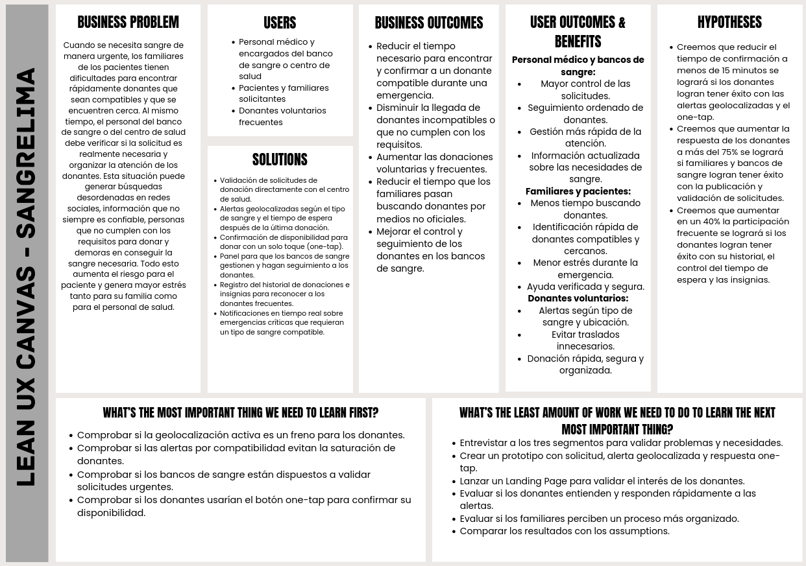

#### Link del canva: [<u>https://canva.link/owh2v89iamdenxx</u>](https://canva.link/owh2v89iamdenxx)

## 1.3. Segmentos objetivo.

> Según el alcance de nuestra aplicación, identificamos tres grupos principales de usuarios:

1.  ***Pacientes y familiares que necesitan una transfusión con urgencia:***

    1.  Demográfico:  
        Hombres y mujeres de 18 a 65 años o más, de ocupaciones variadas, que son pacientes que requieren una transfusión o familiares/responsables a cargo de la gestión del insumo médico durante una emergencia de salud.

    2.  Psicográfico:  
        Enfrentan altos niveles de estrés, ansiedad y vulnerabilidad emocional debido a la situación crítica de salud. Valoren al máximo la efectividad, la rapidez, la transparencia y la confiabilidad. Buscan tranquilidad, seguridad sobre el estado del suministro y predictibilidad para responder de forma inmediata a la emergencia médica de sus seres queridos o propia.

    3.  Conductual:  
        Cuentan con un dominio básico o intermedio en el uso de smartphones e internet móvil. Tienen una frecuencia de uso por necesidad puntual/urgente (intermitente o de alta densidad en períodos de crisis). Buscan registrar rápidamente solicitudes validada por el centro médico, especificar el tipo de sangre requerido y la ubicación del establecimiento. Están plenamente dispuestos a adoptar la herramienta si perciben un beneficio claro, confiable y de respuesta inmediata frente a la urgencia.

    4.  Geográfico:  
        Residentes en Perú. Se desenvuelven principalmente en zonas urbanas que cuentan con infraestructura hospitalaria, clínicas privadas y centros de salud con conectividad a internet móvil.

2.  ***Donantes voluntarios:***

    1.  Demográfico: Hombres y mujeres de 18 a 65 años (rango de edad legal y apto para donar), con ocupaciones variadas (estudiantes, profesionales, trabajadores independientes, etc.) que cumplen con los requisitos médicos y de salud para realizar la donación de sangre.

    2.  Psicográfico: Personas empáticas, solidarias y con un alto sentido de responsabilidad social y comunitaria. Valoran el orden, la eficiencia y la relevancia en la información que reciben. Buscan ayudar de forma ágil sin saturarse de mensajes irrelevantes en redes sociales, priorizando la transparencia, el control de sus aportes y la satisfacción de marcar una diferencia directa en la vida de alguien.

    3.  Conductual: Manejan aplicaciones móviles con facilidad. No usan la app todos los días, sino que responden cuando reciben alertas de casos compatibles y cercanos a su ubicación. Desde la plataforma confirman si pueden donar, revisan su historial y ven cuándo estarán listos para su siguiente donación. La integran rápido a su rutina porque les hace más fácil y ordenada su ayuda voluntaria.

    4.  Geográfico: Residentes en Perú. Se desplazan principalmente en áreas urbanas de alta densidad, con presencia de centros de salud, bancos de sangre o campañas itinerantes, y conectividad estable a internet móvil para recibir las alertas oportunas.

3.  ***Bancos de sangre y centros de salud (clínicas y hospitales):***

    1.  Demográfico:  
        Instituciones públicas y privadas del sector salud (clínicas, hospitales y bancos de sangre autorizados). Representadas operativamente por personal administrativo, jefes de laboratorio, tecnólogos médicos, médicos hematólogos y coordinadores de donación y banco de sangre.

    2.  Psicográfico:  
        Su prioridad es la seguridad del paciente y seguir los protocolos médicos al pie de la letra. Les importa mucho que la información sea real, que el trabajo esté ordenado y que la sangre disponible se use de la mejor manera. Buscan reducir el papeleo, evitar el desorden que generan las solicitudes falsas o repetidas y contar con un proceso transparente y confiable.

    3.  Conductual:  
        Tienen un buen manejo de la tecnología médica e institucional. Utilizan la plataforma de forma constante para validar los pedidos de sangre de los pacientes, verificar la compatibilidad de los donantes y confirmar los aportes realizados. La adoptan fácilmente porque les ayuda a mantener una red de donantes reales, segura y bien organizada.

    4.  Geográfico:  
        Ubicados en Perú. Centros hospitalarios, clínicas e institutos especializados situados en zonas urbanas con alta demanda de procedimientos médicos, quirúrgicos y de emergencia, con infraestructura tecnológica y conectividad constante a internet.

# Capítulo II: Requirements Elicitation & Analysis

# 2.1 Competidores

> Los principales referentes identificados son Dale Vida Perú, Blooders, American Red Cross Blood Donor App, los servicios informativos del Ministerio de Salud del Perú y las redes sociales y aplicaciones de mensajería utilizadas para difundir solicitudes de sangre.

### 2.1.1 Análisis Competitivo

> Para analizar el entorno competitivo de SangreLima se consideraron competidores y referentes nacionales e internacionales, evaluando principalmente su propuesta de valor, mecanismos de conexión con los donantes y principales funcionalidades.

<table>
<colgroup>
<col style="width: 12%" />
<col style="width: 13%" />
<col style="width: 19%" />
<col style="width: 17%" />
<col style="width: 18%" />
<col style="width: 19%" />
</colgroup>
<thead>
<tr>
<th colspan="6"><strong>Competitive Analysis Landscape</strong></th>
</tr>
<tr>
<th colspan="2"><strong>¿Por qué llevar a cabo este análisis?</strong></th>
<th colspan="4">¿Cómo se diferencia SangreLima frente a las principales soluciones digitales de donación de sangre y qué oportunidades puede aprovechar para facilitar una conexión rápida, confiable y organizada entre solicitantes, donantes y establecimientos de salud?</th>
</tr>
<tr>
<th colspan="2" style="text-align: center;"><strong>Competidor</strong></th>
<th style="text-align: center;">
<strong>SangreLima</strong>

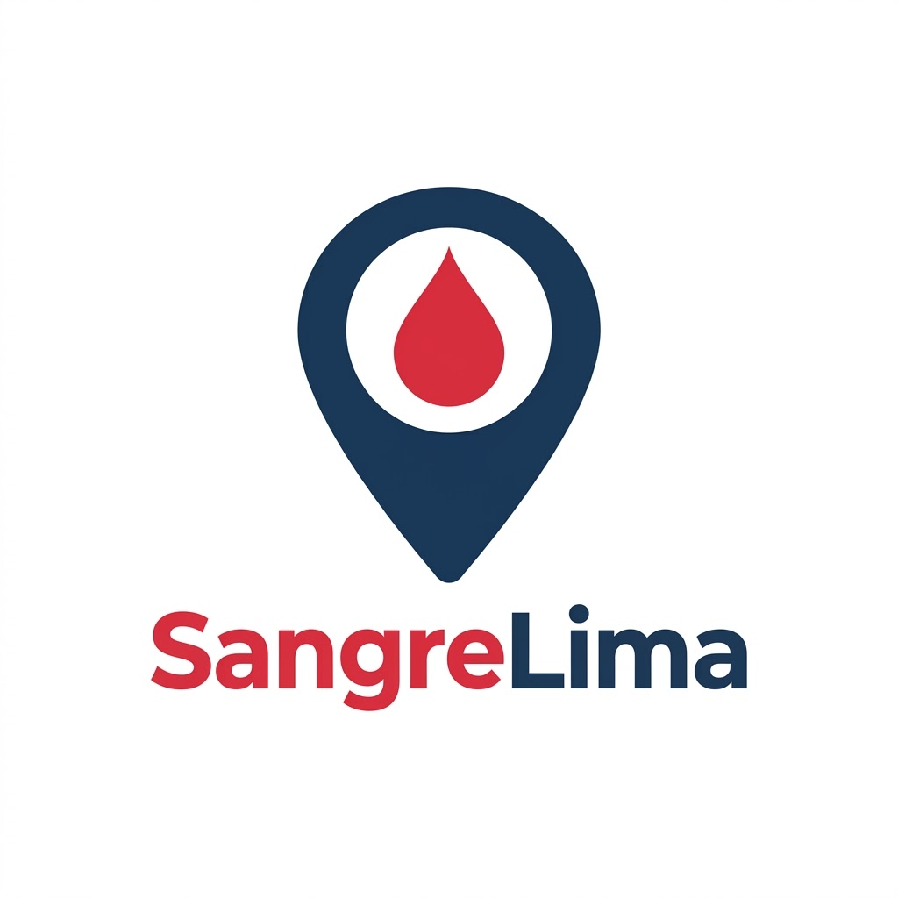
</th>
<th style="text-align: center;">
<strong>Dale Vida Perú</strong>

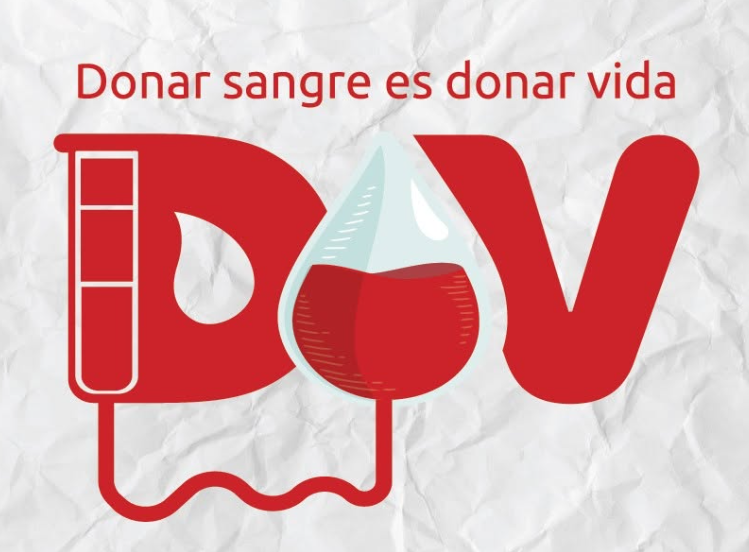
</th>
<th style="text-align: center;">
<strong>Blooders</strong>

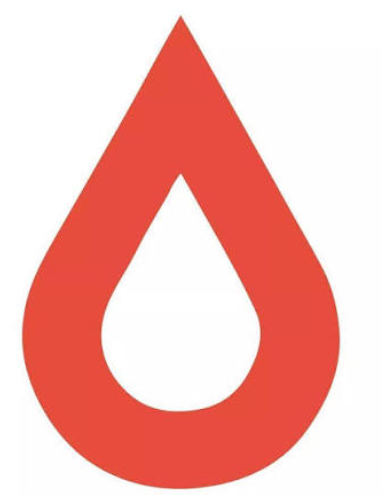
</th>
<th style="text-align: center;">
<strong>American Red Cross Blood Donor App</strong>

</th>
</tr>
<tr>
<th rowspan="2" style="text-align: center;"><strong>Perfil</strong></th>
<th style="text-align: center;"><strong>Overview</strong></th>
<th>Plataforma móvil que busca conectar solicitudes de sangre con donantes compatibles, cercanos y disponibles, mediante alertas segmentadas y solicitudes vinculadas a establecimientos de salud.</th>
<th>Iniciativa de By People orientada a promover la donación voluntaria. Su aplicación permitió registrar donantes, seleccionar lugar y horario y reservar citas. La campaña Dale Vida Perú continúa activa en 2026.</th>
<th>Plataforma mexicana que conecta donantes, pacientes y hospitales. Permite registrar tipo sanguíneo y ciudad, crear campañas, buscar donantes y agendar citas.</th>
<th>Aplicación de la American Red Cross orientada a facilitar la experiencia del donante: localización de campañas, citas, RapidPass, historial y seguimiento de la donación.</th>
</tr>
<tr>
<th style="text-align: center;"><strong>Ventaja competitiva ¿Qué valor ofrece a los clientes</strong></th>
<th>Busca reducir el tiempo de búsqueda mediante matching por compatibilidad, proximidad y disponibilidad, evitando alertas masivas o irrelevantes.</th>
<th>Experiencia y presencia en Perú, vinculación con instituciones sanitarias y organización de campañas presenciales.</th>
<th>Integra en una misma plataforma pacientes, donantes y hospitales, además de campañas y comunidades de donantes.</th>
<th>Respaldo institucional de American Red Cross y ecosistema digital consolidado para administrar todo el proceso del donante.</th>
</tr>
<tr>
<th rowspan="2" style="text-align: center;"><strong>Perfil de Marketing</strong></th>
<th style="text-align: center;"><strong>Mercado objetivo</strong></th>
<th>
1. Pacientes y familiares que requieren sangre.

2. Donantes voluntarios.

3. Bancos de sangre, clínicas y hospitales de Lima.
</th>
<th>Donantes voluntarios peruanos y establecimientos de salud aliados.</th>
<th>Donantes voluntarios, pacientes/familiares que necesitan sangre y hospitales en México.</th>
<th>Personas elegibles para donar sangre o plaquetas y participantes de campañas de American Red Cross en EE. UU.</th>
</tr>
<tr>
<th style="text-align: center;"><strong>Estrategias de marketing</strong></th>
<th><strong>Propuesta:</strong> alianzas con hospitales y bancos de sangre, campañas digitales, contenido educativo, difusión de solicitudes verificadas y programas de reconocimiento al donante.</th>
<th>Campañas presenciales de donación, alianzas con instituciones de salud, municipios y organizaciones, acompañadas de difusión digital.</th>
<th>Comunidad de donantes, campañas compartibles, alianzas hospitalarias, reconocimiento digital y comunicación de historias de pacientes.</th>
<th>Campañas institucionales, llamados ante necesidades de sangre, localización de blood drives, notificaciones, promociones y fidelización mediante la app.</th>
</tr>
<tr>
<th rowspan="3" style="text-align: center;"><strong>Perfil de Producto</strong></th>
<th style="text-align: center;"><strong>Productos &amp; Servicios</strong></th>
<th>Registro de donantes; solicitudes de sangre; compatibilidad sanguínea; geolocalización; alertas dirigidas; confirmación de disponibilidad; historial de donaciones; información de centros de salud.</th>
<th>Registro de donantes; programación de citas; selección de lugar y horario; campañas de donación; información posterior al proceso.</th>
<th>Registro de donantes; búsqueda por tipo sanguíneo; campañas para pacientes; comunidades; citas en hospitales aliados; información sobre compatibilidad y reconocimientos digitales.</th>
<th>Búsqueda de centros y campañas; programación y gestión de citas; RapidPass; resultados del mini-examen; historial; seguimiento de la sangre donada y notificaciones.</th>
</tr>
<tr>
<th style="text-align: center;"><strong>Precios &amp; Costos</strong></th>
<th>Aún no definido en el proyecto. Para el MVP se puede plantear acceso gratuito para donantes y solicitantes; el modelo institucional deberá validarse posteriormente.</th>
<th>La aplicación fue presentada como gratuita para los usuarios y sus convenios institucionales contemplaron acceso sin costo.</th>
<th>El servicio de creación de campañas para solicitar donantes es gratuito.</th>
<th>Aplicación gratuita para los usuarios.</th>
</tr>
<tr>
<th style="text-align: center;"><strong>Canales de distribución (Web y/o Móvil)</strong></th>
<th><strong>Propuesto:</strong> aplicación móvil; posible plataforma web para hospitales/bancos de sangre.</th>
<th>Aplicación móvil y plataforma web/extranet documentadas en sus convenios.</th>
<th>Plataforma web y aplicación móvil.</th>
<th>Aplicación móvil y sitio web RedCrossBlood.org</th>
</tr>
<tr>
<th rowspan="4" style="text-align: center;"><strong>Análisis SWOT</strong></th>
<th style="text-align: center;"><strong>Fortalezas</strong></th>
<th>Matching por compatibilidad y proximidad; alertas segmentadas; enfoque en urgencias; propuesta adaptada al contexto de Lima.</th>
<th>Presencia local; experiencia realizando campañas; alianzas con entidades sanitarias; reconocimiento previo en Perú.</th>
<th>Plataforma especializada; conecta pacientes, donantes y hospitales; campañas; comunidad; hospitales aliados.</th>
<th>Gran respaldo institucional; plataforma consolidada; numerosas funciones para el donante; integración web/móvil.</th>
</tr>
<tr>
<th style="text-align: center;"><strong>Debilidades</strong></th>
<th>Proyecto nuevo; todavía sin base de donantes; depende de conseguir instituciones aliadas; funcionalidades aún deben validarse con usuarios.</th>
<th>Las funciones digitales documentadas corresponden principalmente a años anteriores; actualmente existe evidencia más clara de campañas que de todas las funciones originales de la app.</th>
<th>Está principalmente enfocada en México; su modelo y red hospitalaria no responden directamente al contexto peruano.</th>
<th>Está enfocada en el ecosistema de American Red Cross en EE. UU.; no está diseñada para solicitudes individuales de pacientes en Lima.</th>
</tr>
<tr>
<th style="text-align: center;"><strong>Oportunidades</strong></th>
<th>Déficit de donación voluntaria; digitalización del proceso; alianzas con hospitales; crecimiento de una comunidad recurrente; integración futura con bancos de sangre.</th>
<th>Ampliar nuevamente su presencia digital y extender alianzas con más instituciones del país.</th>
<th>Expandir su modelo a nuevos mercados y fortalecer herramientas de conexión entre pacientes y donantes.</th>
<th>Continuar utilizando datos, personalización y tecnología para aumentar la recurrencia de donantes.</th>
</tr>
<tr>
<th style="text-align: center;"><strong>Amenazas</strong></th>
<th>Baja adopción inicial; desconfianza ante solicitudes digitales; regulación y tratamiento de datos sensibles; competencia de redes sociales y soluciones existentes.</th>
<th>Aparición de plataformas con matching y geolocalización más avanzados; dependencia de alianzas institucionales.</th>
<th>Plataformas locales mejor adaptadas a normativa y necesidades de otros países; dependencia de hospitales participantes.</th>
<th>Otras organizaciones de donación y servicios hospitalarios propios; cambios en hábitos y canales digitales de los donantes.</th>
</tr>
</thead>
<tbody>
</tbody>
</table>

### 2.1.2 Estrategias y Tácticas Frente a Competidores

> Las estrategias no buscan sustituir a los bancos de sangre ni al sistema sanitario, sino complementar el proceso de captación de donantes mediante herramientas digitales que reduzcan las fricciones existentes entre una necesidad y la posibilidad de encontrar personas dispuestas a donar.
>
> **Tácticas**

- ***Matching inteligente entre solicitudes y donantes compatibles***

> En contraste con alternativas basadas principalmente en campañas generales o publicaciones abiertas en redes sociales, SangreLima buscará conectar cada solicitud con personas que realmente puedan atenderla. Como táctica, la plataforma filtrará a los posibles donantes considerando el tipo sanguíneo, la compatibilidad, la ubicación y el tiempo transcurrido desde su última donación, evitando enviar alertas innecesarias a usuarios que no correspondan con la necesidad publicada.

- ***Validación de solicitudes mediante establecimientos de salud***

> Frente a las solicitudes difundidas por Facebook, WhatsApp u otras redes sociales, donde puede resultar difícil verificar la autenticidad de la información, SangreLima buscará incrementar la confianza del usuario mediante solicitudes vinculadas a hospitales, clínicas o bancos de sangre. Como táctica, cada solicitud mostrará información del establecimiento de salud relacionado, el tipo de sangre requerido y los datos necesarios para que el posible donante pueda comprobar dónde debe realizar la donación.

- ***Notificaciones segmentadas según necesidad y proximidad***

> Frente a plataformas y redes sociales que pueden difundir solicitudes de manera masiva, SangreLima buscará reducir la saturación de información recibida por los usuarios. Como táctica, las alertas se enviarán prioritariamente a donantes compatibles que se encuentren dentro de una zona cercana al establecimiento donde se requiere la donación, permitiendo que el usuario reciba información relevante para su perfil.

- ***Simplificación del proceso de respuesta del donante***

> Frente a soluciones en las que el usuario debe buscar campañas, consultar establecimientos o realizar varios pasos antes de decidir donar, SangreLima buscará reducir la fricción del proceso. Como táctica, la notificación mostrará de manera directa la información principal de la solicitud y permitirá que el usuario confirme su disponibilidad desde la misma plataforma, facilitando una respuesta más rápida ante una necesidad de sangre.

- ***Historial y reconocimiento de participación del donante***

> Frente a soluciones enfocadas únicamente en cubrir una necesidad puntual, SangreLima buscará fomentar una relación continua con los donantes voluntarios. Como táctica, se implementará un historial de donaciones y participación, acompañado de reconocimientos digitales que permitan al usuario visualizar su contribución y mantener un seguimiento de su actividad dentro de la plataforma.

**Estrategias**

- **Confiabilidad mediante validación y segmentación de solicitudes**

> **Objetivo:  **
> Incrementar la confianza de los donantes frente a alternativas informales, como publicaciones abiertas en redes sociales, donde la información puede ser incompleta, repetitiva o difícil de verificar.
>
> **Acciones:  **
> Establecer un proceso de validación de solicitudes vinculadas a establecimientos de salud, registrar información esencial como tipo de sangre, ubicación y centro de atención, y dirigir las alertas únicamente a usuarios compatibles con la necesidad publicada.
>
> **Resultados esperados:  **
> Mayor confianza por parte de los donantes, reducción de solicitudes poco relevantes o dudosas y aumento de la probabilidad de respuesta ante necesidades reales de sangre.

- **Optimización de la conexión entre donantes y solicitantes**

> **Objetivo:  **
> Reducir el tiempo y esfuerzo requerido para localizar posibles donantes compatibles frente a métodos tradicionales como llamadas telefónicas, grupos de WhatsApp, publicaciones en Facebook o búsqueda mediante familiares y conocidos.
>
> **Acciones:  **
> Implementar mecanismos de matching considerando compatibilidad sanguínea, proximidad geográfica y disponibilidad del donante, acompañados de notificaciones segmentadas y opciones de confirmación rápida.
>
> **Resultados esperados:  **
> Disminución del tiempo de búsqueda de posibles donantes, reducción de comunicaciones innecesarias y mayor eficiencia en la conexión entre una solicitud y los usuarios que realmente pueden atenderla.

- **Fidelización y formación de una comunidad de donantes voluntarios**

> **Objetivo:  **
> Promover una relación continua con los donantes para disminuir la dependencia exclusiva de donaciones de emergencia o reposición.
>
> **Acciones:  **
> Incorporar historial de donaciones, seguimiento de participación, recordatorios cuando el usuario pueda volver a donar y reconocimientos digitales que refuercen su contribución dentro de la comunidad.
>
> **Resultados esperados:  **
> Mayor recurrencia de donantes voluntarios, incremento de usuarios activos dentro de SangreLima y fortalecimiento de una comunidad disponible para futuras necesidades.

- **Diferenciación mediante experiencia de usuario y respuesta rápida**

> **Objetivo:  **
> Facilitar la participación del donante mediante un proceso digital sencillo y reducir las barreras existentes entre recibir una solicitud y decidir acudir a donar.
>
> **Acciones:  **
> Diseñar notificaciones claras con información esencial, permitir la confirmación de disponibilidad con pocos pasos y mostrar de forma directa el establecimiento de salud, ubicación y características principales de cada solicitud.
>
> **Resultados esperados:  **
> Menor abandono durante el proceso, aumento de las confirmaciones de disponibilidad y una experiencia de uso más clara y eficiente para los potenciales donantes.

## 2.2. Entrevistas.

### 2.2.1. Diseño de entrevistas

> Esta sección presenta las preguntas principales que se aplicarán a cada segmento objetivo. Las preguntas buscan recoger información demográfica (edad, distrito, ocupación) y otras características necesarias para construir los arquetipos, como comportamiento, motivaciones, frustraciones y uso de tecnología frente al proceso de donación o solicitud de sangre.
>
> ***Segmento 1: Pacientes y familiares que necesitan transfusión con urgencia***
>
> 1\. ¿Cuál es tu edad, distrito de residencia y ocupación?
>
> 2\. ¿Has tenido que conseguir sangre para un familiar o paciente alguna vez?
>
> 3\. Cuando necesitaste sangre con urgencia, ¿qué fue lo primero que hiciste?
>
> 4\. ¿A través de qué medios buscaste ayuda? (redes sociales, WhatsApp, hospital, campaña)
>
> 5\. ¿Qué fue lo más difícil o lo que más tiempo te tomó en ese proceso?
>
> 6\. ¿Qué te generaría confianza en los donantes que respondan a tu solicitud?
>
> 7\. ¿Qué aplicaciones usas con más frecuencia? ¿Qué tan cómodo/a te sientes usando apps nuevas?
>
> 8\. ¿Usarías una aplicación para este proceso de solicitar sangre? ¿Qué te preocuparía al respecto?
>
> 9\. Si pudieras cambiar algo del proceso actual de solicitud de sangre, ¿qué sería?
>
> ***Segmento 2: Donantes voluntarios***
>
> 1\. ¿Cuál es tu edad, distrito de residencia y ocupación?
>
> 2\. ¿Has donado sangre alguna vez? ¿Con qué frecuencia?
>
> 3\. Cuando decidiste donar, ¿qué fue lo primero que hiciste?
>
> 4\. ¿A través de qué medios te enteraste? (redes sociales, WhatsApp, hospital, campaña)
>
> 5\. ¿Qué te motivaría a donar ante una solicitud específica?
>
> 6\. ¿Qué te generaría desconfianza o te haría dudar antes de participar en una solicitud publicada por una app?
>
> 7\. ¿Qué aplicaciones usas con más frecuencia? ¿Qué tan cómodo/a te sientes usando apps nuevas?
>
> 8\. ¿Usarías una aplicación para este proceso de donar sangre? ¿Qué te preocuparía al respecto?
>
> 9\. Si pudieras cambiar algo del proceso actual de donación de sangre, ¿qué sería?
>
> ***Segmento 3: Bancos de sangre y centros de salud***
>
> 1\. ¿Cuál es tu cargo y cuánto tiempo llevas trabajando en el área?
>
> 2\. ¿Qué tipo de institución es (hospital público, clínica privada, banco de sangre independiente)?
>
> 3\. ¿Cómo gestionan actualmente las solicitudes de sangre que reciben (canales, formularios, verificación)?
>
> 4\. ¿Cómo verifican que una solicitud o un donante sean legítimos?
>
> 5\. ¿Cuánto tiempo toma en promedio validar una solicitud?
>
> 6\. ¿Qué problemas enfrentan con solicitudes falsas, duplicadas o mal dirigidas?
>
> 7\. ¿Qué dificultades tienen para contactar donantes compatibles rápidamente?
>
> 8\. ¿Qué sistemas o herramientas digitales usan actualmente para este proceso?
>
> 9\. ¿Qué tan digitalizado está su proceso hoy (totalmente manual, mixto, digital)?
>
> 10\. ¿Qué esperarían de una plataforma que los ayude a validar solicitudes y conectar con donantes verificados?
>
> 11\. ¿Qué información necesitarían recibir para confiar en una solicitud generada por una app externa?

### 2.2.2. Registro de entrevistas.

> Se registran de 3 a 5 entrevistas por cada uno de los tres segmentos objetivo. Cada entrevista fue grabada en video como evidencia. A continuación se presenta la ficha de registro de cada entrevista realizada.
>
> ***Segmento 1: Pacientes y familiares que necesitan transfusión con urgencia***
>
> **<u>Entrevista 1:</u>**
>
> Entrevistado: Leonardo Dextre
>
> Edad: 23 años
>
> Distrito:Ate
>
> Fecha de la entrevista: \[19/09/2026\]
>
> Video: [<u>https://youtu.be/9Fd4GNOTsxI</u>](https://youtu.be/9Fd4GNOTsxI)
>
> Captura del video:
>
> 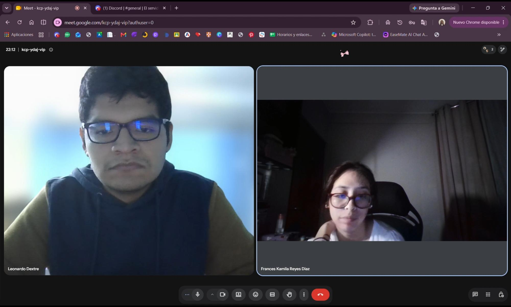
>
> Resumen:
>
> Leonardo Dextre, asistente administrativo de 23 años residente en Ate, necesitó buscar donantes de sangre para su papá antes de un procedimiento médico. Ante esta urgencia, sus primeras acciones consistieron en preguntar dentro de su familia y comunicarse con amigos y conocidos, apoyándose principalmente en WhatsApp y publicaciones en Facebook para difundir la solicitud.
>
> Durante el proceso, lo más complicado para él fue saber quién realmente podía ayudar, ya que muchas personas querían donar pero no tenían el tipo de sangre necesario, estaban lejos o no podían acercarse ese día, lo que obligaba a preguntar una por una.
>
> Para confiar en los donantes, le daría seguridad saber que la persona responde a una solicitud real confirmada por un hospital o clínica, y que está siguiendo el proceso correspondiente en lugar de solo responder a una publicación de internet.
>
> Respecto al uso de tecnología, utiliza frecuentemente WhatsApp, Facebook e Instagram, y se muestra dispuesto a probar una aplicación nueva siempre que sea sencilla y no tenga demasiados pasos, dado que en una emergencia se busca resolver rápido.
>
> Finalmente, utilizaría una aplicación que ayude a encontrar donantes compatibles validados por un centro de salud, aunque le preocuparía la veracidad de la información, la protección de datos y que la plataforma sea seria; asimismo, cambiaría del proceso actual el hecho de que dependa tanto de tener muchos contactos y escribirle a todo el mundo.
>
> **<u>Entrevista 2:</u>**
>
> Entrevistado: Luana Espinoza Cruz
>
> Edad: 18 años
>
> Distrito: Puente Piedra
>
> Fecha de la entrevista: \[19/09/2026\]
>
> Video: [<u>https://youtu.be/9Fd4GNOTsxI</u>](https://youtu.be/9Fd4GNOTsxI)
>
> Captura del video: 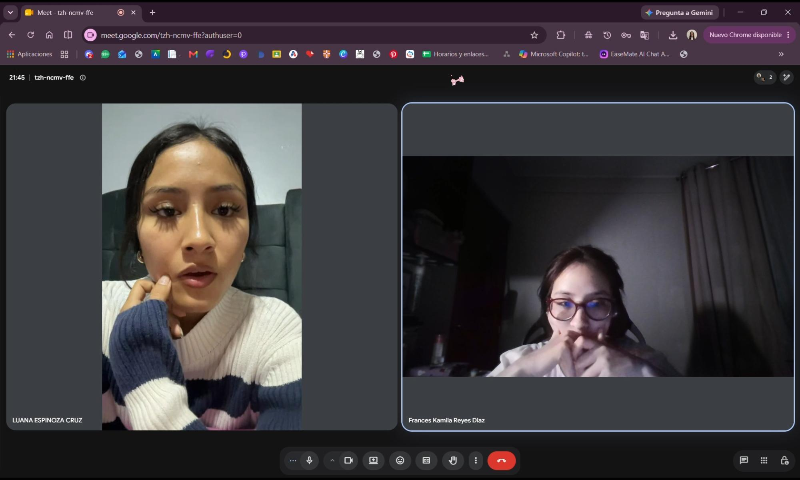
>
> Resumen:
>
> Luana Espinoza Cruz, estudiante de 18 años de la carrera de Medicina Humana y residente en el distrito de Puente Piedra, cuenta con experiencia directa apoyando en la búsqueda de donantes de sangre para familiares y amigos cercanos. Ante una urgencia, sus primeras acciones consisten en consultar de manera directa con su círculo cercano y difundir la solicitud mediante mensajes en WhatsApp y grupos de redes sociales dedicados a la donación.
>
> Durante este proceso, la mayor dificultad a la que se enfrentó fue hallar personas que estuvieran disponibles y realmente cumplieran con todos los requisitos médicos, ya que en ocasiones los voluntarios tenían toda la disposición, pero terminaban siendo rechazados tras los análisis clínicos.
>
> Para confiar en los donantes que responden a un llamado, le da seguridad percibir desde un inicio la disposición y las ganas genuinas de ayudar por parte de las personas.
>
> Respecto al uso de la tecnología, utiliza frecuentemente plataformas como WhatsApp y TikTok, mostrando una alta comodidad y disposición para probar aplicaciones nuevas siempre y cuando sean sencillas e intuitivas; en ese sentido, considera que una app organizada facilitaría enormemente la búsqueda de donantes, aunque su principal preocupación al respecto recae en la seguridad y protección de los datos personales.
>
> Finalmente, al reflexionar sobre el sistema actual de solicitudes, sugirió que lo ideal sería que todo el procedimiento para conseguir sangre fuera mucho más rápido y estructurado.
>
> **<u>Entrevista 3:</u>**
>
> Entrevistado: Carlos Salcedo
>
> Edad: 19 años
>
> Distrito: San Martín de Porres
>
> Fecha de la entrevista: \[19/09/2026\]
>
> Video: [<u>https://youtu.be/9Fd4GNOTsxI</u>](https://youtu.be/9Fd4GNOTsxI)
>
> Captura del video:
>
> 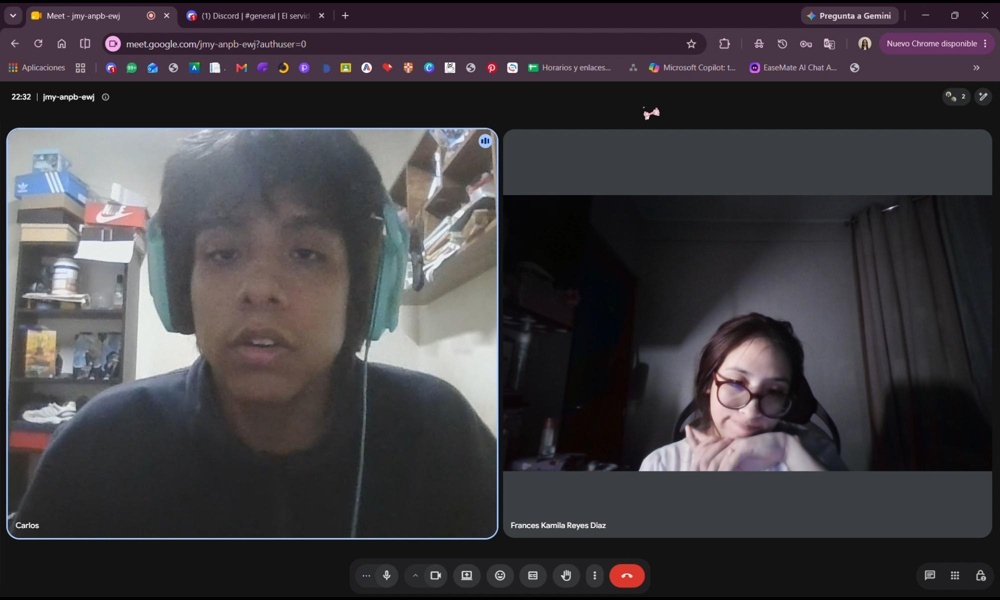
>
> Resumen:
>
> Carlos Salcedo, estudiante de 19 años residente en el distrito de San Martín de Porres, cuenta con experiencia previa ayudando a conseguir donantes para su hermana cuando estuvo hospitalizada. Ante una urgencia de este tipo, sus primeras acciones consisten en llamar a sus hermanos, primos y amigos cercanos para preguntar quién podía acercarse a donar, apoyándose principalmente en WhatsApp y publicaciones en Facebook para difundir la solicitud.
>
> Durante el proceso, lo que más tiempo le tomó fue la coordinación, ya que las personas decían que podían ir pero luego fallaban por trabajo o distancia, o no sabían si su tipo de sangre servía, lo que obligaba a hacer numerosas llamadas y mensajes para confirmar todo.
>
> Para confiar en los donantes, considera importante que la persona esté identificada y que la solicitud provenga directamente de un hospital o institución, con indicaciones claras del tipo de sangre necesario y el lugar de presentación, evitando así compartir información incorrecta.
>
> Respecto al uso de la tecnología, utiliza frecuentemente WhatsApp, Facebook y YouTube, y estaría dispuesto a usar una aplicación nueva si es clara y sin complicaciones, aunque al no ser de descargar muchas apps necesitaría comprobar su verdadera utilidad.
>
> Finalmente, utilizaría una aplicación con solicitudes validadas por un centro de salud si hay urgencia, aunque le preocuparía la veracidad de la información, la exposición de datos familiares y que los donantes realmente cumplan las condiciones; por ello, cambiaría del proceso actual la falta de organización, prefiriendo un sistema centralizado donde se registre la necesidad y ayude a encontrar colaboradores.
>
> ***Segmento 2: Donantes voluntarios***
>
> **<u>Entrevista 1:</u>**
>
> Entrevistado: Herencia Saenz, Jose Gonzalo
>
> Edad: 30 años
>
> Distrito: Puente Piedra
>
> Fecha de la entrevista: \[18/09/2026\]
>
> Video: [<u>https://youtu.be/9Fd4GNOTsxI</u>](https://youtu.be/9Fd4GNOTsxI)
>
> Captura del video:
>
> 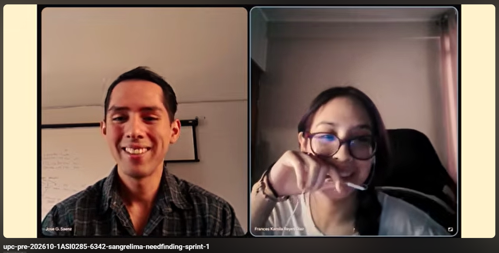
>
> Resumen:
>
> En cuanto a sus datos generales y perfil, José Gonzalo Herencia Saenz tiene 30 años, reside en el distrito de Puente Piedra y trabaja como contador público. Cuenta con experiencia previa como donante, realizando esta acción de manera voluntaria aproximadamente cada tres años. Su motivación inicial surgió a raíz de la solicitud de un amigo cuyo familiar necesitaba donantes, lo que lo llevó a vivir la experiencia y motivarlo a seguir haciéndolo. La primera vez se enteró de la necesidad a través de las redes sociales. Sobre sus motivaciones y factores de confianza, lo que más lo impulsa a donar ante una solicitud específica es el deseo de ayudar a personas que conoce y que sabe que lo necesitan. En cuanto al uso de tecnología, está habituado a aplicaciones como WhatsApp, YouTube y TikTok, y se muestra dispuesto a utilizar apps nuevas si le son recomendadas. Sin embargo, manifestó que le generaría desconfianza participar en solicitudes publicadas a través de una aplicación si esta no es muy conocida. Finalmente, respecto al interés en herramientas digitales y propuestas de mejora, José considera viable el uso de una aplicación orientada a la donación de sangre, aunque le gustaría conocer su funcionamiento y expresó cierta preocupación por la seguridad en los lugares donde se realiza el procedimiento. Como sugerencia de mejora para el proceso actual de donación, indicó que desearía que los trámites fueran más rápidos, ya que en su experiencia anterior llegó a demorar cerca de una hora en concretar el procedimiento.
>
> **<u>Entrevista 2:</u>**
>
> Entrevistado: John Austin Vega Pérez
>
> Edad: 22 años
>
> Distrito: Chiclayo
>
> Fecha de la entrevista: \[19/09/2026\]
>
> Video: [<u>https://youtu.be/9Fd4GNOTsxI</u>](https://youtu.be/9Fd4GNOTsxI)
>
> Captura del video:
>
> 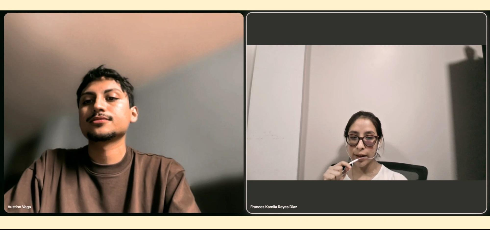
>
> Resumen:
>
> John Austin Vega Pérez, de 22 años, residente en Chiclayo y trabajador freelancer, es un donante frecuente que dona sangre aproximadamente dos veces al año. Su primer contacto con la donación ocurrió hace tres años a través de una campaña informativa organizada en su propio campus universitario, y su principal motivación para participar ante una solicitud específica es el deseo de ayudar a alguien que lo necesite.
>
> En cuanto al uso de herramientas digitales, utiliza frecuentemente aplicaciones de comunicación y entretenimiento como WhatsApp, Instagram y TikTok. Muestra una actitud positiva y cómoda hacia el aprendizaje de nuevas tecnologías, por lo que considera que una aplicación móvil para la donación de sangre sería muy útil para lograr un mayor alcance de personas. No obstante, su principal preocupación al interactuar con una app de este tipo es la desconfianza ante posibles estafas, por lo que evaluaría cuidadosamente la elaboración y estructura de la plataforma.
>
> Finalmente, al reflexionar sobre el proceso actual de donación de sangre, el entrevistado identifica que el principal aspecto por mejorar es la difusión y la información pública. Señala que la falta de conocimiento sobre el proceso real y lo que este conlleva es lo que genera que existan pocas personas que se animen a donar.
>
> **<u>Entrevista 3:</u>**
>
> Entrevistado: Fely Gabriela Villanueva Azulca
>
> Edad: 20 años
>
> Distrito:Ate
>
> Fecha de la entrevista: \[19/09/2026\]
>
> Video: [<u>https://youtu.be/9Fd4GNOTsxI</u>](https://youtu.be/9Fd4GNOTsxI)
>
> Captura del video:
>
> 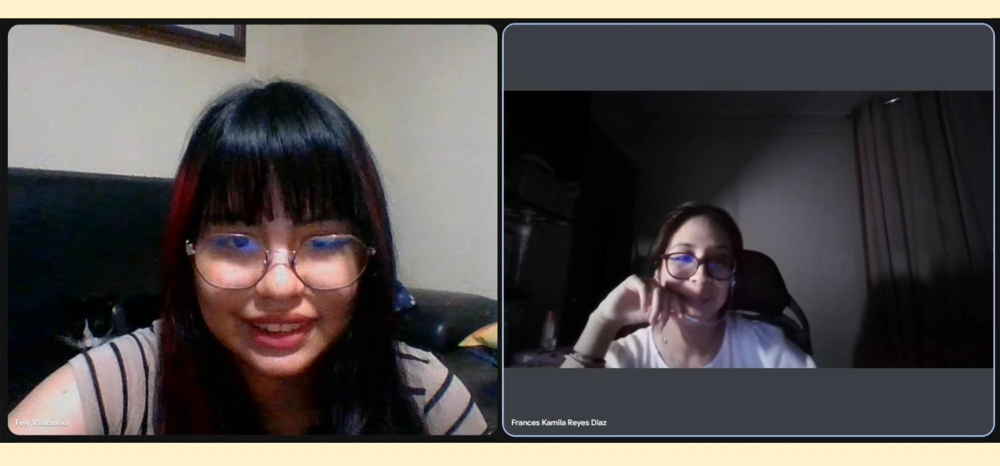
>
> Resumen:
>
> Fely Gabriela Villanueva Azulca, estudiante de 20 años residente en el distrito de Ate, cuenta con una única experiencia previa como donante de sangre realizada hace aproximadamente un año en una campaña organizada en su universidad, a la cual asistió gracias a que una amiga le avisó y la acompañó. En aquella ocasión, el primer paso del proceso consistió en someterla a diversos exámenes médicos para descartar enfermedades y verificar que sus niveles de hemoglobina no estuvieran bajos. Ante una solicitud específica, su principal motivación para donar sería la cercanía o parentesco con la persona afectada y la urgencia del caso. Sin embargo, le generaría desconfianza participar a través de una aplicación si esta no cuenta con el respaldo de instituciones oficiales como ministerios u hospitales, prefiriendo evitar iniciativas particulares o poco conocidas. Aunque utiliza frecuentemente redes sociales y aplicaciones de mensajería como Instagram y WhatsApp, se muestra cautelosa frente a plataformas nuevas destinadas a este fin. Finalmente, al evaluar los aspectos por mejorar del proceso actual, señaló que las dificultades con sus venas generaron estrés en el personal de salud, lo cual incrementó su propia ansiedad y la hizo sentir más nerviosa durante la donación.
>
> ***Segmento 3: Bancos de sangre y centros de salud***
>
> **<u>Entrevista 1:</u>**
>
> Entrevistado: Dylan Jonathan Santiago Salinas
>
> Cargo / institución: Licenciado en enfermería, en el área de Emergencias / Clínica privada
>
> Fecha de la entrevista: \[18/09/2026\]
>
> Video: [<u>https://youtu.be/9Fd4GNOTsxI</u>](https://youtu.be/9Fd4GNOTsxI)
>
> Captura del video:
>
> 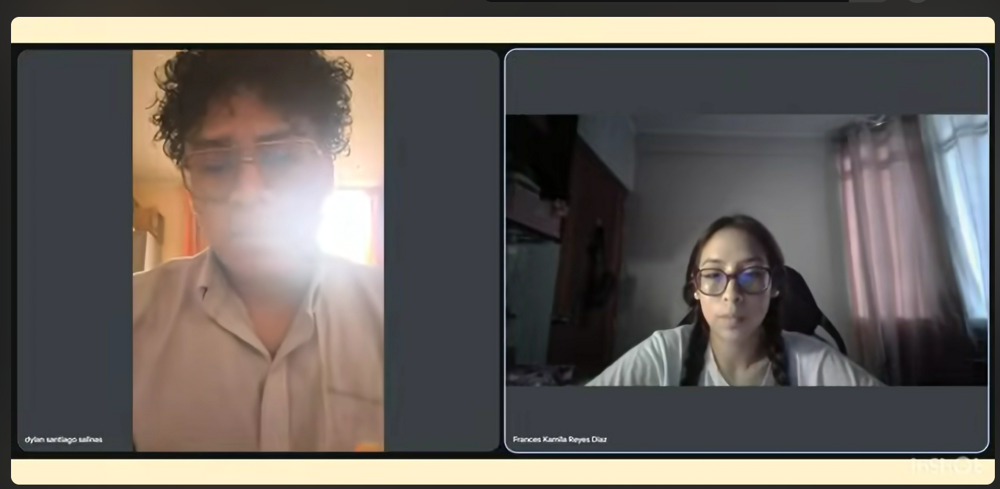
>
> Resumen:
>
> En cuanto a su perfil y contexto institucional, Dylan Jonathan Santiago Salinas se desempeña como licenciado en enfermería en el área de emergencias de la Clínica Doctus, una institución privada que brinda servicios de atención médica de urgencia, contando con más de un año de experiencia en el puesto. Respecto a la gestión de solicitudes y procesos actuales, la clínica maneja un stock establecido de unidades de sangre para emergencias que luego debe ser devuelto o cubierto por el paciente o sus familiares al retirarse. Para este proceso, emplean un sistema mixto que combina documentación física con formularios electrónicos en tablets, donde se evalúan criterios estandarizados a nivel nacional como la edad, el peso, los niveles de hemoglobina y antecedentes de salud, tomando en promedio un día y medio para validar una solicitud. En relación con las dificultades operativas y el nivel de digitalización, el personal enfrenta problemas cotidianos como errores en la escritura de los nombres de los pacientes o la falta de compatibilidad sanguínea de los donantes que aportan los familiares. Aunque actualmente operan de forma mixta, buscan transicionar hacia un entorno más digital mediante firmas y formularios electrónicos por motivos ecológicos. Finalmente, sobre sus expectativas hacia plataformas tecnológicas externas, el entrevistado considera indispensable que cualquier aplicación esté debidamente validada y regularizada por profesionales de la salud, como hematólogos, y respaldada legalmente por el Estado, de modo que se garantice la legitimidad de las solicitudes y se evite el lucro con la donación de sangre.
>
> **<u>Entrevista 2:</u>**
>
> Entrevistado: Guillermo Espinoza Elorreaga
>
> Cargo / institución: Tecnólogo médico
>
> Fecha de la entrevista: \[19/09/2026\]
>
> Video: [<u>https://youtu.be/9Fd4GNOTsxI</u>](https://youtu.be/9Fd4GNOTsxI)
>
> Captura del video:
>
> 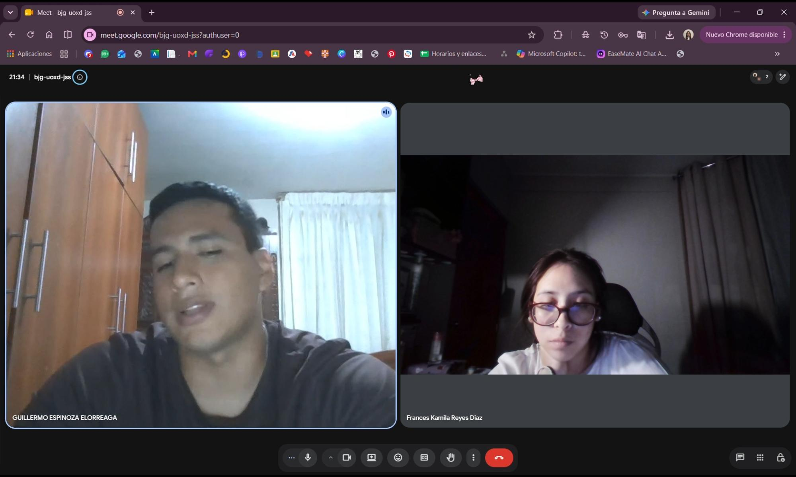
>
> Resumen:
>
> Guillermo Espinoza Elorreaga, tecnólogo médico de 28 años con cinco años de experiencia en el laboratorio y banco de sangre de una clínica privada, gestiona los requerimientos de hemocomponentes que inician los médicos tratantes, los cuales son verificados mediante filtros, entrevistas y pruebas clínicas antes de su uso.
>
> Durante el proceso, el personal enfrenta problemas como la difusión de solicitudes incompletas o duplicadas por parte de las familias, la llegada de donantes que no resultan aptos tras los análisis y la dificultad de encontrar personas que realmente estén disponibles y cumplan con la compatibilidad más allá del grupo sanguíneo.
>
> Para validar la legitimidad, el hospital comprueba que el paciente tenga un requerimiento activo y somete al donante a un riguroso proceso de identificación y selección, tardando un tiempo variable según los análisis posteriores.
>
> Actualmente operan en una etapa de transición digital donde utilizan sistemas informáticos combinados con formatos físicos, por lo que una plataforma externa que conecte con donantes verificados sería de gran ayuda para organizar la disponibilidad y ubicación, siempre y cuando esté respaldada por una institución, proteja los datos personales y actúe como complemento sin reemplazar las evaluaciones del banco de sangre.
>
> **<u>Entrevista 3:</u>**
>
> Entrevistado: Joaquin Ponce
>
> Cargo / institución: Médico cirujano
>
> Fecha de la entrevista: \[19/09/2026\]
>
> Video: [<u>https://youtu.be/9Fd4GNOTsxI</u>](https://youtu.be/9Fd4GNOTsxI)
>
> Captura del video:
>
> 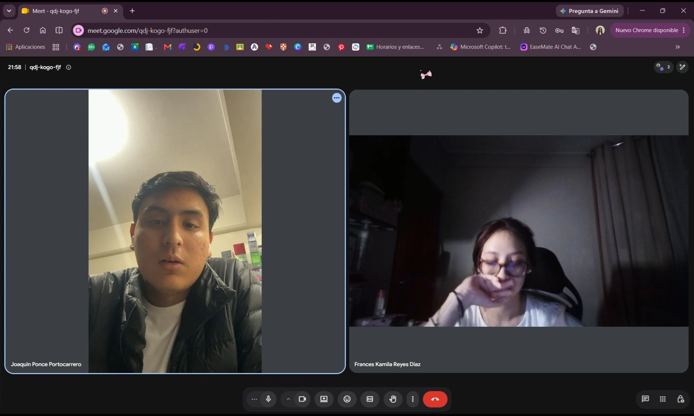
>
> Resumen:
>
> Joaquin, médico cirujano de 26 años con dos años de experiencia en la rotación por emergencia y hospitalización de un hospital de nivel intermedio, gestiona las solicitudes de transfusión mediante formatos en papel y comunicaciones directas con el banco de sangre respaldadas por la historia clínica del paciente.
>
> Durante su labor, se enfrenta a problemas como la angustia de las familias que dependen de su red de contactos, la difusión desactualizada de pedidos en redes sociales cuando el paciente ya no los necesita, y la complicación de que los voluntarios acudan sin cumplir con los criterios de elegibilidad.
>
> Para garantizar la legitimidad, el hospital valida el requerimiento a través del diagnóstico médico y somete al donante a un riguroso filtro de entrevistas y pruebas clínicas, un proceso que puede tomar horas críticas para el paciente.
>
> Actualmente el nivel de digitalización es parcial y los sistemas informáticos no están completamente integrados, por lo que una plataforma externa que organice la difusión y conecte con voluntarios sería un excelente complemento, siempre y cuando esté respaldada por un hospital, cuente con vigencia en las solicitudes, proteja los datos sensibles y respete la evaluación final del banco de sangre.

### 2.2.3. Análisis de entrevistas.

> En esta sección se realiza un análisis por cada segmento objetivo, identificando con sustento estadístico (porcentajes) las características objetivas y subjetivas más comunes de cada segmento, necesarias para la construcción de los arquetipos. La fuente de información proviene de las entrevistas registradas en la sección 2.2.2, evidenciando la relación entre cada característica y los resúmenes de entrevistas correspondientes.
>
> ***Segmento 1: Pacientes y familiares que necesitan una transfusión con urgencia:***
>
> Las entrevistas realizadas a Leonardo, Luana y Carlos evidencian que, ante una necesidad urgente de sangre, la búsqueda comienza siempre dentro del círculo cercano (familia y amigos) y se apoya fuertemente en WhatsApp, y que la confianza en un donante depende de que la solicitud esté respaldada por una institución de salud.
>
> **Características objetivas**

| **Hallazgo** | **Entrevistados relacionados** | **Frecuencia** | **Porcentaje** |
|----|----|----|----|
| Residen en Lima (en distintos distritos) | Leonardo (Ate), Luana (Puente Piedra), Carlos (San Martín de Porres) | 3 de 3 | 100 % |
| Son estudiantes | Luana, Carlos | 2 de 3 | 67 % |
| Cuentan con otra ocupación | Leonardo | 1 de 3 | 33 % |
| Buscaron sangre para un familiar directo (padre / hermana) | Leonardo, Carlos | 2 de 3 | 67 % |
| Buscaron sangre para familiares y amigos cercanos | Luana | 1 de 3 | 33 % |

> **Características subjetivas**

| **Hallazgo** | **Entrevistados relacionados** | **Frecuencia** | **Porcentaje** |
|----|----|----|----|
| Al enterarse de la urgencia, preguntaron primero a familiares y conocidos cercanos | Leonardo, Luana y Carlos | 3 de 3 | 100 % |
| Usaron WhatsApp como principal canal de búsqueda | Leonardo, Luana y Carlos | 3 de 3 | 100 % |
| Recurrieron también a Facebook u otras redes/grupos como canal secundario | Leonardo, Luana y Carlos | 3 de 3 | 100 % |
| Señalan la dificultad de coordinar y confirmar donantes disponibles y compatibles como el mayor obstáculo | Leonardo, Luana y Carlos | 3 de 3 | 100 % |
| La confianza en el donante depende de que la solicitud esté validada por una institución de salud | Leonardo, Carlos | 2 de 3 | 67 % |
| La confianza en el donante depende más de su disposición o ganas de ayudar | Luana | 1 de 3 | 33 % |
| Usan aplicaciones con frecuencia y se sienten cómodos probando apps nuevas si son sencillas | Leonardo, Luana y Carlos | 3 de 3 | 100 % |
| Usarían una aplicación para solicitar sangre si está validada por un centro de salud | Leonardo, Luana y Carlos | 3 de 3 | 100 % |
| Les preocupa la veracidad de la información y la protección de los datos personales | Leonardo, Luana y Carlos | 3 de 3 | 100 % |
| Piden que el proceso dependa menos de la red de contactos personal y sea más organizado o centralizado | Leonardo, Luana y Carlos | 3 de 3 | 100 % |

> El 100 % comenzó preguntando dentro de su círculo cercano. Leonardo indica que lo primero fue “preguntar dentro de mi familia quién podía donar”, para luego recurrir a amigos y conocidos. Luana señala que primero preguntó a “familiares, amigos, personas cercanas” antes de divulgar la necesidad por redes sociales. Carlos precisa que llamó primero a hermanos y primos, y después amplió la búsqueda a amigos y conocidos.
>
> El 100 % usó WhatsApp como canal principal, complementado con Facebook u otras redes. Leonardo y Carlos mencionan haber publicado también en Facebook cuando la red de contactos directa no fue suficiente; Luana divulgó la solicitud en grupos de redes sociales dedicados a donaciones de sangre.
>
> El 100 % coincide en que lo más difícil fue coordinar y confirmar donantes realmente disponibles y compatibles. Leonardo explica que debían preguntar “una por una” porque algunas personas no tenían el tipo de sangre necesario o no podían acercarse ese día. Luana relata que encontró a dos personas dispuestas, pero que “rebotaron” al no cumplir los requisitos tras los análisis. Carlos señala que se hacían “muchas llamadas y mensajes para confirmar todo” porque los donantes cambiaban de disponibilidad o no sabían su tipo de sangre.
>
> El 67 % (Leonardo y Carlos) asocia la confianza en un donante a que la solicitud esté confirmada por un hospital o institución de salud. Leonardo señala que le daría confianza saber que “el hospital o la clínica confirmó que necesita ese tipo de sangre”, y Carlos coincide en que la solicitud debería venir “directamente del hospital o de una institución”. Luana, en cambio, pone el énfasis en la disposición genuina del donante más que en la validación institucional.
>
> El 100 % usaría una aplicación para solicitar sangre si está validada por un centro de salud, y ninguno mostró rechazo hacia la idea. Sin embargo, los tres condicionan esa confianza a la protección de los datos: Leonardo menciona que le preocuparía “que la información sea verdadera y que se protejan los datos del paciente”, Luana señala “la seguridad de los datos personales”, y Carlos teme que “los datos de la familia queden expuestos”.
>
> Finalmente, el 100 % pide un proceso menos dependiente de la red de contactos personal. Leonardo quisiera que el sistema “ayudara a encontrar directamente a personas que podrían donar”, Carlos propone “un solo lugar donde registrar la necesidad”, y Luana resume su expectativa en que el proceso sea “más rápido y organizado”.
>
> Respecto a sus características generales, la edad promedio es de 20 años (Leonardo: 23, Luana: 18, Carlos: 19). Los tres residen en distintos distritos de Lima. El 67 % buscó sangre para un familiar directo (padre o hermana) y el 33 % para familiares y amigos cercanos.
>
> ***Segmento 2: Donantes Voluntarios***
>
> Las entrevistas realizadas a José, Austin y Fely evidencian que la motivación para donar surge principalmente de vínculos cercanos o de campañas organizadas, y que la confianza en canales digitales depende fuertemente de que exista una verificación institucional detrás de la solicitud.
>
> **Características objetivas:**

| **Hallazgo** | **Entrevistados relacionados** | **Frecuencia** | **Porcentaje** |
|----|----|----|----|
| Son hombres | José, Austin | 2 de 3 | 67 % |
| Son mujeres | Fely | 1 de 3 | 33 % |
| Residen en Lima | José, Fely | 2 de 3 | 67 % |
| Residen fuera de Lima | Austin (Chiclayo) | 1 de 3 | 33 % |
| Cuentan con empleo formal | José (contador) | 1 de 3 | 33 % |
| Trabajan como freelancer | Austin | 1 de 3 | 33 % |
| Son estudiantes | Fely | 1 de 3 | 33 % |
| Donan con baja frecuencia (cada 3 años) | José | 1 de 3 | 33 % |
| Donan con frecuencia regular (2 veces al año) | Austin | 1 de 3 | 33 % |
| Son donantes primerizos | Fely | 1 de 3 | 33 % |

> **Características subjetivas**

| **Hallazgo** | **Entrevistados relacionados** | **Frecuencia** | **Porcentaje** |
|----|----|----|----|
| Se motivaron a donar por cercanía con la persona afectada o por una campaña | José, Austin y Fely | 3 de 3 | 100 % |
| Desconfían de aplicaciones no verificadas o poco conocidas | José, Austin y Fely | 3 de 3 | 100 % |
| Usan WhatsApp con frecuencia | José, Austin y Fely | 3 de 3 | 100 % |
| Usan además Instagram o TikTok | Austin y Fely | 2 de 3 | 67 % |
| Se sienten cómodos probando aplicaciones nuevas | José y Austin | 2 de 3 | 67 % |
| Usarían una aplicación para donar si está respaldada por una institución de salud | José, Austin y Fely | 3 de 3 | 100 % |
| Señalan la demora en la atención como una frustración | José | 1 de 3 | 33 % |
| Señalan la falta de información o difusión del proceso como una frustración | Austin | 1 de 3 | 33 % |
| Señalan ansiedad o incomodidad durante la extracción como una frustración | Fely | 1 de 3 | 33 % |

> El 100 % de los entrevistados se motivó a donar por cercanía con la persona afectada o por una campaña organizada. José decidió donar por primera vez porque un amigo tenía un familiar que necesitaba donantes: "me llamó la atención tener esa experiencia y me gustó". Austin y Fely, por su parte, donaron por primera vez a través de campañas realizadas en sus universidades, y Fely añade que la cercanía con la persona o la urgencia del caso son factores que más la motivarían a donar ante una solicitud específica.
>
> El 100 % expresa desconfianza hacia aplicaciones no verificadas o poco conocidas. Austin señala que suele recibir "aplicativos que son con fines de estafa", por lo que verificaría bien ese aspecto antes de participar. Fely menciona que dudaría si la institución detrás de la solicitud "no es algún ministerio o algún hospital". José, de forma similar, indica que tendría dudas si la app "no es muy conocida".
>
> El 100 % usa WhatsApp con frecuencia: José lo combina con YouTube y TikTok, Austin con Instagram y TikTok, y Fely con Instagram. El 67 % (Austin y Fely) usa además Instagram o TikTok como canal habitual, lo que sugiere que estos canales pueden ser útiles para difundir campañas o solicitudes entre donantes jóvenes.
>
> El 67 % (José y Austin) se declara cómodo probando aplicaciones nuevas sin mayor resistencia; José señala que usaría apps nuevas "si me las recomiendan" y Austin afirma que le gusta "probar aplicaciones nuevas" porque son intuitivas. Fely no se pronuncia de forma tan directa, aunque menciona explorar apps similares a TikTok.
>
> El 100 % usaría una aplicación para donar sangre si está respaldada por una institución de salud reconocida. Ninguno mostró rechazo hacia la idea de una app; la condición transversal en los tres casos es la validación institucional.
>
> En cuanto a frustraciones, cada una aparece en el 33 % de la muestra: José señala la demora del trámite presencial ("demoraron casi como una hora"), Austin menciona la falta de información y difusión sobre el proceso de donación, y Fely destaca la ansiedad generada por la dificultad para ubicarle las venas durante la extracción.
>
> Respecto a sus características generales, la edad promedio es de 24 años (José: 30, Austin: 22, Fely: 20). El 67 % son hombres y el 33 % mujer; el 67 % reside en Lima y el 33 % fuera de ella (Austin, en Chiclayo). Las ocupaciones varían entre empleo formal, trabajo freelance y estudios universitarios, y la frecuencia de donación va desde donantes primerizos hasta quienes donan cada 2-3 años.
>
> ***Segmento 3: Bancos de sangre y centros de salud***
>
> Las entrevistas realizadas a Dylan (enfermero de emergencias), Guillermo (tecnólogo médico de laboratorio y banco de sangre) y Joaquín (médico cirujano) ofrecen la perspectiva del segmento institucional. Dos de ellos trabajan en clínicas privadas con servicio de banco de sangre / hemoterapia y uno en un hospital de nivel intermedio, lo que permite contrastar la perspectiva de quien valida al donante con la de quien genera la solicitud como médico tratante.
>
> **Características objetivas**

| **Hallazgo** | **Entrevistados relacionados** | **Frecuencia** | **Porcentaje** |
|----|----|----|----|
| Tiene 26 años | Dylan, Joaquín | 2 de 3 | 67 % |
| Tiene 28 años | Guillermo | 1 de 3 | 33 % |
| Trabaja en una clínica privada con servicio de banco de sangre / hemoterapia | Dylan, Guillermo | 2 de 3 | 67 % |
| Trabaja en un hospital (nivel intermedio, con servicio de banco de sangre) | Joaquín | 1 de 3 | 33 % |
| Ocupa un cargo de enfermería en el área de emergencias | Dylan | 1 de 3 | 33 % |
| Es tecnólogo médico (laboratorio y banco de sangre) | Guillermo | 1 de 3 | 33 % |
| Es médico cirujano | Joaquín | 1 de 3 | 33 % |
| Cuenta con 2 años o menos de experiencia en el área | Dylan (1 año), Joaquín (~2 años) | 2 de 3 | 67 % |
| Cuenta con más de 2 años de experiencia en el área | Guillermo (5 años) | 1 de 3 | 33 % |

> **Características subjetivas**

| **Hallazgo** | **Entrevistados relacionados** | **Frecuencia** | **Porcentaje** |
|----|----|----|----|
| Describe su proceso de gestión como mixto: digital (tablets, sistemas informáticos) y físico (firmas y documentación en papel) | Dylan, Guillermo, Joaquín | 3 de 3 | 100 % |
| Vincula la legitimidad de la solicitud a que corresponda a un paciente real con un requerimiento confirmado por el área asistencial | Guillermo, Joaquín | 2 de 3 | 67 % |
| Valida al donante mediante entrevista y criterios clínicos específicos (edad, hemoglobina, peso, antecedentes) | Dylan, Guillermo, Joaquín | 3 de 3 | 100 % |
| Señala que el tiempo de validación varía según la urgencia o el flujo de atención y no es inmediato | Dylan, Guillermo, Joaquín | 3 de 3 | 100 % |
| Reporta más problemas por información incompleta, duplicada o mal dirigida que por solicitudes falsas | Dylan, Guillermo, Joaquín | 3 de 3 | 100 % |
| Señala que la compatibilidad no depende únicamente del grupo sanguíneo, sino de pruebas adicionales del banco de sangre | Guillermo, Joaquín | 2 de 3 | 67 % |
| Indica que la búsqueda de donantes compatibles depende en gran medida de la red de contactos del paciente o su familia | Dylan, Guillermo, Joaquín | 3 de 3 | 100 % |
| Describe el nivel de digitalización de su institución como intermedio o en transición, no totalmente digital | Dylan, Guillermo, Joaquín | 3 de 3 | 100 % |
| Exige que una plataforma externa esté validada por un profesional de salud o una institución antes de confiar en ella | Dylan, Guillermo, Joaquín | 3 de 3 | 100 % |
| Requiere transparencia sobre quién respalda/administra la plataforma y cómo protege los datos personales | Dylan, Guillermo, Joaquín | 3 de 3 | 100 % |
| Considera que una plataforma externa debería ser un complemento y no un sustituto del proceso institucional | Guillermo, Joaquín | 2 de 3 | 67 % |

> El 100 % de los entrevistados describe su proceso de gestión como una combinación de herramientas digitales y documentación física. Dylan menciona que usan tablets, pero mantienen papel porque “la misma persona tiene que firmar y dar su consentimiento”. Guillermo señala que cuentan con sistemas informáticos, aunque “todavía se utilizan formatos físicos en determinadas etapas”. Joaquín precisa que la historia clínica se maneja en sistema, pero que “las solicitudes de transfusión todavía se hacen en papel en muchos casos”.
>
> El 67 % (Guillermo y Joaquín) vincula la legitimidad de una solicitud a que esté asociada a un paciente real con un requerimiento confirmado por el área asistencial. Joaquín es explícito al señalar que la solicitud es legítima porque “está vinculada a un paciente con historia clínica y una indicación médica justificada”. Dylan, en cambio, centra su respuesta en los criterios clínicos del donante más que en el trámite de la solicitud en sí.
>
> El 100 % describe un proceso de validación del donante basado en entrevista y criterios clínicos específicos. Dylan detalla que se revisan mayoría de edad, niveles de hemoglobina, peso, historial de viajes y de pareja estable. Guillermo menciona identificación, entrevista y selección con criterios definidos, mientras que Joaquín aclara que, aunque él no evalúa al donante directamente, sabe que “no cualquiera puede donar, aunque tenga el grupo sanguíneo correcto”.
>
> El 100 % coincide en que el tiempo de validación no es inmediato y depende del contexto. Dylan indica un promedio de un día y medio. Guillermo señala que la evaluación inicial puede ser rápida, pero que existen procedimientos posteriores que alargan el proceso. Joaquín advierte que, cuando hay que conseguir donantes, “el proceso se alarga bastante” y puede tomar varias horas mientras el paciente espera.
>
> El 100 % reporta más problemas de información incompleta, duplicada o mal dirigida que casos de solicitudes falsas. Dylan menciona apellidos mal escritos que retrasan la donación directa. Guillermo señala que distintos familiares comparten la misma solicitud sin coordinar entre ellos o transmiten información incompleta. Joaquín agrega que los pedidos siguen circulando en redes sociales incluso “cuando el paciente ya no lo necesita o incluso cuando ya fue dado de alta”.
>
> El 67 % (Guillermo y Joaquín) subraya que el grupo sanguíneo no es el único criterio de compatibilidad y que se requieren pruebas adicionales realizadas por el banco de sangre. Joaquín lo resume señalando que “el grupo sanguíneo es solo una parte” del proceso; Dylan también menciona dificultades cuando el tipo de sangre requerido no coincide con el de los contactos cercanos del paciente.
>
> El 100 % coincide en que la búsqueda de donantes compatibles depende en gran medida de la red de contactos del paciente o su familia, lo que genera demoras. Joaquín observa que las familias “no conocen mucho del proceso y se angustian”, y que no existe una forma rápida de identificar quién está disponible cerca con el grupo sanguíneo necesario.
>
> El 100 % describe el nivel de digitalización de su institución como intermedio o en transición, no totalmente digital. Dylan indica que están avanzando hacia el registro electrónico por temas de conservación del medio ambiente; Guillermo lo califica como “una etapa de transición”, y Joaquín como “intermedio o parcial”.
>
> El 100 % exige que cualquier plataforma externa esté validada por un profesional de salud o una institución antes de generar confianza. Dylan requiere que la app esté “verificada por el estado” y respaldada por un profesional como un hematólogo. Guillermo espera mecanismos que eviten “solicitudes falsas o información desactualizada”. Joaquín pide que la solicitud tenga “fecha y vigencia” y se cierre automáticamente cuando ya no sea necesaria.
>
> El 100 % menciona la necesidad de conocer quién respalda y administra la plataforma, así como la forma en que se protegen los datos personales del paciente y del donante, antes de confiar en una solicitud generada por una app externa.
>
> El 67 % (Guillermo y Joaquín) enfatiza que una plataforma externa debería funcionar como un complemento y no como un sustituto del proceso institucional. Joaquín lo resume con claridad: “la plataforma conecta, y el banco de sangre decide”.
>
> Respecto a sus características generales, la edad promedio es de 26.7 años (Dylan: 26, Guillermo: 28, Joaquín: 26). El 67 % trabaja en una clínica privada y el 33 % en un hospital. Los cargos se dividen entre enfermería, tecnología médica y medicina (33 % cada uno), con una experiencia en el área que va desde 1 hasta 5 años.
>
> **Síntesis de los resultados:**
>
> Los pacientes y familiares que buscan sangre con urgencia dependen casi por completo de su red de contactos personal y de WhatsApp, y su mayor frustración es la incertidumbre sobre quién realmente puede ayudar; confiarían en una app siempre que esté validada por un centro de salud y proteja los datos del paciente. Los donantes, por su parte, necesitan sentir que cualquier solicitud proviene de una fuente verificada antes de comprometerse a donar, y valoran canales de comunicación ya familiares (WhatsApp, Instagram) frente a procesos que perciben lentos o poco informados. Los bancos de sangre y centros de salud requieren que cualquier plataforma externa se someta a validación institucional y profesional, y que complemente sin reemplazar los criterios clínicos y normativos que ya aplican para evaluar donantes y solicitudes. El punto en común entre los tres segmentos es claro: la confianza depende de una validación institucional visible, ya sea de un hospital, un ministerio o un profesional de salud.
>
> Estos resultados servirán como fundamento para la elaboración de los User Personas, el User Task Matrix, los User Journey Maps y los Empathy Maps de SangreLima.

## 2.3. Needfinding.

### 2.3.1. User Personas.

> Las siguientes fichas de User Persona se elaboraron a partir del análisis de entrevistas y de los hallazgos del análisis competitivo. Se presenta una ficha por cada uno de los tres segmentos objetivo identificados. Para el Segmento 3, la ficha representa a la persona que opera el proceso dentro de la institución, como un coordinador de banco de sangre o personal administrativo, ya que este segmento corresponde a una institución y no a un usuario individual.
>
> ***Segmento 1: Pacientes y familiares que necesitan transfusión con urgencia***
>
> 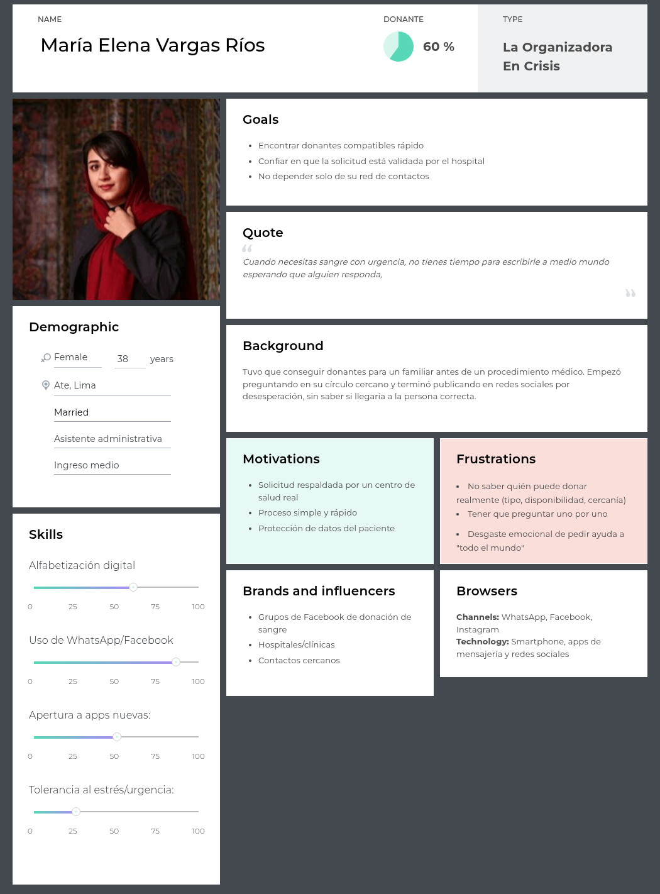
>
> ***Segmento 2: Donantes voluntarios***
>
> 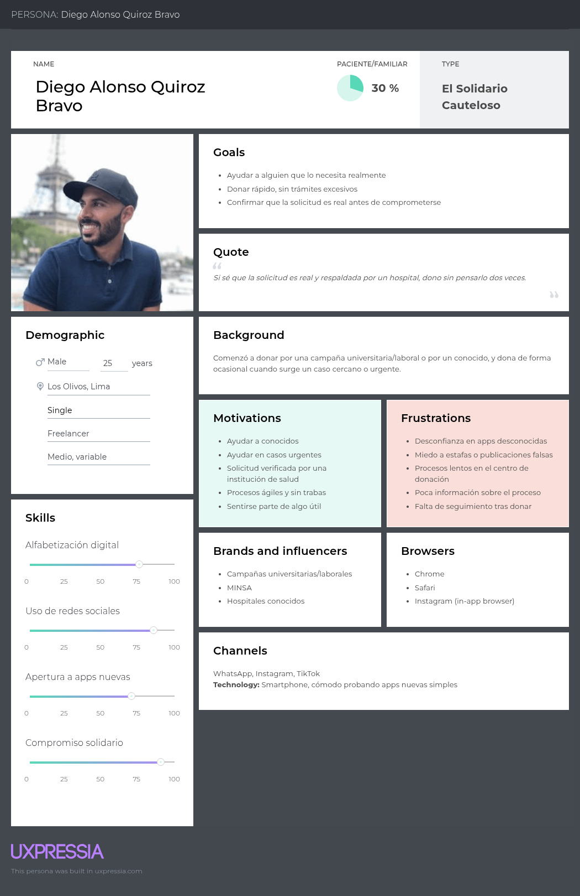
>
> ***Segmento 3: Bancos de sangre y centros de salud***
>
> 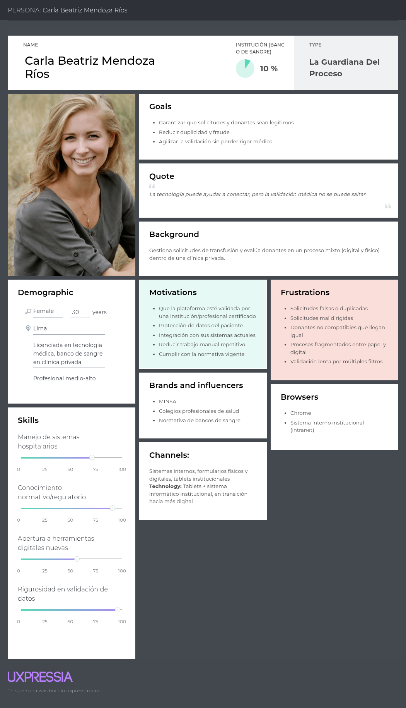

### 2.3.2. User Task Matrix.

> **Segmento Objetivo 1:** Pacientes y familiares que necesitan transfusión con urgencia

<table>
<colgroup>
<col style="width: 33%" />
<col style="width: 33%" />
<col style="width: 33%" />
</colgroup>
<thead>
<tr>
<th colspan="3" style="text-align: center;">Maria Elena Vargas Rios</th>
</tr>
<tr>
<th style="text-align: center;">Actividades</th>
<th style="text-align: center;">Frecuencia</th>
<th style="text-align: center;">Importancia</th>
</tr>
<tr>
<th style="text-align: center;">Detectar la necesidad urgente de transfusión sanguínea</th>
<th style="text-align: center;">Baja</th>
<th style="text-align: center;">Alta</th>
</tr>
<tr>
<th style="text-align: center;">Recopilar datos del paciente</th>
<th style="text-align: center;">Baja</th>
<th style="text-align: center;">Alta</th>
</tr>
<tr>
<th style="text-align: center;">Redactar y difundir solicitudes de ayuda</th>
<th style="text-align: center;">Baja</th>
<th style="text-align: center;">Alta</th>
</tr>
<tr>
<th style="text-align: center;">Responder llamadas de posibles donantes</th>
<th style="text-align: center;">Baja</th>
<th style="text-align: center;">Alta</th>
</tr>
<tr>
<th style="text-align: center;">Gestionar la validación de la solicitud con el centro de salud</th>
<th style="text-align: center;">Baja</th>
<th style="text-align: center;">Alta</th>
</tr>
<tr>
<th style="text-align: center;">Coordinar la asistencia de los voluntarios al hospital</th>
<th style="text-align: center;">Baja</th>
<th style="text-align: center;">Media</th>
</tr>
<tr>
<th style="text-align: center;">Compartir actualización de estado sobre la campaña</th>
<th style="text-align: center;">Ocasional</th>
<th style="text-align: center;">Media</th>
</tr>
<tr>
<th style="text-align: center;">Registrar apoyo a la comunidad</th>
<th style="text-align: center;">Ocasional</th>
<th style="text-align: center;">Baja</th>
</tr>
</thead>
<tbody>
</tbody>
</table>

> **Segmento Objetivo 2:** Donantes voluntarios

<table>
<colgroup>
<col style="width: 33%" />
<col style="width: 33%" />
<col style="width: 33%" />
</colgroup>
<thead>
<tr>
<th colspan="3" style="text-align: center;">Diego Alonso Quiroz Bravo</th>
</tr>
<tr>
<th style="text-align: center;">Actividades</th>
<th style="text-align: center;">Frecuencia</th>
<th style="text-align: center;">Importancia</th>
</tr>
<tr>
<th style="text-align: center;">Revisar solicitud de donaciones</th>
<th style="text-align: center;">Frecuente</th>
<th style="text-align: center;">Alta</th>
</tr>
<tr>
<th style="text-align: center;">Evaluar la confiabilidad de la solicitud</th>
<th style="text-align: center;">Frecuente</th>
<th style="text-align: center;">Alta</th>
</tr>
<tr>
<th style="text-align: center;">Verificar la compatibilidad del tipo de sangre</th>
<th style="text-align: center;">Ocasional</th>
<th style="text-align: center;">Alta</th>
</tr>
<tr>
<th style="text-align: center;">Organizar agenda personal</th>
<th style="text-align: center;">Ocasional</th>
<th style="text-align: center;">Alta</th>
</tr>
<tr>
<th style="text-align: center;">Confirmar disponibilidad</th>
<th style="text-align: center;">Ocasional</th>
<th style="text-align: center;">Alta</th>
</tr>
<tr>
<th style="text-align: center;">Trasladarse al centro de salud</th>
<th style="text-align: center;">Ocasional</th>
<th style="text-align: center;">Alta</th>
</tr>
<tr>
<th style="text-align: center;">Registrar su historial de donación y tiempo de espera</th>
<th style="text-align: center;">Ocasional</th>
<th style="text-align: center;">Media</th>
</tr>
</thead>
<tbody>
</tbody>
</table>

> **Segmento Objetivo 3:** Bancos de sangre y centros de salud

<table>
<colgroup>
<col style="width: 33%" />
<col style="width: 33%" />
<col style="width: 33%" />
</colgroup>
<thead>
<tr>
<th colspan="3" style="text-align: center;">Carla Beatriz Mendoza Ríos</th>
</tr>
<tr>
<th style="text-align: center;">Actividades</th>
<th style="text-align: center;">Frecuencia</th>
<th style="text-align: center;">Importancia</th>
</tr>
<tr>
<th style="text-align: center;">Revisar y verificar solicitudes de transfusión</th>
<th style="text-align: center;">Diaria</th>
<th style="text-align: center;">Alta</th>
</tr>
<tr>
<th style="text-align: center;">Validar la legitimidad de los donantes</th>
<th style="text-align: center;">Diaria</th>
<th style="text-align: center;">Alta</th>
</tr>
<tr>
<th style="text-align: center;">Gestionar stock de unidades de sangre</th>
<th style="text-align: center;">Diaria</th>
<th style="text-align: center;">Alta</th>
</tr>
<tr>
<th style="text-align: center;">Coordinar protocolos de compatibilidad</th>
<th style="text-align: center;">Diaria</th>
<th style="text-align: center;">Alta</th>
</tr>
<tr>
<th style="text-align: center;">Supervisar proceso de triaje y extracción</th>
<th style="text-align: center;">Frecuente</th>
<th style="text-align: center;">Alta</th>
</tr>
<tr>
<th style="text-align: center;">Registrar información</th>
<th style="text-align: center;">Frecuente</th>
<th style="text-align: center;">Media</th>
</tr>
<tr>
<th style="text-align: center;">Resolver incidencias por errores o donantes no aptos</th>
<th style="text-align: center;">Ocasional</th>
<th style="text-align: center;">Media</th>
</tr>
<tr>
<th style="text-align: center;">Revisar reportes normativos</th>
<th style="text-align: center;">Ocasional</th>
<th style="text-align: center;">Media</th>
</tr>
</thead>
<tbody>
</tbody>
</table>

### 

### 2.3.3. User Journey Mapping 

**Segmento Objetivo 1:**Pacientes y familiares que necesitan transfusión con urgencia

### 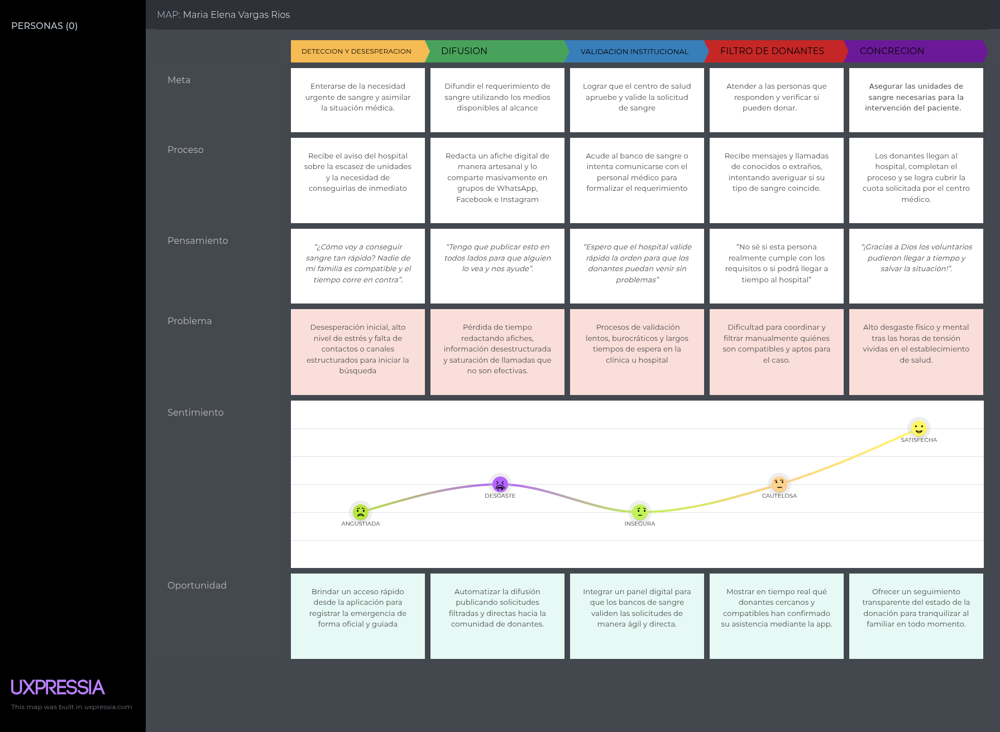

> **Segmento Objetivo 2:** Donantes voluntarios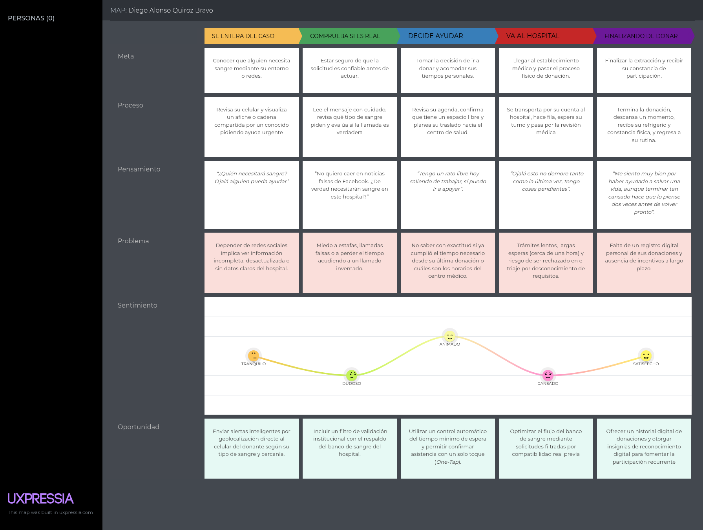
>
> **Segmento Objetivo 3:** Bancos de sangre y centros de salud
>
> 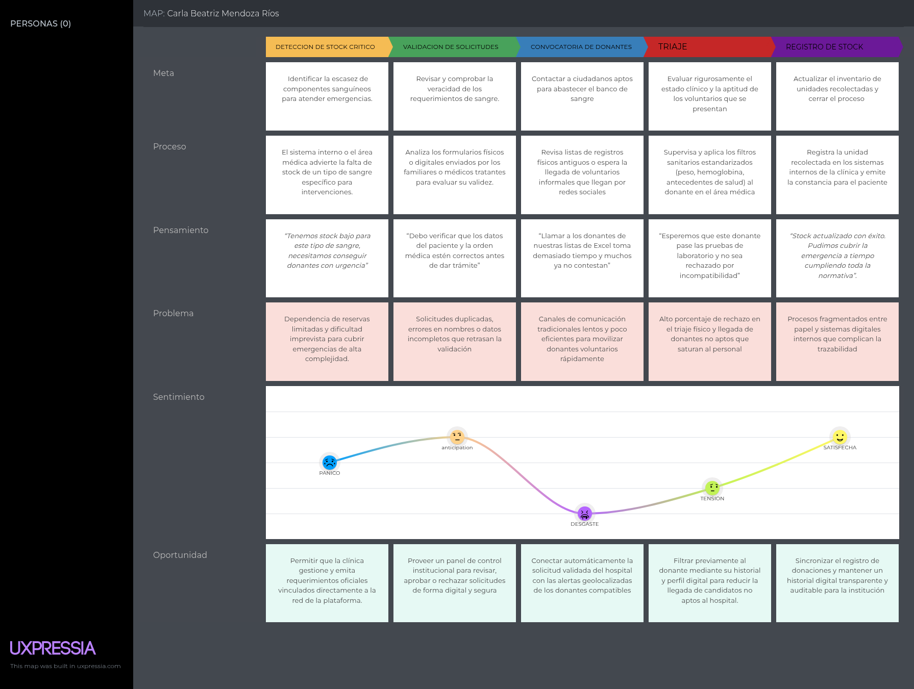

### 

### 

### 2.3.4. Empathy Mapping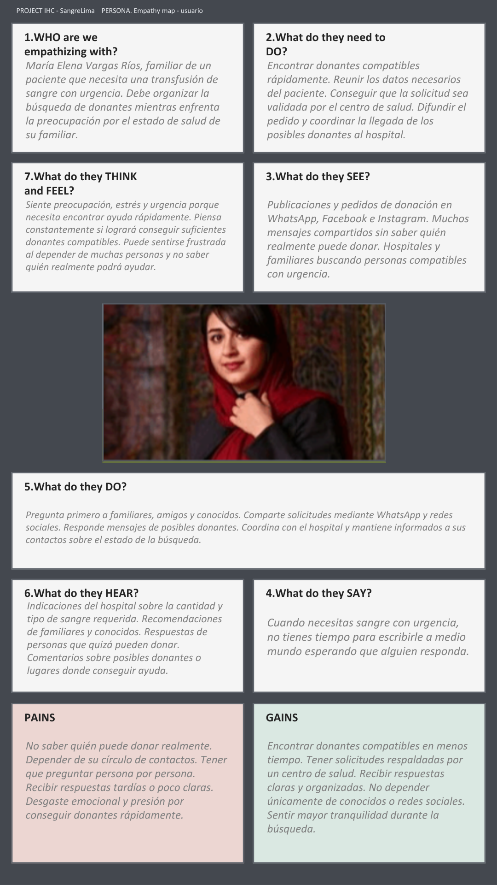

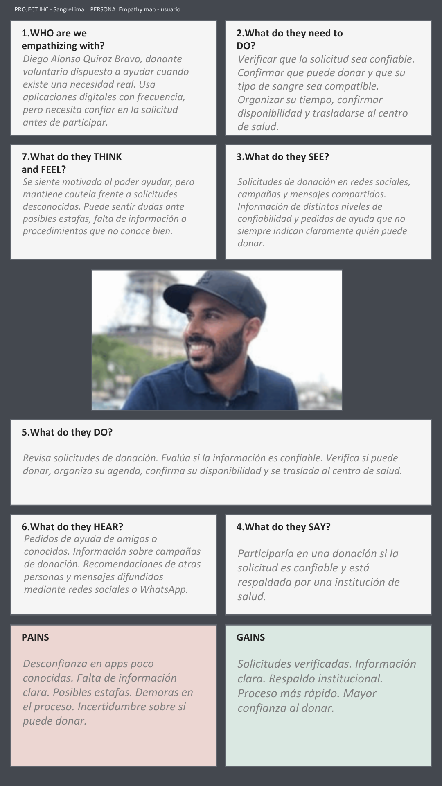

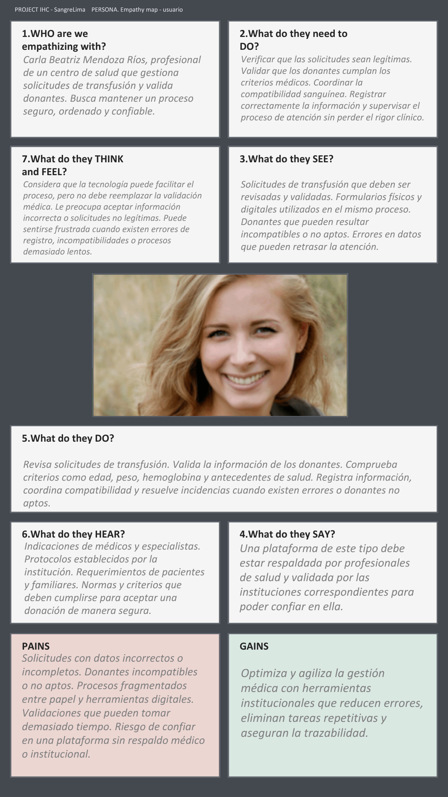

### 2.3.5. As-is Scenario Mapping

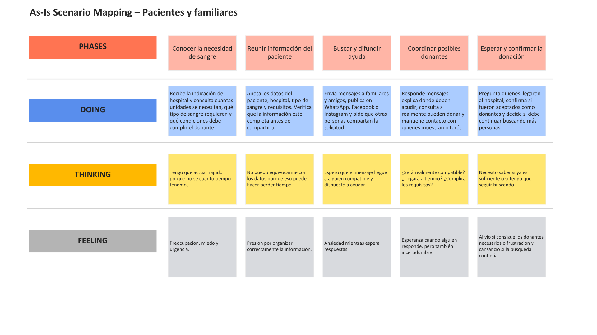

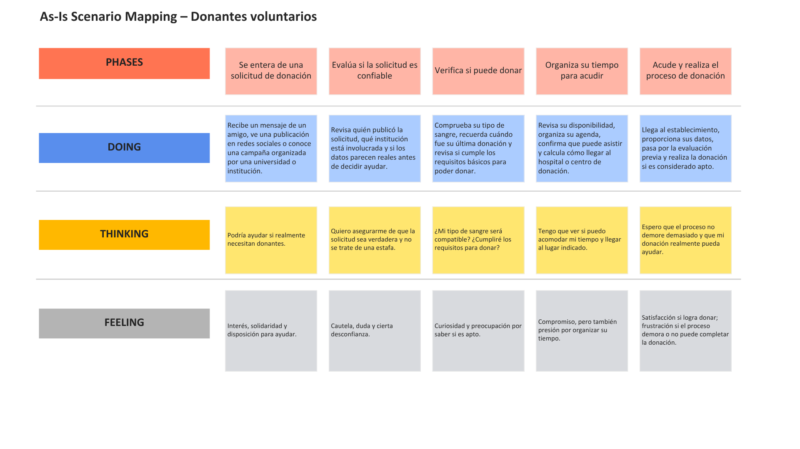

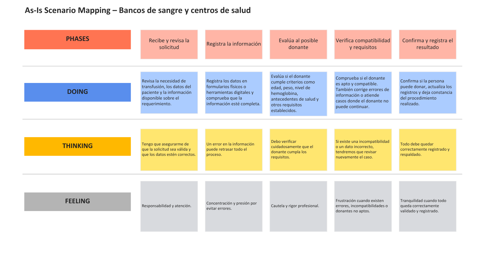

# Capítulo III: Requirements Specification 

## 3.1. To-Be Scenario Mapping. 

El To-Be Scenario Mapping muestra cómo sería la experiencia de cada usuario al utilizar SangreLima y cómo cambiaría su forma de buscar y coordinar donantes. La idea es pasar de depender de mensajes por WhatsApp y llamadas, que muchas veces hacen que el proceso sea más lento y complicado, a tener una forma más organizada, rápida y segura de encontrar donantes cercanos y verificar que puedan donar. Para ello, se elaboró un mapa para cada persona: María Elena Vargas Ríos, Diego Alonso Quiroz Bravo y Carla Beatriz Mendoza Ríos. Estos mapas se desarrollaron tomando como referencia el As-Is Scenario Mapping y los User Journey Maps del capítulo II, con el fin de comparar la situación actual con la experiencia que se busca ofrecer mediante SangreLima.

### Proceso realizado:

- Primero, revisamos los As-Is Scenario Maps, los Empathy Maps y las dificultades y beneficios identificados para cada persona. Con esta información, definimos cómo sería su experiencia al utilizar SangreLima.

- Cada integrante propuso ideas en post-its sobre cómo cambiarían las acciones, los pensamientos y las emociones de cada persona al usar la aplicación.

- Después, revisamos las propuestas en equipo, juntamos las que eran similares y descartamos aquellas que no ayudaban a resolver los problemas identificados. Nos enfocamos en las necesidades encontradas durante las entrevistas, como contar con solicitudes verificadas por instituciones de salud, recibir alertas según la compatibilidad y depender menos de llamadas y contactos personales.

- Organizamos la experiencia en cinco fases para cada persona. Mantuvimos la misma cantidad de fases que en el As-Is Scenario Mapping para que fuera más fácil comparar la situación actual con la experiencia que se espera lograr con SangreLima.

- Finalmente, comparamos cada fase con su equivalente en el escenario actual para identificar los cambios que ofrecería SangreLima y cómo ayudaría a mejorar la experiencia de cada persona.

<!-- -->

- **To-Be Scenario Mapping, María Elena Vargas Ríos (Pacientes y familiares)**

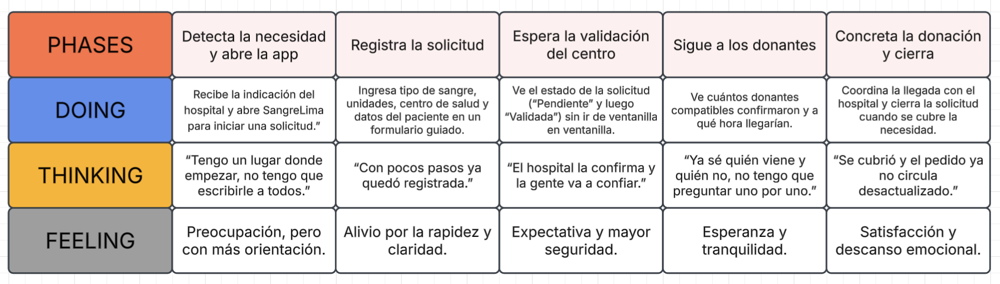

- **To-Be Scenario Mapping, Diego Alonso Quiroz Bravo (Donantes voluntarios)**

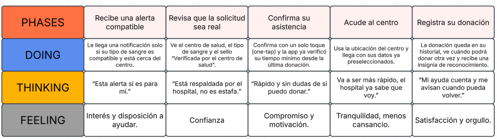

- **To-Be Scenario Mapping, Carla Beatriz Mendoza Ríos (Bancos de sangre y centros de salud)**

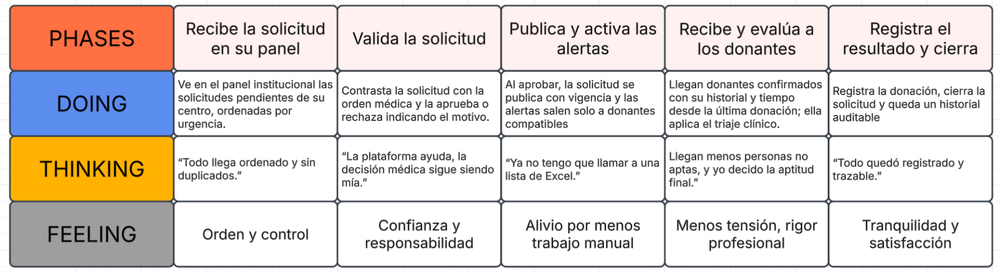

***<u>Comparación con el As-Is:</u>***

María Elena ya no tendría que publicar afiches ni contactar a cada persona por separado para conseguir donantes. Con SangreLima, podría registrar una sola solicitud y saber cuáles son los donantes que han confirmado su disponibilidad. Esto le ayudaría a sentirse más tranquila, ya que podría seguir el proceso sin tanta angustia ni incertidumbre.

Diego, por su parte, podría comprobar que las solicitudes son confiables antes de responder a ellas. En lugar de tener dudas sobre si se trata de una estafa o acudir sin saber si cumple con los requisitos para donar, recibiría alertas verificadas según su tipo de sangre, compatibilidad y tiempo transcurrido desde su última donación. Además, podría consultar su historial y recibir reconocimientos por su participación, algo que no tiene actualmente.

En el caso de Carla, SangreLima le permitiría dejar de depender de formularios físicos y archivos de Excel para organizar las solicitudes. Desde un solo panel podría revisarlas, comprobar su información y recibir una lista de donantes preseleccionados. Sin embargo, la plataforma serviría como apoyo para agilizar el trabajo del banco de sangre, sin reemplazar la evaluación que realiza el personal de salud.

En general, los tres escenarios muestran una mejora en la experiencia de cada persona. Desde las primeras etapas, la confianza y la tranquilidad reemplazan gran parte de la angustia y las dudas que existen en el proceso actual. Esto se debe a que SangreLima permite tener información más clara, solicitudes verificadas y una mejor organización de todo el proceso de donación.

## 3.2. User Stories. 

- **EP01:** Gestión de solicitudes de sangre

- **EP02:** Validación institucional de solicitudes

- **EP03:** Matching y elegibilidad de donantes

- **EP04:** Alertas y notificaciones segmentadas

- **EP05:** Respuesta y coordinación de la donación

- **EP06:** Historial y recurrencia del donante

- **EP07:** Gestión institucional del centro de salud

- **EP08:** Confianza e información verificada

<table>
<colgroup>
<col style="width: 24%" />
<col style="width: 32%" />
<col style="width: 25%" />
<col style="width: 17%" />
</colgroup>
<thead>
<tr>
<th>User Story ID</th>
<th>US01</th>
<th>Epic ID</th>
<th>EP01</th>
</tr>
<tr>
<th>Título:</th>
<th colspan="3">Registrar una solicitud urgente de sangre</th>
</tr>
<tr>
<th>Descripción:</th>
<th colspan="3">Como familiar de un paciente, deseo registrar una solicitud urgente de sangre para iniciar rápidamente la búsqueda de donantes compatibles.</th>
</tr>
<tr>
<th>Criterios de Aceptación:</th>
<th colspan="3">
Dado que necesito sangre para un paciente

Cuando completo los datos obligatorios de la solicitud y la envío

Entonces la solicitud queda registrada con estado pendiente de validación.
</th>
</tr>
</thead>
<tbody>
</tbody>
</table>

<table>
<colgroup>
<col style="width: 25%" />
<col style="width: 25%" />
<col style="width: 25%" />
<col style="width: 25%" />
</colgroup>
<thead>
<tr>
<th>User Story ID</th>
<th>US02</th>
<th>Epic ID</th>
<th>EP01</th>
</tr>
<tr>
<th>Título:</th>
<th colspan="3">Indicar el tipo de sangre requerido</th>
</tr>
<tr>
<th>Descripción:</th>
<th colspan="3">Como familiar de un paciente, deseo indicar el tipo de sangre requerido para que la búsqueda se dirija a donantes compatibles.</th>
</tr>
<tr>
<th>Criterios de Aceptación:</th>
<th colspan="3">
Dado que estoy creando una solicitud

Cuando selecciono el grupo y factor sanguíneo requerido

Entonces el sistema guarda ese dato como criterio de compatibilidad.
</th>
</tr>
</thead>
<tbody>
</tbody>
</table>

<table>
<colgroup>
<col style="width: 25%" />
<col style="width: 25%" />
<col style="width: 25%" />
<col style="width: 25%" />
</colgroup>
<thead>
<tr>
<th>User Story ID</th>
<th>US03</th>
<th>Epic ID</th>
<th>EP01</th>
</tr>
<tr>
<th>Título:</th>
<th colspan="3">Indicar la cantidad de unidades requeridas</th>
</tr>
<tr>
<th>Descripción:</th>
<th colspan="3">Como familiar de un paciente, deseo registrar cuántas unidades de sangre se necesitan para comunicar con claridad la magnitud de la solicitud.</th>
</tr>
<tr>
<th>Criterios de Aceptación:</th>
<th colspan="3">
Dado que estoy completando una solicitud

Cuando ingreso la cantidad de unidades requeridas

Entonces el sistema muestra y conserva la cantidad necesaria para el caso.
</th>
</tr>
</thead>
<tbody>
</tbody>
</table>

<table>
<colgroup>
<col style="width: 25%" />
<col style="width: 25%" />
<col style="width: 25%" />
<col style="width: 25%" />
</colgroup>
<thead>
<tr>
<th>User Story ID</th>
<th>US04</th>
<th>Epic ID</th>
<th>EP01</th>
</tr>
<tr>
<th>Título:</th>
<th colspan="3">Vincular la solicitud a un centro de salud</th>
</tr>
<tr>
<th>Descripción:</th>
<th colspan="3">Como familiar de un paciente, deseo seleccionar el hospital, clínica o banco de sangre relacionado para que los donantes sepan dónde se realizará la donación.</th>
</tr>
<tr>
<th>Criterios de Aceptación:</th>
<th colspan="3">
Dado que estoy registrando una solicitud

Cuando selecciono un establecimiento de salud disponible

Entonces la solicitud queda vinculada a ese establecimiento.
</th>
</tr>
</thead>
<tbody>
</tbody>
</table>

<table>
<colgroup>
<col style="width: 25%" />
<col style="width: 25%" />
<col style="width: 25%" />
<col style="width: 25%" />
</colgroup>
<thead>
<tr>
<th>User Story ID</th>
<th>US05</th>
<th>Epic ID</th>
<th>EP01</th>
</tr>
<tr>
<th>Título:</th>
<th colspan="3">Registrar la ubicación del punto de donación</th>
</tr>
<tr>
<th>Descripción:</th>
<th colspan="3">Como familiar de un paciente, deseo registrar la ubicación del centro de salud para que los posibles donantes puedan evaluar la cercanía antes de responder.</th>
</tr>
<tr>
<th>Criterios de Aceptación:</th>
<th colspan="3">
Dado que la solicitud está vinculada a un centro de salud

Cuando consulto la ubicación registrada

Entonces el sistema muestra el punto de donación asociado a la solicitud.
</th>
</tr>
</thead>
<tbody>
</tbody>
</table>

<table>
<colgroup>
<col style="width: 25%" />
<col style="width: 25%" />
<col style="width: 25%" />
<col style="width: 25%" />
</colgroup>
<thead>
<tr>
<th>User Story ID</th>
<th>US06</th>
<th>Epic ID</th>
<th>EP01</th>
</tr>
<tr>
<th>Título:</th>
<th colspan="3">Definir el nivel de urgencia de la solicitud</th>
</tr>
<tr>
<th>Descripción:</th>
<th colspan="3">Como familiar de un paciente, deseo indicar el nivel de urgencia para que los posibles donantes comprendan la prioridad del caso.</th>
</tr>
<tr>
<th>Criterios de Aceptación:</th>
<th colspan="3">
Dado que estoy completando una solicitud

Cuando selecciono el nivel de urgencia permitido

Entonces la solicitud queda identificada visualmente con esa prioridad.
</th>
</tr>
</thead>
<tbody>
</tbody>
</table>

<table>
<colgroup>
<col style="width: 25%" />
<col style="width: 25%" />
<col style="width: 25%" />
<col style="width: 25%" />
</colgroup>
<thead>
<tr>
<th>User Story ID</th>
<th>US07</th>
<th>Epic ID</th>
<th>EP01</th>
</tr>
<tr>
<th>Título:</th>
<th colspan="3">Revisar la solicitud antes de enviarla</th>
</tr>
<tr>
<th>Descripción:</th>
<th colspan="3">Como familiar de un paciente, deseo revisar un resumen de la solicitud antes de enviarla para reducir errores en los datos compartidos.</th>
</tr>
<tr>
<th>Criterios de Aceptación:</th>
<th colspan="3">
Dado que he completado los datos de la solicitud

Cuando selecciono la opción de revisar

Entonces el sistema muestra un resumen y me permite volver a editar antes del envío.
</th>
</tr>
</thead>
<tbody>
</tbody>
</table>

<table>
<colgroup>
<col style="width: 25%" />
<col style="width: 25%" />
<col style="width: 25%" />
<col style="width: 25%" />
</colgroup>
<thead>
<tr>
<th>User Story ID</th>
<th>US08</th>
<th>Epic ID</th>
<th>EP01</th>
</tr>
<tr>
<th>Título:</th>
<th colspan="3">Consultar el avance de la solicitud</th>
</tr>
<tr>
<th>Descripción:</th>
<th colspan="3">Como familiar de un paciente, deseo consultar el estado de mi solicitud y la cantidad de donantes confirmados para saber si aún debo continuar buscando ayuda.</th>
</tr>
<tr>
<th>Criterios de Aceptación:</th>
<th colspan="3">
Dado que tengo una solicitud activa

Cuando ingreso al detalle de la solicitud

Entonces visualizo su estado y el avance de confirmaciones recibidas.
</th>
</tr>
</thead>
<tbody>
</tbody>
</table>

<table>
<colgroup>
<col style="width: 25%" />
<col style="width: 25%" />
<col style="width: 25%" />
<col style="width: 25%" />
</colgroup>
<thead>
<tr>
<th>User Story ID</th>
<th>US09</th>
<th>Epic ID</th>
<th>EP02</th>
</tr>
<tr>
<th>Título:</th>
<th colspan="3">Recibir solicitudes pendientes de validación</th>
</tr>
<tr>
<th>Descripción:</th>
<th colspan="3">Como personal autorizado de un centro de salud, deseo visualizar las solicitudes vinculadas a mi establecimiento para revisar su legitimidad antes de difundirlas.</th>
</tr>
<tr>
<th>Criterios de Aceptación:</th>
<th colspan="3">
Dado que existe una solicitud asociada al establecimiento

Cuando accedo a la bandeja de solicitudes pendientes

Entonces el sistema muestra la solicitud para su revisión.
</th>
</tr>
</thead>
<tbody>
</tbody>
</table>

<table>
<colgroup>
<col style="width: 25%" />
<col style="width: 25%" />
<col style="width: 25%" />
<col style="width: 25%" />
</colgroup>
<thead>
<tr>
<th>User Story ID</th>
<th>US10</th>
<th>Epic ID</th>
<th>EP02</th>
</tr>
<tr>
<th>Título:</th>
<th colspan="3">Verificar los datos de una solicitud</th>
</tr>
<tr>
<th>Descripción:</th>
<th colspan="3">Como personal autorizado de un centro de salud, deseo revisar los datos clínicos y administrativos esenciales de la solicitud para comprobar que correspondan a una necesidad real.</th>
</tr>
<tr>
<th>Criterios de Aceptación:</th>
<th colspan="3">
Dado que una solicitud está pendiente de validación

Cuando reviso su información

Entonces puedo comprobar los datos necesarios antes de aprobarla o rechazarla.
</th>
</tr>
</thead>
<tbody>
</tbody>
</table>

<table>
<colgroup>
<col style="width: 25%" />
<col style="width: 25%" />
<col style="width: 25%" />
<col style="width: 25%" />
</colgroup>
<thead>
<tr>
<th>User Story ID</th>
<th>US11</th>
<th>Epic ID</th>
<th>EP02</th>
</tr>
<tr>
<th>Título:</th>
<th colspan="3">Solicitar correcciones al solicitante</th>
</tr>
<tr>
<th>Descripción:</th>
<th colspan="3">Como personal autorizado de un centro de salud, deseo solicitar la corrección de datos incompletos o incorrectos para evitar publicar solicitudes con información errónea.</th>
</tr>
<tr>
<th>Criterios de Aceptación:</th>
<th colspan="3">
Dado que detecto información incompleta o incorrecta

Cuando marco la solicitud para corrección e indico el motivo

Entonces el solicitante recibe la observación y puede actualizar los datos.
</th>
</tr>
</thead>
<tbody>
</tbody>
</table>

<table>
<colgroup>
<col style="width: 25%" />
<col style="width: 25%" />
<col style="width: 25%" />
<col style="width: 25%" />
</colgroup>
<thead>
<tr>
<th>User Story ID</th>
<th>US12</th>
<th>Epic ID</th>
<th>EP02</th>
</tr>
<tr>
<th>Título:</th>
<th colspan="3">Aprobar una solicitud de sangre</th>
</tr>
<tr>
<th>Descripción:</th>
<th colspan="3">Como personal autorizado de un centro de salud, deseo aprobar una solicitud verificada para que pueda ser enviada a donantes compatibles.</th>
</tr>
<tr>
<th>Criterios de Aceptación:</th>
<th colspan="3">
Dado que la información de una solicitud es válida

Cuando confirmo su aprobación

Entonces la solicitud cambia a estado validada y queda habilitada para el proceso de matching.
</th>
</tr>
</thead>
<tbody>
</tbody>
</table>

<table>
<colgroup>
<col style="width: 25%" />
<col style="width: 25%" />
<col style="width: 25%" />
<col style="width: 25%" />
</colgroup>
<thead>
<tr>
<th>User Story ID</th>
<th>US13</th>
<th>Epic ID</th>
<th>EP02</th>
</tr>
<tr>
<th>Título:</th>
<th colspan="3">Rechazar una solicitud inválida</th>
</tr>
<tr>
<th>Descripción:</th>
<th colspan="3">Como personal autorizado de un centro de salud, deseo rechazar una solicitud que no pueda validarse para impedir que se difunda información no confiable.</th>
</tr>
<tr>
<th>Criterios de Aceptación:</th>
<th colspan="3">
Dado que una solicitud no cumple las condiciones de validación

Cuando selecciono rechazar e ingreso un motivo

Entonces la solicitud queda rechazada y no se envían alertas a donantes.
</th>
</tr>
</thead>
<tbody>
</tbody>
</table>

<table>
<colgroup>
<col style="width: 25%" />
<col style="width: 25%" />
<col style="width: 25%" />
<col style="width: 25%" />
</colgroup>
<thead>
<tr>
<th>User Story ID</th>
<th>US14</th>
<th>Epic ID</th>
<th>EP02</th>
</tr>
<tr>
<th>Título:</th>
<th colspan="3">Mostrar la validación institucional</th>
</tr>
<tr>
<th>Descripción:</th>
<th colspan="3">Como donante voluntario, deseo identificar claramente que una solicitud fue validada por un establecimiento de salud para confiar en que la necesidad es legítima.</th>
</tr>
<tr>
<th>Criterios de Aceptación:</th>
<th colspan="3">
Dado que una solicitud fue aprobada por un establecimiento

Cuando visualizo su detalle

Entonces el sistema muestra el estado de validación y el centro de salud responsable.
</th>
</tr>
</thead>
<tbody>
</tbody>
</table>

<table>
<colgroup>
<col style="width: 25%" />
<col style="width: 25%" />
<col style="width: 25%" />
<col style="width: 25%" />
</colgroup>
<thead>
<tr>
<th>User Story ID</th>
<th>US15</th>
<th>Epic ID</th>
<th>EP02</th>
</tr>
<tr>
<th>Título:</th>
<th colspan="3">Detectar solicitudes duplicadas</th>
</tr>
<tr>
<th>Descripción:</th>
<th colspan="3">Como personal autorizado de un centro de salud, deseo identificar solicitudes activas que parezcan duplicadas para reducir confusión y difusión repetida del mismo caso.</th>
</tr>
<tr>
<th>Criterios de Aceptación:</th>
<th colspan="3">
Dado que se registra una nueva solicitud con datos coincidentes con otra activa

Cuando el sistema detecta una posible duplicidad

Entonces muestra una advertencia para que el personal la revise antes de aprobarla.
</th>
</tr>
</thead>
<tbody>
</tbody>
</table>

<table>
<colgroup>
<col style="width: 25%" />
<col style="width: 25%" />
<col style="width: 25%" />
<col style="width: 25%" />
</colgroup>
<thead>
<tr>
<th>User Story ID</th>
<th>US16</th>
<th>Epic ID</th>
<th>EP03</th>
</tr>
<tr>
<th>Título:</th>
<th colspan="3">Registrar el tipo de sangre del donante</th>
</tr>
<tr>
<th>Descripción:</th>
<th colspan="3">Como donante voluntario, deseo registrar mi grupo y factor sanguíneo para recibir únicamente solicitudes compatibles con mi perfil.</th>
</tr>
<tr>
<th>Criterios de Aceptación:</th>
<th colspan="3">
Dado que estoy configurando mi perfil de donante

Cuando registro mi grupo y factor sanguíneo

Entonces el sistema los utiliza como datos para el matching de solicitudes.
</th>
</tr>
</thead>
<tbody>
</tbody>
</table>

<table>
<colgroup>
<col style="width: 25%" />
<col style="width: 25%" />
<col style="width: 25%" />
<col style="width: 25%" />
</colgroup>
<thead>
<tr>
<th>User Story ID</th>
<th>US17</th>
<th>Epic ID</th>
<th>EP03</th>
</tr>
<tr>
<th>Título:</th>
<th colspan="3">Filtrar donantes por compatibilidad sanguínea</th>
</tr>
<tr>
<th>Descripción:</th>
<th colspan="3">Como familiar de un paciente, deseo que la plataforma identifique donantes compatibles con el tipo de sangre requerido para evitar contactar personas que no puedan ayudar en ese caso.</th>
</tr>
<tr>
<th>Criterios de Aceptación:</th>
<th colspan="3">
Dado que una solicitud validada tiene un tipo sanguíneo requerido

Cuando se inicia el matching

Entonces el sistema considera únicamente donantes compatibles según la información registrada.
</th>
</tr>
</thead>
<tbody>
</tbody>
</table>

<table>
<colgroup>
<col style="width: 25%" />
<col style="width: 25%" />
<col style="width: 25%" />
<col style="width: 25%" />
</colgroup>
<thead>
<tr>
<th>User Story ID</th>
<th>US18</th>
<th>Epic ID</th>
<th>EP03</th>
</tr>
<tr>
<th>Título:</th>
<th colspan="3">Filtrar donantes por proximidad</th>
</tr>
<tr>
<th>Descripción:</th>
<th colspan="3">Como familiar de un paciente, deseo que la plataforma priorice donantes cercanos al centro de salud para aumentar la posibilidad de obtener una respuesta rápida.</th>
</tr>
<tr>
<th>Criterios de Aceptación:</th>
<th colspan="3">
Dado que una solicitud validada tiene una ubicación asociada

Cuando se buscan posibles donantes

Entonces el sistema prioriza perfiles dentro de una zona cercana al establecimiento.
</th>
</tr>
</thead>
<tbody>
</tbody>
</table>

<table>
<colgroup>
<col style="width: 25%" />
<col style="width: 25%" />
<col style="width: 25%" />
<col style="width: 25%" />
</colgroup>
<thead>
<tr>
<th>User Story ID</th>
<th>US19</th>
<th>Epic ID</th>
<th>EP03</th>
</tr>
<tr>
<th>Título:</th>
<th colspan="3">Considerar la fecha de última donación</th>
</tr>
<tr>
<th>Descripción:</th>
<th colspan="3">Como donante voluntario, deseo que la plataforma considere el tiempo transcurrido desde mi última donación para evitar recibir alertas cuando todavía no puedo volver a donar.</th>
</tr>
<tr>
<th>Criterios de Aceptación:</th>
<th colspan="3">
Dado que tengo registrada una donación previa

Cuando el sistema evalúa mi elegibilidad para una nueva solicitud

Entonces toma en cuenta el tiempo transcurrido antes de incluirme en el matching.
</th>
</tr>
</thead>
<tbody>
</tbody>
</table>

<table>
<colgroup>
<col style="width: 25%" />
<col style="width: 25%" />
<col style="width: 25%" />
<col style="width: 25%" />
</colgroup>
<thead>
<tr>
<th>User Story ID</th>
<th>US20</th>
<th>Epic ID</th>
<th>EP03</th>
</tr>
<tr>
<th>Título:</th>
<th colspan="3">Considerar la disponibilidad del donante</th>
</tr>
<tr>
<th>Descripción:</th>
<th colspan="3">Como donante voluntario, deseo indicar mi disponibilidad para que la plataforma no me considere en solicitudes que no puedo atender en ese momento.</th>
</tr>
<tr>
<th>Criterios de Aceptación:</th>
<th colspan="3">
Dado que tengo un perfil de donante activo

Cuando actualizo mi disponibilidad

Entonces el sistema utiliza ese estado al seleccionar posibles donantes.
</th>
</tr>
</thead>
<tbody>
</tbody>
</table>

<table>
<colgroup>
<col style="width: 25%" />
<col style="width: 25%" />
<col style="width: 25%" />
<col style="width: 25%" />
</colgroup>
<thead>
<tr>
<th>User Story ID</th>
<th>US21</th>
<th>Epic ID</th>
<th>EP03</th>
</tr>
<tr>
<th>Título:</th>
<th colspan="3">Excluir temporalmente a donantes no elegibles</th>
</tr>
<tr>
<th>Descripción:</th>
<th colspan="3">Como donante voluntario, deseo que el sistema evite enviarme solicitudes cuando no cumplo una condición básica de elegibilidad para no recibir alertas que no puedo atender.</th>
</tr>
<tr>
<th>Criterios de Aceptación:</th>
<th colspan="3">
Dado que el sistema identifica que temporalmente no soy elegible

Cuando se genera una lista de posibles donantes

Entonces mi perfil no es incluido hasta que la condición deje de aplicar.
</th>
</tr>
</thead>
<tbody>
</tbody>
</table>

<table>
<colgroup>
<col style="width: 25%" />
<col style="width: 25%" />
<col style="width: 25%" />
<col style="width: 25%" />
</colgroup>
<thead>
<tr>
<th>User Story ID</th>
<th>US22</th>
<th>Epic ID</th>
<th>EP03</th>
</tr>
<tr>
<th>Título:</th>
<th colspan="3">Priorizar coincidencias más relevantes</th>
</tr>
<tr>
<th>Descripción:</th>
<th colspan="3">Como familiar de un paciente, deseo que los posibles donantes se prioricen según compatibilidad, cercanía y disponibilidad para aumentar la probabilidad de recibir ayuda útil.</th>
</tr>
<tr>
<th>Criterios de Aceptación:</th>
<th colspan="3">
Dado que existen varios donantes potenciales

Cuando el sistema ejecuta el matching

Entonces ordena las coincidencias considerando los criterios definidos para la solicitud.
</th>
</tr>
</thead>
<tbody>
</tbody>
</table>

<table>
<colgroup>
<col style="width: 25%" />
<col style="width: 25%" />
<col style="width: 25%" />
<col style="width: 25%" />
</colgroup>
<thead>
<tr>
<th>User Story ID</th>
<th>US23</th>
<th>Epic ID</th>
<th>EP03</th>
</tr>
<tr>
<th>Título:</th>
<th colspan="3">Recalcular el matching cuando cambie la solicitud</th>
</tr>
<tr>
<th>Descripción:</th>
<th colspan="3">Como personal autorizado de un centro de salud, deseo que el matching se actualice cuando cambien datos relevantes de una solicitud para mantener la búsqueda alineada con la necesidad real.</th>
</tr>
<tr>
<th>Criterios de Aceptación:</th>
<th colspan="3">
Dado que una solicitud validada cambia en tipo sanguíneo, ubicación o estado

Cuando se confirma la actualización

Entonces el sistema recalcula los posibles donantes usando la nueva información.
</th>
</tr>
</thead>
<tbody>
</tbody>
</table>

<table>
<colgroup>
<col style="width: 25%" />
<col style="width: 25%" />
<col style="width: 25%" />
<col style="width: 25%" />
</colgroup>
<thead>
<tr>
<th>User Story ID</th>
<th>US24</th>
<th>Epic ID</th>
<th>EP04</th>
</tr>
<tr>
<th>Título:</th>
<th colspan="3">Recibir alertas de solicitudes compatibles</th>
</tr>
<tr>
<th>Descripción:</th>
<th colspan="3">Como donante voluntario, deseo recibir alertas solo cuando exista una solicitud compatible con mi perfil para evitar notificaciones irrelevantes.</th>
</tr>
<tr>
<th>Criterios de Aceptación:</th>
<th colspan="3">
Dado que existe una solicitud validada compatible conmigo

Cuando el sistema genera las alertas segmentadas

Entonces recibo una notificación relacionada con ese caso.
</th>
</tr>
</thead>
<tbody>
</tbody>
</table>

<table>
<colgroup>
<col style="width: 25%" />
<col style="width: 25%" />
<col style="width: 25%" />
<col style="width: 25%" />
</colgroup>
<thead>
<tr>
<th>User Story ID</th>
<th>US25</th>
<th>Epic ID</th>
<th>EP04</th>
</tr>
<tr>
<th>Título:</th>
<th colspan="3">Ver información esencial en la alerta</th>
</tr>
<tr>
<th>Descripción:</th>
<th colspan="3">Como donante voluntario, deseo ver en la alerta el tipo de sangre requerido, el centro de salud y la urgencia para decidir rápidamente si puedo participar.</th>
</tr>
<tr>
<th>Criterios de Aceptación:</th>
<th colspan="3">
Dado que recibo una alerta de donación

Cuando visualizo la notificación

Entonces se muestran los datos esenciales de la solicitud sin necesidad de buscar información adicional.
</th>
</tr>
</thead>
<tbody>
</tbody>
</table>

<table>
<colgroup>
<col style="width: 25%" />
<col style="width: 25%" />
<col style="width: 25%" />
<col style="width: 25%" />
</colgroup>
<thead>
<tr>
<th>User Story ID</th>
<th>US26</th>
<th>Epic ID</th>
<th>EP04</th>
</tr>
<tr>
<th>Título:</th>
<th colspan="3">Conocer la distancia al centro de salud</th>
</tr>
<tr>
<th>Descripción:</th>
<th colspan="3">Como donante voluntario, deseo conocer la cercanía aproximada del establecimiento para evaluar si puedo trasladarme oportunamente.</th>
</tr>
<tr>
<th>Criterios de Aceptación:</th>
<th colspan="3">
Dado que una solicitud incluye una ubicación válida

Cuando abro su información

Entonces visualizo la distancia o referencia de cercanía respecto de mi ubicación permitida.
</th>
</tr>
</thead>
<tbody>
</tbody>
</table>

<table>
<colgroup>
<col style="width: 25%" />
<col style="width: 25%" />
<col style="width: 25%" />
<col style="width: 25%" />
</colgroup>
<thead>
<tr>
<th>User Story ID</th>
<th>US27</th>
<th>Epic ID</th>
<th>EP04</th>
</tr>
<tr>
<th>Título:</th>
<th colspan="3">Abrir el detalle desde una notificación</th>
</tr>
<tr>
<th>Descripción:</th>
<th colspan="3">Como donante voluntario, deseo abrir directamente el detalle de una solicitud desde la alerta para revisar toda la información antes de responder.</th>
</tr>
<tr>
<th>Criterios de Aceptación:</th>
<th colspan="3">
Dado que recibí una notificación de una solicitud compatible

Cuando selecciono la alerta

Entonces el sistema abre el detalle de esa solicitud.
</th>
</tr>
</thead>
<tbody>
</tbody>
</table>

<table>
<colgroup>
<col style="width: 25%" />
<col style="width: 25%" />
<col style="width: 25%" />
<col style="width: 25%" />
</colgroup>
<thead>
<tr>
<th>User Story ID</th>
<th>US28</th>
<th>Epic ID</th>
<th>EP04</th>
</tr>
<tr>
<th>Título:</th>
<th colspan="3">Recibir cambios importantes de una solicitud</th>
</tr>
<tr>
<th>Descripción:</th>
<th colspan="3">Como donante voluntario que confirmó interés, deseo recibir actualizaciones importantes del caso para saber si la urgencia, ubicación o necesidad cambió.</th>
</tr>
<tr>
<th>Criterios de Aceptación:</th>
<th colspan="3">
Dado que confirmé mi disponibilidad para una solicitud

Cuando el centro de salud actualiza información relevante

Entonces recibo una notificación con el cambio realizado.
</th>
</tr>
</thead>
<tbody>
</tbody>
</table>

<table>
<colgroup>
<col style="width: 25%" />
<col style="width: 25%" />
<col style="width: 25%" />
<col style="width: 25%" />
</colgroup>
<thead>
<tr>
<th>User Story ID</th>
<th>US29</th>
<th>Epic ID</th>
<th>EP04</th>
</tr>
<tr>
<th>Título:</th>
<th colspan="3">Detener alertas de una solicitud cubierta</th>
</tr>
<tr>
<th>Descripción:</th>
<th colspan="3">Como donante voluntario, deseo dejar de recibir alertas cuando una solicitud ya fue cubierta o cancelada para no movilizarme innecesariamente.</th>
</tr>
<tr>
<th>Criterios de Aceptación:</th>
<th colspan="3">
Dado que una solicitud cambia a cubierta o cancelada

Cuando el sistema actualiza su estado

Entonces deja de generar nuevas alertas para ese caso.
</th>
</tr>
</thead>
<tbody>
</tbody>
</table>

<table>
<colgroup>
<col style="width: 25%" />
<col style="width: 25%" />
<col style="width: 25%" />
<col style="width: 25%" />
</colgroup>
<thead>
<tr>
<th>User Story ID</th>
<th>US30</th>
<th>Epic ID</th>
<th>EP05</th>
</tr>
<tr>
<th>Título:</th>
<th colspan="3">Confirmar disponibilidad con un toque</th>
</tr>
<tr>
<th>Descripción:</th>
<th colspan="3">Como donante voluntario, deseo confirmar mi disponibilidad con una acción rápida para responder a una emergencia sin completar pasos innecesarios.</th>
</tr>
<tr>
<th>Criterios de Aceptación:</th>
<th colspan="3">
Dado que visualizo una solicitud compatible y validada

Cuando presiono la opción de confirmar disponibilidad

Entonces el sistema registra mi respuesta y la comunica al flujo de la solicitud.
</th>
</tr>
</thead>
<tbody>
</tbody>
</table>

<table>
<colgroup>
<col style="width: 25%" />
<col style="width: 25%" />
<col style="width: 25%" />
<col style="width: 25%" />
</colgroup>
<thead>
<tr>
<th>User Story ID</th>
<th>US31</th>
<th>Epic ID</th>
<th>EP05</th>
</tr>
<tr>
<th>Título:</th>
<th colspan="3">Declinar una solicitud</th>
</tr>
<tr>
<th>Descripción:</th>
<th colspan="3">Como donante voluntario, deseo indicar que no puedo atender una solicitud para que el sistema no me considere como confirmado.</th>
</tr>
<tr>
<th>Criterios de Aceptación:</th>
<th colspan="3">
Dado que recibí una solicitud compatible

Cuando selecciono que no puedo participar

Entonces mi respuesta queda registrada como no disponible para ese caso.
</th>
</tr>
</thead>
<tbody>
</tbody>
</table>

<table>
<colgroup>
<col style="width: 25%" />
<col style="width: 25%" />
<col style="width: 25%" />
<col style="width: 25%" />
</colgroup>
<thead>
<tr>
<th>User Story ID</th>
<th>US32</th>
<th>Epic ID</th>
<th>EP05</th>
</tr>
<tr>
<th>Título:</th>
<th colspan="3">Visualizar donantes confirmados</th>
</tr>
<tr>
<th>Descripción:</th>
<th colspan="3">Como familiar de un paciente, deseo ver cuántos donantes han confirmado disponibilidad para conocer el avance real de la búsqueda.</th>
</tr>
<tr>
<th>Criterios de Aceptación:</th>
<th colspan="3">
Dado que mi solicitud está activa

Cuando uno o más donantes confirman disponibilidad

Entonces el contador de confirmaciones se actualiza en el detalle de la solicitud.
</th>
</tr>
</thead>
<tbody>
</tbody>
</table>

<table>
<colgroup>
<col style="width: 25%" />
<col style="width: 25%" />
<col style="width: 25%" />
<col style="width: 25%" />
</colgroup>
<thead>
<tr>
<th>User Story ID</th>
<th>US33</th>
<th>Epic ID</th>
<th>EP05</th>
</tr>
<tr>
<th>Título:</th>
<th colspan="3">Consultar instrucciones para acudir a donar</th>
</tr>
<tr>
<th>Descripción:</th>
<th colspan="3">Como donante voluntario, deseo consultar el establecimiento, ubicación y recomendaciones básicas antes de acudir para llegar con la información necesaria.</th>
</tr>
<tr>
<th>Criterios de Aceptación:</th>
<th colspan="3">
Dado que confirmé mi disponibilidad

Cuando abro las instrucciones de la solicitud

Entonces visualizo el lugar de atención y las indicaciones registradas para el proceso.
</th>
</tr>
</thead>
<tbody>
</tbody>
</table>

<table>
<colgroup>
<col style="width: 25%" />
<col style="width: 25%" />
<col style="width: 25%" />
<col style="width: 25%" />
</colgroup>
<thead>
<tr>
<th>User Story ID</th>
<th>US34</th>
<th>Epic ID</th>
<th>EP05</th>
</tr>
<tr>
<th>Título:</th>
<th colspan="3">Indicar que voy en camino</th>
</tr>
<tr>
<th>Descripción:</th>
<th colspan="3">Como donante voluntario, deseo indicar que me estoy trasladando al establecimiento para que el solicitante y el centro de salud conozcan mi intención de asistir.</th>
</tr>
<tr>
<th>Criterios de Aceptación:</th>
<th colspan="3">
Dado que confirmé disponibilidad para una solicitud

Cuando marco la opción de ir en camino

Entonces mi estado de atención se actualiza para ese caso.
</th>
</tr>
</thead>
<tbody>
</tbody>
</table>

<table>
<colgroup>
<col style="width: 25%" />
<col style="width: 25%" />
<col style="width: 25%" />
<col style="width: 25%" />
</colgroup>
<thead>
<tr>
<th>User Story ID</th>
<th>US35</th>
<th>Epic ID</th>
<th>EP05</th>
</tr>
<tr>
<th>Título:</th>
<th colspan="3">Confirmar la llegada del donante</th>
</tr>
<tr>
<th>Descripción:</th>
<th colspan="3">Como personal autorizado de un centro de salud, deseo registrar que un donante confirmado llegó al establecimiento para diferenciar confirmaciones de asistencias reales.</th>
</tr>
<tr>
<th>Criterios de Aceptación:</th>
<th colspan="3">
Dado que un donante se presenta por una solicitud

Cuando el personal confirma su llegada

Entonces el sistema registra su asistencia vinculada al caso.
</th>
</tr>
</thead>
<tbody>
</tbody>
</table>

<table>
<colgroup>
<col style="width: 25%" />
<col style="width: 25%" />
<col style="width: 25%" />
<col style="width: 25%" />
</colgroup>
<thead>
<tr>
<th>User Story ID</th>
<th>US36</th>
<th>Epic ID</th>
<th>EP05</th>
</tr>
<tr>
<th>Título:</th>
<th colspan="3">Notificar la cobertura de la necesidad</th>
</tr>
<tr>
<th>Descripción:</th>
<th colspan="3">Como familiar de un paciente, deseo ser informado cuando la cantidad requerida de donaciones haya sido cubierta para dejar de buscar personas innecesariamente.</th>
</tr>
<tr>
<th>Criterios de Aceptación:</th>
<th colspan="3">
Dado que la solicitud alcanza la cobertura definida por el centro de salud

Cuando el personal actualiza el caso como cubierto

Entonces recibo una notificación y la solicitud deja de buscar nuevos donantes.
</th>
</tr>
</thead>
<tbody>
</tbody>
</table>

<table>
<colgroup>
<col style="width: 25%" />
<col style="width: 25%" />
<col style="width: 25%" />
<col style="width: 25%" />
</colgroup>
<thead>
<tr>
<th>User Story ID</th>
<th>US37</th>
<th>Epic ID</th>
<th>EP06</th>
</tr>
<tr>
<th>Título:</th>
<th colspan="3">Consultar el historial de donaciones</th>
</tr>
<tr>
<th>Descripción:</th>
<th colspan="3">Como donante voluntario, deseo consultar mi historial de donaciones para llevar un registro de mi participación en la plataforma.</th>
</tr>
<tr>
<th>Criterios de Aceptación:</th>
<th colspan="3">
Dado que tengo donaciones registradas

Cuando ingreso a mi historial

Entonces visualizo las donaciones asociadas a mi perfil con su fecha y estado.
</th>
</tr>
</thead>
<tbody>
</tbody>
</table>

<table>
<colgroup>
<col style="width: 25%" />
<col style="width: 25%" />
<col style="width: 25%" />
<col style="width: 25%" />
</colgroup>
<thead>
<tr>
<th>User Story ID</th>
<th>US38</th>
<th>Epic ID</th>
<th>EP06</th>
</tr>
<tr>
<th>Título:</th>
<th colspan="3">Conocer la próxima fecha estimada para donar</th>
</tr>
<tr>
<th>Descripción:</th>
<th colspan="3">Como donante voluntario, deseo conocer cuándo podría volver a donar según mi última participación registrada para planificar futuras donaciones.</th>
</tr>
<tr>
<th>Criterios de Aceptación:</th>
<th colspan="3">
Dado que existe una última donación registrada

Cuando consulto mi estado de elegibilidad

Entonces el sistema muestra la próxima fecha estimada en la que podría volver a participar.
</th>
</tr>
</thead>
<tbody>
</tbody>
</table>

<table>
<colgroup>
<col style="width: 25%" />
<col style="width: 25%" />
<col style="width: 25%" />
<col style="width: 25%" />
</colgroup>
<thead>
<tr>
<th>User Story ID</th>
<th>US39</th>
<th>Epic ID</th>
<th>EP06</th>
</tr>
<tr>
<th>Título:</th>
<th colspan="3">Recibir un recordatorio al volver a ser elegible</th>
</tr>
<tr>
<th>Descripción:</th>
<th colspan="3">Como donante voluntario, deseo recibir un recordatorio cuando vuelva a estar habilitado según el tiempo registrado para mantenerme disponible para futuras necesidades.</th>
</tr>
<tr>
<th>Criterios de Aceptación:</th>
<th colspan="3">
Dado que temporalmente no puedo volver a donar por el tiempo transcurrido

Cuando llega la fecha estimada de nueva elegibilidad

Entonces el sistema me notifica que vuelvo a estar disponible.
</th>
</tr>
</thead>
<tbody>
</tbody>
</table>

<table>
<colgroup>
<col style="width: 25%" />
<col style="width: 25%" />
<col style="width: 25%" />
<col style="width: 25%" />
</colgroup>
<thead>
<tr>
<th>User Story ID</th>
<th>US40</th>
<th>Epic ID</th>
<th>EP06</th>
</tr>
<tr>
<th>Título:</th>
<th colspan="3">Obtener reconocimientos por participación</th>
</tr>
<tr>
<th>Descripción:</th>
<th colspan="3">Como donante voluntario, deseo recibir reconocimientos digitales por mi participación para visualizar mi contribución y mantener mi motivación.</th>
</tr>
<tr>
<th>Criterios de Aceptación:</th>
<th colspan="3">
Dado que completo una participación reconocida por la plataforma

Cuando se actualiza mi historial

Entonces el sistema asigna el reconocimiento correspondiente a mi perfil.
</th>
</tr>
</thead>
<tbody>
</tbody>
</table>

<table>
<colgroup>
<col style="width: 25%" />
<col style="width: 25%" />
<col style="width: 25%" />
<col style="width: 25%" />
</colgroup>
<thead>
<tr>
<th>User Story ID</th>
<th>US41</th>
<th>Epic ID</th>
<th>EP06</th>
</tr>
<tr>
<th>Título:</th>
<th colspan="3">Visualizar un resumen de contribuciones</th>
</tr>
<tr>
<th>Descripción:</th>
<th colspan="3">Como donante voluntario, deseo ver un resumen de mis participaciones y donaciones registradas para comprender el impacto acumulado de mi colaboración.</th>
</tr>
<tr>
<th>Criterios de Aceptación:</th>
<th colspan="3">
Dado que tengo actividad registrada

Cuando consulto mi resumen de participación

Entonces visualizo el número de donaciones y acciones reconocidas por la plataforma.
</th>
</tr>
</thead>
<tbody>
</tbody>
</table>

<table>
<colgroup>
<col style="width: 25%" />
<col style="width: 25%" />
<col style="width: 25%" />
<col style="width: 25%" />
</colgroup>
<thead>
<tr>
<th>User Story ID</th>
<th>US42</th>
<th>Epic ID</th>
<th>EP07</th>
</tr>
<tr>
<th>Título:</th>
<th colspan="3">Visualizar solicitudes activas del establecimiento</th>
</tr>
<tr>
<th>Descripción:</th>
<th colspan="3">Como personal autorizado de un centro de salud, deseo visualizar las solicitudes activas vinculadas a mi establecimiento para gestionar las necesidades pendientes desde un solo lugar.</th>
</tr>
<tr>
<th>Criterios de Aceptación:</th>
<th colspan="3">
Dado que existen solicitudes vinculadas al establecimiento

Cuando ingreso al panel de solicitudes

Entonces visualizo los casos activos y su estado actual.
</th>
</tr>
</thead>
<tbody>
</tbody>
</table>

<table>
<colgroup>
<col style="width: 25%" />
<col style="width: 25%" />
<col style="width: 25%" />
<col style="width: 25%" />
</colgroup>
<thead>
<tr>
<th>User Story ID</th>
<th>US43</th>
<th>Epic ID</th>
<th>EP07</th>
</tr>
<tr>
<th>Título:</th>
<th colspan="3">Actualizar el estado de una solicitud</th>
</tr>
<tr>
<th>Descripción:</th>
<th colspan="3">Como personal autorizado de un centro de salud, deseo actualizar una solicitud como activa, cubierta o cancelada para mantener informados a solicitantes y donantes.</th>
</tr>
<tr>
<th>Criterios de Aceptación:</th>
<th colspan="3">
Dado que gestiono una solicitud validada

Cuando selecciono un nuevo estado permitido

Entonces el sistema actualiza el caso y refleja el cambio a los usuarios relacionados.
</th>
</tr>
</thead>
<tbody>
</tbody>
</table>

<table>
<colgroup>
<col style="width: 25%" />
<col style="width: 25%" />
<col style="width: 25%" />
<col style="width: 25%" />
</colgroup>
<thead>
<tr>
<th>User Story ID</th>
<th>US44</th>
<th>Epic ID</th>
<th>EP07</th>
</tr>
<tr>
<th>Título:</th>
<th colspan="3">Registrar el resultado de la evaluación del donante</th>
</tr>
<tr>
<th>Descripción:</th>
<th colspan="3">Como personal autorizado de un centro de salud, deseo registrar si un donante fue considerado apto o no apto en la evaluación presencial para mantener un seguimiento correcto de la atención.</th>
</tr>
<tr>
<th>Criterios de Aceptación:</th>
<th colspan="3">
Dado que un donante se presenta al establecimiento

Cuando finaliza su evaluación presencial

Entonces el personal puede registrar el resultado correspondiente sin reemplazar el criterio clínico.
</th>
</tr>
</thead>
<tbody>
</tbody>
</table>

<table>
<colgroup>
<col style="width: 25%" />
<col style="width: 25%" />
<col style="width: 25%" />
<col style="width: 25%" />
</colgroup>
<thead>
<tr>
<th>User Story ID</th>
<th>US45</th>
<th>Epic ID</th>
<th>EP07</th>
</tr>
<tr>
<th>Título:</th>
<th colspan="3">Registrar una donación completada</th>
</tr>
<tr>
<th>Descripción:</th>
<th colspan="3">Como personal autorizado de un centro de salud, deseo registrar una donación completada y asociarla a la solicitud correspondiente para actualizar el avance del caso y el historial del donante.</th>
</tr>
<tr>
<th>Criterios de Aceptación:</th>
<th colspan="3">
Dado que un donante completó el proceso de donación

Cuando el personal confirma el registro

Entonces la donación queda vinculada tanto a la solicitud como al historial del donante.
</th>
</tr>
</thead>
<tbody>
</tbody>
</table>

<table>
<colgroup>
<col style="width: 25%" />
<col style="width: 25%" />
<col style="width: 25%" />
<col style="width: 25%" />
</colgroup>
<thead>
<tr>
<th>User Story ID</th>
<th>US46</th>
<th>Epic ID</th>
<th>EP07</th>
</tr>
<tr>
<th>Título:</th>
<th colspan="3">Monitorear confirmaciones, llegadas y donaciones</th>
</tr>
<tr>
<th>Descripción:</th>
<th colspan="3">Como personal autorizado de un centro de salud, deseo diferenciar cuántos donantes confirmaron, llegaron y completaron la donación para conocer el avance real de cada solicitud.</th>
</tr>
<tr>
<th>Criterios de Aceptación:</th>
<th colspan="3">
Dado que una solicitud tiene actividad de donantes

Cuando consulto su detalle

Entonces visualizo cantidades separadas de confirmaciones, llegadas y donaciones completadas.
</th>
</tr>
</thead>
<tbody>
</tbody>
</table>

<table>
<colgroup>
<col style="width: 25%" />
<col style="width: 25%" />
<col style="width: 25%" />
<col style="width: 25%" />
</colgroup>
<thead>
<tr>
<th>User Story ID</th>
<th>US47</th>
<th>Epic ID</th>
<th>EP08</th>
</tr>
<tr>
<th>Título:</th>
<th colspan="3">Consultar requisitos básicos antes de acudir</th>
</tr>
<tr>
<th>Descripción:</th>
<th colspan="3">Como donante voluntario, deseo revisar requisitos básicos para donar antes de trasladarme al centro de salud para reducir viajes innecesarios.</th>
</tr>
<tr>
<th>Criterios de Aceptación:</th>
<th colspan="3">
Dado que estoy evaluando una solicitud compatible

Cuando consulto los requisitos informativos

Entonces el sistema muestra las condiciones básicas indicadas para orientar mi decisión.
</th>
</tr>
</thead>
<tbody>
</tbody>
</table>

<table>
<colgroup>
<col style="width: 25%" />
<col style="width: 25%" />
<col style="width: 25%" />
<col style="width: 25%" />
</colgroup>
<thead>
<tr>
<th>User Story ID</th>
<th>US48</th>
<th>Epic ID</th>
<th>EP08</th>
</tr>
<tr>
<th>Título:</th>
<th colspan="3">Consultar información del centro de salud</th>
</tr>
<tr>
<th>Descripción:</th>
<th colspan="3">Como donante voluntario, deseo ver información clara del establecimiento asociado a la solicitud para saber dónde acudir y confiar en el origen del pedido.</th>
</tr>
<tr>
<th>Criterios de Aceptación:</th>
<th colspan="3">
Dado que una solicitud está validada por un establecimiento

Cuando abro su detalle

Entonces visualizo el nombre, ubicación y datos informativos disponibles del centro de salud.
</th>
</tr>
</thead>
<tbody>
</tbody>
</table>

<table>
<colgroup>
<col style="width: 25%" />
<col style="width: 25%" />
<col style="width: 25%" />
<col style="width: 25%" />
</colgroup>
<thead>
<tr>
<th>User Story ID</th>
<th>US49</th>
<th>Epic ID</th>
<th>EP08</th>
</tr>
<tr>
<th>Título:</th>
<th colspan="3">Reportar información sospechosa o inconsistente</th>
</tr>
<tr>
<th>Descripción:</th>
<th colspan="3">Como donante voluntario, deseo reportar una inconsistencia que detecte en una solicitud para que el caso pueda ser revisado antes de afectar a más usuarios.</th>
</tr>
<tr>
<th>Criterios de Aceptación:</th>
<th colspan="3">
Dado que visualizo una solicitud activa

Cuando envío un reporte indicando el motivo

Entonces el sistema registra la observación para revisión sin modificar por sí sola el estado clínico del caso.
</th>
</tr>
</thead>
<tbody>
</tbody>
</table>

<table>
<colgroup>
<col style="width: 25%" />
<col style="width: 25%" />
<col style="width: 25%" />
<col style="width: 25%" />
</colgroup>
<thead>
<tr>
<th>User Story ID</th>
<th>US50</th>
<th>Epic ID</th>
<th>EP08</th>
</tr>
<tr>
<th>Título:</th>
<th colspan="3">Compartir una solicitud verificada</th>
</tr>
<tr>
<th>Descripción:</th>
<th colspan="3">Como familiar de un paciente, deseo compartir una solicitud validada mediante aplicaciones de mensajería o redes sociales para ampliar su alcance sin perder la información oficial del caso.</th>
</tr>
<tr>
<th>Criterios de Aceptación:</th>
<th colspan="3">
Dado que mi solicitud fue validada

Cuando selecciono la opción de compartir

Entonces el sistema genera un contenido con la información esencial y la referencia al caso verificado.
</th>
</tr>
</thead>
<tbody>
</tbody>
</table>

## 3.3. Impact Mapping.

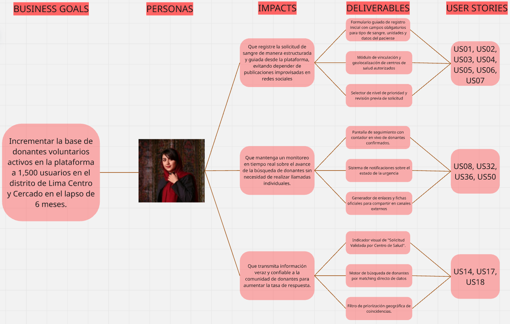

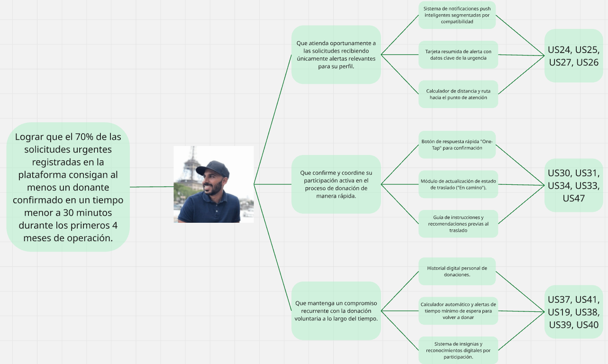

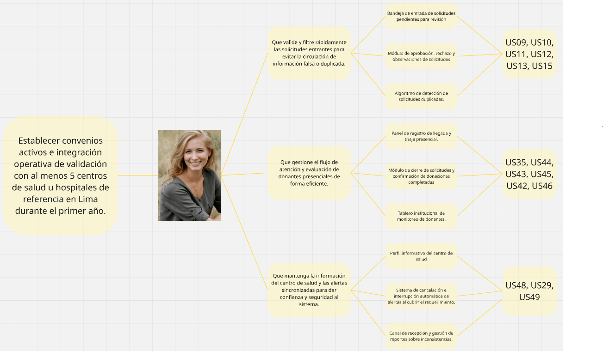

## 3.4. Product Backlog.

| **\# Orden** | **User Story Id** | **Description** | **Story Points (1 / 2 / 3 / 5 / 8)** |
|----|----|----|----|
| 1 | US01 | Como familiar de un paciente, deseo registrar una solicitud urgente de sangre para iniciar rápidamente la búsqueda de donantes compatibles. | 5 |
| 2 | US12 | Como personal autorizado de un centro de salud, deseo aprobar una solicitud verificada para que pueda ser enviada a donantes compatibles. | 3 |
| 3 | US17 | Como familiar de un paciente, deseo que la plataforma identifique donantes compatibles con el tipo de sangre requerido para evitar contactar personas que no puedan ayudar en ese caso. | 8 |
| 4 | US18 | Como familiar de un paciente, deseo que la plataforma priorice donantes cercanos al centro de salud para aumentar la posibilidad de obtener una respuesta rápida. | 5 |
| 5 | US22 | Como familiar de un paciente, deseo que los posibles donantes se prioricen según compatibilidad, cercanía y disponibilidad para aumentar la probabilidad de recibir ayuda útil. | 8 |
| 6 | US24 | Como donante voluntario, deseo recibir alertas solo cuando exista una solicitud compatible con mi perfil para evitar notificaciones irrelevantes. | 5 |
| 7 | US30 | Como donante voluntario, deseo confirmar mi disponibilidad con una acción rápida para responder a una emergencia sin completar pasos innecesarios. | 3 |
| 8 | US04 | Como familiar de un paciente, deseo seleccionar el hospital, clínica o banco de sangre relacionado para que los donantes sepan dónde se realizará la donación. | 3 |
| 9 | US14 | Como donante voluntario, deseo identificar claramente que una solicitud fue validada por un establecimiento de salud para confiar en que la necesidad es legítima. | 2 |
| 10 | US32 | Como familiar de un paciente, deseo ver cuántos donantes han confirmado disponibilidad para conocer el avance real de la búsqueda. | 3 |
| 11 | US35 | Como personal autorizado de un centro de salud, deseo registrar que un donante confirmado llegó al establecimiento para diferenciar confirmaciones de asistencias reales. | 3 |
| 12 | US45 | Como personal autorizado de un centro de salud, deseo registrar una donación completada y asociarla a la solicitud correspondiente para actualizar el avance del caso y el historial del donante. | 5 |
| 13 | US43 | Como personal autorizado de un centro de salud, deseo actualizar una solicitud como activa, cubierta o cancelada para mantener informados a solicitantes y donantes. | 3 |
| 14 | US36 | Como familiar de un paciente, deseo ser informado cuando la cantidad requerida de donaciones haya sido cubierta para dejar de buscar personas innecesariamente. | 3 |
| 15 | US29 | Como donante voluntario, deseo dejar de recibir alertas cuando una solicitud ya fue cubierta o cancelada para no movilizarme innecesariamente. | 2 |
| 16 | US02 | Como familiar de un paciente, deseo indicar el tipo de sangre requerido para que la búsqueda se dirija a donantes compatibles. | 2 |
| 17 | US05 | Como familiar de un paciente, deseo registrar la ubicación del centro de salud para que los posibles donantes puedan evaluar la cercanía antes de responder. | 3 |
| 18 | US06 | Como familiar de un paciente, deseo indicar el nivel de urgencia para que los posibles donantes comprendan la prioridad del caso. | 2 |
| 19 | US19 | Como donante voluntario, deseo que la plataforma considere el tiempo transcurrido desde mi última donación para evitar recibir alertas cuando todavía no puedo volver a donar. | 5 |
| 20 | US20 | Como donante voluntario, deseo indicar mi disponibilidad para que la plataforma no me considere en solicitudes que no puedo atender en ese momento. | 2 |
| 21 | US21 | Como donante voluntario, deseo que el sistema evite enviarme solicitudes cuando no cumplo una condición básica de elegibilidad para no recibir alertas que no puedo atender. | 3 |
| 22 | US25 | Como donante voluntario, deseo ver en la alerta el tipo de sangre requerido, el centro de salud y la urgencia para decidir rápidamente si puedo participar. | 2 |
| 23 | US27 | Como donante voluntario, deseo abrir directamente el detalle de una solicitud desde la alerta para revisar toda la información antes de responder. | 2 |
| 24 | US33 | Como donante voluntario, deseo consultar el establecimiento, ubicación y recomendaciones básicas antes de acudir para llegar con la información necesaria. | 2 |
| 25 | US34 | Como donante voluntario, deseo indicar que me estoy trasladando al establecimiento para que el solicitante y el centro de salud conozcan mi intención de asistir. | 2 |
| 26 | US31 | Como donante voluntario, deseo indicar que no puedo atender una solicitud para que el sistema no me considere como confirmado. | 1 |
| 27 | US08 | Como familiar de un paciente, deseo consultar el estado de mi solicitud y la cantidad de donantes confirmados para saber si aún debo continuar buscando ayuda. | 3 |
| 28 | US09 | Como personal autorizado de un centro de salud, deseo visualizar las solicitudes vinculadas a mi establecimiento para revisar su legitimidad antes de difundirlas. | 3 |
| 29 | US10 | Como personal autorizado de un centro de salud, deseo revisar los datos clínicos y administrativos esenciales de la solicitud para comprobar que correspondan a una necesidad real. | 5 |
| 30 | US11 | Como personal autorizado de un centro de salud, deseo solicitar la corrección de datos incompletos o incorrectos para evitar publicar solicitudes con información errónea. | 3 |
| 31 | US13 | Como personal autorizado de un centro de salud, deseo rechazar una solicitud que no pueda validarse para impedir que se difunda información no confiable. | 2 |
| 32 | US15 | Como personal autorizado de un centro de salud, deseo identificar solicitudes activas que parezcan duplicadas para reducir confusión y difusión repetida del mismo caso. | 5 |
| 33 | US23 | Como personal autorizado de un centro de salud, deseo que el matching se actualice cuando cambien datos relevantes de una solicitud para mantener la búsqueda alineada con la necesidad real. | 5 |
| 34 | US28 | Como donante voluntario que confirmó interés, deseo recibir actualizaciones importantes del caso para saber si la urgencia, ubicación o necesidad cambió. | 3 |
| 35 | US42 | Como personal autorizado de un centro de salud, deseo visualizar las solicitudes activas vinculadas a mi establecimiento para gestionar las necesidades pendientes desde un solo lugar. | 3 |
| 36 | US44 | Como personal autorizado de un centro de salud, deseo registrar si un donante fue considerado apto o no apto en la evaluación presencial para mantener un seguimiento correcto de la atención. | 5 |
| 37 | US46 | Como personal autorizado de un centro de salud, deseo diferenciar cuántos donantes confirmaron, llegaron y completaron la donación para conocer el avance real de cada solicitud. | 5 |
| 38 | US16 | Como donante voluntario, deseo registrar mi grupo y factor sanguíneo para recibir únicamente solicitudes compatibles con mi perfil. | 2 |
| 39 | US26 | Como donante voluntario, deseo conocer la cercanía aproximada del establecimiento para evaluar si puedo trasladarme oportunamente. | 3 |
| 40 | US47 | Como donante voluntario, deseo revisar requisitos básicos para donar antes de trasladarme al centro de salud para reducir viajes innecesarios. | 2 |
| 41 | US48 | Como donante voluntario, deseo ver información clara del establecimiento asociado a la solicitud para saber dónde acudir y confiar en el origen del pedido. | 2 |
| 42 | US49 | Como donante voluntario, deseo reportar una inconsistencia que detecte en una solicitud para que el caso pueda ser revisado antes de afectar a más usuarios. | 3 |
| 43 | US50 | Como familiar de un paciente, deseo compartir una solicitud validada mediante aplicaciones de mensajería o redes sociales para ampliar su alcance sin perder la información oficial del caso. | 3 |
| 44 | US07 | Como familiar de un paciente, deseo revisar un resumen de la solicitud antes de enviarla para reducir errores en los datos compartidos. | 2 |
| 45 | US03 | Como familiar de un paciente, deseo registrar cuántas unidades de sangre se necesitan para comunicar con claridad la magnitud de la solicitud. | 1 |
| 46 | US37 | Como donante voluntario, deseo consultar mi historial de donaciones para llevar un registro de mi participación en la plataforma. | 3 |
| 47 | US38 | Como donante voluntario, deseo conocer cuándo podría volver a donar según mi última participación registrada para planificar futuras donaciones. | 3 |
| 48 | US39 | Como donante voluntario, deseo recibir un recordatorio cuando vuelva a estar habilitado según el tiempo registrado para mantenerme disponible para futuras necesidades. | 3 |
| 49 | US40 | Como donante voluntario, deseo recibir reconocimientos digitales por mi participación para visualizar mi contribución y mantener mi motivación. | 3 |
| 50 | US41 | Como donante voluntario, deseo ver un resumen de mis participaciones y donaciones registradas para comprender el impacto acumulado de mi colaboración. | 2 |

# **Capítulo IV: Product UX/UI Design** 

## 4.1. Style Guidelines. 

### 4.1.1. General Style Guidelines

> ***Branding:***

- Identidad visual: La identidad visual de la marca busca transmitir confianza, rapidez, empatía y valores importantes para una plataforma relacionada con la donación de sangre en Lima. El logotipo está formado por una gota de sangre combinada con una línea de pulso cardíaco, lo que representa la vida, la ayuda y la necesidad de actuar rápidamente ante una emergencia.

- Logotipo: El logo cuenta con una versión principal a color, utilizando un rojo carmesí sobre un fondo claro, y una versión en blanco para utilizarla sobre fondos oscuros.

- Margen de respeto y escalabilidad: Para mantener una buena visibilidad, se deja un espacio libre alrededor del logotipo equivalente a la altura de la letra “S” del logo. Además, se establece un tamaño mínimo de 24 px de alto para dispositivos móviles y 32 px para la versión web, evitando que el logo pierda claridad al reducirse.

> ***Typography:***
>
> Se eligió la familia tipográfica Outfit porque tiene un estilo moderno, limpio y llamativo. Además, sus letras y números son fáciles de distinguir, lo cual es importante para mostrar información relevante en SangreLima, como los grupos sanguíneos (por ejemplo, O+ y AB-) y las alertas de donación urgente. También permite mantener una buena lectura tanto en dispositivos móviles como en la versión web.

1.  Fuente principal: Se utiliza Outfit, una tipografía sans-serif disponible en Google Fonts. Se eligió por su estilo moderno y su buena legibilidad en la interfaz.

2.  Fuente secundaria o alternativa: En caso de que Outfit no esté disponible, se utilizará una tipografía sans-serif del sistema, como SF Pro Display en dispositivos iOS y Roboto en Android.

> Para mantener una interfaz ordenada y fácil de leer en SangreLima, se establecieron diferentes tamaños y estilos de letra según la importancia de cada contenido:

- Título principal (H1): 32px \| Interlineado: 40px \| Negrita (700). Se utiliza en títulos principales, pantallas de bienvenida y mensajes de emergencia que necesitan destacar.

- Título secundario (H2): 24px \| Interlineado: 32px \| Semi-negrita (600). Se utiliza para títulos de secciones, módulos principales y encabezados de formularios.

- Subtítulo (H3): 18px \| Interlineado: 24px \| Semi-negrita (600). Se aplica en subtítulos de tarjetas de donantes, identificadores de grupos sanguíneos y alertas.

- Texto principal (Body Medium): 16px \| Interlineado: 24px \| Regular (400). Se utiliza para textos informativos, instrucciones relacionadas con la donación y campos de formularios.

- Texto secundario (Body Small / Caption): 14px \| Interlineado: 20px \| Regular (400). Se utiliza para información complementaria, como ubicaciones de hospitales, fechas, horas y notas secundarias.

- Texto de botones: 16px \| Interlineado: 24px \| Negrita (700). Se utiliza en botones de acción rápida, como la opción de respuesta 1-Tap, y en otros llamados a la acción. El texto mantiene su formato normal, sin convertirlo a mayúsculas.

> ***Colors:***
>
> La paleta de colores de SangreLima permite diferenciar fácilmente los distintos tipos de información y estados dentro de la plataforma. Cada color tiene una función específica para mantener una interfaz clara, ordenada y fácil de entender.

<table>
<colgroup>
<col style="width: 24%" />
<col style="width: 25%" />
<col style="width: 25%" />
<col style="width: 25%" />
</colgroup>
<thead>
<tr>
<th style="text-align: center;"><blockquote>

Rol de Color

</blockquote></th>
<th style="text-align: center;"><blockquote>

Nombre

</blockquote></th>
<th style="text-align: center;"><blockquote>

Código

</blockquote></th>
<th><blockquote>

Uso Principal

</blockquote></th>
</tr>
<tr>
<th style="text-align: center;"><blockquote>

Rojo principal

</blockquote></th>
<th style="text-align: center;"><blockquote>

Crimson Red

</blockquote></th>
<th style="text-align: center;"><blockquote>

#D32F2F

</blockquote></th>
<th><blockquote>

Botones de acción, elementos

importantes y badges de grupos

sanguíneos.

</blockquote></th>
</tr>
<tr>
<th style="text-align: center;"><blockquote>

Rojo secundario

</blockquote></th>
<th style="text-align: center;"><blockquote>

Dark Carmine

</blockquote></th>
<th style="text-align: center;"><blockquote>

#9A0007

</blockquote></th>
<th style="text-align: center;"><blockquote>

Estados al pasar el cursor, bordes de alertas y enlaces importantes.

</blockquote></th>
</tr>
<tr>
<th style="text-align: center;"><blockquote>

Fondo claro

</blockquote></th>
<th><blockquote>

Off-White / Light Gray

</blockquote></th>
<th style="text-align: center;"><blockquote>

#F8F9FA

</blockquote></th>
<th style="text-align: center;"><blockquote>

Fondo general de las pantallas y secciones de la plataforma.

</blockquote></th>
</tr>
<tr>
<th style="text-align: center;"><blockquote>

Superficie blanca

</blockquote></th>
<th style="text-align: center;"><blockquote>

Pure White

</blockquote></th>
<th style="text-align: center;"><blockquote>

#FFFFFF

</blockquote></th>
<th style="text-align: center;"><blockquote>

Tarjetas, ventanas emergentes y

campos de formulario.

</blockquote></th>
</tr>
<tr>
<th style="text-align: center;"><blockquote>

Texto principal

</blockquote></th>
<th style="text-align: center;"><blockquote>

Charcoal Gray

</blockquote></th>
<th style="text-align: center;"><blockquote>

#212121

</blockquote></th>
<th style="text-align: center;"><blockquote>

Títulos y textos principales, buscando una buena legibilidad.

</blockquote></th>
</tr>
<tr>
<th style="text-align: center;"><blockquote>

Texto secundario

</blockquote></th>
<th style="text-align: center;"><blockquote>

Medium Gray

</blockquote></th>
<th style="text-align: center;"><blockquote>

#666666

</blockquote></th>
<th><blockquote>

Información complementaria,

etiquetas y metadatos.

</blockquote></th>
</tr>
<tr>
<th><blockquote>

Éxito / Validado

</blockquote></th>
<th style="text-align: center;"><blockquote>

Health Green

</blockquote></th>
<th style="text-align: center;"><blockquote>

#2E7D32

</blockquote></th>
<th style="text-align: left;"><blockquote>

Confirmaciones y estados validados por hospitales o

bancos de sangre.

</blockquote></th>
</tr>
<tr>
<th><blockquote>

Advertencia / Pendiente

</blockquote></th>
<th style="text-align: center;"><blockquote>

Amber Gold

</blockquote></th>
<th style="text-align: center;"><blockquote>

#F57C00

</blockquote></th>
<th style="text-align: center;"><blockquote>

Alertas de nivel intermedio y

solicitudes que aún están en proceso.

</blockquote></th>
</tr>
</thead>
<tbody>
</tbody>
</table>

> ***Spacing:***
>
> Para mantener una interfaz ordenada y consistente, SangreLima utilizara un sistema de espaciado basado en una unidad de 8 px. Esto permite mantener una distribución uniforme entre los diferentes elementos de la plataforma.

- Unidad base: Se trabaja con múltiplos de 8 px, como 8px, 16px, 24px, 32px, 48px y 64px.

- Espaciado interno de las tarjetas: Se utilizan valores de 16px o 24px, dependiendo del contenido.

- Espaciado entre elementos: Se mantiene una separación vertical de aproximadamente 16px para evitar que los elementos se vean amontonados.

- Márgenes laterales en Mobile: Se utiliza un margen de 16px a cada lado de la pantalla para aprovechar mejor el espacio disponible.

- Márgenes laterales en Web: Se utiliza una rejilla adaptable (Dynamic Grid) con márgenes de referencia de 32px, permitiendo que el contenido se ajuste a diferentes tamaños de pantalla.

> ***Tono de voz y comunicación:***
>
> El tono de SangreLima busca transmitir confianza y cercanía, considerando que se trata de una plataforma relacionada con situaciones donde la donación de sangre puede ser urgente. Por ello, la comunicación debe ser clara y humana, sin generar miedo o preocupación innecesaria.

- Serio y empático: Se utiliza un lenguaje que transmita confianza y responsabilidad, pero evitando que los mensajes suenen alarmistas. La comunicación debe reconocer la importancia de la donación y la situación de las personas que necesitan sangre.

- Respetuoso y cercano: Se busca hablar con el usuario de manera respetuosa, pero utilizando palabras sencillas y directas. Por ejemplo: *“Tú puedes salvar una vida hoy”*.

- Instrucciones claras: En situaciones urgentes, los mensajes deben comunicar rápidamente qué está pasando y qué acción puede realizar el usuario. Por ejemplo, en lugar de un mensaje general, se puede mostrar:*“Hospital Rebagliati necesita O+ con urgencia”*. De esta manera, el usuario entiende la situación de inmediato y puede responder con mayor facilidad

### 4.1.2. Web Style Guidelines.

- **Estructura responsive y grid**

> La interfaz web se construirá con una rejilla flexible que permita reorganizar el contenido sin perder jerarquía. Se consideran tres rangos principales de referencia:

<table style="width:100%;">
<colgroup>
<col style="width: 24%" />
<col style="width: 25%" />
<col style="width: 25%" />
<col style="width: 25%" />
</colgroup>
<thead>
<tr>
<th style="text-align: center;"><blockquote>

<strong>Rango</strong>

</blockquote></th>
<th style="text-align: center;"><blockquote>

<strong>Ancho de referencia</strong>

</blockquote></th>
<th style="text-align: center;"><blockquote>

<strong>Grid</strong>

</blockquote></th>
<th style="text-align: center;"><blockquote>

<strong>Aplicación</strong>

</blockquote></th>
</tr>
<tr>
<th style="text-align: left;"><blockquote>

Desktop

</blockquote></th>
<th style="text-align: left;"><blockquote>

≥ 1200 px

</blockquote></th>
<th style="text-align: left;"><blockquote>

12 columnas, margen

lateral 32 px

</blockquote></th>
<th style="text-align: left;"><blockquote>

Dashboard, mapas, listados amplios y paneles en paralelo.

</blockquote></th>
</tr>
<tr>
<th style="text-align: left;"><blockquote>

Tablet

</blockquote></th>
<th style="text-align: left;"><blockquote>

768-1199 px

</blockquote></th>
<th style="text-align: left;"><blockquote>

8 columnas, margen lateral 24 px

</blockquote></th>
<th style="text-align: left;"><blockquote>

Contenido en una o dos columnas según prioridad.

</blockquote></th>
</tr>
<tr>
<th style="text-align: left;"><blockquote>

Web móvil

</blockquote></th>
<th style="text-align: left;"><blockquote>

≤ 767 px

</blockquote></th>
<th style="text-align: left;"><blockquote>

4 columnas, margen lateral 16 px

</blockquote></th>
<th style="text-align: left;"><blockquote>

Contenido apilado en una sola columna y acciones prioritarias visibles.

</blockquote></th>
</tr>
</thead>
<tbody>
</tbody>
</table>

- **Navegación y encabezado**

<!-- -->

- Header principal: incluye logotipo de SangreLima, accesos a Inicio, Solicitudes, Centros de donación, Historial/Actividad y Perfil.

- En Desktop, la navegación principal se muestra horizontalmente. En anchos reducidos, se transforma en menú colapsable para evitar saturación visual.

- La acción primaria “Donar / Responder solicitud” utilizará Crimson Red (#D32F2F) y tendrá mayor peso visual que las acciones secundarias.

- El usuario debe identificar siempre en qué sección se encuentra mediante estado activo en navegación, título de página y jerarquía visual consistente.

<!-- -->

- **Componentes principales**

<table>
<colgroup>
<col style="width: 22%" />
<col style="width: 24%" />
<col style="width: 25%" />
<col style="width: 27%" />
</colgroup>
<thead>
<tr>
<th style="text-align: center;"><blockquote>

<strong>Componente</strong>

</blockquote></th>
<th style="text-align: center;"><blockquote>

<strong>Estándar visual</strong>

</blockquote></th>
<th style="text-align: center;"><blockquote>

<strong>Estados</strong>

</blockquote></th>
<th style="text-align: center;"><blockquote>

<strong>Uso en SangreLima</strong>

</blockquote></th>
</tr>
<tr>
<th style="text-align: left;"><blockquote>

Botón primario

</blockquote></th>
<th style="text-align: left;"><blockquote>

Altura mínima 44 px, borde redondeado 8 px, fondo #D32F2F, texto blanco 16 px/700.

</blockquote></th>
<th style="text-align: left;"><blockquote>

Default, hover, focus, pressed y disabled.

</blockquote></th>
<th style="text-align: left;"><blockquote>

Confirmar una donación, responder una solicitud o completar una acción principal.

</blockquote></th>
</tr>
<tr>
<th style="text-align: left;"><blockquote>

Botón secundario

</blockquote></th>
<th style="text-align: left;"><blockquote>

Fondo blanco, borde #D32F2F, texto #D32F2F.

</blockquote></th>
<th style="text-align: left;"><blockquote>

Default, hover, focus, pressed y disabled.

</blockquote></th>
<th style="text-align: left;"><blockquote>

Ver detalle, cancelar o realizar una acción de menor prioridad.

</blockquote></th>
</tr>
<tr>
<th style="text-align: left;"><blockquote>

Tarjeta de solicitud

</blockquote></th>
<th style="text-align: left;"><blockquote>

Fondo #FFFFFF, padding 16-24 px, radio 12 px y separación mínima de 16 px.

</blockquote></th>
<th style="text-align: left;"><blockquote>

Normal, destacada/urgente y completada.

</blockquote></th>
<th style="text-align: left;"><blockquote>

Presentar grupo

sanguíneo, hospital, ubicación, fecha, nivel de urgencia y CTA.

</blockquote></th>
</tr>
<tr>
<th style="text-align: left;"><blockquote>

Campo de formulario

</blockquote></th>
<th style="text-align: left;"><blockquote>

Altura mínima 48 px, etiqueta visible, borde neutro y mensaje inferior.

</blockquote></th>
<th style="text-align: left;"><blockquote>

Normal, focus, error, validado y disabled.

</blockquote></th>
<th style="text-align: left;"><blockquote>

Registro, inicio de sesión, perfil y datos de donación.

</blockquote></th>
</tr>
<tr>
<th style="text-align: left;"><blockquote>

Badge/estado

</blockquote></th>
<th style="text-align: left;"><blockquote>

Texto corto, icono cuando sea necesario y color semántico.

</blockquote></th>
<th style="text-align: left;"><blockquote>

Urgente, pendiente, validado y cerrado.

</blockquote></th>
<th style="text-align: left;"><blockquote>

Comunicar estado sin depender únicamente del color.

</blockquote></th>
</tr>
<tr>
<th style="text-align: left;"><blockquote>

Modal/diálogo

</blockquote></th>
<th style="text-align: left;"><blockquote>

Superficie blanca, título, mensaje breve y máximo dos acciones principales.

</blockquote></th>
<th style="text-align: left;"><blockquote>

Informativo, confirmación y alerta.

</blockquote></th>
<th style="text-align: left;"><blockquote>

Confirmar respuestas, informar cambios críticos o prevenir acciones irreversibles.

</blockquote></th>
</tr>
</thead>
<tbody>
</tbody>
</table>

- **Estados de interacción**

> Todos los elementos interactivos deben comunicar su estado de manera visible y consistente:

- Hover: cambio sutil de tono o elevación sin modificar el significado del color.

- Focus: contorno visible alrededor del componente para facilitar navegación con teclado.

- Pressed/Active: retroalimentación inmediata al seleccionar o mantener presionado el elemento.

- Disabled: menor énfasis visual, pero conservando legibilidad suficiente; el elemento no debe responder a interacción.

- Loading: mostrar indicador de progreso y bloquear únicamente la acción que está siendo procesada.

- Error/Success: acompañar el color con texto e iconografía para que el estado sea comprensible por todos los usuarios.

<!-- -->

- **Formularios y validación**

<!-- -->

- Las etiquetas se mantienen visibles sobre los campos; no se utilizará el placeholder como único identificador.

- Los mensajes de error deben explicar qué ocurrió y cómo corregirlo, por ejemplo: “Ingresa un número de documento válido”.

- Los campos relacionados se agrupan visualmente y se mantiene un espaciado vertical mínimo de 16 px.

- Los campos obligatorios se identifican de manera consistente y la validación debe aparecer cerca del campo correspondiente.

<!-- -->

- **Accesibilidad web**

<!-- -->

- Mantener contraste suficiente entre texto, fondo y controles interactivos.

- No utilizar únicamente el color para indicar urgencia, error o éxito; complementar con texto e iconos.

- Permitir navegación por teclado con un orden de foco lógico y foco visible.

- Usar textos alternativos en imágenes relevantes y etiquetas accesibles en iconos o botones sin texto.

- Mantener un tamaño de texto base de 16 px para contenido principal y evitar bloques extensos en mayúsculas.

<!-- -->

- **Ejemplo de aplicación preliminar**

> En una pantalla de solicitudes, cada tarjeta mostrará primero el grupo sanguíneo y el nivel de urgencia, seguido por hospital, distrito, fecha y tiempo estimado. La acción “Puedo donar” se presentará como botón primario, mientras que “Ver detalles” se mostrará como acción secundaria. En Desktop las tarjetas pueden organizarse en dos o tres columnas; en anchos menores se apilarán en una sola columna para conservar legibilidad y prioridad.

### 4.1.3. Mobile Style Guidelines. 

> Esta versión preliminar establece los estándares visuales y de interacción para SangreLima en dispositivos móviles. La identidad de marca se mantiene en Android e iOS, pero determinados componentes se adaptan a los patrones nativos de cada plataforma para que la experiencia resulte familiar y predecible.

- **Layout móvil y áreas seguras**

<!-- -->

- Se utiliza una rejilla de 4 columnas con margen lateral de 16 px y sistema de espaciado basado en múltiplos de 8 px.

- El contenido principal debe respetar las áreas seguras del dispositivo para no interferir con notch, cámara, barra de estado o indicador de inicio.

- Las acciones primarias se ubican dentro del alcance natural del pulgar, especialmente en pantallas que requieren respuesta rápida.

- Las listas y tarjetas utilizan desplazamiento vertical; se evita colocar acciones críticas únicamente al final de pantallas extensas.

<!-- -->

- **Navegación móvil**

<!-- -->

- Se prioriza una barra de navegación inferior con entre 3 y 5 destinos principales, por ejemplo: Inicio, Solicitudes, Centros y Perfil.

- Las pantallas secundarias utilizan una barra superior con título y acción de regreso cuando corresponda.

- Los iconos de navegación siempre se acompañan de etiqueta textual en destinos principales para reducir ambigüedad.

- Las notificaciones urgentes pueden dirigirse al detalle de la solicitud, pero el usuario debe conservar una ruta clara para regresar al flujo principal.

<!-- -->

- **Tamaños táctiles y componentes**

<table>
<colgroup>
<col style="width: 24%" />
<col style="width: 25%" />
<col style="width: 24%" />
<col style="width: 25%" />
</colgroup>
<thead>
<tr>
<th style="text-align: center;"><blockquote>

<strong>Elemento</strong>

</blockquote></th>
<th style="text-align: center;"><blockquote>

<strong>Android</strong>

</blockquote></th>
<th style="text-align: center;"><blockquote>

<strong>iOS</strong>

</blockquote></th>
<th style="text-align: center;"><blockquote>

<strong>Criterio común</strong>

</blockquote></th>
</tr>
<tr>
<th><blockquote>

Área táctil mínima

</blockquote></th>
<th><blockquote>

48 × 48 dp

</blockquote></th>
<th><blockquote>

44 × 44 pt

</blockquote></th>
<th style="text-align: left;"><blockquote>

Evitar acciones difíciles de tocar o controles demasiado próximos.

</blockquote></th>
</tr>
<tr>
<th><blockquote>

Botón primario

</blockquote></th>
<th><blockquote>

Material-style, altura mínima 48 dp.

</blockquote></th>
<th><blockquote>

Botón adaptado a patrones iOS, altura mínima 44 pt.

</blockquote></th>
<th style="text-align: left;"><blockquote>

Crimson Red como color de acción y texto claro con etiqueta directa.

</blockquote></th>
</tr>
<tr>
<th><blockquote>

Barra superior

</blockquote></th>
<th><blockquote>

Top App Bar.

</blockquote></th>
<th><blockquote>

Navigation Bar.

</blockquote></th>
<th><blockquote>

Título de pantalla y navegación contextual.

</blockquote></th>
</tr>
<tr>
<th><blockquote>

Navegación principal

</blockquote></th>
<th><blockquote>

Navigation Bar inferior.

</blockquote></th>
<th><blockquote>

Tab Bar.

</blockquote></th>
<th><blockquote>

3-5 destinos persistentes y claramente etiquetados.

</blockquote></th>
</tr>
<tr>
<th><blockquote>

Diálogos

</blockquote></th>
<th><blockquote>

Material Dialog.

</blockquote></th>
<th><blockquote>

Alert/Action Sheet según contexto.

</blockquote></th>
<th><blockquote>

Mensajes breves, jerarquía clara y pocas acciones.

</blockquote></th>
</tr>
<tr>
<th><blockquote>

Switches / Selectores

</blockquote></th>
<th><blockquote>

Componente Material nativo.

</blockquote></th>
<th><blockquote>

Control nativo de iOS.

</blockquote></th>
<th><blockquote>

Mantener comportamiento esperado por la plataforma.

</blockquote></th>
</tr>
<tr>
<th><blockquote>

Selector de fecha/hora

</blockquote></th>
<th><blockquote>

Date/Time Picker Material.

</blockquote></th>
<th><blockquote>

Date Picker iOS.

</blockquote></th>
<th><blockquote>

Usar selector nativo para reducir errores de entrada.

</blockquote></th>
</tr>
</thead>
<tbody>
</tbody>
</table>

- **Tipografía en Android e iOS**

> Outfit se mantiene como fuente de marca para títulos y contenido cuando esté disponible. Como fallback, Android utilizará Roboto e iOS utilizará SF Pro. La jerarquía tipográfica definida en los General Style Guidelines se conserva, pero se ajustará cuando sea necesario para respetar escalado de texto y preferencias de accesibilidad del sistema.

- **Diferencias de representación por plataforma**

<table>
<colgroup>
<col style="width: 32%" />
<col style="width: 33%" />
<col style="width: 33%" />
</colgroup>
<thead>
<tr>
<th style="text-align: center;"><blockquote>

<strong>Aspecto</strong>

</blockquote></th>
<th style="text-align: center;"><blockquote>

<strong>Android</strong>

</blockquote></th>
<th style="text-align: center;"><blockquote>

<strong>iOS</strong>

</blockquote></th>
</tr>
<tr>
<th><blockquote>

Navegación

</blockquote></th>
<th><blockquote>

Patrones Material; uso de Top App Bar y Navigation Bar.

</blockquote></th>
<th style="text-align: left;"><blockquote>

Patrones Human Interface Guidelines; Navigation Bar y Tab Bar.

</blockquote></th>
</tr>
<tr>
<th><blockquote>

Botón “atrás”

</blockquote></th>
<th><blockquote>

Puede existir navegación del sistema además del control de interfaz.

</blockquote></th>
<th style="text-align: left;"><blockquote>

Se utiliza el control de regreso en la barra de navegación y gestos propios del sistema.

</blockquote></th>
</tr>
<tr>
<th><blockquote>

Diálogos y acciones

</blockquote></th>
<th><blockquote>

Material Dialog / Bottom Sheet cuando corresponda.

</blockquote></th>
<th><blockquote>

Alert / Action Sheet según el tipo de decisión.

</blockquote></th>
</tr>
<tr>
<th><blockquote>

Controles

</blockquote></th>
<th><blockquote>

Switches, pickers y campos con comportamiento Material.

</blockquote></th>
<th><blockquote>

Switches, pickers y campos con comportamiento nativo de iOS.

</blockquote></th>
</tr>
<tr>
<th><blockquote>

Iconografía

</blockquote></th>
<th style="text-align: left;"><blockquote>

Iconos simples y consistentes con Material Symbols cuando corresponda.

</blockquote></th>
<th><blockquote>

Símbolos adaptados a la convención visual de iOS cuando corresponda.

</blockquote></th>
</tr>
</thead>
<tbody>
</tbody>
</table>

- **Notificaciones y solicitudes urgentes**

<!-- -->

- El título de una notificación debe indicar de forma breve la necesidad, por ejemplo: “Se necesita O+”.

- El cuerpo debe incluir el dato mínimo de contexto, como hospital o distrito, evitando mensajes alarmistas.

- Al tocar una notificación, el usuario debe llegar al detalle de la solicitud correspondiente y no a una pantalla genérica.

- Las notificaciones no deben utilizarse para contenido no esencial si eso puede reducir la atención del usuario ante alertas realmente importantes.

<!-- -->

- **Accesibilidad móvil**

<!-- -->

- Respetar el escalado de texto del sistema y evitar que la interfaz se rompa cuando el usuario incrementa el tamaño de fuente.

- Incluir etiquetas accesibles para iconos, imágenes y controles que no contienen texto visible.

- Mantener áreas táctiles adecuadas y separación suficiente entre controles para reducir toques accidentales.

- Agregar retroalimentación visual y, cuando corresponda, háptica, sin depender únicamente de una vibración para comunicar estados.

- Los estados de error, éxito y urgencia deben incluir texto o iconografía además del color.

<!-- -->

- **Ejemplo de aplicación preliminar**

> En el detalle móvil de una solicitud urgente, el grupo sanguíneo y el estado de urgencia se presentan en la parte superior. A continuación se muestran hospital, ubicación, fecha y requisitos. La acción principal “Puedo donar” permanece claramente visible y utiliza el color primario. Las acciones complementarias, como compartir o ver indicaciones, se presentan con menor jerarquía. En Android e iOS se conserva la misma información y orden, aunque los controles de navegación, diálogos y selectores se adaptan al patrón nativo de cada sistema.

#### 4.1.3.1. Primary Mobile Platform Style Guidelines. 

> SangreLima adopta iOS como plataforma principal, siguiendo las Human Interface Guidelines de Apple, para que la app se sienta familiar y predecible. Esto se aplica sobre la identidad ya definida (Outfit, Crimson Red \#D32F2F, espaciado de 8 px).

- Frame de diseño: iPhone de 393 x 852 pt, con márgenes laterales de 16 pt y respeto de las áreas seguras (Dynamic Island y home indicator).

- Navegación principal: Tab Bar inferior con 4 destinos, cada uno con icono y etiqueta (Inicio, Solicitudes, Centros, Perfil). Las pantallas secundarias usan Navigation Bar con título y botón de regreso, además del gesto de deslizar desde el borde.

- Iconografía: SF Symbols en trazo simple, coherentes con el peso de Outfit.

- Botón primario: altura mínima de 44 pt, radio de 8 pt, fondo \#D32F2F y texto blanco 16/700. Es el único botón relleno de la pantalla.

- Área táctil mínima: 44 x 44 pt, con 8 pt de separación entre controles.

- Diálogos: Alert para confirmaciones breves, como “¿Confirmas que la información es real?”. Sheet o Action Sheet para elegir opciones, como el centro de salud.

- Controles nativos: UISwitch para activar alertas, Date Picker de iOS para fechas y menús nativos para tipo de sangre y distrito, para reducir errores de ingreso.

- Notificaciones push: título “Se necesita O+” y cuerpo con hospital y distrito. Incluyen la acción rápida “Puedo donar” (flujo 1-Tap de US30). Al tocarlas llevan al detalle de la solicitud, no a una pantalla genérica.

- Accesibilidad: Dynamic Type (el texto escala con el sistema), etiquetas para VoiceOver en iconos y botones sin texto, y estados con texto e icono además del color.

- Retroalimentación: háptica ligera al confirmar disponibilidad o publicar una solicitud, siempre acompañada de un mensaje visual.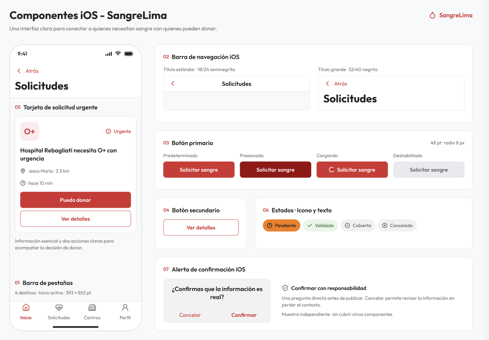

#### 4.1.3.2. Secondary Mobile Platform Comparative Guidelines. 

> La muestra comparativa cubre los 12 User Stories core con más prioridad del Product Backlog: US01, US12, US17, US18, US22, US24, US30, US04, US14, US32, US35 y US45. La identidad se mantiene igual, pero los componentes se adaptan a Material Design 3.

- ***Comparativa iOS / Android:***

<!-- -->

- Navegación principal: Tab Bar (iOS) / Navigation Bar inferior con indicador de selección en forma de píldora (Android).

- Barra superior: Navigation Bar con título centrado o grande (iOS) / Top App Bar con título alineado a la izquierda (Android).

- Regreso: botón en la barra y gesto lateral (iOS) / flecha en la Top App Bar más el gesto o botón del sistema (Android).

- Acción principal: botón relleno de 44 pt (iOS) / botón Material de 48 dp, o FAB extendido para “Solicitar sangre” (Android).

- Diálogos: Alert / Action Sheet (iOS) / Material Dialog / Bottom Sheet (Android).

- Selectores: UISwitch y Date Picker de iOS (iOS) / Material Switch y Date Picker modal (Android).

- Iconos: SF Symbols (iOS) / Material Symbols (Android).

- Área táctil: 44 x 44 pt (iOS) / 48 x 48 dp (Android).

- Fallback tipográfico: SF Pro (iOS) / Roboto (Android).

- Notificaciones: acción “Puedo donar” desde la notificación expandida en ambas, con canal de alta prioridad para urgentes en Android.

<!-- -->

- ***Aplicación en los flujos core:***

<!-- -->

- US01 (registrar solicitud urgente): en Android el FAB extendido “Solicitar sangre” reemplaza al botón centrado de iOS.

- US12 y US14 (validación de solicitudes): la insignia “Validada” usa Health Green con icono de check en ambas, y se mantiene el mismo texto.

- US24 y US30 (alerta y confirmación 1-Tap): iOS usa Action Sheet de confirmación y Android usa Bottom Sheet.

- US32, US35 y US45 (seguimiento y confirmación de donación): cambia la barra superior y los selectores de fecha, y el orden de la información se conserva.

> iOS: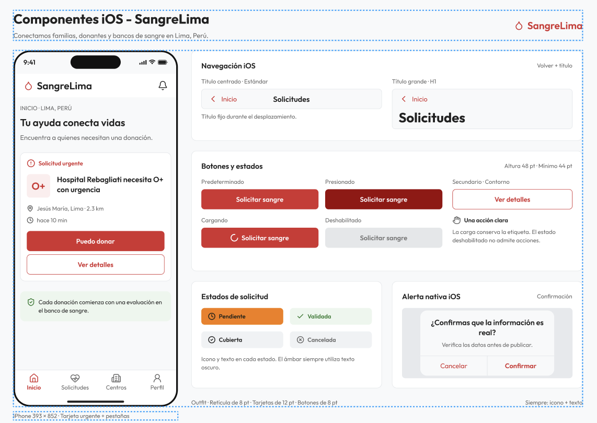
>
> Android:

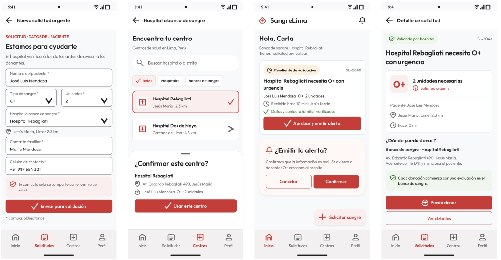

## 4.2. Information Architecture. 

### 4.2.1. Organization Systems. 

> Organización visual:

- Jerárquica: en Inicio y Solicitudes, la tarjeta urgente va primero, con grupo sanguíneo, hospital, distancia y tiempo desde la publicación, y la acción “Puedo donar” como único botón primario.

- Secuencial: “Nueva solicitud” (paciente, tipo de sangre, unidades, centro, contacto, confirmación), el registro y la confirmación de donación, con indicador de pasos.

- Matricial: el panel de Carla ordena las solicitudes por estado (Pendientes, Activas, Completadas) y por nivel de urgencia.

> Esquemas de categorización:

- Por tópicos: Solicitudes, Centros y Perfil.

- Por audiencia: tres recorridos separados según el rol (solicitante, donante y centro de salud), definidos al registrarse.

- Cronológico: historial de donaciones y solicitudes, de más reciente a más antigua.

- Alfabético: solo en los selectores largos de distrito y centro de salud.

- Por relevancia: las solicitudes para el donante se ordenan por compatibilidad, cercanía y disponibilidad (US22).

### 4.2.2. Labeling Systems. 

> Etiquetas cortas, en el lenguaje de los entrevistados y sin jerga técnica:

- Navegación: Inicio, Solicitudes, Centros, Perfil. Para el centro de salud: Panel, Validar, Donaciones, Perfil.

- Acciones: Solicitar sangre, Puedo donar, Ver solicitud, Aprobar y emitir alerta, Rechazar y observar, Confirmar donación.

- Estados: Pendiente (ámbar), Validada (verde), Activa, Cubierta, Cancelada.

- Términos evitados: no se usa “matching” ni “triaje” en pantallas del público general. En su lugar se dice “Donantes compatibles”.

### 4.2.3. Searching Systems. 

- María Elena (solicitante): busca centros por nombre o distrito, con filtros de tipo de institución (hospital, clínica, banco de sangre) y “Validado”. Los resultados salen como tarjetas con nombre, distrito, distancia y horario.

- Diego (donante): no busca, la app le muestra solo solicitudes compatibles según su perfil. Puede filtrar por distancia y urgencia. Cada resultado muestra grupo sanguíneo, hospital, distancia y tiempo desde la publicación.

- Carla (centro de salud): busca por DNI o código del donante, por nombre del paciente y por número de historia clínica. Filtra por estado, urgencia y fecha.

- Estado vacío: mensaje claro con una acción sugerida, por ejemplo “No hay solicitudes compatibles ahora. Te avisaremos cuando haya una”.

- Landing page: no tiene buscador. Usa navegación por secciones y una FAQ.

### 4.2.4. Navigation Systems. 

> App móvil:

- Navegación global: Tab Bar de 3 a 5 destinos según el rol, siempre visible y con el destino activo resaltado.

- Navegación local: Navigation Bar con título y regreso. Los formularios largos usan indicador de pasos.

- Navegación contextual: las notificaciones llevan al detalle de la solicitud con una ruta clara de regreso a Inicio.

- Meta de eficiencia: llegar al flujo core (solicitar sangre o responder una alerta) en máximo 2 toques desde Inicio.

> Landing page:

- Header fijo con logo y enlaces ancla: Cómo funciona, Para quién, Video, Centros, Preguntas. A la derecha, el CTA “Solicitar sangre” y el secundario “Quiero donar”. En móvil se convierte en menú colapsable.

- Footer con enlaces de apoyo, contacto y datos de privacidad.

- El usuario siempre sabe en qué sección está por el estado activo del enlace.

## 4.3. Landing Page UI Design. 

### 4.3.1. Landing Page Wireframe.

- Explicación de Diseño:

Para la página de inicio de SangreLima, el objetivo principal fue crear una pantalla limpia, ordenada y muy fácil de entender a primera vista. En lugar de saturar al usuario, acomodamos los elementos de manera estratégica: la promesa principal y los botones clave saltan a la vista de inmediato, mientras que el resto de la información se agrupa de forma lógica mediante bloques, contrastes y separaciones claras. Además, para que todo se vea perfectamente alineado y equilibrado, seguimos al pie de la letra la regla de espaciado de la guía de estilos, usando una cuadrícula basada en múltiplos de 8 píxeles. Diseñamos el flujo de la información pensando exactamente en el camino que recorre el usuario al entrar a la página. La historia de la web avanza de forma lógica: empezamos con el propósito de SangreLima y las llamadas a la acción más importantes; luego, explicamos de manera sencilla cómo funciona el servicio; pasamos a mostrar las urgencias del momento junto a los centros de donación y, para cerrar, destacamos los beneficios de la plataforma. Además, adaptándonos a las pantallas de escritorio, incluimos un menú de navegación horizontal que permite moverse entre las secciones principales con total fluidez, tal como lo define nuestra guía web. Nos aseguramos de que la plataforma fuera accesible para todos y respetara fielmente el sistema de diseño de SangreLima, evitando depender únicamente del color para comunicar mensajes importantes; por eso, reforzamos las alertas visuales con etiquetas de texto claras como “VALIDADA” o “URGENTE”. Para la identidad visual, implementamos la tipografía Outfit junto a la paleta oficial del proyecto, donde el rojo (#D32F2F) guía al usuario hacia las acciones principales, el verde (#2E7D32) confirma los estados validados y el naranja (#F57C00) resalta las alertas o situaciones de emergencia. El resultado final es una interfaz que no solo mantiene una consistencia visual impecable, sino que también garantiza una lectura cómoda, clara y verdaderamente inclusiva para cualquier persona.

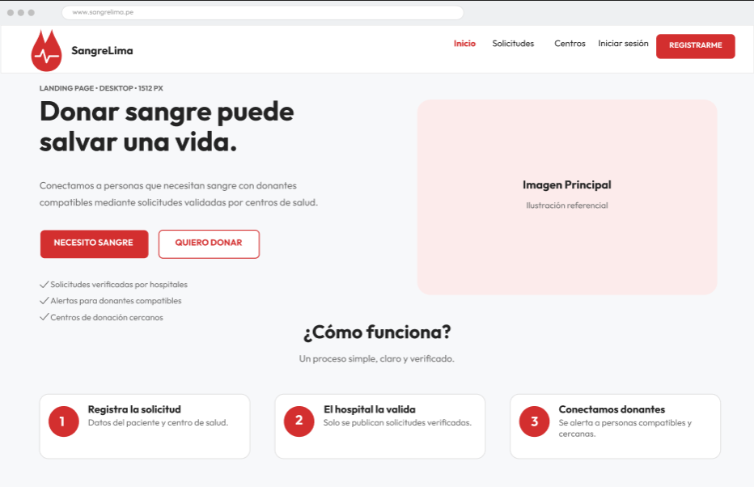

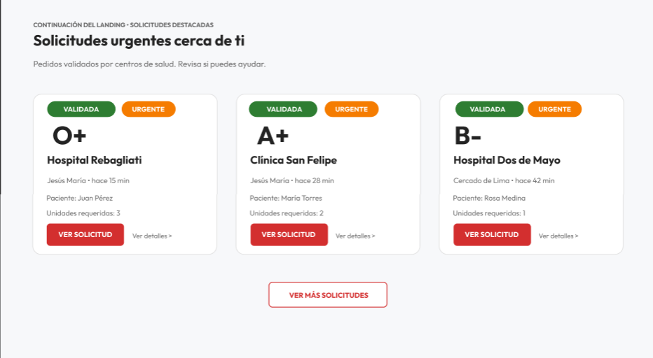

### 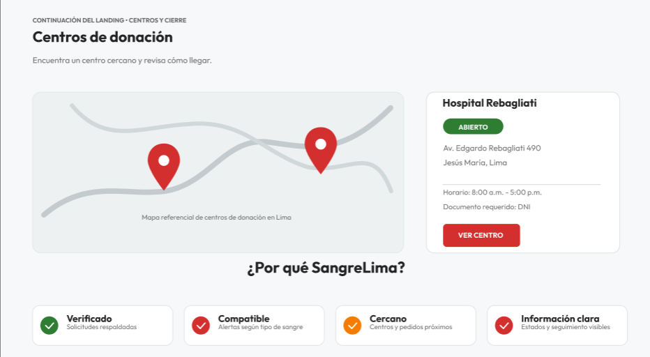4.3.2. Landing Page Mock-up

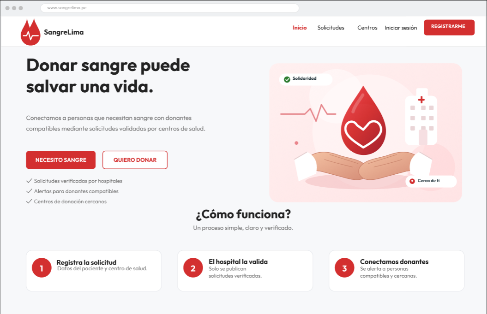

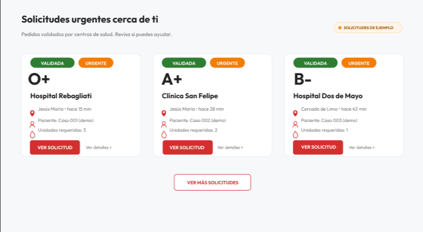

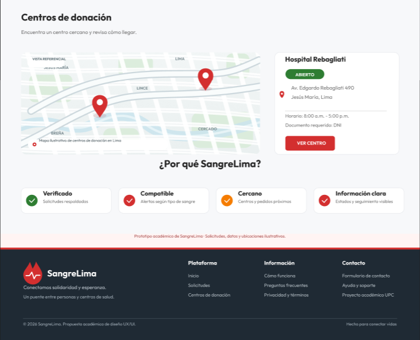

## 4.4. Mobile Applications UX/UI Design. 

### 4.4.1. Mobile Applications Wireframes. 

- María Elena Vargas Ríos (Segmento 1: pacientes y familiares que necesitan transfusión con urgencia)

<!-- -->

- User goal: María Elena, familiar de un paciente que necesita una transfusión urgente, quiere publicar una solicitud de sangre validada por el hospital y ver qué donantes compatibles confirmaron su asistencia, para dejar de depender de cadenas de WhatsApp y de escribirle a todo el mundo.

- Wireframes:

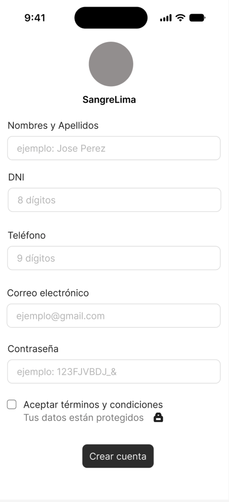

1.  ***Pantalla Registro***

2.  ***Pantalla cuenta creada con éxito***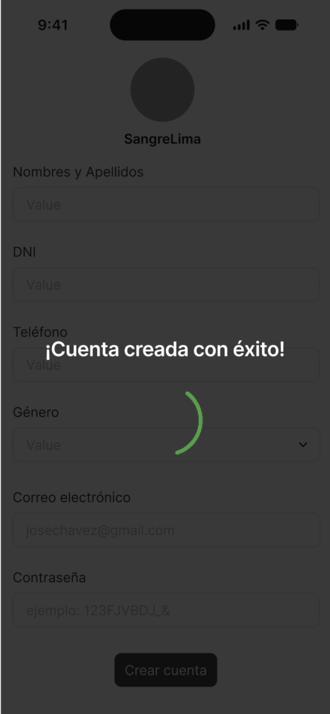

3.  ***Pantalla inicio:***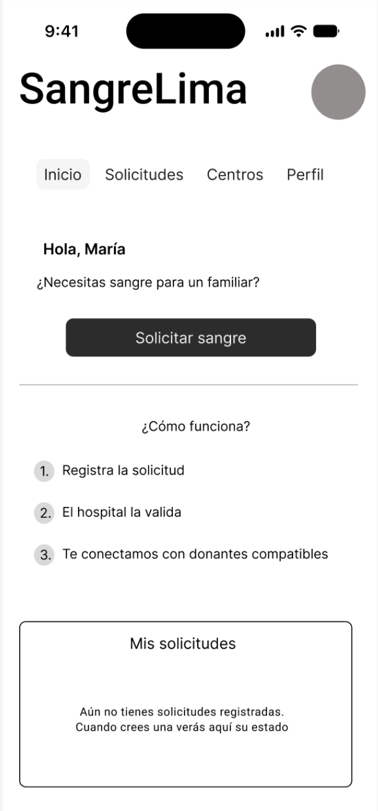

4.  ***Pantalla solicitud:***

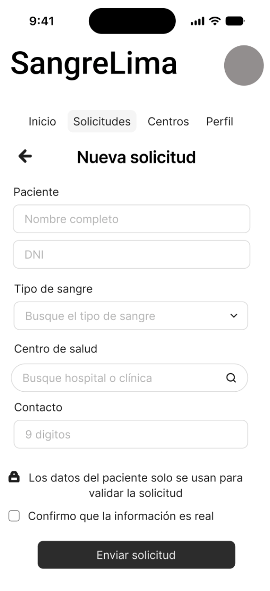

5.  ***Pantalla validación:***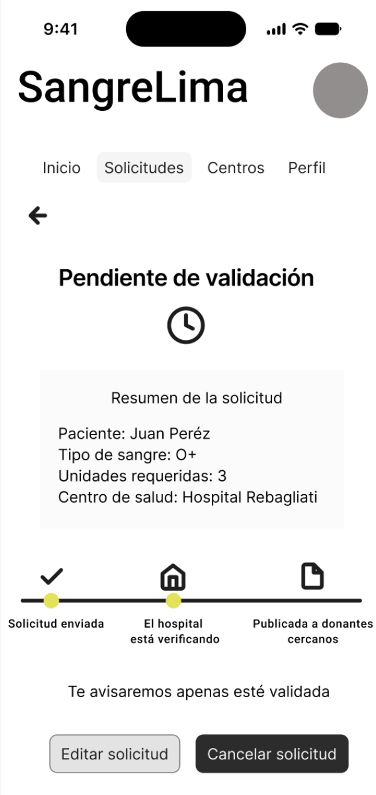

6.  ***Pantalla solicitud publicada:***

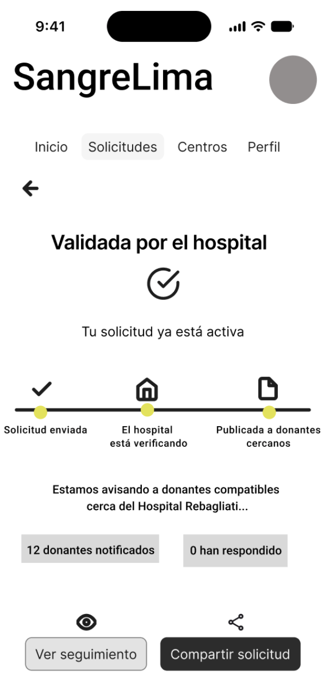

7.  ***Pantalla seguimiento de solicitud:***

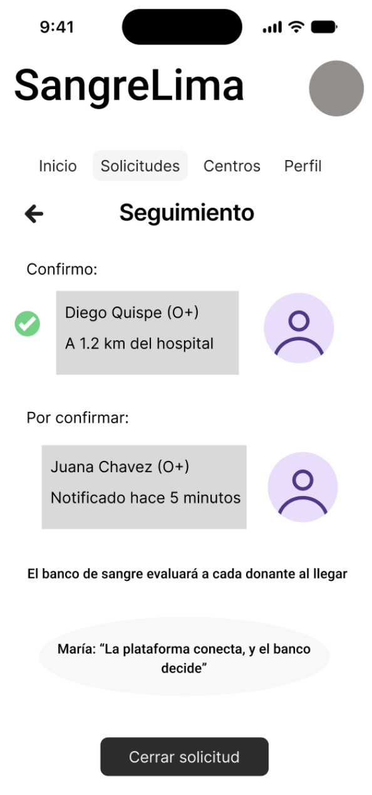

- Diego Alonso Quiroz Bravo (Segmento 2: Donantes voluntarios)

<!-- -->

- User goal: Diego, donante voluntario, quiere recibir una alerta de una solicitud compatible con su tipo de sangre, comprobar que está validada por un hospital y confirmar su disponibilidad con un solo toque, para ayudar rápido y sin trámites excesivos.

- Wireframes:

1.  ***Pantalla Registro y Pantalla cuenta creada con éxito***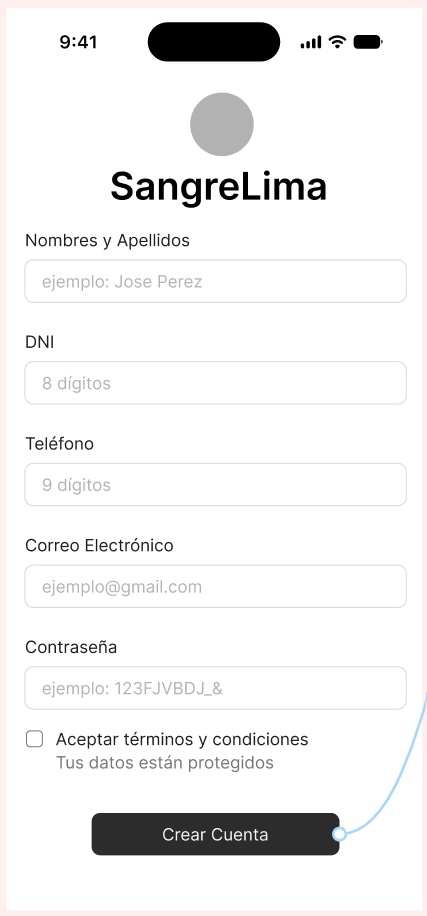

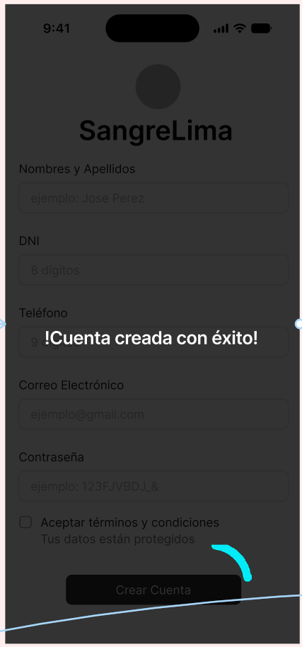

2.  ***Perfil de donante e Inicio de donante***

3.  ***Detalle de la solicitud y Confirmación e indicaciones***

- Carla Beatriz Mendoza Ríos (Segmento 3: Bancos de sangre y centros de salud)

<!-- -->

- User goal: Carla, profesional de un banco de sangre, quiere revisar y validar las solicitudes de transfusión que llegan y confirmar la donación de los voluntarios que se presentan, para que solo se difundan pedidos legítimos a donantes compatibles sin perder el rigor médico

<!-- -->

- Wireframes:

1.  ***Pantalla de Registro y Pantalla de cuenta creada***

2.  ***Pantalla de inicio de sesión y Pantalla de panel de control***

3.  ***Pantalla de detalles y Pantalla de Confirmación***

### 4.4.2. Mobile Applications Wireflow

1.  María Elena Vargas Ríos (Segmento 1: pacientes y familiares que necesitan transfusión con urgencia)

- User goal: María Elena, familiar de un paciente que necesita una transfusión urgente, quiere publicar una solicitud de sangre validada por el hospital y ver qué donantes compatibles confirmaron su asistencia, para dejar de depender de cadenas de WhatsApp y de escribirle a todo el mundo.

<!-- -->

- Explicación del flujo:

El flujo comienza cuando María Elena crea su cuenta en la pantalla de Registro, ingresando sus datos personales y aceptando los términos, con un aviso que le asegura que sus datos están protegidos. Luego llega a la pantalla de Inicio, donde encuentra de inmediato el botón 'Solicitar sangre', una explicación breve de cómo funciona el proceso y el estado de sus solicitudes. Al tocar el botón, accede al formulario de Nueva solicitud, donde registra los datos del paciente, el tipo de sangre, las unidades requeridas, el centro de salud y su contacto, y confirma que la información es real antes de enviarla.

Después de enviar, la pantalla de Validación le informa que su solicitud está pendiente de validación y le muestra un resumen y una línea de tiempo con el avance, para que no tenga que preguntar a nadie cómo va. Cuando el hospital valida la solicitud, la pantalla de Publicada confirma que está activa, que se está avisando a donantes compatibles cercanos y cuántos fueron notificados. Finalmente, en la pantalla de Seguimiento, María Elena ve qué donantes confirmaron y cuáles faltan por confirmar, y puede cerrar la solicitud cuando ya no la necesite. Así, el proceso queda centralizado en un solo lugar, con respaldo del hospital, y reduce la incertidumbre que expresaron los entrevistados.

2.  Diego Alonso Quiroz Bravo (Segmento 2: Donantes voluntarios)

- User goal: Diego, donante voluntario, quiere recibir una alerta de una solicitud compatible con su tipo de sangre, comprobar que está validada por un hospital y confirmar su disponibilidad con un solo toque, para ayudar rápido y sin trámites excesivos.

<!-- -->

- Explicación del flujo:

> El flujo comienza cuando Diego crea su cuenta en la pantalla de Registro, ingresando sus datos personales y aceptando los términos y condiciones, con un aviso que le asegura que sus datos están protegidos. Al tocar "Crear Cuenta", la pantalla de confirmación le informa que su cuenta fue creada con éxito. Luego llega a la pantalla de Perfil de donante, donde activa la opción para recibir alertas de solicitudes compatibles y selecciona su tipo de sangre y su distrito. Con esta información, la aplicación puede avisarle solo cuando exista una solicitud que realmente pueda atender.
>
> Al tocar "Guardar y continuar", Diego accede a la pantalla de Inicio de donante, donde encuentra de inmediato una alerta marcada como urgente con el tipo de sangre requerido, el hospital, la distancia y el tiempo desde su publicación. También ve una explicación breve de cómo funciona el proceso. Al tocar "Ver solicitud", llega al Detalle de la solicitud, donde puede comprobar que está validada por un hospital, revisar los datos del paciente, las unidades requeridas, el centro de salud y cuántos donantes ya confirmaron, además de ver que su tipo de sangre es compatible.
>
> Finalmente, al tocar "Confirmar que puedo donar", Diego confirma su disponibilidad con un solo toque. La pantalla de Confirmación e indicaciones le agradece, le muestra la tarjeta del centro de salud con su dirección y un mapa, y le da recomendaciones para antes de donar, como llevar su DNI, hidratarse y comer algo ligero. Así, Diego puede ayudar rápido y sin trámites excesivos, con la seguridad de que la solicitud fue respaldada por un hospital.

3.  Carla Beatriz Mendoza Ríos (Segmento 3: Bancos de sangre y centros de salud)

- User goal: Carla, profesional de un banco de sangre, quiere revisar y validar las solicitudes de transfusión que llegan y confirmar la donación de los voluntarios que se presentan, para que solo se difundan pedidos legítimos a donantes compatibles sin perder el rigor médico

> 

- Explicación del flujo:

El flujo comienza comienza en la **pantalla de Registro**, donde el profesional de la salud ingresara sus datos personales(nombres, DNI, teléfono, correo y contraseña) y acepta los términos de protección de datos. Al presionar crear cuenta, en la **pantalla de Cuenta creada correctamente,** se muestra una ventana emergente de confirmación exitosa. Posteriormente, desde la **pantalla de Inicio de Sesión,** el usuario se autentica usando sus credenciales para acceder al entorno de la aplicación. Dentro, el usuario accede a la **pantalla de Panel de control,** donde se visualiza las solicitudes categorizadas por estados(Pendientes, activas y completadas). En la lista de pendientes identifica las alertas por nivel de emergencia, con el nombre del paciente, número de historia clínica y unidades requeridas. Al presionar Revisar y Validar pasa a la **pantalla de Detalles,** en esta pantalla se ve la información médica como datos del paciente, número de historia clínica, tipo de sangre, hospitalaria y verifica el documento del sustento médico. Si cumple con el rigor clínico, se presiona el botón “Aprobar y emitir alerta” , lo que valida institucionalmente la solicitud, en caso contrario se presiona “Rechazar y Observar” . Finalmente, cuando los donantes confirmados se presentan físicamente en el establecimiento, el profesional utiliza la **pantalla de Confirmación,** desde allí busca al donante por su DNI o código, registra el triaje médico, al presionar “Confirmar donación efectuada”, el sistema actualizará el conteo de la solicitud y deja registro oficial del procedimiento.

### 4.4.3. Primary Mobile Platform Mock-ups.

### 4.4.4. Primary Mobile Platform User Flow Diagrams.

## 4.5. Mobile Applications Prototyping.

### 4.5.1. Primary Mobile Platform Prototyping.

### 4.5.2. Secondary Mobile Platform Comparative Prototyping.

# Capítulo V: Product Implementation (centrado en el Landing Page, desarrollado en HTML y CSS, 100% responsive, con JavaScript básico)

## 5.1. Software Configuration Management

> En esta sección el equipo de SangreLima establece las decisiones y convenciones que permitirán mantener la consistencia del Landing Page y de los artefactos asociados durante todo el ciclo de vida del producto. Se especifican las herramientas que utiliza cada integrante, el esquema de control de versiones basado en Git, GitHub y el modelo GitFlow, las convenciones de codificación para HTML, CSS, JavaScript y Gherkin, y la configuración necesaria para publicar el Landing Page. Estas decisiones buscan que los siete integrantes puedan trabajar en paralelo sobre sus propias User Stories sin generar conflictos, y que cualquier cambio sea trazable hasta la persona y la historia que lo originó.

### 5.1.1. Software Development Environment Configuration

> A continuación, se especifican los productos de software que utilizan los integrantes del equipo para colaborar en el ciclo de vida de SangreLima, organizados según el tipo de actividad. Para las herramientas SaaS se indica la ruta de referencia y, para las que se instalan en el computador de cada integrante, la ruta de descarga. Todas las herramientas respetan las restricciones del curso: el Landing Page se construye solo con HTML5, CSS3 y JavaScript básico, sin frameworks de CSS.

<table>
<colgroup>
<col style="width: 17%" />
<col style="width: 17%" />
<col style="width: 20%" />
<col style="width: 45%" />
</colgroup>
<thead>
<tr>
<th style="text-align: center;"><strong>Actividad</strong></th>
<th style="text-align: center;"><strong>Herramienta</strong></th>
<th style="text-align: center;"><strong>Uso en SangreLima</strong></th>
<th style="text-align: center;"><strong>Ruta de referencia / descarga</strong></th>
</tr>
<tr>
<th>Project Management</th>
<th>Trello</th>
<th>Tablero del Sprint: User Stories, tasks, responsables y estado (To-do / In-Process / To-Review / Done).</th>
<th><a href="https://trello.com"><u>https://trello.com</u></a></th>
</tr>
<tr>
<th>Project Management</th>
<th>WhatsApp</th>
<th>Coordinación diaria del equipo y avisos de avance.</th>
<th><a href="https://www.whatsapp.com"><u>https://www.whatsapp.com</u></a></th>
</tr>
<tr>
<th>Requirements Management</th>
<th>UXPressia</th>
<th>User Personas, User Journey Maps, Empathy Maps e Impact Map.</th>
<th><a href="https://uxpressia.com"><u>https://uxpressia.com</u></a></th>
</tr>
<tr>
<th>Requirements Management</th>
<th>Lucidchart</th>
<th>As-Is y To-Be Scenario Mapping.</th>
<th><a href="https://www.lucidchart.com"><u>https://www.lucidchart.com</u></a></th>
</tr>
<tr>
<th>Product UX/UI Design</th>
<th>Figma</th>
<th>Wireframes, Wireflows, Mock-ups, User Flows y prototipos de iOS (plataforma principal) y Android (muestra comparativa).</th>
<th><a href="https://www.figma.com"><u>https://www.figma.com</u></a></th>
</tr>
<tr>
<th>Product UX/UI Design</th>
<th>Canva</th>
<th>Recursos gráficos para el Landing Page y la presentación.</th>
<th><a href="https://www.canva.com"><u>https://www.canva.com</u></a></th>
</tr>
<tr>
<th>Software Development</th>
<th>WebStorm</th>
<th>IDE para escribir HTML, CSS, JavaScript y archivos .feature, con integración de Git.</th>
<th><a href="https://www.jetbrains.com/webstorm/download/"><u>https://www.jetbrains.com/webstorm/download/</u></a></th>
</tr>
<tr>
<th>Software Development</th>
<th>Git</th>
<th>Control de versiones local en el computador de cada integrante.</th>
<th><a href="https://git-scm.com/downloads"><u>https://git-scm.com/downloads</u></a></th>
</tr>
<tr>
<th>Software Development</th>
<th>GitHub</th>
<th>Organización del equipo, repositorios remotos, Pull Requests, Insights y despliegue con GitHub Pages.</th>
<th><a href="https://github.com"><u>https://github.com</u></a></th>
</tr>
<tr>
<th>Software Development</th>
<th>Google Fonts</th>
<th>Tipografía Outfit definida en el Style Guide.</th>
<th><a href="https://fonts.google.com"><u>https://fonts.google.com</u></a></th>
</tr>
<tr>
<th>Software Development</th>
<th>Font Awesome</th>
<th>Iconografía del Landing Page.</th>
<th><a href="https://fontawesome.com"><u>https://fontawesome.com</u></a></th>
</tr>
<tr>
<th>Software Testing</th>
<th>Gherkin (plugin Gherkin de WebStorm)</th>
<th>Redacción de los Acceptance Tests en archivos .feature.</th>
<th><a href="https://cucumber.io/docs/gherkin/"><u>https://cucumber.io/docs/gherkin/</u></a></th>
</tr>
<tr>
<th>Software Testing</th>
<th>Chrome DevTools</th>
<th>Pruebas responsive (Device Mode) y revisión de errores en consola.</th>
<th><a href="https://developer.chrome.com/docs/devtools"><u>https://developer.chrome.com/docs/devtools</u></a></th>
</tr>
<tr>
<th>Software Testing</th>
<th>Lighthouse y WAVE</th>
<th>Revisión de accesibilidad (a11y), rendimiento y buenas prácticas.</th>
<th>
<a href="https://developer.chrome.com/docs/lighthouse"><u>https://developer.chrome.com/docs/lighthouse</u></a>

<a href="https://wave.webaim.org"><u>https://wave.webaim.org</u></a>
</th>
</tr>
<tr>
<th>Software Testing</th>
<th>W3C Markup Validation Service</th>
<th>Validación del HTML.</th>
<th><a href="https://validator.w3.org"><u>https://validator.w3.org</u></a></th>
</tr>
<tr>
<th>Software Documentation</th>
<th>Microsoft Word / Google Docs</th>
<th>Elaboración colaborativa del informe del proyecto.</th>
<th>
<a href="https://www.office.com"><u>https://www.office.com</u></a>

<a href="https://docs.google.com"><u>https://docs.google.com</u></a>
</th>
</tr>
<tr>
<th>Software Documentation</th>
<th>Markdown (README.md)</th>
<th>Documentación del repositorio: proyecto, autores, segmentos y características.</th>
<th><a href="https://docs.github.com/es/get-started/writing-on-github"><u>https://docs.github.com/es/get-started/writing-on-github</u></a></th>
</tr>
<tr>
<th>Software Documentation</th>
<th>YouTube</th>
<th>Publicación de videos (navegación de prototipos, validación, About-the-Product).</th>
<th><a href="https://www.youtube.com"><u>https://www.youtube.com</u></a></th>
</tr>
</thead>
<tbody>
</tbody>
</table>

### 5.1.2. Source Code Management

> Para el seguimiento de las modificaciones, el equipo utiliza Git como sistema de control de versiones y GitHub como plataforma. Los repositorios se agrupan en una organización de GitHub, de modo que el proyecto pertenece al equipo y no a un integrante en particular, y todos los miembros participan como colaboradores con permisos de escritura.

| **Elemento** | **URL** |
|----|----|
| Organización de GitHub | [<u>https://github.com/SangreLima-UPC</u>](https://github.com/SangreLima-UPC) |
| Repositorio del Landing Page | [<u>https://github.com/SangreLima-UPC/sangrelima-landing-page</u>](https://github.com/SangreLima-UPC/sangrelima-landing-page) |
| Repositorio de Acceptance Tests (.feature) | [<u>https://github.com/fatima-campos/sangrelima-acceptance-tests</u>](https://github.com/fatima-campos/sangrelima-acceptance-tests) |

> 
>
> **Workflow GitFlow:** El equipo aplica el modelo GitFlow propuesto por Vincent Driessen (2010) en "A successful Git branching model". Este modelo separa el código publicado del código en desarrollo y permite que cada integrante trabaje sus User Stories en una rama propia. Las ramas utilizadas son:

| **Rama** | **Se crea desde** | **Se fusiona en** | **Propósito** | **Convención de nombre** |
|----|----|----|----|----|
| main | — | — | Contiene solo versiones estables y publicadas del Landing Page. Cada fusión en main corresponde a un release etiquetado. | main |
| develop | main | release/\* | Integra el trabajo terminado de todos los integrantes. Es la base de cada nueva feature. | develop |
| feature | develop | develop | Desarrollo de una sección o funcionalidad del Landing Page asociada a una o más User Stories. | feature/\<descripcion-en-kebab-case\> |
| release | develop | main y develop | Preparación de una entrega: últimos ajustes, revisión y actualización de la versión. | release/v\<MAJOR.MINOR.PATCH\> |
| hotfix | main | main y develop | Corrección urgente de un error detectado en la versión publicada. | hotfix/v\<MAJOR.MINOR.PATCH\> |

> **Convenciones para feature branches:** El nombre de cada feature branch se escribe en inglés, en minúsculas y en kebab-case (palabras separadas por guiones), y describe la sección o funcionalidad que se implementa. Cuando la rama corresponde directamente a una User Story, se antepone su identificador. No se usan espacios, tildes ni caracteres especiales. Ejemplos:

- feature/header-navigation

- feature/hero-section

- feature/us01-blood-request-form

- feature/us24-donor-alert-simulation

- feature/us37-donation-history

- feature/footer-contact

> **Convenciones para release y hotfix branches:** Las ramas release toman el número de la versión que se va a publicar (por ejemplo, release/v1.0.0) y las ramas hotfix el número de la versión corregida (por ejemplo, hotfix/v1.0.1). Al cerrar cada una se fusiona en main, se crea un tag con el mismo número y se fusiona de vuelta en develop.
>
> **Semantic Versioning:** Para nombrar los releases se aplica Semantic Versioning 2.0.0 con el formato MAJOR.MINOR.PATCH:

- MAJOR: cambios grandes que modifican la estructura del Landing Page.

- MINOR: nuevas secciones o funcionalidades que no rompen lo existente.

- PATCH: correcciones de errores o ajustes menores.

> Las versiones planificadas para el proyecto son las siguientes:

| **Versión** | **Contenido** |
|----|----|
| v0.1.0 | Estructura base del proyecto: carpetas, README.md, archivos base y primer avance del Landing Page (Challenge Landing Page Work-in-progress). |
| v1.0.0 | Landing Page del Sprint 1 (TB2): secciones principales con las User Stories core simuladas y diseño 100% responsive. |
| v1.1.0 | Landing Page del Sprint 2 (TF1): mejoras a partir de las entrevistas de validación y la auditoría de UX. |
| v1.x.y | Correcciones puntuales que surjan entre entregas (hotfix). |

> **Conventional Commits:** Los mensajes de commit siguen la especificación Conventional Commits 1.0.0, con el formato \<type\>(\<scope\>): \<description\>. La descripción se escribe en inglés, en modo imperativo, en minúsculas, sin punto final y con un máximo de 72 caracteres.
>
> El scope indica la sección afectada. Los tipos utilizados son:

| **Tipo** | **Uso** | **Ejemplo** |
|----|----|----|
| feat | Nueva funcionalidad o sección | feat(hero): add main call to action |
| fix | Corrección de un error | fix(request-form): validate blood type selection |
| style | Cambios visuales o de formato sin alterar la lógica | style(header): adjust spacing on mobile |
| refactor | Reorganización del código sin cambiar el comportamiento | refactor(styles): group color variables |
| docs | Documentación | docs(readme): add team members and segments |
| test | Acceptance Tests | test(us30): add one-tap confirmation scenarios |
| chore | Configuración y mantenimiento | chore(pages): add deployment workflow |

> **Flujo de trabajo de cada integrante:** Cada integrante crea su feature branch desde develop, realiza commits pequeños y frecuentes, y al terminar abre un Pull Request hacia develop. Ese Pull Request debe ser revisado y aprobado por al menos otro integrante antes de fusionarse.
>
> Los comandos básicos son:
>
> **git checkout develop**
>
> **git pull origin develop**
>
> **git checkout -b feature/us01-blood-request-form**
>
> **git add .**
>
> **git commit -m "feat(request-form): add blood type and units fields"**
>
> **git push -u origin feature/us01-blood-request-form**
>
> **\# Luego se abre un Pull Request hacia develop en GitHub**

*Figura: Pull Request \#1 de feature/landing-base hacia develop.*

*Figura: Ramas del repositorio según GitFlow (main, develop y feature).*

### 5.1.3. Source Code Style Guide & Conventions

> En esta sección el equipo resume las convenciones que adopta para nombrar elementos y programar en los lenguajes de la solución: HTML y CSS como base obligatoria del Landing Page, JavaScript de forma básica para interacciones simples y Gherkin para los archivos .feature. En todos los lenguajes la nomenclatura técnica (nombres de archivos, clases, identificadores, variables, funciones, ramas y commits) se escribe en inglés. El contenido visible para el usuario del Landing Page está en español. Las referencias adoptadas son el Google HTML/CSS Style Guide, el HTML Style Guide and Coding Conventions de W3Schools y Gherkin Conventions for Readable Specifications de SpecFlow.
>
> **Convenciones generales y de archivos.**

- Nombres de archivos y carpetas en minúsculas y kebab-case (por ejemplo, blood-request.png, donor-alert.svg).

- Estructura del proyecto: public (archivos .html y favicon.ico), public/assets/styles (.css), public/assets/images (imágenes) y public/assets/scripts (.js). El README.md se ubica en la raíz.

- Indentación de 2 espacios, sin tabulaciones, y codificación UTF-8.

> 
>
> **HTML**

- Declarar \<!DOCTYPE html\>, \<html lang="es"\>, \<meta charset="UTF-8"\> y la etiqueta meta viewport para el diseño responsive.

- Etiquetas y atributos en minúsculas, y valores de atributos entre comillas dobles.

- Usar etiquetas semánticas: \<header\>, \<nav\>, \<main\>, \<section\>, \<article\> y \<footer\>. Un solo \<h1\> por página y una jerarquía de títulos sin saltos.

- Clases e identificadores en inglés y kebab-case (por ejemplo, class="hero-section", id="blood-request-form").

- Todas las imágenes llevan un atributo alt descriptivo. Las decorativas usan alt="".

- Accesibilidad (a11y): cada campo de formulario tiene su \<label\>; los botones con solo un ícono llevan aria-label; el menú móvil usa aria-expanded; los mensajes simulados de confirmación y alertas usan aria-live="polite".

- No se usan estilos en línea (atributo style). Los scripts se enlazan al final o con el atributo defer.

> **\<section class="hero-section" id="home" aria-labelledby="hero-title"\>**
>
> **\<h1 id="hero-title"\>Encuentra donantes compatibles cerca de ti\</h1\>**
>
> **\**
>
> **\<a class="button button--primary" href="#request"\>Solicitar sangre\</a\>**
>
> **\</section\>**
>
> **CSS**

- Un único archivo styles.css, organizado por secciones con comentarios (variables, base, layout, componentes, secciones y media queries).

- Colores, tipografía y espaciados definidos como variables en :root, según el Style Guide: --color-primary: \#d32f2f, fuente Outfit y espaciado en múltiplos de 8 px.

- Enfoque mobile-first: estilos base para celular y media queries con min-width para tablet (768px) y escritorio (1024px).

- Selectores por clase en kebab-case, opcionalmente con la notación BEM (block\_\_element--modifier). No se usan selectores de id para dar estilo ni !important.

- Una declaración por línea, un espacio después de los dos puntos, punto y coma al final de cada declaración y colores hexadecimales en minúsculas.

> **:root {**
>
> **--color-primary: \#d32f2f;**
>
> **--font-main: "Outfit", sans-serif;**
>
> **--space-2: 16px;**
>
> **}**
>
> **.button--primary {**
>
> **background-color: var(--color-primary);**
>
> **color: \#ffffff;**
>
> **padding: var(--space-2);**
>
> **}**
>
> **@media (min-width: 768px) {**
>
> **.hero-section {**
>
> **display: flex;**
>
> **}**
>
> **}**
>
> **JavaScript (uso básico)**
>
> Todo el código en public/assets/scripts/main.js. Se usa solo para interacciones simples: menú móvil, simulación del envío de una solicitud, simulación de alertas a donantes y mensajes de confirmación.
>
> Variables con const y let (no var). Variables y funciones en camelCase (por ejemplo, showDonorAlert) y constantes fijas en UPPER_SNAKE_CASE.
>
> Comparaciones con === y punto y coma al final de cada sentencia.
>
> Eventos con addEventListener, nunca con atributos onclick en el HTML.
>
> **const requestForm = document.querySelector('#blood-request-form');**
>
> **requestForm.addEventListener('submit', (event) =\> {**
>
> **event.preventDefault();**
>
> **showConfirmation('Tu solicitud quedó pendiente de validación');**
>
> **});**
>
> **Gherkin (archivos .feature)**

- Un archivo .feature por User Story, nombrado con su identificador y una descripción corta en kebab-case (por ejemplo, us01-register-blood-request.feature).

- Redacción en inglés con las palabras clave Feature, Scenario, Given, When, Then y And.

- Un Scenario por cada criterio de aceptación. Se usa Scenario Outline con Examples cuando un mismo comportamiento se prueba con distintos datos (por ejemplo, tipos de sangre).

- Los pasos describen el comportamiento que observa el usuario, no detalles técnicos de la interfaz. Se mantiene el mismo tiempo verbal en todos los pasos.

- Etiquetas con la User Story y la épica a la que pertenecen (por ejemplo, @US01 @EP01).

> **@US01 @EP01**
>
> **Feature: Register an urgent blood request**
>
> **As a patient's relative**
>
> **I want to register an urgent blood request**
>
> **So that the search for compatible donors starts quickly**
>
> **Scenario: Request registered as pending validation**
>
> **Given I need blood for a patient**
>
> **When I complete the required request data and submit it**
>
> **Then the request is registered with status "Pending validation"**

### 5.1.4. Software Deployment Configuration

> El Landing Page de SangreLima se publica con GitHub Pages, el servicio de hosting de sitios estáticos de GitHub. Como el proyecto ubica sus archivos web dentro de la carpeta public, y GitHub Pages solo publica directamente desde la raíz del repositorio o desde la carpeta /docs, el despliegue se automatiza con un workflow de GitHub Actions que publica únicamente el contenido de public. De esta manera, cada vez que un release se fusiona en la rama main, el Landing Page se actualiza automáticamente.
>
> **Pasos para el despliegue:**

1.  Verificar que el repositorio sangrelima-landing-page de la organización sea público y que public/index.html exista en la rama main.

2.  2Comprobar que todas las rutas de index.html sean relativas a la carpeta public (por ejemplo, assets/styles/styles.css y assets/scripts/main.js), para que funcionen al publicarse.

3.  Crear el archivo .github/workflows/deploy-pages.yml con el contenido que se muestra a continuación, desde una rama feature, y fusionarlo en develop.

4.  En GitHub, entrar a Settings \> Pages y, en Build and deployment \> Source, seleccionar la opción GitHub Actions.

5.  Crear la rama release/vX.Y.Z desde develop, hacer los ajustes finales y fusionarla en main mediante un Pull Request.

6.  Al recibir el push en main, el workflow se ejecuta automáticamente. Su avance se revisa en la pestaña Actions del repositorio.

7.  Al terminar, el Landing Page queda disponible en la URL que muestra Settings \> Pages. Se verifica en Chrome en vista de escritorio y en vista móvil (DevTools \> Device Mode).

8.  Crear el tag de la versión publicada (por ejemplo, v1.0.0) y su release en GitHub.

> **Workflow de despliegue (.github/workflows/deploy-pages.yml):**
>
> **name: Deploy Landing Page to GitHub Pages**
>
> **on:**
>
> **push:**
>
> **branches: \[main\]**
>
> **workflow_dispatch:**
>
> **permissions:**
>
> **contents: read**
>
> **pages: write**
>
> **id-token: write**
>
> **concurrency:**
>
> **group: pages**
>
> **cancel-in-progress: false**
>
> **jobs:**
>
> **deploy:**
>
> **runs-on: ubuntu-latest**
>
> **environment:**
>
> **name: github-pages**
>
> **url: \${{ steps.deployment.outputs.page_url }}**
>
> **steps:**
>
> **- uses: actions/checkout@v4**
>
> **- uses: actions/configure-pages@v5**
>
> **- uses: actions/upload-pages-artifact@v3**
>
> **with:**
>
> **path: ./public**
>
> **- id: deployment**
>
> **uses: actions/deploy-pages@v4**

| **Elemento** | **Valor** |
|----|----|
| URL del Landing Page publicado | [<u>https://sangrelima-upc.github.io/sangrelima-landing-page/</u>](https://sangrelima-upc.github.io/sangrelima-landing-page/) |
| Rama de despliegue | main |
| Carpeta publicada | public |
| Versión publicada | v1.0.0 |

## 5.2. Product Implementation & Deployment.

### 5.2.1. Sprint 1

#### 5.2.1.1. Sprint Backlog 1.

#### 5.2.1.2. User Interface & Execution.

#### 5.2.1.3. Team Collaboration Insights.

## 5.3. Video About-the-Product.

# 

# Capítulo VI: Product Validation

En este capítulo se explica cómo se comprobó que la propuesta de SangreLima cumple con lo planteado en las User Stories y si realmente es fácil de utilizar para los tres segmentos de usuarios identificados. Para ello, primero se elaboraron los Acceptance Tests utilizando Gherkin. Después, se realizaron entrevistas con usuarios reales, quienes probaron el Landing Page y los prototipos de la aplicación móvil. Finalmente, se revisó el diseño teniendo en cuenta aspectos como la facilidad de uso, la organización de la información y la inclusión, con el fin de identificar qué funciona bien y qué aspectos todavía se pueden mejorar.

## 6.1. Acceptance Tests

Los Acceptance Tests permiten comprobar si las 50 User Stories (sección 3.2) cumplen con lo que se había establecido desde el inicio. Para ello, sus criterios de aceptación se transformaron en escenarios utilizando el lenguaje Gherkin, que sigue la estructura Given / When / Then. Además, se creó un archivo .feature para cada épica, de manera que las historias de usuario relacionadas con una misma funcionalidad quedaran agrupadas y fueran más fáciles de organizar y revisar.

Convenciones aplicadas:

Para mantener las pruebas ordenadas y facilitar su revisión, se siguieron algunas convenciones al momento de crear los archivos:

- Los archivos .feature se redactaron en inglés y siguiendo la estructura estándar de Gherkin, tal como lo solicita el curso.

- Cada escenario incluye el ID de su User Story (por ejemplo, @US01). Esto permite identificar fácilmente a qué historia de usuario corresponde cada prueba.

- De los 50 User Stories, se seleccionaron 12 para la comparación en Android. Estas se identifican con la etiqueta adicional @android-comparative: US01, US04, US12, US14, US17, US18, US22, US24, US30, US32, US35 y US45.

- También se consideraron situaciones en las que algo podría salir mal, además de los escenarios donde todo funciona correctamente. Por ejemplo, solicitudes con campos vacíos (US01), unidades no válidas (US03), rechazos o correcciones sin justificación (US11, US13), alertas para solicitudes que no son compatibles (US24), donaciones sin registro de llegada (US45) y reportes sin indicar un motivo (US49).

- Finalmente, todos los archivos siguen el mismo formato de nombre: epNN-nombre-en-ingles.feature, lo que ayuda a mantenerlos organizados según cada épica.

Relación de tests diseñados:

| **Archivo .feature** | **Épica** | **User Stories** | **Escenarios** |
|----|----|----|----|
| ep01-blood-requests.feature | EP01 Gestión de solicitudes de sangre | US01 a US08 | 10 |
| ep02-institutional-validation.feature | EP02 Validación institucional de solicitudes | US09 a US15 | 9 |
| ep03-donor-matching.feature | EP03 Matching y elegibilidad de donantes | US16 a US23 | 8 |
| ep04-segmented-alerts.feature | EP04 Alertas y notificaciones segmentadas | US24 a US29 | 7 |
| ep05-donation-coordination.feature | EP05 Respuesta y coordinación de la donación | US30 a US36 | 7 |
| ep06-donor-history.feature | EP06 Historial y recurrencia del donante | US37 a US41 | 5 |
| ep07-health-center-management.feature | EP07 Gestión institucional del centro de salud | US42 a US46 | 6 |
| ep08-trust-and-information.feature | EP08 Confianza e información verificada | US47 a US50 | 5 |
| **Total** | 8 épicas | 50 User Stories | **57** |

Código de los archivos.feature:

- ep01-blood-requests.feature

<table>
<colgroup>
<col style="width: 100%" />
</colgroup>
<thead>
<tr>
<th>
Feature: Gestión de solicitudes de sangre

Como familiar de un paciente

Quiero registrar y hacer seguimiento a una solicitud de sangre

Para encontrar donantes compatibles sin depender de cadenas de mensajes

@US01 @android-comparative

Scenario: Registrar una solicitud urgente de sangre

Given que necesito sangre para un paciente

When completo los campos obligatorios y envío la solicitud

Then la solicitud se guarda con el estado "Pendiente de validación"

@US01

Scenario: Enviar una solicitud con campos obligatorios vacíos

Given que estoy creando una solicitud

When dejo un campo obligatorio vacío y envío la solicitud

Then la solicitud no se guarda

And veo un mensaje de error junto al campo vacío

@US02

Scenario: Seleccionar el tipo de sangre requerido

Given que estoy creando una solicitud

When selecciono el grupo sanguíneo "O" y el factor Rh "positivo"

Then el sistema guarda "O+" como criterio de compatibilidad

@US03

Scenario: Ingresar la cantidad de unidades de sangre

Given que estoy completando una solicitud

When ingreso 2 unidades

Then el sistema muestra y conserva "2 unidades" para el caso

@US03

Scenario: Rechazar una cantidad de unidades no válida

Given que estoy completando una solicitud

When ingreso 0 unidades

Then el sistema me solicita ingresar al menos 1 unidad

@US04 @android-comparative

Scenario: Vincular la solicitud con un centro de salud

Given que estoy registrando una solicitud

When selecciono un centro de salud disponible

Then la solicitud queda vinculada a ese centro de salud

@US05

Scenario: Mostrar la ubicación del punto de donación

Given que la solicitud está vinculada a un centro de salud

When abro la ubicación registrada

Then veo el punto de donación en un mapa junto con su dirección

@US06

Scenario: Establecer el nivel de urgencia

Given que estoy completando una solicitud

When selecciono el nivel de urgencia "Urgente"

Then la solicitud aparece identificada visualmente como urgente

@US07

Scenario: Revisar la solicitud antes de enviarla

Given que he completado los datos de la solicitud

When selecciono la opción "Revisar"

Then veo un resumen de la solicitud

And puedo regresar para editar cualquier campo antes de enviarla

@US08

Scenario: Consultar el avance de una solicitud activa

Given que tengo una solicitud activa

When abro el detalle de la solicitud

Then veo su estado y la cantidad de confirmaciones recibidas
</th>
</tr>
</thead>
<tbody>
</tbody>
</table>

- ep02-institutional-validation.feature

<table>
<colgroup>
<col style="width: 100%" />
</colgroup>
<thead>
<tr>
<th>
Feature: Validación institucional de solicitudes

Como personal autorizado de un centro de salud

Quiero revisar y validar las solicitudes

Para asegurar que solo los casos legítimos lleguen a los donantes

@US09

Scenario: Ver las solicitudes pendientes de mi centro de salud

Given que una solicitud está vinculada a mi centro de salud

When ingreso a la bandeja de solicitudes pendientes

Then veo la solicitud lista para ser revisada

@US10

Scenario: Verificar los datos de una solicitud

Given que una solicitud está pendiente de validación

When abro su información

Then puedo revisar los datos clínicos y administrativos antes de aprobarla o rechazarla

@US11

Scenario: Solicitar al usuario que corrija los datos

Given que detecto información incompleta o incorrecta

When marco la solicitud para su corrección e ingreso el motivo

Then el solicitante recibe la observación

And puede actualizar los datos

@US11

Scenario: Solicitar una corrección sin indicar el motivo

Given que detecto información incompleta

When marco la solicitud para su corrección sin indicar un motivo

Then el sistema me solicita escribir el motivo

@US12 @android-comparative

Scenario: Aprobar una solicitud de sangre

Given que la información de una solicitud es válida

When confirmo la aprobación con la opción "Aprobar y enviar alerta"

Then el estado de la solicitud cambia a "Validada"

And la solicitud queda habilitada para buscar donantes compatibles

@US13

Scenario: Rechazar una solicitud no válida

Given que una solicitud no cumple con las condiciones de validación

When selecciono "Rechazar" e ingreso un motivo

Then la solicitud queda marcada como rechazada

And no se envían alertas a los donantes

@US13

Scenario: Rechazar una solicitud sin indicar el motivo

Given que una solicitud no cumple con las condiciones de validación

When selecciono "Rechazar" sin indicar un motivo

Then la solicitud permanece pendiente

And el sistema me solicita escribir el motivo

@US14 @android-comparative

Scenario: Mostrar la validación institucional al donante

Given que una solicitud fue aprobada por un centro de salud

When un donante consulta el detalle de la solicitud

Then ve el estado "Validada" y el centro de salud responsable

@US15

Scenario: Advertir sobre una posible solicitud duplicada

Given que existe una solicitud activa para el mismo paciente y centro de salud

When se registra una nueva solicitud con datos similares

Then el sistema muestra una advertencia de posible duplicado al personal antes de aprobarla
</th>
</tr>
</thead>
<tbody>
</tbody>
</table>

- ep03-donor-matching.feature

<table>
<colgroup>
<col style="width: 100%" />
</colgroup>
<thead>
<tr>
<th>
Feature: Búsqueda de donantes y evaluación de compatibilidad

Como plataforma

Quiero relacionar las solicitudes validadas con donantes aptos

Para contactar únicamente a personas compatibles, cercanas y disponibles

@US16

Scenario: Registrar el tipo de sangre del donante

Given que soy un donante y estoy configurando mi perfil

When registro mi grupo sanguíneo y factor Rh

Then el sistema utiliza esos datos para buscar solicitudes compatibles

@US17 @android-comparative

Scenario: Seleccionar únicamente donantes compatibles

Given que la solicitud requiere el tipo de sangre "O-"

When se inicia la búsqueda de donantes

Then solo se consideran donantes con un tipo de sangre compatible

@US18 @android-comparative

Scenario: Dar prioridad a los donantes cercanos

Given que la solicitud tiene registrada la ubicación de un centro de salud

When se buscan posibles donantes

Then se da prioridad a los donantes que se encuentran cerca del centro de salud

@US19

Scenario: Excluir a los donantes que realizaron una donación recientemente

Given que un donante tiene registrada una donación anterior

When se evalúa su disponibilidad para una nueva solicitud

Then se verifica el tiempo transcurrido desde su última donación antes de incluirlo

@US20

Scenario: Tener en cuenta la disponibilidad del donante

Given que soy un donante activo

When marco mi estado como no disponible

Then no soy seleccionado como posible donante

@US21

Scenario: Excluir temporalmente a los donantes que no son aptos

Given que el sistema detecta que temporalmente no cumplo con los requisitos para donar

When se genera una lista de posibles donantes

Then mi perfil no se incluye hasta que la condición deje de aplicarse

@US22 @android-comparative

Scenario: Ordenar los donantes según su nivel de compatibilidad

Given que existen varios posibles donantes

When se realiza la búsqueda de coincidencias

Then los resultados se ordenan según la compatibilidad, cercanía y disponibilidad

@US23

Scenario: Actualizar la búsqueda cuando cambia una solicitud

Given que una solicitud validada cambia su tipo de sangre, ubicación o estado

When se confirma la actualización

Then el sistema vuelve a buscar posibles donantes utilizando los nuevos datos
</th>
</tr>
</thead>
<tbody>
</tbody>
</table>

- ep04-segmented-alerts.feature

<table>
<colgroup>
<col style="width: 100%" />
</colgroup>
<thead>
<tr>
<th>
Feature: Alertas y notificaciones segmentadas

Como donante

Quiero recibir únicamente alertas relevantes

Para poder responder rápidamente sin recibir demasiadas notificaciones innecesarias

@US24 @android-comparative

Scenario: Recibir una alerta de una solicitud compatible

Given que existe una solicitud validada compatible con mi perfil

When se generan las alertas segmentadas

Then recibo una notificación sobre ese caso

@US24

Scenario: No recibir alertas de solicitudes incompatibles

Given que existe una solicitud validada que requiere un tipo de sangre que no puedo donar

When se generan las alertas segmentadas

Then no recibo ninguna notificación

@US25

Scenario: Visualizar los datos principales en la alerta

Given que recibo una alerta de donación

When reviso la notificación

Then puedo ver el tipo de sangre, el centro de salud y el nivel de urgencia sin tener que buscar más información

@US26

Scenario: Conocer la distancia hasta el centro de salud

Given que una solicitud tiene una ubicación válida

When abro su información

Then veo la distancia aproximada desde mi ubicación autorizada

@US27

Scenario: Abrir el detalle de una solicitud desde una notificación

Given que recibí una notificación sobre una solicitud compatible

When presiono la notificación

Then la aplicación abre el detalle de esa solicitud

@US28

Scenario: Recibir notificaciones sobre cambios importantes en una solicitud

Given que confirmé mi disponibilidad para una solicitud

When el centro de salud actualiza información importante

Then recibo una notificación con los cambios realizados

@US29

Scenario: Dejar de recibir alertas de una solicitud que ya fue atendida

Given que una solicitud cambia al estado "Cubierta" o "Cancelada"

When el sistema actualiza su estado

Then no se generan nuevas alertas para ese caso
</th>
</tr>
</thead>
<tbody>
</tbody>
</table>

- ep05-donation-coordination.feature

<table>
<colgroup>
<col style="width: 100%" />
</colgroup>
<thead>
<tr>
<th>
Feature: Coordinación de respuestas y donaciones

Como donante, solicitante o personal de un centro de salud

Quiero coordinar cada etapa de la donación

Para que el avance real de una solicitud esté siempre claro

@US30 @android-comparative

Scenario: Confirmar disponibilidad con un solo toque

Given que soy un donante y estoy viendo una solicitud validada y compatible

When presiono la opción "Puedo donar"

Then el sistema registra mi respuesta

And mi confirmación se agrega al seguimiento de la solicitud

@US31

Scenario: Rechazar una solicitud

Given que soy un donante que recibió una solicitud compatible

When selecciono que no puedo participar

Then mi respuesta queda registrada como "No disponible" para ese caso

@US32 @android-comparative

Scenario: Ver los donantes que confirmaron su disponibilidad

Given que soy un solicitante y tengo una solicitud activa

When uno o más donantes confirman su disponibilidad

Then el contador de confirmaciones se actualiza en el detalle de la solicitud

@US33

Scenario: Consultar las indicaciones antes de acudir a donar

Given que soy un donante que confirmó su disponibilidad

When abro las indicaciones de la solicitud

Then veo el centro de salud, su ubicación y las recomendaciones registradas

@US34

Scenario: Indicar que estoy en camino

Given que soy un donante que confirmó su disponibilidad

When presiono la opción "Estoy en camino"

Then mi estado de asistencia se actualiza para ese caso

@US35 @android-comparative

Scenario: Confirmar la llegada de un donante

Given que un donante se presenta para atender una solicitud

When el personal del centro de salud confirma su llegada

Then el sistema registra su asistencia vinculada al caso

@US36

Scenario: Notificar que la necesidad de sangre ya fue cubierta

Given que la solicitud alcanza la cantidad de donantes definida por el centro de salud

When el personal marca el caso como cubierto

Then el solicitante recibe una notificación

And la solicitud deja de buscar nuevos donantes
</th>
</tr>
</thead>
<tbody>
</tbody>
</table>

- ep06-donor-history.feature

<table>
<colgroup>
<col style="width: 100%" />
</colgroup>
<thead>
<tr>
<th>
Feature: Historial y continuidad de donaciones

Como donante

Quiero consultar mi historial y saber cuándo puedo volver a donar

Para mantenerme motivado y estar disponible para futuras donaciones

@US37

Scenario: Consultar mi historial de donaciones

Given que tengo donaciones registradas

When ingreso a mi historial

Then veo cada donación con su fecha y estado

@US38

Scenario: Conocer la próxima fecha estimada para donar

Given que tengo registrada mi última donación

When consulto mi estado de elegibilidad

Then veo la próxima fecha estimada en la que podré volver a donar

@US39

Scenario: Recibir un recordatorio cuando vuelva a ser apto para donar

Given que todavía no puedo donar porque no ha transcurrido el tiempo necesario

When llega mi fecha estimada para volver a donar

Then recibo una notificación indicando que ya estoy disponible para donar nuevamente

@US40

Scenario: Obtener una insignia de reconocimiento

Given que completé una participación reconocida por la plataforma

When se actualiza mi historial

Then se asigna la insignia correspondiente a mi perfil

@US41

Scenario: Consultar el resumen de mis aportes

Given que tengo actividades registradas en la plataforma

When ingreso a mi resumen de participación

Then veo la cantidad de donaciones y acciones reconocidas que he realizado
</th>
</tr>
</thead>
<tbody>
</tbody>
</table>

- ep07-health-center-management.feature

<table>
<colgroup>
<col style="width: 100%" />
</colgroup>
<thead>
<tr>
<th>
Feature: Gestión de centros de salud

Como personal autorizado de un centro de salud

Quiero gestionar las solicitudes y donaciones desde un solo lugar

Para conocer en todo momento el avance real de cada caso

@US42

Scenario: Ver las solicitudes activas de mi centro de salud

Given que existen solicitudes vinculadas a mi centro de salud

When ingreso al panel de solicitudes

Then veo los casos activos y su estado actual

@US43

Scenario: Actualizar el estado de una solicitud

Given que estoy a cargo de una solicitud validada

When selecciono un nuevo estado permitido, como "Cubierta"

Then el sistema actualiza el caso

And el cambio se refleja para los usuarios relacionados

@US44

Scenario: Registrar el resultado de la evaluación del donante

Given que un donante se encuentra en el centro de salud

When finaliza la evaluación presencial

Then puedo registrar si está "Apto" o "No apto"

And el sistema no reemplaza los criterios médicos establecidos

@US45 @android-comparative

Scenario: Registrar una donación completada

Given que un donante completó el proceso de donación

When confirmo el registro

Then la donación queda vinculada a la solicitud y al historial del donante

@US45

Scenario: Registrar una donación de un donante que no llegó al centro de salud

Given que un donante no tiene registrada su llegada para la solicitud

When intento registrar una donación completada

Then el sistema me solicita confirmar primero su llegada

@US46

Scenario: Consultar las confirmaciones, llegadas y donaciones

Given que una solicitud tiene actividad de donantes

When ingreso al detalle de la solicitud

Then veo por separado la cantidad de confirmaciones, llegadas y donaciones completadas
</th>
</tr>
</thead>
<tbody>
</tbody>
</table>

- ep08-trust-and-information.feature

<table>
<colgroup>
<col style="width: 100%" />
</colgroup>
<thead>
<tr>
<th>
Feature: Información confiable y verificada

Como donante o solicitante

Quiero acceder a información clara y verificada

Para confiar en cada solicitud y evitar traslados innecesarios

@US47

Scenario: Consultar los requisitos básicos antes de acudir a donar

Given que soy un donante y estoy evaluando una solicitud compatible

When abro la información sobre los requisitos

Then veo las condiciones básicas para poder donar

@US48

Scenario: Consultar la información del centro de salud

Given que una solicitud fue validada por un centro de salud

When abro el detalle de la solicitud

Then veo el nombre, la ubicación y la información disponible del centro de salud

@US49

Scenario: Reportar información sospechosa

Given que soy un donante y estoy viendo una solicitud activa

When envío un reporte indicando el motivo

Then el sistema registra la observación para su revisión

And el estado clínico del caso no cambia automáticamente

@US49

Scenario: Enviar un reporte sin indicar el motivo

Given que soy un donante y estoy viendo una solicitud activa

When envío un reporte sin indicar el motivo

Then el sistema me solicita seleccionar o escribir el motivo

@US50

Scenario: Compartir una solicitud verificada

Given que mi solicitud fue validada

When selecciono la opción "Compartir"

Then el sistema genera un contenido con la información principal y una referencia al caso verificado
</th>
</tr>
</thead>
<tbody>
</tbody>
</table>

Repositorio de pruebas de aceptación:

URL del repositorio en GitHub: [<u>https://github.com/fatima-campos/sangrelima-acceptance-tests</u>](https://github.com/fatima-campos/sangrelima-acceptance-tests)

## 6.2. Entrevistas de validación.

### 6.2.1. Diseño de Entrevistas.

> La validación con usuarios busca comprobar si las personas de cada uno de los tres segmentos pueden utilizar SangreLima y realizar sus tareas principales sin necesitar ayuda. También se busca conocer si entienden los nombres de las opciones, si pueden navegar fácilmente por la plataforma y si les transmite confianza. Los resultados obtenidos permitirán identificar qué aspectos funcionan bien y cuáles necesitan mejorar. Además, servirán para comprobar si los supuestos e hipótesis planteados en el Lean UX (sección 1.2.2) realmente se cumplen.
>
> Se consideró la participación de entre 3 y 5 personas por cada segmento, lo que representa un total de 9 a 15 sesiones de validación. Los participantes se dividieron de la siguiente manera:

- **Segmento 1: Familiares y solicitantes**

> **Landing Page:** comprobar si la persona entiende qué es SangreLima y si puede encontrar fácilmente la opción para solicitar sangre.
>
> **Aplicación iOS, flujo a validar:** registrar una solicitud urgente indicando el tipo de sangre, la cantidad de unidades, el centro de salud y el nivel de urgencia. Luego, revisar la solicitud antes de enviarla y consultar su estado y la cantidad de donantes que han confirmado.
>
> **Muestra Android:** probar el registro de una solicitud urgente.
>
> **User Stories involucradas:** US01 a US08 y US32.
>
> **Tarea que se le plantea:** “Un familiar necesita sangre con urgencia. Intenta conseguir donantes utilizando esta aplicación y luego revisa cómo va tu solicitud”.

- **Segmento 2: Donantes voluntarios**

> **Landing Page:** comprobar si la persona entiende cómo funciona SangreLima y si puede encontrar fácilmente la opción para registrarse como donante.
>
> **Aplicación iOS, flujo a validar:** recibir una alerta de una solicitud compatible, abrir sus detalles, verificar que haya sido validada por el centro de salud, confirmar su disponibilidad con un solo toque y consultar las indicaciones para acudir a donar.
>
> **Muestra Android:** probar cómo se muestra una alerta y cómo se confirma la disponibilidad para donar.
>
> **User Stories involucradas:** US14, US24 a US27, US30 y US33.
>
> **Tarea que se le plantea:** “Recibes esta alerta. Decide si puedes ayudar y, si es así, confirma que estás dispuesto a donar”.

- **Segmento 3: Centros de salud y bancos de sangre**

> **Landing Page:** comprobar si el personal entiende cuál es el beneficio de SangreLima para los centros de salud y cómo puede ayudarles a gestionar las solicitudes y donaciones.
>
> **Aplicación iOS, flujo a validar:** revisar una solicitud pendiente, aprobarla o rechazarla indicando el motivo, confirmar la llegada de un donante y registrar la donación una vez completada.
>
> **Muestra Android:** probar el proceso de aprobación de una solicitud y el registro de una donación.
>
> **User Stories involucradas:** US09 a US13, US35 y US45.
>
> **Tarea que se le plantea:** “Tienes una nueva solicitud de sangre. Revisa la información y decide si corresponde aprobarla para difundirla. Luego, cuando un donante llegue al centro de salud, registra su donación”.
>
> User Flows a validar:
>
> Flujo 1. Solicitar sangre de forma urgente

- Segmento: Familiares

- Plataforma: iOS (principal) y Android (muestra)

- Pasos: abrir la app, tocar “Solicitar sangre”, elegir tipo de sangre y unidades, elegir centro de salud y urgencia, revisar el resumen, enviar y ver la solicitud en estado “Pendiente de validación”.

- User Stories: US01 a US07

- Camino alterno a probar: dejar un campo obligatorio vacío y ver cómo reacciona la app.

> Flujo 2. Seguir el avance de la solicitud

- Segmento: Familiares

- Plataforma: iOS

- Pasos: abrir la solicitud activa, ver su estado, ver cuántos donantes confirmaron.

- User Stories: US08 y US32

> Flujo 3. Responder a una alerta de donación

- Segmento: Donantes

- Plataforma: iOS (principal) y Android (muestra)

- Pasos: recibir la alerta, abrir el detalle, ver la validación del centro de salud y la distancia, confirmar disponibilidad con un toque.

- User Stories: US14, US24 a US27 y US30

- Camino alterno: declinar la solicitud (US31).

> Flujo 4. Prepararse para donar

- Segmento: Donantes

- Plataforma: iOS

- Pasos: abrir las instrucciones del centro de salud, revisar los requisitos y marcar “Voy en camino”.

- User Stories: US33, US34 y US47

> Flujo 5. Validar una solicitud

- Segmento: Centros de salud

- Plataforma: iOS (principal) y Android (muestra)

- Pasos: abrir la bandeja de pendientes, revisar los datos, aprobar la solicitud.

- User Stories: US09, US10 y US12

- Camino alterno: rechazar con motivo (US13) o pedir correcciones (US11).

> Flujo 6. Registrar la llegada y la donación

- Segmento: Centros de salud

- Plataforma: iOS (principal) y Android (muestra)

- Pasos: confirmar la llegada del donante, registrar la evaluación y registrar la donación completada.

- User Stories: US35, US44 y US45

### 6.2.2. Registro de Entrevistas.

### 

### 6.2.3. Evaluaciones según heurísticas

> Escala de severidad : se utilizará una escala del 0 al 4 para indicar qué tan grave es cada dificultad identificada durante las pruebas:

- 0 – No es un problema: no afecta el uso de la plataforma.

- 1 – Cosmético: es un detalle visual o de presentación que no dificulta el uso.

- 2 – Menor: es una pequeña dificultad, pero el usuario puede continuar sin mayores inconvenientes.

- 3 – Mayor: es un problema que dificulta completar una tarea y necesita corregirse.

- 4 – Catastrófico: es un problema que impide completar una tarea importante o afecta gravemente su funcionamiento.

1.  Heurísticas de usabilidad:

| \# | Heurística | Como se observó en SangreLima |
|----|----|----|
| H1 | Visibilidad del estado del sistema | ¿Entendió el estado de la solicitud (Pendiente, Validada, Activa, Cubierta) y el progreso de confirmaciones? |
| H2 | Coincidencia con el mundo real | ¿Entendió las etiquetas ("Donantes compatibles", "Puedo donar") sin jerga técnica? |
| H3 | Control y libertad del usuario | ¿Pudo volver atrás, editar antes de enviar (US07) o declinar (US31)? |
| H4 | Consistencia y estándares | ¿Los patrones coinciden con iOS y Android? ¿Los botones primarios se comportan igual en todas las pantallas? |
| H5 | Prevención de errores | ¿Las confirmaciones, validaciones de campos y alertas evitaron errores (unidades inválidas, solicitudes duplicadas)? |
| H6 | Reconocimiento antes que recuerdo | ¿Encontró cada opción sin tener que recordarla? |
| H7 | Flexibilidad y eficiencia | ¿Resultó rápido el flujo core (máximo 2 toques desde Inicio, confirmación con un toque)? |
| H8 | Diseño estético y minimalista | ¿Cada pantalla mostró solo la información necesaria, con jerarquía clara? |
| H9 | Ayuda a reconocer y corregir errores | ¿Los mensajes de error explicaron qué pasó y cómo corregirlo? |
| H10 | Ayuda y documentación | ¿Encontró indicaciones (requisitos, instrucciones para acudir) cuando las necesitó? |

2.  Heurísticas de arquitectura de información

| **\#** | **Heurística** | **Cómo se observó** |
|----|----|----|
| IA1 | Organización | ¿La agrupación en Inicio, Solicitudes, Centros y Perfil le resultó natural? |
| IA2 | Etiquetado | ¿Las etiquetas de navegación y botones se entendieron al primer vistazo? |
| IA3 | Navegación | ¿Supo dónde estaba y cómo volver? ¿Funcionó el Tab Bar y la navegación desde la notificación? |
| IA4 | Búsqueda y filtros | ¿Los filtros por distancia, urgencia, estado o centro fueron útiles y comprensibles? |

3.  Heurísticas de diseño inclusivo y accesibilidad

| \# | Heurística | Cómo se observó |
|----|----|----|
| IN1 | No depender solo del color | ¿Entendió urgencia y validación gracias al texto y a los íconos, no solo al color? |
| IN2 | Legibilidad y contraste | ¿Pudo leer textos, grupos sanguíneos y botones sin esfuerzo? |
| IN3 | Tamaño y espacio táctil | ¿Pudo tocar los controles sin errores? |
| IN4 | Lenguaje claro y tono | ¿El tono le pareció respetuoso y no alarmista? |
| IN5 | Atención a distintas capacidades y contextos | ¿Qué barreras surgieron para usar la app con estrés, prisa o poca experiencia con tecnología? |

Entrevista 1:

| Heurística | Cumple (Sí / Parcial / No) | Evidencia o comentario del entrevistado | Severidad (0 a 4) | Mejora propuesta |
|----|----|----|----|----|
|  |  |  |  |  |

**Avance de Conclusiones, Bibliografía y Anexos**

# Conclusiones:

- El análisis de la problemática permitió identificar que la búsqueda de donantes de sangre todavía depende en gran medida de redes sociales, mensajes y contactos personales, lo que puede generar demoras, desorganización y falta de información confiable.

- Las entrevistas realizadas ayudaron a conocer mejor las necesidades y preocupaciones de los usuarios, especialmente la importancia de contar con solicitudes verificadas y con respaldo de instituciones de salud.

- El desarrollo de los User Persona permitió representar de manera más clara a los principales segmentos involucrados en el proceso de donación: familiares de pacientes, donantes voluntarios y personal de centros de salud.

- Los Empathy Mapping permitieron comprender mejor lo que cada tipo de usuario piensa, siente, observa y necesita durante el proceso actual de búsqueda, validación y donación de sangre.

- El análisis realizado muestra que la confianza es un factor importante para los donantes, ya que existe preocupación frente a solicitudes poco conocidas, posibles estafas y aplicaciones que no cuentan con respaldo institucional.

- En el caso de los centros de salud, se identificó la necesidad de mantener procesos de validación médica y de contar con información correcta y organizada para reducir errores y facilitar la atención.

- Los hallazgos obtenidos durante esta etapa servirán como base para continuar definiendo la experiencia de usuario y las funcionalidades de SangreLima en las siguientes etapas del proyecto.

#  Bibliografía: 

# Anexos:

- To-Be Scenario Mapping: [<u>https://lucid.app/lucidchart/bc6140a3-b839-4293-bcfd-b78608fb5b37/edit?viewport_loc=-44%2C-111%2C1716%2C871%2C0_0&invitationId=inv_06f3e39b-199d-438d-87a0-e52cd70bdd04</u>](https://lucid.app/lucidchart/bc6140a3-b839-4293-bcfd-b78608fb5b37/edit?viewport_loc=-44%2C-111%2C1716%2C871%2C0_0&invitationId=inv_06f3e39b-199d-438d-87a0-e52cd70bdd04)

- 
